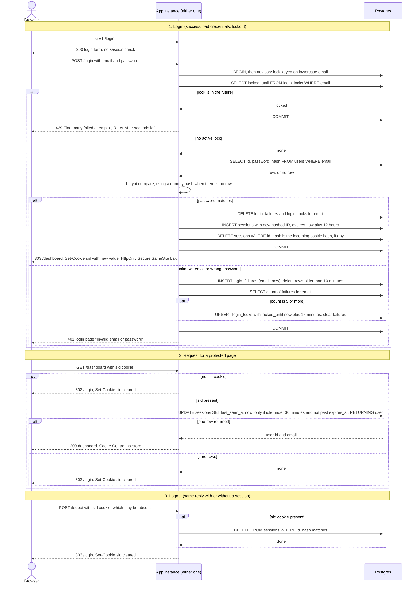

# Login with server-side sessions: design

## Summary

Sessions and failed-login counts live in the existing Postgres database, not in process memory and not in a new Redis service. Both app instances share that database, so logins and logouts are visible to both at once. The design adds three tables, one indexed atomic `UPDATE` per protected request, and a small cleanup job. The rest of this document states each decision, the reason for it, and what happens when storage fails.

## Decisions

### 1. Where state lives: Postgres, not Redis

Both instances already depend on this database, so it is the one shared store they both trust. Session and lockout state use it for these reasons:

- **Consistency with login.** Failure counting, the password check, lock clearing and session creation can run in one transaction. Splitting state across Postgres and Redis would need two stores to agree, and failures between them would be hard to reason about.
- **No new service.** There is nothing new to deploy, monitor, secure, back up or scale.
- **No cross-store orphans.** `sessions.user_id` references `users(id)` with `ON DELETE CASCADE`, so a deleted user's sessions go with them.
- **Load fits.** This is a small team app. One primary-key write per request is well within what Postgres handles.

Trade-off: every protected request writes to Postgres. If write load or latency later shows this to be a bottleneck, sessions can move to Redis behind a `SessionStore` interface. This design does not need Redis today.

### 2. Schema

```
sessions(
  id_hash      bytea  PRIMARY KEY,         -- SHA-256 of the session ID, never the raw ID
  user_id      bigint NOT NULL REFERENCES users(id) ON DELETE CASCADE,
  created_at   timestamptz NOT NULL,
  last_seen_at timestamptz NOT NULL,       -- drives the 30-minute idle rule
  expires_at   timestamptz NOT NULL        -- created_at + 12 hours, never extended
)
INDEX sessions(last_seen_at), INDEX sessions(expires_at)

login_failures(
  email     text        NOT NULL,          -- lowercase, trimmed
  failed_at timestamptz NOT NULL
)
INDEX login_failures(email, failed_at)

login_locks(
  email        text PRIMARY KEY,
  locked_until timestamptz NOT NULL
)
```

- All time comparisons use Postgres `now()`, not each instance's clock. Two instances with slightly different clocks therefore agree on expiry.

### 3. Session IDs

- The ID is 32 bytes from a cryptographically secure random source, encoded as base64url. That gives 256 bits of entropy.
- Only `SHA-256(ID)` is stored. A database leak does not expose live session IDs.
- Every successful login creates a new ID and never reuses one, which prevents session fixation.

### 4. Cookie

- Name `sid`, with `Path=/`, `HttpOnly`, `Secure`, `SameSite=Lax`, and no `Domain` attribute, so it is host-only.
- `Max-Age=43200` (12 hours) so the browser drops it when the server would expire it anyway. The server is still the authority.
- The value is the opaque ID and nothing else.
- Local development over plain HTTP needs `localhost`, which current browsers treat as a secure context. Other non-HTTPS environments will not receive `Secure` cookies.

### 5. Expiry checks: one atomic statement per request

A protected request runs a single statement:

```
UPDATE sessions s
SET    last_seen_at = now()
FROM   users u
WHERE  s.id_hash = $1
  AND  s.last_seen_at > now() - interval '30 minutes'   -- idle rule
  AND  s.expires_at  > now()                            -- absolute rule
  AND  u.id = s.user_id
RETURNING u.id, u.email
```

- One row returned: the session is valid. Its idle clock restarts because `last_seen_at` was just set.
- Zero rows returned: the session is unknown, idle for 30 minutes or more, or past 12 hours. The server clears the cookie and redirects to `/login`.
- An expired session is never touched. The predicate excludes it before the `SET` runs, so a stale request cannot keep it alive.

### 6. Failure counting and lockout

- **Sliding window, not a fixed one.** The rule is "5 failures in any 10-minute period," so the server keeps each failure timestamp and counts those within the last 10 minutes. A fixed window that resets at the first failure can miss a burst that spans a reset, so it is not used.
- **Per-email serialization.** Each login opens a transaction that takes `pg_advisory_xact_lock(hash(email))`. Concurrent attempts for the same email run one at a time, so the 5-failure limit cannot be overshot by parallel requests. The lock is held during the bcrypt comparison. This is acceptable at this scale.
- **Order of checks.** Under the lock, the server checks `login_locks` first and returns 429 if the lock is active. Only then does it check the password. A locked email is never password-checked.
- **The 5th failure.** It was actually checked, so it returns the normal 401 response. Setting the lock at that point means the 6th and later attempts get 429. This is an explicit choice.
- **On the 5th failure.** The server upserts `login_locks` with `locked_until = now() + 15 minutes` and deletes that email's `login_failures` rows. After the lock expires, the old failures are already outside the 10-minute window, so no separate reset is needed.
- **On success.** The server deletes the email's `login_failures` and `login_locks` rows, then creates the session.
- **Lockout applies to any email string, known or not.** The 429 response for an unknown email is therefore identical to the one for a real account, so lockout reveals nothing about which accounts exist.

### 7. Login responses

| Case | Status | Body | Cookie |
|---|---|---|---|
| Success | 303 to `/dashboard` | none | New `sid`; the incoming session is deleted |
| Unknown email or wrong password | 401 | Login page with "Invalid email or password" | No change |
| Locked email | 429 with `Retry-After` set to seconds remaining | Login page: "Too many failed attempts. Try again in 15 minutes." | No change |
| Storage error | 503 with `Retry-After` | Login page: "Sign-in is temporarily unavailable. Try again shortly." | No change |

- **Timing.** When no user row exists, the server still runs bcrypt against a fixed dummy hash. Response time therefore does not reveal whether an account exists.
- **Normalization.** The email is `lower(trim(input))` before any lookup, failure count or lock check.

### 8. Session creation on success

In one transaction:

1. Generate a new ID and insert its hash into `sessions` with `last_seen_at = now()` and `expires_at = now() + 12 hours`.
2. Delete the session row that the incoming cookie pointed to, if there is one. This happens whether or not the incoming session belongs to the same user.
3. Commit, then set the new cookie and redirect.

If the commit fails, nothing changes, no cookie is set, and the user can retry.

### 9. Logout

- `POST /logout` deletes `sessions` where `id_hash` matches the cookie's hash, if a cookie is present. This happens before the reply.
- The reply is the same whether or not a session existed: `Set-Cookie: sid` expired, plus 303 to `/login`.
- `SameSite=Lax` means browsers do not send the cookie on cross-site POSTs, so another site cannot force a logout.

### 10. Cleanup of abandoned rows

- Expired sessions are already rejected on read. Cleanup only reclaims space.
- Every instance runs a cleanup job every 5 minutes. The job runs in batches of about 1,000 rows. The deletes are idempotent, so duplicate runs are harmless.
  - `DELETE FROM sessions WHERE last_seen_at < now() - interval '30 minutes' OR expires_at < now()`
  - `DELETE FROM login_failures WHERE failed_at < now() - interval '10 minutes'`
  - `DELETE FROM login_locks WHERE locked_until < now()`

### 11. What the user sees when storage fails

Storage failure is distinct from every auth outcome. It never looks like a wrong password, and a valid session is never discarded because of it.

- **Login.** Any database error during the lock check, password lookup, failure recording or session creation gets a 503 login page: "Sign-in is temporarily unavailable. Try again shortly." No cookie is set, and the response does not depend on whether the email exists.
- **Protected page.** If the session lookup fails, the server returns 503 with a "We can't check your session right now" page. It does not redirect and does not clear the cookie. Failing closed means no protected content is served, and the user keeps the cookie so a retry can succeed once the database recovers.
- **Logout.** If the delete fails, the server returns 503 with "We couldn't sign you out. Try again." It does not clear the cookie, so the user can retry. Until the session times out, a copy of the cookie would still work. This is the accepted cost of not lying to the user about being logged out.

### 12. Other rules

- Protected responses carry `Cache-Control: no-store`, so the back button after logout does not show private pages from cache.
- `/login` and static assets (`/static/*`) are public. Static assets hold no user data, and the login page needs them to render.

## Sequence diagram



## Notes on state and rules that do not fit on the arrows

- **Session states.** A session is either active, idle-expired, absolute-expired, or deleted. Idle expiry is `now() - last_seen_at >= 30 minutes`. Absolute expiry is `now() >= expires_at`, and `expires_at` is set once at login and never changed. Whichever comes first ends the session. Both checks happen on every read.
- **Lock states.** An email is either unlocked with 0 to 4 recent failures, unlocked with failures expiring, or locked until `locked_until`. A lock ends by time only. A successful login cannot happen during a lock, because the lock is checked before the password.
- **Failure-window accuracy.** The 5-failure rule is evaluated on every failure, against failures in the last 10 minutes. If 5 failures fall within any 10-minute span, the lock is set at the fifth.
- **Storage errors take precedence.** A storage error at any step returns 503 and changes nothing visible to the user. A storage error never produces 401, 429 or a redirect to `/login`.
- **Clock source.** Every expiry comparison uses Postgres `now()`. The application clocks never decide whether a session or lock is still live.

## Accepted risks and open items

- **Targeted lockout.** Anyone who knows an email can lock that account for 15 minutes by sending 5 wrong passwords. This follows from the brief's per-email rule. A per-IP limit would reduce it but is not part of this design.
- **Login CSRF.** `SameSite=Lax` stops cross-site logout but not cross-site login. An attacker could make a victim's browser submit the attacker's credentials. A form token on `/login` would close that. It is not in the brief, so it is flagged here for review.
- **Per-request write load.** Each protected request writes `last_seen_at`. Acceptable for a small team. Revisit if the database shows write contention.
- **Single cleanup job.** Cleanup runs on every instance but is idempotent. If cleanup is ever made non-idempotent, it needs a single-runner lock.
- **Session cap.** A user may have any number of concurrent sessions. The brief does not cap them, so none is enforced.
- **User-visible expiry message.** The redirect after expiry goes to `/login` with no message. A generic "Please sign in again" notice is an optional addition.