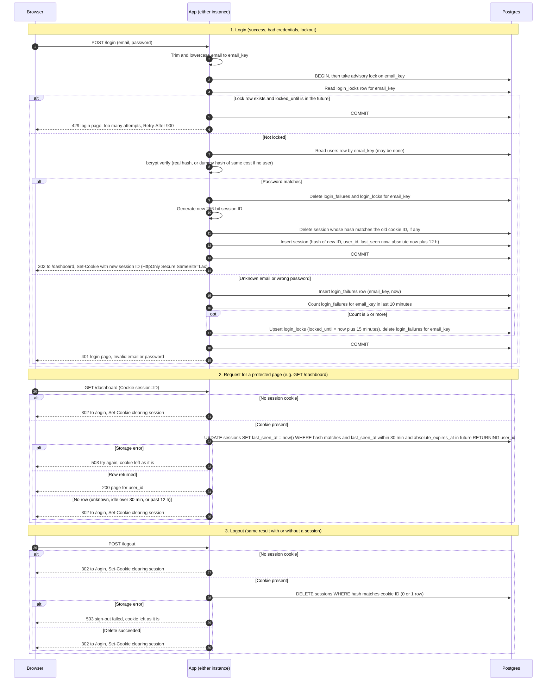

# Login with server-side sessions: design for review

Status: proposal, not yet built. Storage: the existing Postgres database. No Redis.

## Summary

Every page except `/login` requires a signed-in user. After a successful login, the browser holds one random session ID in a cookie. The server keeps the session in Postgres, the database the app already uses, and checks it on every protected request. Failed logins are counted per email in Postgres too, so the limit holds across both app instances.

The four choices the brief left open:

1. **Where sessions and failure counts live:** Postgres, in new tables. Redis is not added (see Decisions).
2. **How expiry is checked and recorded:** one database statement checks the session and restarts its idle timer, using the database clock.
3. **How abandoned sessions are removed:** expired rows are ignored immediately, and a background job deletes them every 10 minutes.
4. **What the user sees when storage fails:** a "try again" message with HTTP status 503. The app never guesses. Details are in Decisions.

## Terms used in this document

- **Instance:** one running copy of the app. There are two, behind a load balancer (a server that spreads incoming requests across instances). The load balancer does not keep a browser on the same instance, so any state a request needs must be shared, not kept in one instance's memory.
- **Session:** a row in the `sessions` table. It records which user is signed in and when the session ends.
- **Session ID:** a random value given to the browser in a cookie. The server stores only a SHA-256 hash of it. SHA-256 is a one-way function: the server can check a hash against an ID, but cannot recover the ID from the hash.
- **Cookie:** a small piece of data the server asks the browser to store and send back with each request. Here it carries only the session ID.
- **Failure row:** one row per failed login attempt for an email.
- **Lock row:** one row per locked email. It records when the lock ends.
- **Transaction:** a group of database steps that either all happen or none happen. `BEGIN` starts one and `COMMIT` saves it. If any step fails, the group is rolled back and nothing in it is kept.
- **Advisory lock:** a Postgres lock on a number derived from a value (here, the email). Only one transaction can hold it at a time, and others wait. It is released when the transaction commits or rolls back.
- **bcrypt verify:** the password check. bcrypt is a slow, one-way hashing method for passwords. Verifying a password means hashing the attempt and comparing it with the stored hash. The work is deliberately slow, and it takes about the same time whether or not the password matches.
- **Cost factor:** the setting that controls how much work bcrypt does. Using the same cost factor keeps timing consistent.
- **Dummy hash:** a fixed, made-up bcrypt hash. It is used when no account matches the email, so the server does the same slow work either way.
- **Conditional UPDATE:** an `UPDATE` statement with a `WHERE` clause. It changes only the rows that meet the condition. `RETURNING` hands back the changed row, if there is one.
- **Upsert:** "insert the row, or update it if it already exists."
- **timestamptz:** a Postgres timestamp that includes a time zone.
- **Status codes:** 302 is a redirect. 401 means the credentials were rejected. 429 means too many attempts. 503 means the service is temporarily unavailable, here because the database could not be reached or used. `Retry-After` tells the browser how many seconds to wait before retrying.

## Decisions

| Concern | Decision | Reason |
|---|---|---|
| Where sessions live | A `sessions` table in the existing Postgres database | Both instances read and write the same rows. Login reads and writes the `users`, failure, lock and session rows inside one transaction. No new service is needed for a team-sized app. |
| Why not Redis | Not added | Redis would be a second stateful service with its own failure modes. Checking the lock atomically across two instances would need Lua scripts (small programs that Redis runs as one step). Postgres gives the same guarantee with one advisory lock. Revisit only if the per-request writes become a measured load problem. |
| Where failure counts live | `login_failures` (one row per failed attempt) and `login_locks` (one row per lock) | The rule is "5 failures in any 10-minute period," which needs exact timestamps. A fixed window, such as 10-minute buckets, would miss bursts that cross a bucket boundary. |
| Session ID | 32 random bytes from a cryptographically secure random generator, encoded as base64url (43 characters). This is the only thing in the cookie. | 256 random bits cannot be guessed. The cookie holds no user data. |
| What the database stores | The SHA-256 hash of the session ID, never the ID itself | If the database leaks, the attacker gets hashes, not working cookies. |
| Clock | The database's `now()` for every expiry check and every timestamp written | The two instances may have clocks that differ. Using one clock means they always agree. |
| Idle timeout | Each live request sets `last_seen_at = now()`. A session is live only if `last_seen_at` is within the last 30 minutes. | Each request restarts the 30-minute clock. An expired session is not refreshed. |
| Absolute timeout | `absolute_expires_at` = login time + 12 hours. Set once at login and never extended. | The session ends 12 hours after login, even if the user stays active. |
| How expiry is checked | One conditional `UPDATE ... RETURNING user_id`. A row comes back only if the session is live. | The check and the idle refresh happen in one statement, so there is no gap between them. |
| How abandoned sessions are removed | Two layers. (1) Expired rows are never honored, because the `WHERE` clause excludes them. (2) Every 10 minutes, each instance runs a batched delete of dead rows. | Deleting only reclaims space. Correctness does not depend on it. Both instances can run the job safely, because deleting a row twice has the same effect as deleting it once. |
| What the cleanup deletes | Sessions whose `last_seen_at` is more than 30 minutes old, or whose `absolute_expires_at` has passed. Failure rows older than 10 minutes. Lock rows whose lock has ended. | It removes only rows that can no longer change any decision. |
| Cookie attributes | `session=<ID>; Path=/; HttpOnly; Secure; SameSite=Lax`. No `Max-Age` or `Expires`. | With no expiry date, the cookie is a browser-session cookie, which the browser normally discards when it closes. The server enforces the real lifetime, not the browser. To clear the cookie, the server sends the same attributes with an empty value and `Max-Age=0`. `HttpOnly` hides the cookie from page scripts. `Secure` sends it only over HTTPS. `SameSite=Lax` stops browsers from sending it on most cross-site POST requests. |
| Email key | The email, trimmed and lowercased. Used for the `users` lookup and for failure and lock rows. | Emails match in lowercase only, so one key is used everywhere. |
| Unknown emails | Failures and locks are recorded for any email string, whether or not an account exists | If only real accounts were counted, a 429 would reveal that the account exists. |
| Concurrency across instances | `pg_advisory_xact_lock(hashtext(email_key))`, taken right after `BEGIN` and held until commit or rollback | Only one login attempt per email runs at a time, across both instances. Parallel guesses cannot exceed the 5-failure limit. If two different emails map to the same number, they wait for each other. That is harmless. |
| Timing parity | If no user matches, bcrypt verify runs against the dummy hash with the same cost factor | Unknown-email and wrong-password responses take about the same time. |
| Session rotation on login | In one transaction: delete the session the incoming cookie points to (if any), then insert a new session with a new ID | The old ID is dead before the response is sent. This works whether or not the browser sent a cookie. |
| Storage failure on login | 503 "We cannot sign you in right now. Try again." The whole transaction is rolled back. If the lock state cannot be read, the password is not checked. | Fails closed. It never shows "Invalid email or password" when that may be untrue, and it never skips the lockout. |
| Storage failure on a protected page | 503 with `Retry-After: 5`. Cookie unchanged. No redirect. | The session may still be valid. A redirect would log the user out over a temporary fault. |
| Storage failure on logout | 503 "Sign-out failed. Try again." Cookie unchanged. | The server row must be gone before the cookie is cleared. Keeping the cookie lets the user retry. |
| Static assets (CSS, images, favicon) | Served without a session check | They hold no user data. The sign-in rule covers pages, so this is an explicit exception. |

## New tables

- `sessions`: `id_hash` (bytes, primary key), `user_id` (same type as `users.id`), `created_at`, `last_seen_at`, `absolute_expires_at`. Indexes on `last_seen_at` and `absolute_expires_at` keep cleanup fast.
- `login_failures`: `email_key` (text), `failed_at` (timestamptz). Index on `(email_key, failed_at)` for the 10-minute count.
- `login_locks`: `email_key` (text, primary key), `locked_until` (timestamptz).

## Sequence diagram

Notes on reading the diagram:

- `opt` means the enclosed steps run only when the condition holds. Here, that is when the failure count reaches 5.
- The diagram shows only the normal paths. Storage errors during login are covered in Decisions and in the rules below.
- A lock row whose `locked_until` is in the past does not block login. The attempt proceeds as "Not locked."

## Rules the diagram does not show

**Lockout**

- A failure is any attempt where the password does not match, including an attempt with an unknown email. Both cases return the same 401 page with the same message, so the user cannot tell them apart.
- The window slides. Example: failures at minutes 0, 2, 4, 6 and 8 are five failures within 10 minutes, so the lock starts at minute 8. Failures at minutes 0, 3, 6, 9 and 11 do not trigger a lock. In the 10 minutes before minute 11 (minutes 1 to 11), only four failures fall inside the window: at 3, 6, 9 and 11.
- A lock starts when, after a failure is recorded, the email has 5 or more failure rows in the last 10 minutes. Those failure rows are then deleted, and a lock row is written with `locked_until` = now + 15 minutes.
- The 5th failed attempt still returns 401, because its password was checked. The lock applies to the attempts after it.
- While locked, an attempt returns 429 without a bcrypt check. It records no failure and does not extend the lock.
- The failure rows were deleted when the lock started, and no new failures are recorded while locked. So the count is already zero when the lock ends, and no reset logic is needed.
- "Lock still in effect" is compared using the database clock, like every other time check.
- A locked email never reaches the password check, so a successful login can happen only before 5 failures or after the lock has ended. Either way, it deletes the failure and lock rows for that email only. Other emails are not affected.

**Enumeration (learning whether an account exists)**

- The 429 response applies to any email string, so it reveals nothing about whether an account exists.
- A locked attempt skips bcrypt, so it responds faster than a 401. That timing depends only on the lock state, not on whether the account exists.

**Session rotation.** Deleting the old session and inserting the new one happen in the same transaction. Either both happen or neither does.

**Transactions.** A storage error during login rolls back the whole transaction. No partial failure rows, lock rows or sessions remain. The response is 503.

**Session lifetime.** A session is valid only while `last_seen_at` is within the last 30 minutes and `absolute_expires_at` is in the future. The database checks both inside the `UPDATE`. A session that has already expired is not refreshed.

## Open items and risks

1. **Targeted lockout.** Anyone who knows a user's email can lock that user out for 15 minutes. The brief requires keying the lock on email. A per-IP limit would reduce this, but it needs trusted proxy configuration (the app must know the real client address behind the load balancer), which is out of scope for now.
2. **CSRF tokens.** CSRF (cross-site request forgery) is when another website tricks the browser into sending a request. The brief does not require protection against it. I recommend adding a token to `POST /login` and `POST /logout`. `SameSite=Lax` stops cross-site POSTs from sending the session cookie, which protects logout. It does not stop login CSRF, where an attacker's page logs the victim's browser into the attacker's account.
3. **Retention of email addresses.** `login_failures` holds normalized emails, including unknown ones, for up to 10 minutes. `login_locks` holds them for up to 15 minutes. Confirm this is acceptable.
4. **Secure cookie.** Browsers send and accept `Secure` cookies only over HTTPS, meaning encrypted web traffic. The load balancer must terminate TLS (decrypt HTTPS traffic) and tell the app that the original request was HTTPS.
5. **Write load.** Each protected request runs one `UPDATE`, which writes to the database. This should be fine for team-sized traffic. Measure it before launch.
6. **Not included.** Sign out everywhere, session listing, and rotation on privilege change are not part of this design.