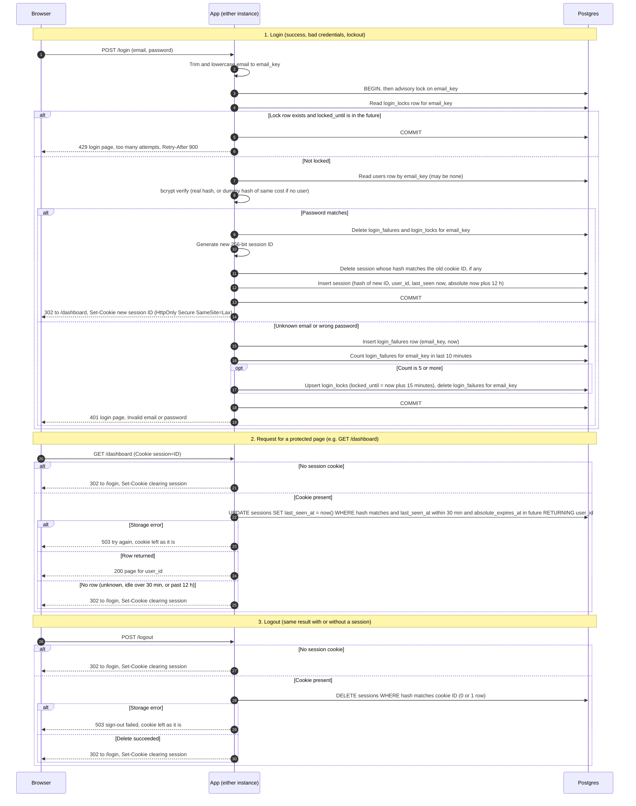

# Login with server-side sessions: design for review

Status: proposal, not yet built. Storage choice: the existing Postgres database. No Redis.

## Decisions

| Concern | Decision | Reason |
|---|---|---|
| Where sessions live | A `sessions` table in the existing Postgres database | Both instances see the same rows. Session writes share a transaction boundary with the `users` lookup. No new service to run for a team-sized app. |
| Why not Redis | Not added | Redis would add a second stateful service and its own failure mode. Lockout counting across two instances would need Lua scripts to stay atomic. Postgres gives this with one advisory lock. Revisit only if per-request writes become a measured load problem. |
| Where failure counts live | `login_failures` (one row per failed attempt) and `login_locks` (one row per lock) | Exact "any 10-minute period" semantics need timestamps. A fixed window would miss bursts that straddle a window boundary. |
| Session ID | 32 bytes from a CSPRNG, base64url-encoded. This value is the only thing in the cookie. | 256 bits of randomness is not guessable. The cookie carries no user data. |
| What the database stores | SHA-256 hash of the session ID, never the ID | A database leak does not yield live session cookies. |
| Clock | Database `now()` for every expiry check and write | Two app instances may have skewed clocks. One clock avoids disagreement. |
| Idle timeout | `last_seen_at` is set to `now()` on every protected request. A session is live only if `last_seen_at` is within 30 minutes. | Matches "every request restarts the clock". |
| Absolute timeout | `absolute_expires_at = login time + 12 h`, set once at login and never extended | Matches "12 hours after login". |
| How expiry is checked | One conditional `UPDATE ... RETURNING user_id`. A row comes back only if the session is live. | The check and the refresh are a single round trip with no race. |
| How abandoned sessions are removed | Lazy: expired rows are never honored, because the `WHERE` clause excludes them. Periodic: each instance runs a batched, idempotent delete every 10 minutes. Sessions with `last_seen_at` older than 30 minutes or `absolute_expires_at` in the past are deleted. Failures older than 10 minutes and locks already expired are deleted too. | Cleanup only reclaims space. Correctness does not depend on it. Running it on both instances is safe because the deletes are idempotent. |
| Cookie attributes | `session=<ID>; Path=/; HttpOnly; Secure; SameSite=Lax`. No `Max-Age` or `Expires`, so it is a browser-session cookie and the server enforces lifetime. | Server-side checks are the authority. Clearing the cookie uses the same attributes with an empty value and `Max-Age=0`. |
| Email key | Trimmed, lowercased email, used for `users` lookup, failure rows and lock rows | Matches the requirement that emails are matched in lowercase. |
| Counting unknown emails | Failures and locks are recorded for any email string, existing or not | If only real accounts were counted, a 429 would reveal that the account exists. |
| Concurrency across instances | `pg_advisory_xact_lock(hashtext(email_key))`, held from the lock check through commit | Serializes guesses for one email across both instances, so the 5-failure limit holds under concurrency. |
| Timing parity | When no user matches, bcrypt verify runs against a fixed dummy hash with the same cost factor | Unknown and wrong-password responses take the same time. |
| Session rotation on login | In one transaction: delete the session the incoming cookie points to (if any), then insert a new session with a new ID | The old ID is dead before the response is sent. Works whether or not the browser sent a cookie. |
| Storage failure on login | 503 "We cannot sign you in right now. Try again." The transaction rolls back. Password is not checked if the lock state cannot be read. | Fails closed. Never shows "Invalid email or password", which would be false. Never bypasses the lockout. |
| Storage failure on protected page | 503 with `Retry-After: 5`. The cookie is left as it is. No redirect. | The session may still be valid. A redirect would loop or log the user out for a transient fault. |
| Storage failure on logout | 503 "Sign-out failed. Try again." The cookie is left as it is. | Replying with a cleared cookie while the server row survives would break "destroy before replying". Keeping the cookie lets the user retry. |
| Static assets (CSS, images, favicon) | Served without a session check | They carry no user data. The brief says "page", so this is an explicit exception. |

## Schema (new tables)

- `sessions`: `id_hash` (bytes, primary key), `user_id` (same type as `users.id`), `created_at`, `last_seen_at`, `absolute_expires_at`. Indexes on `last_seen_at` and `absolute_expires_at`.
- `login_failures`: `email_key` (text), `failed_at` (timestamptz). Index on `(email_key, failed_at)`.
- `login_locks`: `email_key` (text, primary key), `locked_until` (timestamptz).

## Sequence diagram

## Rules the arrows do not show

**Lockout.**
- A failure is any attempt where the password does not match, including an unknown email.
- The lockout window is sliding. A lock starts when `login_failures` holds 5 or more rows for the email within the last 10 minutes. This matches "any 10-minute period".
- The 5th failed attempt still returns 401, because its password was checked. Attempts made while locked return 429 without a bcrypt check. They do not record a failure and do not extend the lock.
- When the lock ends, every earlier failure is more than 10 minutes old, so the count starts from zero. No extra reset logic is needed.
- A successful login clears the `login_failures` and `login_locks` rows for that email only.

**Enumeration.**
- The 429 path applies to any email string, including emails with no account, so it reveals nothing about existence.
- The locked path skips bcrypt, so it is faster than the 401 path. That timing difference depends only on lock state, not on whether an account exists.

**Session rotation.** The old session row is deleted in the same transaction as the new insert. Either both happen or neither does.

**Transactions.** Any storage error during login rolls back the whole transaction. No partial failure rows, lock rows or sessions are left behind, and the response is 503.

**Session lifetime.** A session is valid only while `last_seen_at` is within 30 minutes and `absolute_expires_at` is in the future. Both are checked in the database's clock inside the `UPDATE`.

## Open items and risks for review

1. **Targeted lockout.** Keying the lock on email means anyone who knows a user's email can lock that user out for 15 minutes. The brief requires this. A per-IP limit would reduce it, but per-IP needs a trusted proxy configuration, which is not in scope yet.
2. **CSRF tokens.** The brief does not require them. Recommend adding a token to `POST /login` and `POST /logout`. `SameSite=Lax` stops cross-site POSTs from carrying the session cookie, which covers logout, but not login CSRF.
3. **Retention of email addresses.** `login_failures` stores normalized email addresses, including addresses with no account, for up to 10 minutes. `login_locks` stores them for up to 15 minutes. Confirm this is acceptable.
4. **Secure cookie.** `Secure` requires HTTPS from the browser to the load balancer. The load balancer must terminate TLS and forward the protocol to the app.
5. **Write load.** Each protected request does one `UPDATE`. For team-sized traffic this should be fine. Measure it before launch.
6. **Not included.** Sign out everywhere, session listing, and privilege-change rotation are not in this design.
