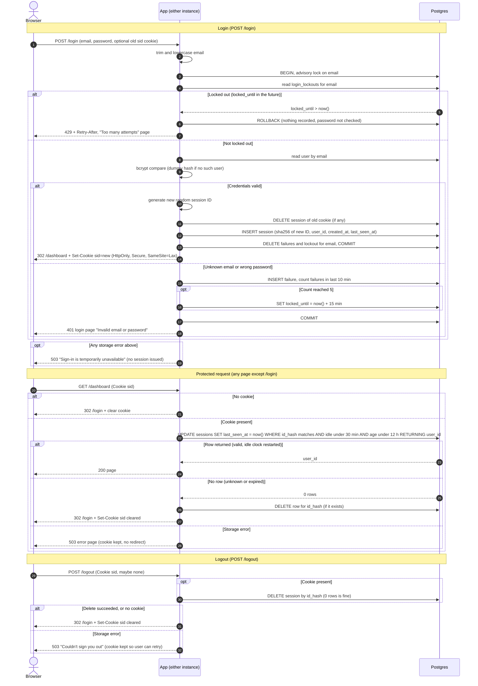

# Login with server-side sessions: design

## Summary

Every page except `/login` requires a signed-in user. After a successful login, the browser holds a random session ID in a cookie. The server holds the matching session record in the existing Postgres database. Both app instances read the same table, so the load balancer needs no sticky sessions. Brute-force counters are also kept in Postgres. No new infrastructure is added.

## Decisions

**Storage: Postgres, not Redis.** Sessions, failed-attempt records and lockouts all live in the existing Postgres database, which both instances already share. I am not adding Redis. The app is small and the user base is team-sized. Redis would be a new component to run, secure, back up and monitor, and a second place that can fail. One extra indexed write per request is cheap at this scale. Postgres also lets a login commit as a single transaction: new session in, old session out, failures cleared. If load grows, session storage can move to Redis later behind the same small interface.

**New tables**
- `sessions(id_hash bytea PRIMARY KEY, user_id REFERENCES users(id), created_at timestamptz, last_seen_at timestamptz)`. Indexes on `last_seen_at` and on `created_at` serve the cleanup job.
- `login_failures(email text, attempted_at timestamptz)`, indexed on `(email, attempted_at)`.
- `login_lockouts(email text PRIMARY KEY, locked_until timestamptz)`.

In the last two tables, `email` is the trimmed, lowercased text the user typed. It is not checked against `users`, so unknown emails are throttled exactly like real ones. Otherwise the 429 response would reveal which accounts exist.

**Session ID and cookie**
- The ID is 32 bytes from a cryptographically secure random generator, base64url-encoded. It is generated fresh on every successful login and is never derived from the incoming cookie.
- The database stores only `sha256(id)`, so a leaked table or backup contains no usable session IDs.
- The cookie is `sid=<id>; Path=/; HttpOnly; Secure; SameSite=Lax`. It carries no user data and no `Max-Age`, so the browser treats it as a session cookie. Real expiry is enforced on the server.
- To clear the cookie, the server sends the same name, path and attributes with `Max-Age=0`.

**Expiry: checked on every request, recorded in `last_seen_at`**
- One atomic statement both checks validity and restarts the idle clock. It uses the database clock (`now()`), so the two instances cannot disagree:

  `UPDATE sessions SET last_seen_at = now() WHERE id_hash = $1 AND last_seen_at > now() - interval '30 minutes' AND created_at > now() - interval '12 hours' RETURNING user_id`

- One returned row means the session is valid, and the idle clock has already been restarted. No row means the session is missing, unknown or expired. All three cases are handled the same way, on purpose.
- A session therefore ends at whichever comes first: 30 minutes idle, or 12 hours since `created_at`. `created_at` is never updated, so activity cannot extend the 12-hour cap.

**Removing abandoned sessions**
- Lazy cleanup: a request rejected as expired deletes its own session row, if one exists.
- Sweeper: every 5 minutes, each instance calls `pg_try_advisory_lock(<sweeper key>)`. This is a Postgres lock that only one connection can hold at a time. The instance that gets it runs the job, so the job runs once per cycle with no extra scheduler. The job deletes:
  - sessions where `last_seen_at < now() - 30 min` or `created_at < now() - 12 h`;
  - `login_failures` older than 10 minutes;
  - `login_lockouts` whose `locked_until` has passed.
- Correctness never depends on the sweeper, because every request re-checks expiry. The sweeper only keeps the tables small.

**Brute-force rules**

The email is trimmed and lowercased first. Then:
- Each login attempt runs in one transaction that begins with `pg_advisory_xact_lock(hashtext(email))`. This lock is held until the transaction ends, so concurrent attempts for the same email run one at a time. Parallel requests cannot slip past the limit of 5.
- If `login_lockouts.locked_until > now()`, return 429 immediately. The password is not checked and nothing is recorded. The response includes `Retry-After`, and the page says "Too many attempts. Try again later." in the same wording for every email.
- A failed attempt inserts a `login_failures` row, then counts rows with `attempted_at > now() - 10 minutes`. When the count reaches 5, it sets `locked_until = now() + 15 minutes`. The 5th failure itself still returns 401. The 429 applies from the next attempt.
- When a lock ends, the 5 failures that caused it are more than 15 minutes old, so none is inside the 10-minute window. The user starts fresh.
- A successful login deletes that email's `login_failures` and `login_lockouts` rows.
- Unknown email: run bcrypt against a fixed dummy hash so response time matches a wrong password. Return the same 401 and page, and record the failure the same way.

**When storage is down: fail closed, and say so honestly**
- Login (any step fails, including the lockout check): no session is issued and the password is not accepted. Return HTTP 503 with a login page saying "Sign-in is temporarily unavailable. Please try again in a moment." This is not the 401 text, because the user's credentials were never judged.
- Protected request: return 503 with an error page and an automatic-retry hint. Do not redirect to `/login` and do not clear the cookie. The session may well be valid, and an outage should not log the user out.
- Logout: if the session row cannot be deleted, return 503 and keep the cookie. The page says "We couldn't sign you out. Please try again." The server must destroy the session before replying, and clearing the cookie while the session survives would give a false sense of being signed out.
- Errors are logged server-side with no email, password or session ID in the log line.

**Other rules**
- `/login` is the only route exempt from the session check. The check runs as middleware before any handler.
- A `POST /login` that fails (401, 429 or 503) leaves any existing session untouched. Replacement happens only on success.
- `SameSite=Lax` keeps the cookie off cross-site POSTs. Adding CSRF tokens to forms is outside this brief and is worth a follow-up.

## Sequence diagram

## Checks against the requirements

| # | How it is met |
|---|---|
| 1 | Email is trimmed and lowercased before every user lookup and every throttle key. |
| 2 | Unknown email and wrong password share one code path, one 401 and one page. A dummy bcrypt compare equalizes timing. Throttling is keyed on the typed email, not on the account. |
| 3 | An advisory lock serializes attempts per email. 5 failures within a sliding 10-minute window trigger a 15-minute lock, which returns 429 without checking the password. Success clears the email's counters. |
| 4 | A new ID is always generated, and the old cookie's session is deleted in the same transaction. The redirect goes to `/dashboard`. |
| 5 | The cookie holds only the opaque ID, with HttpOnly, Secure and SameSite=Lax. |
| 6 | The single `UPDATE ... WHERE` enforces the 30-minute idle and 12-hour absolute limits and restarts the idle clock on each request. |
| 7 | Middleware runs the check on every route except `/login`. A missing, unknown or expired session results in a cleared cookie and a redirect to `/login`. |
| 8 | The server-side delete happens before the reply. The same path runs with no cookie or an unknown session. |