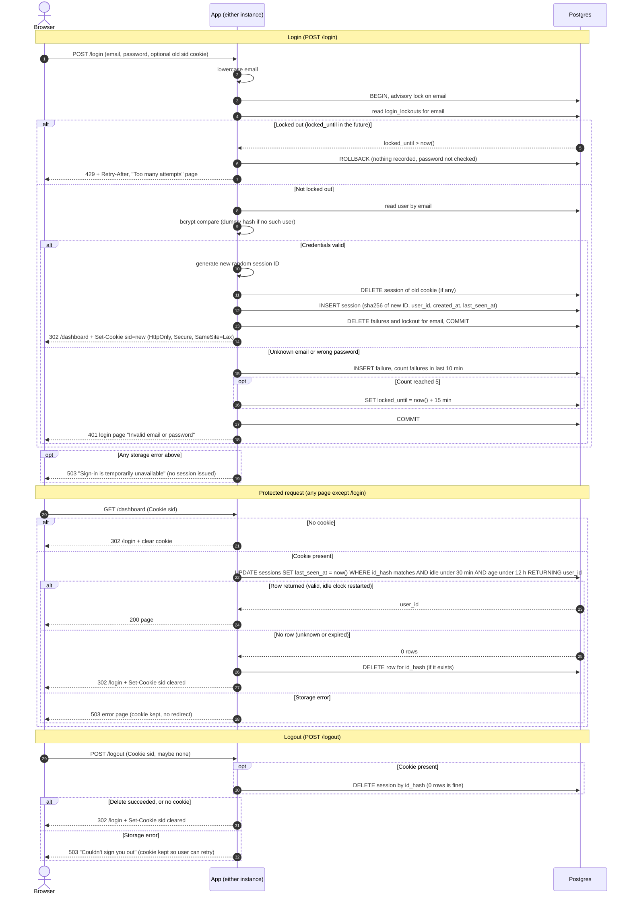

# Login with server-side sessions: design

## Decisions

**Storage: Postgres, not Redis.** Sessions, failed-attempt records and lockouts all go in the existing Postgres database. Both instances already share it, so no sticky sessions are needed. I am not adding Redis. The app is small and has a team-sized user base. Redis would be a new component to run, secure, back up and monitor, and it would add a second place that can fail. One extra indexed write per request is cheap at this scale. Postgres also lets the login change commit in one transaction (new session in, old session out, failures cleared). If load grows, session storage can move behind the same small interface later.

**Tables (new)**
- `sessions(id_hash bytea PK, user_id → users.id, created_at timestamptz, last_seen_at timestamptz)`, with an index on `last_seen_at` and one on `created_at` for the sweeper.
- `login_failures(email text, attempted_at timestamptz)`, indexed on `(email, attempted_at)`.
- `login_lockouts(email text PK, locked_until timestamptz)`.

`email` in the last two tables is the lowercased input. The input is not checked against `users`, so unknown emails are throttled exactly like real ones. This is what stops the 429 from revealing whether an account exists.

**Session ID and cookie**
- The ID is 32 bytes from a CSPRNG, base64url-encoded. It is generated fresh on every successful login and never derived from the incoming cookie.
- The database stores only `sha256(id)`, so a leaked table or backup contains no usable session IDs.
- The cookie is `sid=<id>; Path=/; HttpOnly; Secure; SameSite=Lax`. It carries no user data and no `Max-Age`, so it is a browser-session cookie. Real expiry is enforced on the server.
- Clearing the cookie sends the same name, path and attributes with `Max-Age=0`.

**Expiry: checked on every request, recorded in `last_seen_at`**
- The check and the idle-clock restart are one atomic statement, using the database clock (`now()`) so the two instances cannot disagree:
  `UPDATE sessions SET last_seen_at = now() WHERE id_hash = $1 AND last_seen_at > now() - interval '30 minutes' AND created_at > now() - interval '12 hours' RETURNING user_id`
- One returned row means the session is valid, and the same statement has already restarted the idle clock. No row means missing, unknown or expired. The three cases are deliberately handled the same way.
- Both limits are therefore enforced by whichever comes first: idle for 30 minutes, or 12 hours since `created_at`. `created_at` is never updated, so activity cannot extend the 12-hour cap.

**Removing abandoned sessions**
- Lazy: a rejected request deletes its own row if one exists.
- Sweeper: every 5 minutes, each instance tries `pg_try_advisory_lock(<sweeper key>)`. Only the instance that gets the lock runs the job, so it runs once per cycle with no extra scheduler. The job deletes sessions where `last_seen_at < now() - 30 min` or `created_at < now() - 12 h`. It also deletes `login_failures` older than 10 minutes and `login_lockouts` past `locked_until`.
- Correctness never depends on the sweeper, because every request re-checks expiry. The sweeper only keeps the tables small.

**Brute-force rules**
- The email is lowercased (and trimmed) first.
- Each login attempt runs in one transaction that begins with `pg_advisory_xact_lock(hashtext(email))`. Concurrent guesses for the same email are therefore serialized, and parallel requests cannot slip past the limit of 5.
- If `login_lockouts.locked_until > now()`, return 429 immediately. The password is not checked and nothing is recorded. The response includes `Retry-After`. The page says "Too many attempts. Try again later." in the same wording for every email.
- A failed attempt inserts a `login_failures` row and counts rows with `attempted_at > now() - 10 minutes`. On reaching 5, it sets `locked_until = now() + 15 minutes`. The 5th failure itself still returns 401. The 429 applies from the next attempt.
- The 5 failures fall inside a 10-minute window and the lock lasts 15 minutes. So when a lock ends, none of those failures is still inside the window and the count is effectively zero.
- Success deletes that email's `login_failures` and `login_lockouts` rows.
- Unknown email: run bcrypt against a fixed dummy hash so response time matches a wrong password. Return the same 401 and page as a wrong password. Record the failure the same way.

**Failure behavior when storage is down: fail closed, and say so honestly**
- Login (any step fails, including the lockout check): no session is issued and the password is not accepted. Return HTTP 503 with a login page that says "Sign-in is temporarily unavailable. Please try again in a moment." This is not the 401 text, because the user's credentials were not judged.
- Protected request: return 503 with an error page and an automatic-retry hint. Do not redirect to `/login` and do not clear the cookie. The session may well be valid, and the user should not be logged out by an outage.
- Logout: if the session row cannot be deleted, return 503 and keep the cookie. The page says "We couldn't sign you out. Please try again." This follows the rule that the server destroys the session before replying. Clearing the cookie while the session survives would give a false sense of being signed out.
- Errors are logged server-side with no email, password or session ID in the log line.

**Other rules**
- `/login` is the only route exempt from the session check. The check runs as middleware before any handler.
- A `POST /login` that fails (401, 429 or 503) leaves any existing session untouched. Replacement only happens on success.
- `SameSite=Lax` keeps the cookie off cross-site POSTs. Adding CSRF tokens to forms is outside this brief and is worth a follow-up.

## Sequence diagram

## Checks against the requirements

| # | How it is met |
|---|---|
| 1 | Email lowercased before every lookup and every throttle key. |
| 2 | Unknown email and wrong password share one code path, one 401 and one page. A dummy bcrypt compare equalizes timing. Throttling is keyed on the typed email, not on the account. |
| 3 | Advisory-locked, sliding 10-minute count. Lock is 15 minutes with 429 and no password check. Success clears the email's counters. |
| 4 | A new ID is always generated and the old cookie's session is deleted in the same transaction. Redirect goes to `/dashboard`. |
| 5 | The cookie holds only the opaque ID, with HttpOnly, Secure and SameSite=Lax. |
| 6 | The single `UPDATE ... WHERE` enforces 30-minute idle and 12-hour absolute limits and restarts the idle clock on each request. |
| 7 | Middleware runs the check on every route except `/login`. Missing, unknown or expired results in a cleared cookie and a redirect to `/login`. |
| 8 | The server delete happens before the reply. The same path runs with no cookie or an unknown session. |
