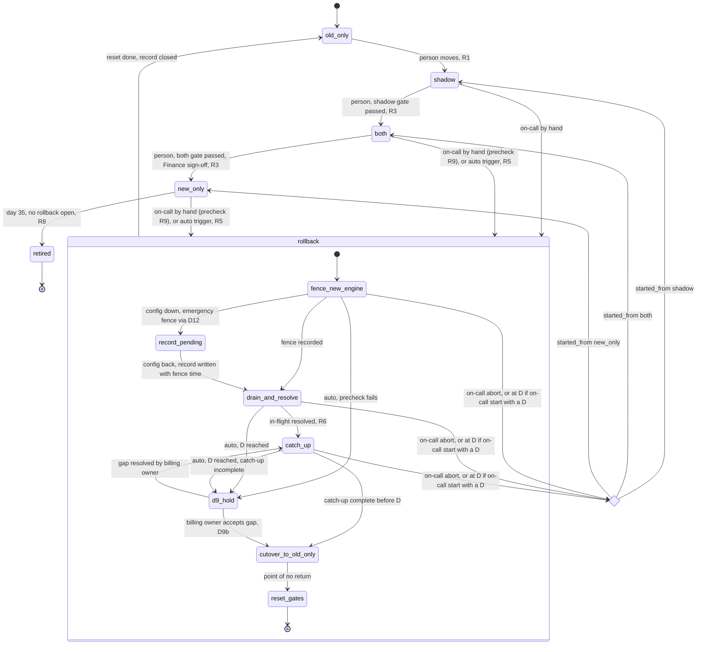

# Billing engine rollout: state machine

Draft 4. Source: the brief "Billing engine rollout: model the state machine" (not reproduced here; its fixed rules and numbers are restated in section 3). Rules marked *(proposed)* go beyond the brief and need owner approval. Section 6 lists the decisions. Six must be settled before the rollout controller is built. Five have working defaults that must be confirmed before go-live.

## 1. State diagram

Reading the diagram:
- Forward moves are one step at a time, made by a person. Each is a compare-and-set on the rollout record's version (R1).
- "Rollback open" means the rollout is in the `rollback` composite state. The rollout record shows it. `billing_mode` does not change until cutover.
- `record_pending` is a substate of rollback. The emergency fence is up (D12), but the record has not yet been written. Cutover and reset cannot happen there.
- `d9_hold` is where an automatic rollback goes when it cannot complete before D. The fence stays up, charges queue, and the rollback is not aborted. It leaves only when the billing owner resolves the gap (back to `catch_up`) or accepts it (to `cutover_to_old_only`).
- Abort exists only for on-call starts and only before cutover. The choice node returns to the mode stored as `started_from`.
- Retirement is reachable only from `new_only` with no rollback open. A rollback can be open on day 35 only as a `d9_hold` (R8).

## 2. Modes

| Mode | Charges and writes ledger | Old engine | New engine | Nightly comparison | Leaves when |
|---|---|---|---|---|---|
| `old_only` | Old | Computes and charges | Off | None | Person moves to `shadow` (R1) |
| `shadow` | Old | Computes and charges | Computes into shadow store; never charges or writes ledger | New shadow-store invoice vs old ledger invoice, counts toward gate (R2, R3) | Shadow gate passes and person moves (R3) |
| `both` | New | Computes every invoice into shadow store; never charges or writes ledger | Charges and writes ledger | Old shadow-store invoice vs new ledger invoice, counts toward gate (R2, R3) | Both gate passes, Finance sign-off, person moves (R3) |
| `new_only` | New | Stopped; computes nothing | Charges and writes ledger | None (rollback catch-up has its own one-off comparison) | Day 35 with no rollback open (R8) |
| `rollback` (from any origin) | None from `both` or `new_only`; Old from `shadow` | Catch-up only, no charges from `both` or `new_only`; keeps charging from `shadow` | Fenced; no charges | None | Cutover to `old_only`, then reset (section 4) |

Only one engine charges in any mode. During a rollback from `both` or `new_only`, neither engine charges until cutover, and due charges queue (R7). Customers see a delay, bounded by how long catch-up takes before D. From `shadow`, the old engine keeps charging throughout.

## 3. Rules

**R1. Authority, moves and ordering.**
- The rollout record is authoritative for mode, counters, sign-off, fence, `mode_epoch` and rollback progress.
- `billing_mode` is a copy. It carries the mode, the fence state and the `mode_epoch` it was copied from. Ordering: write the record first (with a new `mode_epoch` whenever mode or fence changes), then write the flag. The controller re-copies a stale flag until it matches the record. Writes that change only counters or rollback steps do not change `mode_epoch` (D7 may remove the two-entry form).
- A worker acts on the flag only when the flag's `mode_epoch` equals the epoch of the latest record it has read, and only within T of that read (R12). A worker never acts on a flag it cannot match to the record.
- A forward move is one step, made by a member of the billing-owner role, recorded in the audit log with the actor's identity, and applied as a compare-and-set on the record's version. A forward move is refused while a rollback is open or while the record cannot be read.

**R2. Comparison.** The nightly job compares two invoices per customer per billing period. A mismatch is a customer-period whose totals differ by more than one cent. The mismatch rate for a day is mismatched customer-periods divided by customer-periods compared that day. Nightly comparisons run only in `shadow` and `both`. The one-off comparison during rollback catch-up from `new_only` is separate (section 4).

**R3. Gates and Finance sign-off.**
- A day counts toward a gate only if the nightly comparison ran, its result was written to the record within 24 hours, and the day's test passed. A missing, late or failed run, or a failing day, resets the counter to zero. Both gates need consecutive counted days.
- A day is judged at its end. If any mismatch is unresolved at that point, the day does not count. A mismatch resolved later under R4 does not retroactively count the day, and the counter is not restored.
- A gate is *passed* when its count reaches its requirement. A reset clears the passed state.
- `shadow` to `both`: 7 consecutive counted days, each with a mismatch rate below 0.1 percent and at least 5,000 invoices compared that day (D1). Shadow-era mismatches still unresolved at the move block it (D10).
- `both` to `new_only`: 14 consecutive counted days, each ending with no unresolved mismatch, plus Finance sign-off.
- Finance sign-off *(proposed)*: given by an approver in the Finance role after the `both` gate is passed. It is recorded with name and time. It is valid for the move it covers, until that move or 14 days after it is given, whichever comes first. It is consumed by the move. The expiry is absolute: an abort does not extend it. A completed rollback clears it (D3). Because a restarted gate needs 14 counted days, sign-off given before an abort always expires at or before the time a restarted gate could pass. A restarted gate therefore needs fresh sign-off.

**R4. Unresolved mismatch (adopted, see D10).** A mismatch stays unresolved until its cause is fixed and a rerun of that customer-period is within one cent. The fix and the rerun are written to the audit log. Mismatches are never waived.

**R5. New-engine faults and automatic rollback.**
- A fault is a new-engine charge attempt that times out, has an unknown outcome, gets a provider 5xx, or hits an engine error. A customer decline (for example, card declined) is not a fault.
- The failure rate is faults divided by charge attempts in a 10-minute window (brief). The window clock restarts at each move, so history from an earlier mode does not carry into a later window.
- Trigger (brief): in `both` or `new_only`, the failure rate is above 2 percent over any 10-minute window.
- Low volume *(proposed)*: a 10-minute window with fewer than N attempts is re-evaluated over the latest 60 minutes. If that 60-minute window has at least N attempts, its rate is tested against 2 percent. If it still has fewer than N, no automatic trigger fires and a low-volume alert is raised. N and the 60-minute fallback are proposed additions; their values are set in D4 and are not restated here.
- In `shadow`, faults are recorded and never trigger rollback. The new engine charges nothing in `shadow`.
- When triggered, the fence goes up at once (section 4, step 1). The precheck then runs (R9).
- An automatically triggered rollback cannot be aborted by a person's decision. Aborting would resume the engine whose rate triggered it, and while fenced that engine produces no attempts from which recovery could be measured.
- Accepted cost of a transient spike or false positive: the brief requires every rollback to end in `old_only` and to reset the gates, and it gives no partial resume. A spike therefore costs queued charges from `both` or `new_only` until cutover (R7), then a restart at `shadow` with at least 21 counted days (7 plus 14) before `new_only` is reachable again. A fence-only pause with resume would need new rules outside the brief. It is not adopted here.

**R6. Double-charge guard.** Each charge carries an idempotency key derived from customer and billing period. The ledger allows at most one charge per customer per period, and the provider's idempotency key backs this. An unknown outcome is resolved against the provider by that key before any retry. Mode and fence control which engine does work. They do not replace this guard.

**R7. No dropped charges.** A due charge that is blocked by a fence, the mode, an outage or a hold (R11, R12) stays queued. It is never discarded. Customers may see a delay.

**R8. Day 35.** Day 35 is counted from entry into `new_only` (D2). Rollbacks and aborts do not pause or reset the clock. In `new_only` with no rollback open, the old engine is retired on day 35. A rollback can be open on day 35 only as a `d9_hold`. In that case retirement waits. When the rollback closes into `old_only`, retirement does not apply.

**R9. Precheck and the reprocess deadline D.** M is the retention margin (D5, default 2 days). D is computed per origin mode:
- `shadow`: no deadline. The old engine has charged the ledger in real time throughout, so no usage events are skipped. There is no precheck.
- `both`: D = (retention expiry of the oldest usage event with no shadow-store invoice) minus M. If there is no such event, there is no deadline. It is re-evaluated at the precheck and at each catch-up check.
- `new_only`: D = the earlier of (a) the retention expiry of the oldest skipped, unreprocessed event minus M, and (b) entry into `new_only` plus 35 days minus M. Skipping starts at entry, so when retention is 35 days from creation, (a) and (b) give the same day: entry plus 33 days with M = 2. Only this origin has a fixed day-33 point.

Precheck by trigger:
- Planned and on-call rollbacks: the precheck runs before the fence goes up. It estimates reprocess time from the backlog (the gap for `both`, the skipped events for `new_only`), adds a fixed cutover allowance A, and starts only if the estimate ends before D. A refused precheck changes nothing, because nothing has been fenced. It escalates to on-call and the billing owner.
- Automatic rollbacks: the fence goes up first (R5), because stopping new-engine harm must not wait for a deadline. The precheck then decides only whether the rollback can complete before D. If it cannot, the rollout enters `d9_hold`.

**R10. After rollback.** On completion (reset done), counters are zeroed, sign-off is cleared (D3), and the rollout is in `old_only`. The rollout restarts at `shadow` only through a person's move from `old_only` (R1), with all counters at zero. On abort, counters are zeroed and the rollout returns to `started_from`. The gate restarts there. Sign-off is kept, but its expiry runs on (R3). An abort at D from `new_only` closes the way back in practice: after D, no planned rollback from `new_only` passes the precheck (R9). Retirement then follows R8.

**R11. Held periods *(proposed)*.** During catch-up from `new_only`, a customer-period with a mismatch and no ledger charge is held. Held periods are excluded from the automatic charge run and from cutover, and they stay queued (R7). The billing owner decides which invoice is charged. That decision and the single resulting charge, with its idempotency key, are written to the audit log. Holds do not block cutover. A hold still undecided at reset is listed as open in the rollout record.

**R12. Config outage *(proposed)*.** A worker's cached flag is valid for T (D11) after its last successful read of the flag and the record. Past T, the worker stops charging with either engine and queues due charges. A worker that has never read a mode does the same from the start. Cached modes have no unlimited validity.

## 4. Rollback

A rollback is started by on-call by hand (from `shadow`, `both` or `new_only`, subject to R9 for planned starts), or automatically under R5 (`both` and `new_only` only). Each step is idempotent and resumable, and records its progress in the rollout record: `started_from`, current step, actor and timestamps. A rollback stays open until it reaches reset, or until an on-call abort before cutover. It never returns to `both` or `new_only` except by an on-call abort.

1. **Fence the new engine.** The new engine starts no new charges. Due charges queue (R7). The fence is recorded with its actor and time and copied to the flag (R1). It has no automatic expiry (D6). If config is unreachable, the emergency fence (D12) is applied instead and the rollout is in `record_pending` until the record is written with the fence time. For an automatic start, the precheck (R9) runs after the fence. If it fails, the rollout enters `d9_hold`.
2. **Drain and resolve.** Wait for in-flight charges. Resolve each unknown outcome by idempotency key (R6). From `shadow`, nothing is in flight.
3. **Catch up.** Bring the old engine's invoices to a complete state, charging nothing. Catch-up must finish before D where D exists.
   - From `new_only`: the old engine recomputes invoices for usage events since entry, writes them to the shadow store and compares them with the ledger. For a period with a ledger charge, the ledger stands and any difference is logged. For a period with no ledger charge and a mismatch, R11 applies. Cutover does not wait for holds.
   - From `both`: verify that the shadow store holds an invoice for every customer-period through the last usage event. Fill any gap by running the old engine over the missing events.
   - From `shadow`: there is no reprocessing and no deadline. The step checks that the old engine's last run completed.
   - A failed or stalled catch-up is retried. If it cannot progress, on-call is paged and the rollback stays open with the fence up. At D, an on-call start aborts (below). An automatic start enters `d9_hold`.
4. **Cutover to `old_only`.** This is the point of no return. Compare-and-set the record from `rollback` to `old_only` with a new `mode_epoch`, then copy the flag to `billing_mode` = `old_only`. If the compare-and-set fails, nothing has changed; re-read the record and retry. The old engine's normal charge run then picks up queued due charges. It skips any customer-period that has a ledger charge or an in-flight charge, and it skips held periods (R11). After cutover, the rollback runs to reset and does not abort. From `d9_hold`, cutover happens only when the billing owner accepts the unverified gap (D9b), and that decision is audit-logged.
5. **Reset.** Zero the shadow counter and the 14-day counter. Apply D3 to sign-off. Write the reason and timestamps to the audit log. Close the rollback record.

**Abort (on-call starts, before step 4 only).**
- Available only for on-call starts. The fence is lifted (new `mode_epoch`, flag copied), the rollout returns to `started_from`, and counters are zeroed (R10). Sign-off is kept, and its expiry runs on (R3).
- Automatic rollbacks cannot be aborted by a person (R5).
- At D, an on-call rollback that has not reached cutover aborts automatically to `started_from` and pages on-call. An automatic rollback that reaches D before cutover enters `d9_hold` instead.
- A shadow-origin rollback has no D, so the at-D abort never applies to it. On-call can still abort it before cutover.

**D9 hold.** The fence stays up, charges queue, the billing owner and on-call are paged, and retirement waits (R8). It exits in one of two ways: (a) the gap is resolved and the rollback returns to `catch_up`; or (b) the billing owner accepts the unverified gap and the rollback cuts over (D9b).

## 5. Failure handling

| Failure | Response | Rule |
|---|---|---|
| Config service unreachable | Workers keep their last mode while the cached flag is within T (D11). After T, both engines stop charging and queue. No moves and no compare-and-set. Gate writes queue, and a day written more than 24 hours late counts as missing. Alert fires. If a rollback is needed, on-call applies an emergency fence through the platform control path (D12), which does not write the record. The record is written on recovery, marked with the fence time. Until then the rollout is in `record_pending`: no cutover and no reset. | R1, R3, R12, D11, D12 |
| Auto rollback needed during outage | The rate monitor applies the fence through the D12 path and pages on-call. If D12 is also down, the R12 TTL rule is the only automatic protection, and the outage itself is the page. | R5, R12, D12 |
| Nightly comparison fails or is missing | Day does not count. Gate counter resets. | R3 |
| Mismatch in `shadow` | Resets the 7-day counter. No rollback. | R3 |
| Mismatch in `both` | Stays unresolved and blocks `both` to `new_only`. No rollback, because the brief defines no such trigger. | R3, R4 |
| Faults in `shadow` | Recorded only. | R5 |
| Failure spike in `both` or `new_only` | Automatic fence, then precheck. The rollback completes, or enters `d9_hold` if it cannot. If a step fails, on-call is paged and the rollback stays open with the fence up. The step is retried until on-call completes it or, for on-call starts, aborts at D. | R5, R9, section 4 |
| Planned rollback refused by precheck | Nothing changes. Escalates to on-call and the billing owner. | R9 |
| Automatic rollback fails precheck | Fence stays up. Enters `d9_hold`. Billing owner and on-call paged for a D9 decision. | R9, D9 |
| Catch-up incomplete at D, on-call start | Abort to `started_from`, page on-call. No cutover, because periods in the gap cannot be verified. | Section 4 |
| Catch-up incomplete at D, automatic start | `d9_hold`. Fence stays up. No abort. | D9 |
| Catch-up stalls, `shadow` origin | No deadline. Retried. On-call paged. Rollback stays open with the fence up. | Section 4 |
| Cutover compare-and-set fails | Nothing has changed. Re-read the record and retry. | Section 4, step 4 |
| Flag out of step with record | Controller re-copies the flag. Workers stop charging until the flag epoch matches the record they read, or until T passes. | R1, R12 |
| Forced rollback from a transient spike | Accepted cost (R5): queued charges until cutover, then a restart at `shadow` with at least 21 counted days. | R5 |
| Day 35 in `new_only` | Old engine retired unless a rollback is open. An open rollback is only a `d9_hold`, and retirement waits for it. | R8 |
| After any completed rollback | Restarts at `shadow` only through a person's move. | R10 |

## 6. Decisions

Decided: D8. The rollout record is required; the fence, counters, sign-off and rollback progress all live there.

Owners are roles; names are to be assigned. Working assumptions are used in this draft and are not approved.

**Must be settled before the rollout controller is built.** Each of these changes controller structure, state or tests.

| ID | Question | Working assumption and cost if wrong | Owner |
|---|---|---|---|
| D2 | Does the day-35 clock start at entry into `new_only` or at the first skipped event? | Entry. The two differ only for events created before the flip. | Billing owner |
| D3 | Does a completed rollback clear Finance sign-off, and does an abort keep it? | A completed rollback clears sign-off and zeroes counters. An abort keeps sign-off, whose expiry still runs on (R3), and zeroes counters. | Finance approver with billing owner |
| D7 | Can the config service hold `billing_mode` and the rollout record in one versioned entry? | No, assumed. Two entries, ordered as in R1. If yes, the epoch rule goes away and a mode change and fence become one compare-and-set. | Platform owner |
| D9 | What does an automatic rollback do at D when it is still before cutover? | `d9_hold`: the fence stays up, charges queue, retirement waits, and the rollback stays open until the billing owner chooses (a) resolve the gap and return to catch-up, or (b) accept the gap and cut over. Held until that choice. | Billing owner with Finance |
| D10 | Is R4 adopted, and do unresolved shadow-era mismatches block `shadow` to `both`? | Adopted. Unresolved shadow-era mismatches block the move. | Billing owner |
| D12 | Is there an emergency fence path that does not depend on the config service? | Not decided. Without it, during an outage only the R12 TTL rule protects customers, and an automatic fence cannot be applied. The outage row in section 5 relies on it. | Platform owner |

**Defaults to confirm before go-live.** The controller can be built with these defaults. Each must be confirmed by its owner, and each is a parameter, not a structural choice.

| ID | Question | Working assumption and cost if wrong | Owner |
|---|---|---|---|
| D1 | Is the 5,000-invoice minimum for the shadow gate per day or cumulative over 7 days? | Per day, the stricter reading. If too low, the gate passes on small samples. If too high, the gate never passes below that daily volume, so the rollout stalls. | Billing owner |
| D4 | N (minimum attempts per window), the fault classes and the 60-minute fallback (R5). | N = 50, fault classes as in R5, fallback as in R5. If N is too low, off-hours noise causes false rollbacks, which cost the R5 restart. If too high, detection is slow. Set N from observed shadow volume before go-live. | Platform owner with billing owner |
| D5 | Retention margin M for R9. | 2 days. If too small, reprocess can miss retention. If too large, planned rollbacks from `new_only` are refused earlier. | Billing owner |
| D6 | On-call response window, and whether a fence has a maximum duration. | Page on-call at once. Escalate to the billing owner after 60 minutes unanswered. No maximum fence duration; a fence is held until a person decides. | On-call lead |
| D11 | Config-outage TTL T for a cached flag (R12). | T = 15 minutes. Past T, both engines stop charging and queue. This trades customer delay for safety, so it needs business sign-off before go-live. | Billing owner with platform owner |