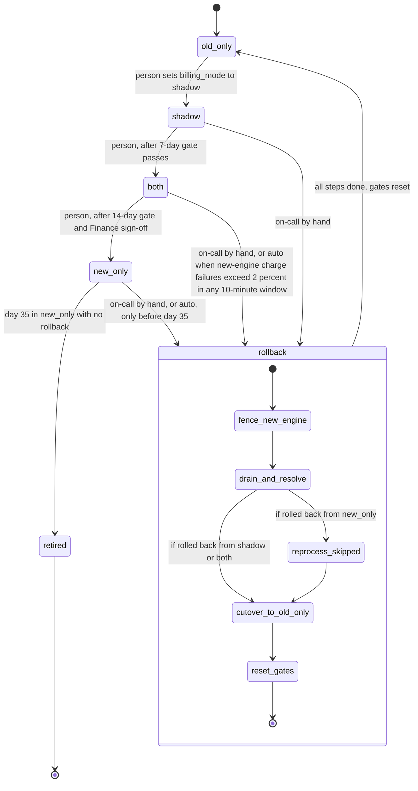

# Billing engine rollout: state machine

## Modes

| Mode | Who charges | Who writes the ledger | Old engine | New engine | Exit condition |
|---|---|---|---|---|---|
| `old_only` | Old | Old | Computes and charges | Off | Person moves to `shadow` |
| `shadow` | Old | Old | Computes and charges | Computes into shadow store, never charges or writes ledger; nightly comparison runs | 7 consecutive days with mismatch rate under 0.1 percent and at least 5,000 invoices compared |
| `both` | New | New | Computes every invoice into shadow store, never charges or writes ledger | Charges and writes ledger | 14 days with no unresolved mismatches, plus Finance sign-off |
| `new_only` | New | New | Stopped | Charges and writes ledger | Day 35 in `new_only` with no rollback: old engine retired |

Only one engine charges in any mode. A mismatch is any invoice total that differs by more than one cent. Mismatches are counted per customer per billing period.

## Where the rollout state lives

- **`billing_mode`** is one global flag in the config service. It holds only the mode. Every change is a compare-and-set on the flag's version, so the nightly gate job, a person's forward move and an automatic rollback cannot race. A forward move fails if a rollback is in progress.
- **Rollout record** (recommended, not in the brief): gate counters, the list of consecutive passing days, Finance sign-off, rollback step progress and the day-35 clock for `new_only`. It sits beside the flag, is updated in the same compare-and-set, and is kept with an append-only audit log.
- **Shadow store**: holds shadow invoices and the daily comparison results. It is separate from the ledger.
- **Billing ledger**: the system of record. It is the guard against double charges: at most one charge per customer per billing period, enforced by ledger keys plus the payment provider's idempotency key.
- **Usage event log**: 35-day retention. Events the old engine skipped while in `new_only` must be reprocessed before they expire.

## Double-charge and dropped-charge guard

- Every charge attempt carries an idempotency key derived from customer and billing period. A charge with an unknown outcome (timeout, lost response) is resolved against the provider by that key before any retry. It is never re-issued blindly.
- The guard applies in both directions. The first new-engine run in `both` skips periods the old engine already charged. Catch-up charges after a rollback skip periods the new engine already charged.
- A charge that is due but blocked is delayed, not dropped. It stays queued until the mode allows it.

## Rollback steps (in order)

1. **Fence the new engine.** It stops starting new charges. Nothing is charged while the fence is up.
2. **Drain and resolve.** Wait for in-flight charges to finish. Resolve each unknown outcome against the provider by idempotency key.
3. **Reprocess skipped events (from `new_only` only).** The old engine recomputes invoices for usage events since entering `new_only`, writes them to the shadow store, and compares them with the ledger. It does not charge in this step.
4. **Cutover to `old_only`.** Set `billing_mode` to `old_only` (compare-and-set). The old engine becomes the sole charger. It charges only periods with no ledger charge and no in-flight charge.
5. **Reset gates.** Zero the shadow day counter and the 14-day counter. Clear Finance sign-off (assumption, see open questions). Record the reason and timestamps in the audit log.

Each step is idempotent and resumable. A rollback that stops partway stays in `rollback`. It does not return to `both` or `new_only`.

## What happens when something fails

- **Config service unreachable.** Workers keep the last mode they read. No mode change is possible until it returns, and an alert fires. A worker that has never read a mode charges nothing and queues its work.
- **Nightly comparison fails or is missing for a day.** That day does not count toward the 7-day or 14-day gate. A gap never counts as a pass. The counter resets only on a day that fails the threshold, not on a missing day.
- **Mismatch in `shadow`.** The 7-day counter resets. No rollback is triggered.
- **Mismatch in `both`.** It counts as unresolved and blocks `both` to `new_only`. The brief does not make it an automatic rollback trigger.
- **New-engine errors in `shadow`.** They are recorded and never trigger a rollback.
- **Charge failure spike in `both` or `new_only`.** Above 2 percent in a 10-minute window, the automatic rollback starts. A failed rollback step pages on-call and stays in `rollback` until it completes.
- **Reprocess needs events past 35-day retention.** The rollback is refused. Escalate. Do not cut over, because periods in the gap cannot be verified. The old engine's data is not recoverable from the usage log after that point.
- **Day 35 reached in `new_only`.** Rollback is no longer possible. The old engine is retired and there is no exit from `retired`.
- **After any rollback.** The rollout restarts at `shadow` with the 7-day count at zero. Moving from `old_only` to `shadow` is a person's move, never automatic.

## Open questions

- Is the 5,000-invoice minimum per day or cumulative across the 7 days? The brief is ambiguous.
- Does the 35-day clock start when the rollout enters `new_only`, or at the first skipped event? The draft assumes entry into `new_only`.
- Does a rollback clear Finance sign-off? The draft assumes it does.
- The 2 percent auto-rollback trigger needs a minimum attempt count per window. At low volume, a few failures would trip it.