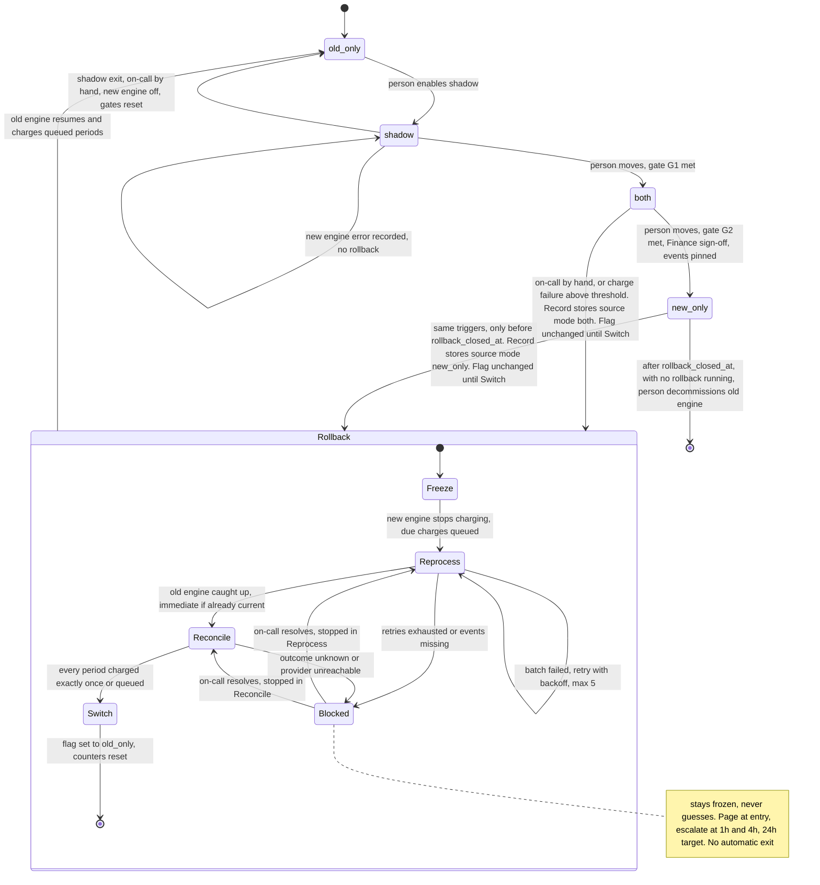

# Billing engine rollout: state machine

## Summary

The rollout has four modes: `old_only`, `shadow`, `both`, `new_only`. Forward moves are made by a person, one step at a time, and only when the gate for that step is met (including Finance sign-off for `both` to `new_only`). Nothing skips a step.

There are two ways back, and both end in `old_only`:

- **Rollback** is the multi-step procedure (Freeze, Reprocess, Reconcile, Switch) that runs from `both` or `new_only`. It exists because the new engine has charged customers.
- **Shadow exit** is a manual step from `shadow` only. The new engine has never charged or written the ledger there, so on-call sets the flag to `old_only` and turns the new engine off. It is not a Rollback and has no steps.

After either, the gates reset and the rollout must go through `shadow` again. Rollback can start only before `rollback_closed_at` (35 days after `new_only` began). After that the machine can only go forward. A rollback already running at that moment still completes (see "The 35-day boundary").

How to read this document: the diagram is the authority on which states and transitions exist. The prose is the authority on numbers (thresholds, timings, retention) and on what each transition touches. If the two disagree about a state or transition, the diagram wins and the prose is the bug.

## Diagram

## What each mode does

| Mode | Old engine | New engine | Who charges | Ledger written by | Shadow store written by |
|---|---|---|---|---|---|
| `old_only` | Computes invoices | Off | Old | Old | nobody |
| `shadow` | Computes invoices | Reads the same events, computes invoices | Old | Old | New |
| `both` | Computes every invoice, never charges | Computes invoices | New | New | Old |
| `new_only` | Stopped | Computes invoices | New | New | nobody |

**The shadow store** holds the invoices of whichever engine is *not* authoritative. Nothing in it is ever charged or treated as a record. It exists for the nightly comparison and for rollback. The **ledger is the system of record**, and the engine that charges is the engine whose invoice is in the ledger. In `both`, the old engine's invoices in the shadow store are a comparison copy, but they are also what the old engine can promote into the ledger during a rollback (see "How queued periods are charged").

**Nightly comparison** runs in `shadow` and `both`. A mismatch is a per-customer invoice total that differs by more than one cent.

**Gate G1 (`shadow` to `both`).**
- A day qualifies when the nightly job ran, compared at least one invoice, and had a mismatch rate under 0.1%.
- The controller tracks the current run of consecutive qualifying days. Any non-qualifying day ends the run and the count restarts at zero.
- G1 is met when the run is at least 7 days and the invoices compared across the last 7 days of the run total at least 5,000.
- If the total is short, the run is not reset. It keeps growing, the 7-day window moves forward, and G1 opens as soon as a window reaches 5,000.
- The job reports the gate as met. A person makes the move.

**Gate G2 (`both` to `new_only`).** It needs all of:
- 14 days in `both`.
- Zero open mismatches when the move is made.
- Finance sign-off.
- The usage events pinned (see "The 35-day boundary").

A person makes the move. The 0.1% rate does not apply to G2.

**Open mismatch.** In `both`, a mismatch opens when the nightly comparison finds a customer-period invoice that differs by more than one cent. It closes when a later comparison shows the same customer-period within one cent, or when a person records a resolution with the cause. G2 reads only the open set at the moment of the move.

## Rollback (from `both` or `new_only`)

The aim is to hand over to the old engine with no double charges and no lost charges. The rollout record stores the source mode, and the record, not the flag, is the authority on behaviour until Switch.

| Aspect | From `both` | From `new_only` |
|---|---|---|
| Who charges during rollback | Nobody. Due charges are queued. | Same |
| New engine | Computes, does not charge or write the ledger | Same |
| Old engine | Catches up from its watermark (usually nothing to do), then keeps computing | Reprocesses the events it skipped from the pinned copy, then computes |
| Nightly comparison | Paused | Not running |
| G1 and G2 counters | Frozen, reset at Switch | Same |

Steps:

1. **Freeze.** The new engine stops charging immediately. Charges that fall due are queued, not dropped.
2. **Reprocess.** The old engine processes every usage event after its own watermark, in order. From `new_only` it reads the pinned copy. From `both` it reads the live log. If it is already current, this step finishes at once. Running it in both cases means rollback never assumes the old engine is current. A failed batch is retried with backoff up to 5 attempts, then the rollback goes to `Blocked`. Missing events go to `Blocked` directly.
3. **Reconcile.** For each customer and billing period, check the ledger and the payment provider and classify the period as charged, not charged, or in-flight. Resolve in-flight periods with the provider first. Charged periods are final and the old engine never touches them. Not-charged periods are queued for the old engine. If the outcome cannot be determined, go to `Blocked`.
4. **Switch.** Set `billing_mode` to `old_only` and reset the counters. The old engine resumes and charges only the queued periods.

**How queued periods are charged.** A queued period either already has a ledger invoice, written by the new engine, or it has none.
- If it has one, that invoice stands and the old engine charges that amount. Ledger entries are never rewritten.
- If it has none, the old engine promotes its invoice from the shadow store into the ledger and then charges it. Promotion and charge use the period's idempotency key.

This promotion rule is not yet approved (open question 4). Until it is, the fallback is that periods with no ledger entry are treated like an undetermined outcome: the rollback goes to `Blocked` and on-call decides.

**Blocked.** The rollback stays frozen and never guesses, because a wrong guess either double charges or drops a charge. Charges stay queued, so nothing is lost, but billing is delayed. Escalation (proposed defaults, open question 2):
- Page on-call at entry and every 30 minutes until acknowledged.
- After 1 hour, escalate to the secondary on-call. After 4 hours, escalate to the billing engineering lead and notify Finance.
- Target resolution is 24 hours. It is a target, not an automatic action, because any automatic exit would be a guess.
- While `Blocked`, the pinned archive and the live log are held and decommission is refused, even after day 35.

## The 35-day boundary

- **The clock.** Committing the move to `new_only` writes `new_only_entered_at` and `rollback_closed_at = new_only_entered_at + 35 days` in the same commit. No timer fires at day 35.
- **The check.** Eligibility is a test, not an event. A rollback start, manual or automatic, is accepted only if the current time is before `rollback_closed_at`, evaluated inside the same compare-and-set that starts the rollback. This is what "less than 35 days" means.
- **In progress at the deadline.** A rollback that started before `rollback_closed_at` finishes, including while `Blocked`.
- **Pinning.** Moving to `new_only` is blocked until the controller has copied every event since `both` began into a pinned archive. The 35-day retention of the live log therefore cannot break a rollback. Reprocess from `new_only` reads the pinned copy.
- **Archive retention.** One rule: the archive exists from the pin until the first of (a) Switch of a completed rollback, or (b) decommission. Switch deletes it even if the rollback finishes after day 35, because the rollout restarts at `old_only` and pins again before any later `new_only`. While a rollback is `Blocked` the archive is held. If nobody decommissions after `rollback_closed_at`, the archive stays, and the controller pages billing engineering on that day and monthly after, so storage cost does not grow unnoticed.
- **Decommission.** A person may decommission only when `rollback_closed_at` has passed and no rollback is in progress. It is a compare-and-set on the record, so a rollback that started just before the deadline blocks it. It deletes the archive.
- **After the deadline.** A charge failure above threshold pages on-call and the team fixes forward.

## Where the rollout state lives

- **Mode.** The `billing_mode` flag in the config service is the source of truth for the mode. It changes only on a forward move, a shadow exit, or Switch.
- **Rollback progress.** A flag value cannot express "rolling back, in step 3", so progress lives in a durable rollout record next to the ledger. It holds the rollback step, the source mode, `new_only_entered_at`, `rollback_closed_at`, the G1 and G2 counters, and a version number.
- **One writer at a time.** Every change to the record or flag (forward move, shadow exit, rollback start, step change, decommission) is a compare-and-set on the record's version. The first commit wins and the loser re-reads. Specifically:
  - A forward move or shadow exit is accepted only when no rollback is in progress.
  - A rollback start is accepted only when none is in progress and the deadline test passes.
  - The flag changes only after a successful commit, so mode and record cannot disagree.
- **Freeze check.** Workers check the record before every charge, so a worker with a stale flag still stops.
- **Charge ownership.** Every charge carries an idempotency key made from customer and billing period. The ledger enforces uniqueness on it and the payment provider receives it. Stale workers and retries cannot charge a period twice.
- **Crash recovery.** The step is in the record. The next worker resumes from it, and every step is safe to repeat.

## Auto-rollback trigger

- **Rule.** Roll back automatically when, over a sliding 10-minute window evaluated every minute, the system-failure rate is above 2% and there are at least 10 system failures in the window. The 10-failure minimum is a proposed default (open question 1). For example, 10 failures in 12 attempts fires.
- **Measure.** Failed charge attempts divided by all charge attempts, counting system failures (timeouts, provider errors, our own errors). Ordinary card declines are excluded.
- **Below the minimum.** If the rate is above 2% with fewer than 10 failures, page on-call but do not roll back. This also covers a window with attempts and no successes.
- **Where it applies.** Only in `both` and `new_only`, and only before `rollback_closed_at`. New-engine errors in `shadow` are recorded but never trigger anything.
- **Requests during a rollback.** Only one rollback runs at a time. A manual request gets an explicit "rollback already in progress" response and is logged. An automatic trigger is logged and adds no new page, since on-call is already engaged, or `Blocked` is already paging.

## What happens when something fails

The rules above are not repeated here. This table is an index.

| Failure | Behaviour |
|---|---|
| New-engine error in `shadow` | Recorded. May keep G1 closed. No state change. |
| Failure above threshold, `both` or `new_only`, before `rollback_closed_at` | Automatic Rollback. |
| Same failure after `rollback_closed_at` | Page on-call, fix forward. |
| Nightly mismatch in `shadow` | Non-qualifying day if the rate is at or above 0.1%. See G1. |
| Open mismatch in `both` | G2 stays closed. The 14-day count keeps running. |
| Reprocess retries exhausted, events missing, or Reconcile outcome unknown | `Blocked`, page, escalation ladder. |
| Worker crash mid-rollback | Resume from the recorded step. |
| Rollback or forward move requested when the record forbids it | Rejected by compare-and-set or the deadline test. |

## Counter resets

| Event | Effect |
|---|---|
| Non-qualifying day in `shadow` | G1 run restarts at zero. |
| Move to `both` | G1 spent and cleared. G2 day count starts at zero. |
| Switch of a rollback, or shadow exit | G1 and G2 both reset to zero. The rollout must pass `shadow` again. |

## Open questions

**Block implementation. Resolve before the controller is written:**

1. **Auto-rollback threshold** (owner: on-call lead). Confirm the 10-failure minimum and that card declines are excluded.
2. **Blocked escalation** (owner: on-call lead and Finance). Confirm the 30-minute, 1-hour and 4-hour steps and the 24-hour target.
3. **Pinned archive** (owner: billing engineering). Confirm it can store 35 days of usage events and that pinning can be a precondition of the `new_only` move.
4. **Ledger and promotion rule** (owner: billing engineering and Finance). Confirm that a new-engine ledger invoice stands during rollback and the old engine charges that amount, and that promoting a shadow invoice into the ledger for periods with no entry is allowed. If not allowed, those periods go to `Blocked`.
5. **G1 volume** (owner: product). I read "at least 5,000 invoices compared" as the total across the 7 days, not per day.
6. **G2 wording** (owner: Finance). I read "no unresolved mismatches" as zero open mismatches when the move is made, plus 14 days in `both`. A stricter reading is none open at any point in the 14 days.
7. **Decommission** (owner: billing engineering). I treated it as a person's decision after `rollback_closed_at`, refused while a rollback is in progress.

**Does not block:**

8. **Old-engine staleness alert in `both`** (owner: billing engineering). Rollback does not assume the old engine is current, but a large lag makes Reprocess slower, so an alert is wanted.