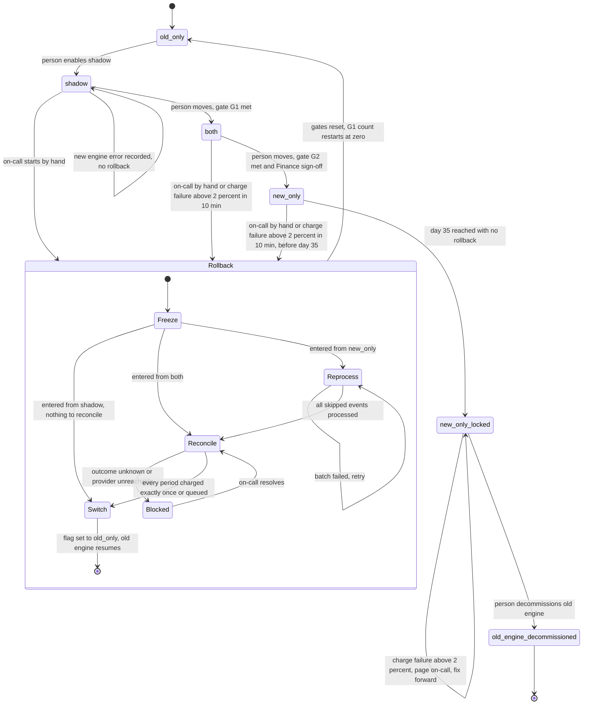

# Billing engine rollout: state machine

## Summary

The rollout has four modes. A person moves forward one step at a time. Rollback is a separate procedure with its own steps, and it always ends in `old_only`. Rollback has a deadline. After day 35 in `new_only`, no rollback is possible and the machine can only go forward.

## Diagram

The diagram does not show that `old_only` is the only legal re-entry point. After a rollback the rollout restarts at `old_only` and must go through `shadow` again.

## What each mode does

| Mode | Old engine | New engine | Who charges | Who writes the ledger |
|---|---|---|---|---|
| `old_only` | Computes invoices | Off | Old | Old |
| `shadow` | Computes invoices | Reads the same events and writes to the shadow store | Old | Old |
| `both` | Computes every invoice into the shadow store, never charges | Computes invoices | New | New |
| `new_only` | Stopped | Computes invoices | New | New |

- **Nightly comparison.** It runs in `shadow` and `both`. A mismatch is any per-customer invoice total that differs by more than one cent.
- **Gate G1 (`shadow` to `both`).** It needs 7 consecutive days with a mismatch rate under 0.1% and at least 5,000 invoices compared. The job reports the gate as met, but a person still makes the move.
- **Gate G2 (`both` to `new_only`).** It needs 14 days in `both` with no unresolved mismatches, plus Finance sign-off. A person makes the move.
- **`new_only_locked`.** The flag still reads `new_only`. This state only records that day 35 has passed and rollback is no longer possible.

## Rollback steps

Rollback keeps the old engine safe to take over without double charges or lost charges.

1. **Freeze.**
   - The new engine stops charging immediately. Charges that fall due while frozen are queued, not dropped.
   - In `shadow` there is nothing to freeze, because the new engine never charged.
2. **Reprocess (from `new_only` only).**
   - The old engine stopped computing when `new_only` began.
   - It must now process every usage event it skipped, in order, and write the invoices to the shadow store.
   - From `both` this step is not needed, because the old engine has kept computing.
3. **Reconcile.**
   - For each customer and billing period, check the ledger and the payment provider and classify the period as charged, not charged, or in-flight.
   - Resolve in-flight charges with the provider before going on.
   - Charged periods are final and the old engine never touches them. Not-charged periods are queued for the old engine.
4. **Switch.**
   - Set `billing_mode` to `old_only`. The old engine resumes and charges only the queued periods.
   - Reset the gates.

**Blocked.** If reconcile cannot tell whether a period was charged, rollback stops in `Blocked`, stays frozen, and pages on-call. It never guesses, because a wrong guess either double charges or drops a charge.

## Where the rollout state lives

- **Mode.** The `billing_mode` flag in the config service is the only source of truth for the current mode.
- **Flag timing.** The flag changes only on a forward move or at the final Switch step of a rollback. It is not changed at the start of a rollback.
- **Rollback progress.** A flag value can't express "rolling back, in step 3". Progress therefore lives in a durable rollout record kept next to the ledger. It holds:
  - the rollback step
  - the mode the rollback started from
  - the time `new_only` was entered (this starts the 35-day clock)
  - the G1 and G2 counters
- **Freeze check.** Workers check the rollout record before every charge. This works even if a worker still holds a stale copy of the flag.
- **Charge ownership.** Every charge carries an idempotency key made from customer and billing period. The ledger enforces uniqueness on it and the payment provider receives it. Stale workers, retries, and a rollback racing a forward move therefore cannot charge a period twice, whatever the flag says.
- **Invoices.** The ledger is the system of record. The shadow store is only for comparison and for rollback.

## What happens when something fails

| Failure | Behaviour |
|---|---|
| New-engine error in `shadow` | Recorded, no rollback. Repeated errors will keep gate G1 from being met, but they don't move the state. |
| Charge failure rate above 2% over any 10-minute window in `both` or `new_only` (before day 35) | Automatic rollback starts. |
| Same failure after day 35 | No rollback is possible. Page on-call and fix forward. |
| Mismatch in `shadow` | The G1 day count restarts. |
| Unresolved mismatch in `both` | Gate G2 stays closed. |
| Reprocess batch fails | Retry. The rollback stays frozen and does not advance. |
| Reconcile cannot determine a charge | Move to `Blocked` and page on-call. |
| Worker crashes mid-rollback | The rollback step is in the durable record. The next worker resumes from that step. Every step can be repeated safely. |
| Manual rollback requested during a rollback | Ignored. There is one rollback at a time. |

After any rollback, G1 starts again at zero and G2's 14 days are lost. The next forward move from `old_only` to `shadow` is made by a person.

## Risks and open questions

These are gaps in the brief. The diagram assumes the first answer in each case.

1. **Retention against the 35-day limit.**
   - The usage event log keeps events for 35 days. The oldest skipped events, from the moment `new_only` began, expire exactly at day 35.
   - A rollback started on day 34 may not finish reprocessing before those events are gone.
   - Recommendation: copy or pin the usage events when `new_only` begins. Alternatively, treat rollback as unavailable a set margin (for example 2 days) before day 35.
2. **G1 volume.** I read "at least 5,000 invoices compared" as the total across the 7 days, not per day. Please confirm.
3. **G2 wording.** I read "no unresolved mismatches" as zero open mismatches when the move is made, and 14 days elapsed in `both`. A stricter reading is that no mismatch may have been open at any point in the 14 days. Please confirm.
4. **Auto-rollback noise.** A 2% failure rate over 10 minutes can fire on a handful of charges in a quiet window. Consider a minimum number of charges per window.
5. **Old engine staleness in `both`.** Rollback assumes the old engine's shadow invoices are current. Alert if the old engine lags in `both`. Otherwise rollback would need a longer reprocess.
6. **Decommission.** I treated it as a person's decision after day 35. The 35-day lock itself happens automatically.
