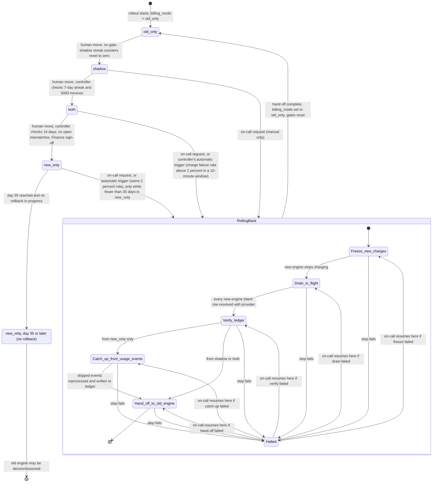

# Billing engine rollout: state machine

This document models how the billing engine moves from the old engine to the new one, and how it moves back. The rollout is gradual, reversible, and must never charge a customer twice for a billing period.

## Diagram

## Who does what in each mode

| Mode | Old engine | New engine | Ledger written by | Shadow store written by | Nightly comparison |
|---|---|---|---|---|---|
| old_only | Computes and charges | Off | Old engine | Nothing | None |
| shadow | Computes and charges | Computes, never charges | Old engine | New engine | Old invoices (ledger) vs new invoices (shadow store) |
| both | Computes into shadow store, never charges | Computes and charges | New engine | Old engine | Old invoices (shadow store) vs new invoices (ledger) |
| new_only | Off (on only during catch-up in a rollback, and then it does not charge) | Computes and charges | New engine | Nothing | None |

- **old_only**: The starting state. The move to `shadow` is a human action. The controller checks no gate for it, but it follows the same commit order as every other forward move.
- **shadow**: The new engine reads the same usage events and writes to the shadow store only. Its errors are recorded but never cause a rollback.
- **both**: The new engine charges. The old engine keeps computing every invoice into the shadow store, so a rollback stays cheap. Automatic rollback applies in this mode.
- **new_only**: The old engine stops computing. A rollback from here is allowed only within 35 days of entering this mode.

### Who may charge

One rule decides charging in every state, including during a rollback:

- The **old engine** charges only when `billing_mode` is `old_only` or `shadow`. It reads `billing_mode` only, not the gate record. It has no flag check.
- The **new engine** charges only when `billing_mode` is `both` or `new_only`. It never charges in `shadow` and never writes intent rows there.

Before any charge, each engine does the following, in this order:

0. **Pre-check the gate flag (new engine only).** Read `rollback_in_progress` from the gate record. If the flag is set, or the gate record cannot be read, do not insert an intent row and do not charge. This step only stops new rows from being created during a freeze. The safety argument does not depend on it; it depends on step 2.
1. **Insert the intent row.** Make a conditional insert in the ledger for the customer-period, carrying the idempotency key (see Charge intent) and the name of the engine doing the insert. If the insert fails, or the row already exists, do not charge.
2. **Read the gate flag (new engine only).** Read `rollback_in_progress` from the gate record again, after the insert. If the flag is set, or the gate record cannot be read, do not charge. Leave the intent row in place. Drain will resolve it.
3. **Charge** with the idempotency key, for the amount in the ledger invoice (see Charge intent).

The read in step 2, after the insert, is what lets freeze work without a worker acknowledgement. An engine that reads the flag as clear has already written its intent row, so the controller's scan after setting the flag sees every such row (see Controller and steps, step 1). Step 0 is only an optimisation.

`billing_mode` keeps its pre-rollback value until hand off, so during a rollback this rule alone determines who charges. The old engine is not frozen by the rollback flag. From `shadow` it keeps charging throughout a rollback, and from `both` or `new_only` it does not charge, because `billing_mode` does not allow it.

## Human moves and gate checks

A human asks the rollout controller to move to the next mode. The controller refuses any move while a rollback is in progress or `Halted`, or while a previous move is pending (`pending_mode` is set). Otherwise it checks the gate for that move:

- `old_only` to `shadow`: no extra check. The move resets `shadow_streak_days` and `shadow_streak_invoices` to zero.
- `shadow` to `both`: `shadow_streak_days` is at least 7, and `shadow_streak_invoices` is at least 5,000. If the streak is 7 or more but the invoices are under 5,000, the move is refused and the streak keeps counting.
- `both` to `new_only`: at least 14 days have passed since `both_entered_at`, there are no open mismatch records since `both_entered_at`, and a Finance sign-off is present in the gate record.

If a check fails, the controller refuses, records the reason, and changes nothing. If every check passes, the controller applies the move in the commit order below.

## Commit order for mode changes

`billing_mode` lives in the config service. The gate record lives in the controller's own store. No transaction spans both, so the controller writes them in a fixed order and recovers from a partial write.

**Forward move** (`old_only` to `shadow`, `shadow` to `both`, or `both` to `new_only`):

1. Gate record: set `pending_mode` to the target. Set the entry timestamp for the target: `shadow_started_at` with the streak counters reset to zero when entering `shadow`, `both_entered_at` when entering `both`, or `new_only_entered_at` when entering `new_only`.
2. Config service: set `billing_mode` to the target.
3. Gate record: clear `pending_mode`.

**Hand off** (see Rollback, step 5):

1. Config service: set `billing_mode` to `old_only`.
2. Gate record: clear `rollback_in_progress` and `rollback_status`, reset every gate, clear the Finance sign-off, and keep the rollback history.

Why this order: a forward move writes the gate first, so a stop after its first write leaves `billing_mode` at the old mode, and each mode has exactly one charger. Hand off writes the config first, so a stop after its first write leaves `rollback_in_progress` set. The new engine stays stopped, and the old engine may charge only because steps 1 to 4 have finished.

**Recovery.** On start, the controller reads `pending_mode`. If it is set, the controller repeats step 2 and step 3 of the forward move, without rechecking the gates, because the checks passed when `pending_mode` was written. If `rollback_status` is running, the controller resumes at `rollback_step`. Writing a value is a set, so repeating it is safe.

**Rollback start.** One gate write: set `rollback_in_progress`, `rollback_source`, `rollback_from_mode` (the `billing_mode` the rollback starts from, see below), `rollback_status` to running, and `rollback_step` to freeze. `billing_mode` is not written.

**Rollback start while a forward move is pending.** If `pending_mode` is set when a rollback request or automatic trigger arrives, the controller first completes the pending move (step 2 and step 3 of the forward move, with no gate recheck). It then records the rollback start, with `rollback_from_mode` set to the mode the move completed to. The request is held only until that completion, which is one config write. This trade-off is deliberate: on-call can start a rollback at any time, and refusing would leave a failing rollout running. The cost is an exposure: after the pending move completes and before the rollback flag is set, the new engine may charge if the target is `both` or `new_only`. Any such charge has an intent row, and drain resolves it.

## Daily comparison and gate counters

- **Scope.** For each UTC date D, the comparison covers the customer-periods whose billing period ends on D. It compares both engines' output for those periods. (The brief does not define billing periods. See Assumptions.)
- A **mismatch** is a customer-period where the two engines' totals differ by more than one cent, or where only one engine produced an invoice for it.
- The comparison is **complete** when both engines finished and produced output for every customer-period that has usage events for a period ending on D. Anything else is incomplete. A date before `shadow_started_at` is never complete, because the new engine had not started, so it does not count.
- A day's **mismatch rate** is mismatches divided by invoices compared that day.
- The nightly job writes two kinds of rows for each date. Re-running a date replaces its own rows, so it creates no duplicates. It writes the mismatch records first and the count row last, so a count row means its mismatch records exist:
  - One **count row** per date: the date, invoices compared, mismatches, and whether the comparison was complete.
  - One **mismatch record** per mismatched customer-period: the date, the customer ID, the period ID, both totals, and a status of `open`. A person changes the status to `resolved` through the controller, which records who and when. (Who may do this is open.)
- The controller reads each date's count row once and updates the gate record. It reads only dates that have a count row. Updates are keyed by date, so re-running a date that already counted changes nothing.
- A day **counts** toward the shadow streak only if the comparison is complete, at least one invoice was compared, and the mismatch rate is strictly under 0.1 percent. A day that does not count sets the consecutive run back to zero, and it resets `shadow_streak_days` and `shadow_streak_invoices` to zero together. The 5,000-invoice total counts only invoices from the current run of counted days.
- Arithmetic: on a day with 1,000 or fewer invoices, a single mismatch makes the rate 0.1 percent or more, so any mismatch fails that day.
- Gate counters: `shadow_streak_days` and `shadow_streak_invoices`. Days in `both` are the elapsed 24-hour periods since `both_entered_at`, so no counter is needed.
- In `both` the same comparison runs and each day's count row and mismatch records are written. The 14-day gate does not use the daily rate. It counts open mismatch records dated since `both_entered_at`, and it passes only when that count is zero.

## Rollback

Rollback can start from `shadow`, `both` or `new_only`. It always ends in `old_only`. From `both` or `new_only` it goes straight to `old_only` and does not pass through `shadow`.

### Starting and requests

- On-call starts a rollback by sending a request to the rollout controller. The controller is the only writer of the gate record and of `billing_mode`. `rollback_source` is recorded as `on_call:<requester>`.
- The automatic trigger is evaluated by the controller itself, not sent by another component. The controller reads each new-engine charge outcome, computes the charge failure rate per 10-minute window, and when it is above 2 percent in `both` or `new_only` it starts the rollback as if an on-call request had arrived. `rollback_source` is recorded as `automatic:charge_failure_rate`. How the rate is computed is open (see Open questions).
- Only one rollback can run at a time. The controller handles requests as follows:
  - A start request from `shadow`, `both` or `new_only`, with no rollback active, is accepted.
  - A start request or automatic trigger that arrives while a forward move is pending is held until the pending move completes, then applies the rules here to the mode it completed to (see Rollback start while a forward move is pending).
  - A start request from `old_only` is refused.
  - A start request from `new_only` at or after day 35 is refused.
  - A resume request while `Halted` resumes at the recorded step. A resume request at any other time is refused.
  - Any other on-call request while a rollback is active is refused, and the reason is recorded.
  - An automatic trigger while a rollback is active, running or `Halted`, is ignored and recorded.
  - An automatic trigger from `new_only` at or after day 35 is refused and recorded.
  - A human forward move while a rollback is active is refused.

### Controller and steps

The controller runs every step. Engines charge only as the charging rule allows. The old engine runs in catch-up mode only in step 4. Steps 1 to 3 cover only intent rows inserted by the new engine (see Per source mode).

Before each step the controller writes `rollback_step` to the gate record. After the step completes, it records completion and moves to the next step. On restart with `rollback_status` set to running, it reruns the recorded step. Each step is idempotent, so resuming after a failure or a crash is safe. A failed step sets `rollback_status` to halted and records `rollback_last_error`.

1. **Freeze new charges.** The controller sets `rollback_in_progress` at start, so the new engine stops charging at its next flag read. Step 1 completes when one ledger query, run after that write, returns the unsettled intent rows inserted by the new engine. This query is the drain set. It is safe because of the ordering in Who may charge: a new-engine worker that read the flag as clear had already inserted its row before that read, so the query sees it. A worker that reads the flag as set may insert a row after the query. It does not charge, and step 2 picks the row up. Due periods wait. None are dropped. Whether the flag and the intent rows are read in a consistent order across the gate record and the ledger is open.
2. **Drain in-flight charges.** Repeat until a query returns no unsettled new-engine intent rows. For each row, the controller asks the provider for the outcome of its idempotency key:
   - **Charged:** write a settled ledger entry with the key and the provider's confirmation.
   - **Not charged, and the row is older than the charge deadline:** clear the intent row. The period is due again, and it may be charged later with the same key.
   - **Not charged, and the row is younger than the charge deadline:** the row stays pending, and the answer is not final, because a provider call may still be in flight. The controller asks again on a later pass. It tracks the wait with `rollback_step` set to drain and the row's insert time in the ledger, so a restart resumes the wait. The pass interval is open.
   - **Unknown:** the intent row stays pending, which blocks charges to that customer-period from both engines. The step waits. If there is no answer by the timeout, the rollback halts with the key in `rollback_last_error`.
   - Nothing is re-sent on a guess.
3. **Verify the ledger.** Every row in the drain set must now be settled or cleared. For each key the provider confirmed as charged, the controller checks that a settled entry exists, and writes it if the earlier write failed. Intent rows in the drain set are the only source for this step, because an engine never charges without one. If any drain-set row is still pending, the step fails and the rollback halts.
4. **Catch up (from `new_only` only).** The controller runs the old engine in catch-up mode. It recomputes invoices from the usage events with event time since `new_only_entered_at`, in event order. For each customer-period:
   - If it is settled, skip it.
   - If the ledger holds an invoice that is not settled, keep that invoice and record any difference for review. Do not overwrite it.
   - If the ledger holds no invoice, write one to the ledger as due.
   - Catch-up charges nothing. Its progress is saved as `catch_up_cursor` (the last event processed). The step completes when every event since entry has been processed.
5. **Hand off.** Use the hand-off commit order above. `billing_mode` becomes `old_only`, the rollback flags clear, and every gate resets. The next forward path starts again at `shadow`, with the 7-day count at zero.

### Per source mode

- **From `shadow`**: The new engine never charged, so it wrote no intent rows, and the drain set is empty. The old engine is the charger in `shadow` and in `old_only` alike, so the rollback does not stop it. It keeps charging through the rollback, and its intent rows follow its normal settle path. Steps 1 to 3 do not wait for or check its rows. Step 4 does not run. Shadow invoices and comparison output are kept for audit. They are not written to the ledger and not deleted.
- **From `both`**: Steps 1 and 2 stop new charges. The old engine does not charge while `billing_mode` is `both`, so due periods wait until hand off. Step 3 settles every period the new engine charged. Old-engine intent rows left pending by an earlier `shadow` phase are outside steps 1 to 3. They still block their customer-period, and the normal controller resolution handles them. After hand off, the old engine charges the remaining due periods, using the unsettled ledger invoice for each (see Charge intent), and skips settled ones.
- **From `new_only`**: All five steps run. Step 4 is the only step that reads usage events. Due periods wait until hand off, then the old engine charges the unsettled ones.

### Hand off after its first write

If hand off's first write (`billing_mode` set to `old_only`) lands and the second does not, the rollback is `Halted` at hand off with `rollback_in_progress` still set:

- The old engine may charge under its own rule, because `billing_mode` is now `old_only`. This is intended: steps 1 to 4 have finished, and the new engine stays blocked by the flag.
- On-call resume runs hand off again. Both writes are idempotent, so the rerun is safe. Only then does the rollback end.
- During this window, forward moves, new rollback starts, automatic triggers and any resume other than hand off are refused, and each refusal is recorded.

## Charge intent

Before it calls the provider, an engine makes a conditional insert in the ledger: an intent row for the customer-period, carrying the idempotency key and the name of the engine that inserted it. Only the engine whose insert succeeds may charge. If the row already exists, the engine does not charge. If the insert fails, the engine does not charge. The new engine also checks the gate flag before and after the insert (see Who may charge).

- The key is derived from the customer ID and the billing period ID only. It has no engine name, attempt number or amount, so every attempt for that period, from either engine, sends the same key. The engine name on the row is metadata. It is not part of the key, and it is used only to scope the rollback steps.
- The intent row becomes settled when the provider confirms the charge. It is cleared when the provider confirms that no charge exists and the charge deadline has passed (drain).
- **Settling in the normal path.** The engine that made the charge writes the settled entry itself, straight after the provider confirms, with the key and the provider's confirmation. If that write fails, the row stays pending. It is not cleared, because the charge may have happened. The engine retries the write. A pending row blocks both engines from charging that customer-period, so a failed write stalls the period but cannot cause a second charge. If the engine cannot finish, the controller resolves the row by key, using the drain rules. Outside a rollback this resolution also runs from the controller. How often it runs, and the timeout for an unknown answer, are open.
- **Due.** A customer-period is due when the ledger holds an invoice for it that has no settled entry. How an engine finds due periods (schedule, event or poll) is open.
- **Charge amount.** An engine charges the total of the unsettled ledger invoice for the customer-period. If the ledger holds none, the engine computes one and writes it to the ledger as due before it inserts the intent row. An unsettled ledger invoice is never overwritten by either engine. Any difference from the other engine's total is recorded for review.
- **Charge deadline.** The deadline is measured from the intent row's insert timestamp, as recorded in the ledger. An engine must not start a provider call for an intent row whose insert is older than the deadline. A "not charged" answer is final only after the deadline plus the provider's maximum request latency has passed. That margin stops a call started just before the deadline from reaching the provider after the answer was given. The deadline length, the latency bound, and whether the answer is final after that are open.
- The provider's idempotency key is the second line of protection, not the first.

## Day 35 in new_only

- `new_only_entered_at` is written in step 1 of the forward move's commit order, before `billing_mode` changes. The clock therefore starts no later than the mode change, so the window is never longer than the brief allows.
- Day 35 is 35 times 24 hours after that time, in UTC.
- A rollback request, or an automatic trigger, from `new_only` at or after day 35 is refused. The controller checks the current time when the request arrives. It does not rely on a daily job.
- A daily check of the controller sets `new_only_closed` in the gate record, which means the old engine may be decommissioned. The closure fires only when no rollback is in progress or `Halted`, and no `pending_mode` is set.
- If a daily check is missed, rollback is still refused on day 35.
- The 35-day limit applies only to `new_only`. Rollback from `shadow` or `both` has no time limit.

## Where rollout state lives

- **`billing_mode`** lives in the config service. The controller writes it on a forward move (step 2) and on hand off (step 1). Workers read it.
- **Gate record** lives in the rollout controller's own durable, versioned store. It holds: `shadow_started_at`, `shadow_streak_days`, `shadow_streak_invoices`, `both_entered_at`, `new_only_entered_at`, `finance_signoff` (who and when, empty when withdrawn), `pending_mode`, `rollback_in_progress`, `rollback_source`, `rollback_from_mode`, `rollback_status` (running or halted), `rollback_step`, `rollback_last_error`, `catch_up_cursor`, `new_only_closed`, the last date counted, and the rollback history.
- **Comparison results** live in the shadow store and the nightly comparison output: one count row per date, and one mismatch record per mismatched customer-period with its status.
- **Charges, invoices and intent rows** live in the billing ledger, the system of record. A customer-period is **settled** when the ledger holds a provider-confirmed charge for it, with its idempotency key. An intent row is a charge that has started but is not yet confirmed. Each intent row carries its insert timestamp and the name of the engine that inserted it. Both engines check the ledger, for a settled entry and for an intent row, before charging.
- **Usage events** live in the usage event log, which keeps 35 days of events.

## What happens when something fails

- **Config service unreadable**: Workers keep the last-known `billing_mode` and retry. The mode does not change. A pending move or hand off waits and is retried. A rollback request that arrives in that state is held behind the pending move, as described above.
- **Stale `billing_mode` read**: A worker that reads an old mode can charge in the wrong mode. The intent row still stops a second charge to the same customer-period, but it does not stop the wrong engine from charging. The staleness bound is open.
- **Gate record unreadable**: The controller refuses requests and cannot run steps, so it waits and retries. The new engine does not charge, because it cannot confirm that no rollback is in progress. Intent rows it already inserted stay pending, and they block both engines for those customer-periods until drain clears them. The old engine follows its charging rule, which reads `billing_mode` only. In `shadow` and `old_only` it keeps charging as usual. In `both` and `new_only` nothing charges until the gate record is readable, and due periods wait.
- **Controller crash**: On restart the controller reads `pending_mode` and `rollback_status`, and completes the pending move or resumes the recorded step (see Commit order and Controller and steps).
- **Nightly comparison fails or is incomplete**: That date does not count toward the 7-day or 14-day gates, and it sets the consecutive run back to zero. If its mismatch records were not written, the 14-day gate cannot be trusted, and the move is refused until the date is re-run.
- **Mismatch in `shadow`**: If the day's mismatch rate is 0.1 percent or more, the day does not count and the streak sets back to zero. A day under the rate counts, even with a few mismatches.
- **Mismatch in `both`**: The open mismatch records must be resolved before the move to `new_only`. A mismatch does not by itself pause charging.
- **Charge failure spike in `both` or `new_only`**: The controller starts an automatic rollback. The 2 percent trigger applies only once the window has the minimum charge count, which is an open question. New-engine errors in `shadow` are recorded and never trigger a rollback.
- **Rollback step fails**: The controller records the failed step and the error, and the rollback moves to `Halted`. `billing_mode` does not change. Charging follows the charging rule: in `shadow` the old engine keeps charging, and in `both` or `new_only` nobody charges and due periods wait. On-call resumes at the recorded step.
- **Hand off fails before its first write**: `billing_mode` is unchanged, and the rollback moves to `Halted` with hand off recorded as the step. In `both` or `new_only`, nobody charges until hand off succeeds.
- **Hand off fails after its first write**: See Hand off after its first write.
- **Provider timeout or unknown outcome**: The intent row stays pending, which blocks both engines for that customer-period. Resolve it by idempotency key before any retry, and never re-send a charge on a guess.
- **Not-charged answer younger than the charge deadline**: The row stays pending and drain asks again on a later pass. See Controller and steps, step 2.
- **Settled write fails after a charge**: The row stays pending and the engine retries the write. See Charge intent.
- **Intent row insert fails** (ledger unavailable): The engine does not charge. Due periods wait.
- **Finance sign-off missing or withdrawn**: The rollout stays in `both`. Withdrawing sign-off clears the field in the gate record. Sign-off is checked only at the move to `new_only`. Withdrawing it after that move does not change the mode.
- **Day 35 in `new_only`**: Rollback is closed, as described above. A rollback that is in progress or `Halted` on day 35 is not covered by this rule (see open questions).

## Assumptions

- "5,000 invoices compared" is a cumulative count over the 7 counted days, not per day.
- A day with no invoices compared does not count.
- An invoice that exists in one engine's output but not the other is a mismatch.
- A day that does not count sets the consecutive run back to zero, and resets both streak counters.
- A date before `shadow_started_at` does not count, because the new engine had not yet produced output for it.
- The 35-day clock for `new_only` starts at the gate write that records `new_only_entered_at`, which is no later than the change to `billing_mode`.
- Billing periods end on a UTC date. The brief does not define billing periods, so this is an assumption.
- Catch-up needs usage events from `new_only_entered_at` onward, and those events are kept for 35 days.

## Open questions

- The on-call mechanism (CLI command, button or ticket) is not specified. Whichever it is, it sends a request to the rollout controller.
- Who computes the new-engine charge failure rate per 10-minute window, from what data, and whether the window is fixed or sliding. The controller evaluates the trigger, so the open point is the data path. A proposal: the new engine emits each charge outcome, and the controller computes the rate per window. The minimum charge count per window is not given.
- "No open mismatches" needs a definition of "resolved". A proposal: the mismatch is explained and the ledger corrected. Who may mark a mismatch resolved is also open. In `both`, a mismatch can concern an invoice that is already charged, so a ledger correction may not be possible without a separate decision.
- Whether an incomplete or failed comparison day in `both` should block the 14-day gate. The document does not block it, and that is a gap.
- Who may give Finance sign-off, and who may withdraw it.
- The usage event log's writer and its exact retention rules.
- The ledger's full schema, the exact structure of the settled marker, and the intent row. The conditional insert needs a unique constraint on the customer-period, which the brief does not confirm.
- Whether the provider honours a repeated idempotency key across the two engines, and what it does when the amount differs under the same key.
- The provider's answer format for an idempotency key (charge reference, amount, and how it reports unknown).
- Whether the gate record and the ledger can be read in the order that the freeze argument needs. The argument requires that an engine's intent insert be visible to the controller's scan whenever the engine's later flag read returned clear. The brief does not confirm this across the two stores.
- Whether the config service supports a compare-and-set or versioned write. The commit order and its recovery are designed but not tested.
- The timeout for an unknown provider outcome.
- The charge deadline length, the provider's maximum request latency used to decide when a "not charged" answer is final, and the pass interval at which drain re-asks the provider for rows younger than the deadline.
- How often the controller resolves pending intent rows outside a rollback.
- What makes a customer-period due for an engine (schedule, event or poll), and where the workers run.
- How often workers read `billing_mode`, whether they cache it, and how stale it can be.
- What runs the nightly comparison job, and when it runs.
- The billing period definition (start, end and time zone) used by the comparison. The document assumes UTC period ends.
- A billing period whose usage events straddle the `new_only` entry time: how catch-up treats it is not specified.
- A rollback that is in progress or `Halted` on day 35 of `new_only`. The brief says there is no way back from day 35, but not whether a rollback started earlier may finish catch-up after that point. The safe default is that charging stays paused and no transition returns to `old_only` until a person decides. This is open because events may expire before catch-up finishes, which would leave due periods uncharged.
- Catch-up must finish before the oldest usage event in its window expires, 35 days after the event. A rollback started late in the window may not finish in time. The brief sets no start deadline earlier than day 35. Whether one is needed is open.
- Charge failure handling after day 35 in `new_only`. The brief allows no automatic rollback then, and it does not say how charge failures are handled.
- A gate record outage in `both` or `new_only` stops all charging. Whether that is acceptable is open.
- Differences found by catch-up against an existing unsettled ledger invoice are recorded for review. Whether they should block hand off is open. The document currently says they do not.
- Differences between an unsettled ledger invoice and the other engine's total, found after hand off, are recorded for review. Whether they should block charging is open.
- The exposure when a rollback starts while a forward move is pending: the new engine may charge for about one controller step after the pending move completes. Whether to accept that, or to refuse the rollback until the pending move has completed, is open.