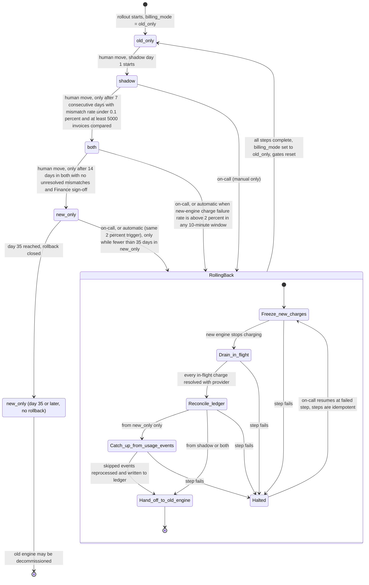

# Billing engine rollout: state machine

## Modes

- **old_only**: The old engine computes invoices, writes the ledger and charges. The new engine is off. Forward move to `shadow` is a human action.
- **shadow**: The old engine still charges and writes the ledger. The new engine reads the same usage events and writes invoices to the shadow store only. It never charges and never writes the ledger. A nightly job compares invoices per customer; a mismatch is any total differing by more than one cent. A day with a mismatch resets the 7-day streak. New-engine errors are recorded but never trigger rollback.
- **both**: The new engine charges and writes the ledger. The old engine keeps computing every invoice into the shadow store without charging, so rollback stays cheap. The comparison continues. Automatic rollback applies here.
- **new_only**: The new engine does everything and the old engine stops computing. Rollback is possible only while usage events from the start of `new_only` are still in the 35-day event log. From day 35 the path closes (`new_only_closed`).

## Rollback

Rollback can start from `shadow`, `both` or `new_only` and always ends in `old_only`. It skips modes, but it runs these steps in order:

1. **Freeze new charges.** The new engine stops charging. Due periods wait; none are dropped.
2. **Drain in-flight charges.** Each unknown provider outcome is resolved against the provider by idempotency key before any retry.
3. **Reconcile the ledger.** The ledger is the system of record. A customer-period already charged by either engine is marked settled, so the old engine cannot charge it again.
4. **Catch up (from `new_only` only).** The old engine reprocesses the usage events it skipped, within the 35-day retention, and writes those invoices to the ledger. Periods already charged by the new engine are not charged again.
5. **Hand off.** The old engine becomes the only charger, `billing_mode` is set to `old_only`, and all gates reset. The next forward path starts again at `shadow`, with the 7-day count at zero.

## Where rollout state lives

These locations are a proposal; the brief does not fix them.

- **`billing_mode`** lives in the config service. Only the rollout controller writes it, after a human action or an automatic rollback. Workers read it.
- **Gate records** (shadow streak, days in `both`, invoices compared, Finance sign-off, `new_only` entry time, rollback step) live in the rollout controller's own durable, versioned store. Changes to the flag and the gate record are made together.
- **Comparison results** live in the shadow store and the nightly comparison output.
- **Charges and invoices** live in the billing ledger, which is the system of record for "already charged" decisions.

## What happens when something fails

- **Config service unreadable:** Workers keep the last-known mode and retry. The mode does not change.
- **Nightly comparison fails or is incomplete:** That day does not count toward the 7-day or 14-day gates.
- **Mismatch in `shadow`:** The 7-day streak resets. Mismatches in `both` must be resolved before `new_only`.
- **Charge failure spike in `both` or `new_only`:** Automatic rollback starts. The 2 percent rate needs a minimum charge volume per window, or one failure in a quiet window can trigger it. See the open question below.
- **Rollback step fails:** Rollback halts. Charging stays paused for due periods until reconciliation passes. The mode does not change to `old_only` before reconciliation. On-call resumes at the failed step.
- **Provider timeout or unknown outcome:** Resolve it by idempotency key before any retry. Never re-send a charge on a guess.
- **Finance sign-off missing or withdrawn:** The rollout stays in `both`.
- **Day 35 in `new_only`:** Rollback is closed. The old engine may be decommissioned. No transition returns to `old_only`.

## Assumptions and open questions

- "5,000 invoices compared" is read as a cumulative count over the 7-day window, not per day.
- The 35-day clock for `new_only` starts at the moment `billing_mode` changes to `new_only`.
- The 2 percent trigger needs a minimum charge count per 10-minute window. The brief does not give one.
- "No unresolved mismatches" for `both` to `new_only` needs a definition of "resolved" (for example, the mismatch is explained and the ledger corrected).
- Manual rollback from `shadow` or `both` is assumed to remain available after day 35 of the rollout as a whole, since the 35-day limit only binds on the usage events needed to reprocess `new_only`.