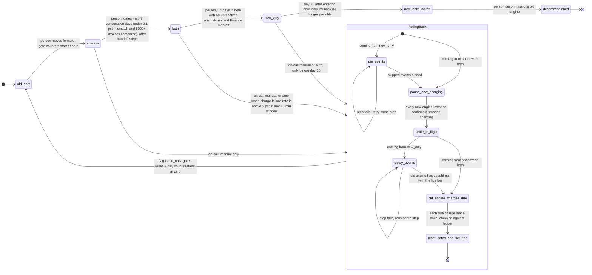

# Billing engine rollout: state machine

## Terms used below

| Term | Meaning | Status |
|---|---|---|
| Usage event log | The log of usage events. Both engines read it. Entries are kept 35 days. | Given |
| Billing ledger | The system of record for what was charged. | Given |
| Payment provider | The external service that charges customers. | Given |
| Shadow store | A separate store for non-authoritative invoices. In `shadow` it holds the new engine's invoices. In `both` it holds the old engine's. During a rollback replay it holds the old engine's replayed invoices. It never holds charges. | Given. Physical storage not decided. |
| Nightly comparison | A nightly job that compares the two engines' invoice totals per customer and saves one result row per customer per night. A mismatch is a total that differs by more than one cent. It runs only in `shadow` and `both`, because those are the only modes where both engines produce invoices. In `old_only` the new engine is off. In `new_only` the old engine has stopped computing, so the comparison stops at the move to `new_only`. | Given. Where results are saved is an assumption: a comparison results table, outside the ledger. |
| Person | A human operator who makes forward moves. | Given. How they make the move is an open question. |
| On-call | The human who may start a rollback by hand. | Given. |
| Controller | The software that holds the rollout procedure: it reports gate status, rejects forward-move commands whose gates are not met, runs the forward handoff and rollback steps and writes the flag. It never makes a forward move on its own. | Assumed. |
| Rollback record | A small record in the config service, next to the flag. It holds the current rollback step and the new-engine acknowledgements. While it exists, the new engine must not charge. It also tells the old engine what it may do during a rollback (see "Engine rules"). | Assumed. Needs confirmation. |
| Handoff record | A small record in the config service, next to the flag. It is written for the `shadow` to `both` move. It holds old-engine acknowledgements. While it exists, the old engine must not charge (except in the rollback charge-due run, see "Engine rules"). | Assumed. Needs confirmation. |
| Acknowledgement | An entry that one engine instance writes into the rollback record (new engine) or the handoff record (old engine), under its own instance id from the registry, once it has seen the record and stopped charging. The controller reads the record to see who has acknowledged. | Assumed. |
| Instance registry | A list in the config service where every engine instance registers itself and sends a regular heartbeat. The controller uses it to know whose acknowledgement to wait for. An instance is **live** if its latest heartbeat is newer than the heartbeat expiry. An instance that registered but has never sent a heartbeat is not live, so it is not waited for. An instance may charge only while its own heartbeats are succeeding (part of the lease). | Assumed. Does not exist today as far as we know. |
| Lease | A rule each engine instance follows: it may charge only if it has successfully read the flag and the records from the config service, and successfully sent a heartbeat, within the last lease period. If it cannot reach the config service, it stops charging by itself. The heartbeat expiry time must be longer than the lease period. | Assumed. Needs confirmation that engines can do this. |
| Charge key | Customer plus billing period. Sent to the payment provider as the idempotency key, so the provider refuses a second charge for the same key. This assumes one charge per customer per billing period, and that both engines use the same key. | Assumed. |

## Modes at a glance

| Mode | Old engine | New engine | Who charges | Who writes the ledger |
|---|---|---|---|---|
| `old_only` | computes, charges | off | old | old |
| `shadow` | computes, charges | computes into the shadow store from the same usage events | old | old |
| `both` | computes into the shadow store, no charging | computes, charges | new | new |
| `new_only` | stops computing | computes, charges | new | new |

- **`shadow`:** the nightly comparison runs. The new engine never charges and never writes the ledger.
- **`both`:** the old engine keeps its shadow-store invoices current, so rollback stays cheap. The nightly comparison continues. The new engine does not need anything from the old engine to do its work. The old engine's invoices exist only for the comparison and for rollback.
- **`new_only`:** the old engine skips usage events from here on, so the nightly comparison stops too. That is why a rollback from this mode needs a replay first.

## Engine rules

Each engine checks these itself, on every charge or every event. They are what the modes table means in practice, plus the rollback exceptions.

| Engine | May compute | May charge |
|---|---|---|
| New | `shadow`, `both`, `new_only`. Off in `old_only`. | Only if the flag is `both` or `new_only`, no rollback record exists, and its lease is valid. |
| Old | `old_only`, `shadow`, `both`. In `new_only` it does not compute, except once the rollback record has reached step 4 (replay): from then until the flag is `old_only` it computes every event, from the replay start and then live, into the shadow store. | Only if its lease is valid, no handoff record exists, and the flag is `old_only` or `shadow`. **Exception:** the charge-due run (rollback step 5) may charge although the flag still says `both` or `new_only`. It is started by the controller, and the old engine accepts it only while the rollback record is at step 5. |

## Diagram

Notes on the diagram:

- `RollingBack` is the rollback path. It can be entered only from `shadow`, `both` or `new_only`, and always ends in `old_only`.
- The controller writes the rollback record at the moment `RollingBack` is entered, before the first step. So the new engine is blocked from charging for the whole rollback, including the pin step. The `pause_new_charging` step is the step that waits until every instance has confirmed it.
- Every rollback step that fails is retried in place (see "What happens when something fails"). Only the pin and replay steps are drawn with a retry loop because they are the ones most likely to fail.
- `new_only_locked` is not a stored mode. It is `new_only` once 35 days have passed since the stored `new_only` entry time. The controller checks the clock when a rollback is requested. `billing_mode` still says `new_only`. The rollback edge is simply refused. A rollback that started before day 35 is allowed to finish.
- `decommissioned` is not a stored mode either. It is an action by a person, allowed only from day 35 on (`new_only_locked`). It retires the old engine's software. `billing_mode` stays `new_only` and the new engine's behaviour does not change. How decommissioning is done is outside this plan.
- The only exit from `old_only` is `shadow`, one step forward, made by a person.
- Forward moves: a person sends a move command to the controller. The controller computes whether the gates are met, from the stored data below, and rejects the command if they are not. It also rejects any forward move while a rollback record exists with a step other than "done".

## Forward moves

Only one forward move needs care about who charges.

- **`old_only` to `shadow`.** Nobody's charging changes. The controller writes the "gates reset at" timestamp (this is where the gate counters start at zero, including the first ever move), deletes the rollback record if one exists, then sets the flag.
- **`shadow` to `both`.** The charger changes from old to new, so the controller does a handoff first, with the same idea as the rollback pause:
  1. Check the gates, once, at the start. Reject if not met. They are not checked again during the handoff.
  2. Write the handoff record. The old engine must check before every charge that `billing_mode` allows it and that no handoff record exists.
  3. Wait until every live old-engine instance in the instance registry has written its acknowledgement into the handoff record. The controller re-reads the record and the registry repeatedly. It goes on only when the set of live old-engine instances is a subset of the set that has acknowledged. The same liveness rules as rollback step 2 apply: an old-engine instance that starts after the record exists checks the record first and needs no acknowledgement. An instance that is not live (its heartbeat expired, or it never sent one) is dropped from the wait, which is safe because of the lease. If a live instance has not acknowledged after a timeout, keep waiting and page on-call. The flag does not change.
  4. Settle in-flight old-engine charges. A charge that passed the old engine's check just before the handoff record appeared may still be in flight. Wait for every charge the old engine already sent to the payment provider to reach a known outcome. If an outcome is unknown, look it up at the provider by its charge key and do not resubmit it blindly. The step ends only when every charge the provider confirms has a row in the ledger. Here the old engine is the one that writes ledger rows, so a missing row (the old engine charged but crashed before writing the row) is expected to be written by the old engine's own recovery before moving on. That is an assumption, and it is the same open question as in rollback step 3 (see open questions). The new engine does not charge yet, so nothing else can add charges during this step.
  5. Write the `both` entry time, then set the flag to `both`. The new engine charges only when the flag says `both` and no rollback record exists.

  During the handoff the flag is still `shadow`, so both engines keep computing invoices and the nightly comparison keeps running as in `shadow`. Nobody charges between step 2 and step 5. The handoff record stays while the mode is `both`, so an old-engine worker with a stale cached `shadow` flag still cannot charge. Charges that fall due during the handoff are late, not lost: the new engine charges them in its normal run, after the same ledger check.

  **Cancelling a handoff.** A person sends a cancel command to the controller while the flag is still `shadow`. The controller deletes the handoff record. The flag stays `shadow`, and the old engine charges again, because nothing blocks it. The gates are checked afresh the next time a person tries the move. A handoff cannot be cancelled once the flag is `both`. After that, only a rollback undoes it.

  **A rollback beats a handoff.** If on-call starts a rollback while a handoff is unfinished (the flag is still `shadow`), the controller abandons the handoff and starts the rollback. The handoff record is left in place, so the old engine stays blocked until rollback step 5 deletes it and lets the old engine charge. The rollback steps then run as normal for `shadow`.

  **Rollback after a completed handoff.** If the rollback starts from `both`, the handoff record is still there, because it stays for the whole of `both`. Step 5 deletes it, the same as in the unfinished case.
- **`both` to `new_only`.** The same engine keeps charging. The controller writes the `new_only` entry time, then sets the flag. The old engine stops computing when it sees the flag.

## Rollback steps

A rollback is one durable procedure, and only one can run at a time. A manual start while one is running is a no-op. An automatic start does nothing if the rollout is already in `RollingBack`. The controller writes the rollback record when the rollback starts, before step 1, and updates its step after each step finishes. From that moment the new engine is blocked from charging. Charges that fall due while it is blocked are late, not lost (see step 5).

1. **Pin skipped events (from `new_only` only).** Pin the usage events that exist now, from the stored `new_only` entry time onward, so the 35-day retention cannot expire them. This comes first because the oldest skipped events expire on day 35, and later steps take time. Events that arrive after the pin need no pin: they are younger than the pinned ones, so they cannot expire before the rollback ends. It does not wait for any instance: the record already blocks new charging, and step 2 only confirms it. From `shadow` or `both`, skip this step, because the old engine is already current.
2. **Pause new charging (confirm the block).** The new engine must check, before every charge, that `billing_mode` allows it and that no rollback record exists. Each new-engine instance writes an acknowledgement into the rollback record, under its instance id, when it has seen the record and stopped. The controller waits until every new-engine instance in the instance registry that is live has acknowledged. It re-reads the record and the registry repeatedly. An instance that starts or restarts after the record exists checks the record before charging, so it starts blocked and needs no acknowledgement. An instance that is not live (its heartbeat expired, or it registered but never sent a heartbeat) is dropped from the wait. This is safe because of the lease: an instance that lost contact with the config service, or whose heartbeats fail, stops charging by itself within the lease period, and the heartbeat expiry is longer than the lease. So an instance that was dropped from the wait is no longer charging, even if it is still running. If a live instance has not acknowledged after a timeout, keep waiting and page on-call. Never go on without it. `billing_mode` is not changed yet. In `shadow` this step does nothing, because the new engine never charged.
3. **Settle in-flight charges.** A charge that passed the check just before the record appeared may still be in flight. Wait for every charge already sent to the payment provider to reach a known outcome. If an outcome is unknown, look it up at the provider by its charge key. Do not resubmit it blindly. The step ends only when every charge the provider confirms has a row in the ledger. If the provider confirms a charge but the ledger has no row (the new engine sent it but did not write the row), the missing row is written before moving on. Who writes it is an open question. The charge key at the provider is the backstop if step 5 ever runs before the row exists.
4. **Replay (from `new_only` only).** The controller sets the rollback record to step 4. From then on the old engine computes again (see "Engine rules"): first it reprocesses the pinned events, from the `new_only` entry time up to the current end of the usage event log, then it keeps processing new events as they arrive. Usage events keep arriving during steps 1 to 3, and the old engine does not touch those until step 4 starts, so replay must catch up with them. The step ends when the old engine reports it has caught up with the live end of the log. Its invoices go to the shadow store. Replay is safe to overlap with events the old engine already handled just after entry: an invoice is keyed by customer and billing period, and a replayed invoice overwrites the earlier one. A failure retries the same step and does not move forward. From `shadow` or `both` this step is skipped, because the old engine never stopped computing.
5. **Old engine charges what is due.** First delete the handoff record, if one exists, so the old engine may charge. Then the controller sets the rollback record to step 5 and starts one batch run of the old engine, called the charge-due run, and waits for it to finish. The flag still says `both` or `new_only`, but the old engine accepts this run because the rollback record is at step 5 (see "Engine rules"); that is the only way it may charge before the flag changes. A crashed run is restarted and is safe to repeat. The run finds the due work itself. Due means: every customer and billing period that is closed (its billing period has ended, as the old engine already defines this) and has a finished old-engine invoice (one computed in full for that period, in the shadow store), and has no charge in the ledger. This includes periods that fell due during the pause or during `new_only`. The old engine charges from its own invoice in the shadow store. If there is none for a closed period, it computes one from the usage events first. For each period, check the ledger first. If the new engine already charged that period, the old engine does not charge it. If no charge exists, the old engine charges once, using the charge key.
6. **Reset gates and set the flag to `old_only`.** In this order: write the "gates reset at" timestamp (this restarts the mismatch history, the 7-day count and the 14-day `both` clock), clear the stored `new_only` and `both` entry times, then set the flag. Workers see `old_only` only after the ledger is consistent. Then the controller releases the pins (it removes the pin it placed in step 1 on the usage event log) and marks the rollback record "done". Every action in this step is safe to repeat, so if the controller crashes anywhere in it, including after the flag is set but before "done", it resumes from the stored step and runs the whole step again. Until the record says "done", forward moves are rejected, so a crash cannot leave a half-reset rollout moving forward. The record is not deleted yet: it stays, and the new engine stays blocked, until a person moves `old_only` to `shadow`. That move deletes it. A person must go through `shadow` again.

   **What happens after the flag says `old_only`.** Nothing needs to start the old engine: it has been computing since step 4 (or never stopped, from `shadow` or `both`). Once an old-engine worker re-reads the flag and sees `old_only`, the normal rule in "Engine rules" lets it charge, so it resumes its ordinary runs. It carries on from the position it already holds in the usage event log, which is the live end after replay. Each ordinary run charges closed periods that have no ledger row, with the same ledger check and charge key. The new engine is off in `old_only`. How fast workers see the flag is unknown (see open questions).

Why this meets both rules:

- **No double charge.** Only one engine charges at any moment: the old engine until the handoff (or the new engine, after it), nobody during the pause and replay, then the old engine in step 5. Forward and backward switches both use a record that must be acknowledged before the flag changes, so a slow-reading worker cannot overlap with the other engine. The lease stops an instance that lost contact. The ledger check and the charge key cover retries and unknown outcomes. Because the rollback record outlives the flag change, a worker with a stale cached flag cannot make the new engine charge again.
- **No dropped charge.** Charges that fall due during a pause are not skipped. Rollback step 5 picks up those already due. Any that fall due after step 5 and before the flag changes are charged by the old engine's normal run once the flag says `old_only`, with the same ledger check. They are late but not lost. The same holds for the forward handoff.

## Where the rollout state lives

- **`billing_mode`** is one global flag in the config service. It is the only source of truth for the mode. Workers and both engines read it. How often they re-read it, and so how fast a change reaches them, is not known (see open questions). Neither the handoff nor the rollback relies on a fast flip: each stops the engine with a record and the engines' acknowledgements before the flag changes.
- **Rollback record and handoff record.** Both sit next to the flag in the config service. The rollback record holds the current step and the new-engine acknowledgements. It is created when a rollback starts, marked "done" in step 6 and deleted when a person moves to `shadow`. The handoff record holds old-engine acknowledgements, is created at the start of a `shadow` to `both` move and is deleted in rollback step 5 (or when a person cancels the handoff). Acknowledgements are keyed by instance id, so the controller compares them with the live instances in the registry. These are additions to the rules you gave, so please confirm them.
- **Instance registry.** Each engine instance registers and sends a heartbeat. This is also an addition and needs confirmation.
- **Gate counters** are not stored separately. The controller computes them from the nightly comparison results, from an explicit "gates reset at" timestamp. The timestamp is written when a person moves `old_only` to `shadow` (the first move too) and again in rollback step 6. A night with a failed or missing comparison counts as a failing day, so it restarts the 7-day count. The controller reads them each time a forward-move command or a gate-status request arrives. No other part writes the timestamp.
- **`both` and `new_only` entry times** are stored the same way, written by the controller before it sets the flag. The `new_only` entry time makes the day-35 limit checkable, and day 35 counts from it. Writing it before the flag means it is never later than the first event the old engine skips, and it may be a little earlier than the flag change. That is safe: it makes the day-35 limit slightly stricter and only makes replay start slightly early, and replay overlap is harmless (see step 4).
- **The ledger** is the system of record for what was charged. **The shadow store** holds the non-authoritative invoices from whichever engine is not charging.

## What happens when something fails

| Failure | Mode | Response |
|---|---|---|
| New-engine errors | `shadow` | Record only. No rollback. |
| Charge failure rate above 2% over any 10-minute window | `both`, `new_only` | Automatic rollback. |
| On-call decides to roll back | `shadow`, `both`, `new_only` (before day 35) | Manual rollback, same procedure. If a `shadow` to `both` handoff is unfinished, the rollback wins and the handoff is abandoned. |
| Nightly comparison fails or is missing | `shadow`, `both` | That night counts as a failing day. The 7-day count restarts. Alert a person. |
| Mismatch rate too high, or fewer than 5,000 invoices compared | `shadow` | The 7-day count restarts. No forward move. |
| Unresolved mismatch, or no Finance sign-off | `both` | Cannot move to `new_only`. |
| A live old-engine instance never acknowledges the handoff | forward move `shadow` to `both` | Keep waiting and page on-call. The flag stays `shadow`, so the old engine keeps its role once the handoff is cancelled. Until then nobody charges. |
| An instance is in the registry but never sends a heartbeat | any wait for acknowledgements | It is not live, so it is not waited for. By the lease it may not charge without successful heartbeats. Alert on-call so the stale registry entry is looked at. |
| Controller crash mid-handoff | forward move `shadow` to `both` | Resume from the handoff record. If the flag is not yet `both`, the old engine stays blocked and nobody charges until the move finishes or a person cancels it. Cancelling deletes the handoff record. |
| A rollback step fails | during `RollingBack` | Retry that step. Stay in `RollingBack`. New charging stays paused. Do not set the flag until the ledger is consistent. Page on-call if retries keep failing. |
| A new-engine instance never acknowledges the pause | during `RollingBack`, step 2 | Keep waiting and page on-call. Do not go on to step 3. |
| An instance loses contact with the config service (for example a network partition) | any | By the lease it stops charging on its own. After its heartbeat expires the controller stops waiting for it. When contact returns it reads the records before charging again. |
| Pin fails, or pinned events have already expired | during `RollingBack`, step 1 | Retry. If events are already gone, the replay cannot be complete. This is not decided (see open questions). |
| Old engine cannot catch up with the live log | during `RollingBack`, step 4 | Retry that step. Do not go on to step 5 until it has caught up. |
| Controller crash mid-rollback | during `RollingBack` | Resume from the stored step. Each step is safe to repeat. |
| Config service unavailable | any | Not decided (see open questions). Instances stop charging after their lease runs out. |
| Failure rate above 2% on day 35 or later | `new_only_locked` | No rollback exists. Treat as an incident and fix forward. |

## Open questions

- **How a person moves forward, cancels a handoff or decommissions.** Command, UI or config edit is not specified. I assumed a command to the controller. A person who edits the flag directly in the config service would bypass the controller's gate check and the handoff. Whether that is prevented is not known.
- **Who is on-call, and how they start a rollback.** Not specified. Assumed a command to the controller.
- **Charge failure rate.** I assumed failed charges divided by attempted charges, measured by the controller over a rolling 10-minute window. Where the controller gets the counts (provider responses, the ledger or engine metrics) is not known. What counts as a failure (declines versus provider errors) and any minimum volume before the rule applies are not defined.
- **Timeouts and retry limits.** The acknowledgement timeout, how many step retries trigger a page, and any retry back-off are not specified. The plan only says to keep waiting or retrying and to page on-call.
- **Mismatch rate and invoice count.** I assumed the rate for a night is mismatched invoices divided by invoices compared that night, each of the 7 nights must be under 0.1%, and the 5,000 is the total compared across the 7 nights. The brief does not say whether 5,000 is per night or in total.
- **Config service unavailable.** The flag, the records and the instance registry all live there. If it is down when an automatic rollback fires, the controller cannot record the pause or flip the flag. With the lease, instances stop charging after the lease runs out, so nobody charges, but what the system should do beyond that is not decided.
- **How workers read the flag, the instance registry and the lease.** Caching and refresh interval are unknown. The handoff and step 2 need each engine instance to register, send a heartbeat, write an acknowledgement and enforce the lease. Whether the engines can do this is unknown, and so are the lease and heartbeat lengths.
- **Engine changes for the rollback exception.** "Engine rules" needs the old engine to accept a controller-started charge-due run while the flag still says `both` or `new_only`, and to resume computing once the rollback record reaches step 4. Whether the old engine can be changed this way is unknown. Without it, the plan has no way to charge before the flag changes.
- **Who fills a missing ledger row when settling in-flight charges.** This applies to rollback step 3 (a charge by the new engine) and to handoff step 4 (a charge by the old engine). When the provider confirms a charge the ledger does not show, I do not know whether the controller, the charging engine's own recovery routine or something else should write the row. In rollback step 3 the new engine owns ledger writes in `both` and `new_only`. In handoff step 4 I assumed the old engine's own recovery does it.
- **Ledger format.** I assume the old engine can read charges the new engine wrote, keyed by customer and billing period, and that both engines use the same charge key. This is unverified.
- **One charge per customer per period.** The brief says never charge twice "for a billing period", so I assume one charge per customer per period, and a period is charged whole by whichever engine is charging when it is due. If there are legitimate extra charges in a period (for example usage top-ups), the charge key would block them and would need another part. Not known. How the old engine decides a billing period is closed is also not known.
- **Charging from the shadow store.** In step 5 the old engine charges from its own invoice in the shadow store, which is non-authoritative. Whether that is acceptable, or whether it must always recompute, is not decided.
- **Shadow store and comparison storage.** Physical form is not decided.
- **Finance sign-off and "unresolved mismatch".** How sign-off is recorded, and who resolves a mismatch and how, are not specified.
- **14-day "no unresolved mismatches" in `both`.** I read this as 14 days elapsed in `both` with zero unresolved mismatches at that point. If any new mismatch should restart the 14-day clock, say so, because that changes the controller.
- **Pinning and replay.** I do not know whether the usage event log supports pinning or releasing a pin, or how it is done. I also do not know how the old engine identifies "events since `new_only` began" beyond using the stored entry time, or how it tells the controller it has caught up with the live end. If a rollback starts shortly before day 35 and the pin fails, events may expire and the replay would be incomplete. What to do then is not decided.
- **A rollback from `shadow`.** I treated this as the same procedure with steps 1, 4 and the replay doing nothing. The old engine already charges, so no ledger work is needed beyond settling its in-flight charges.
