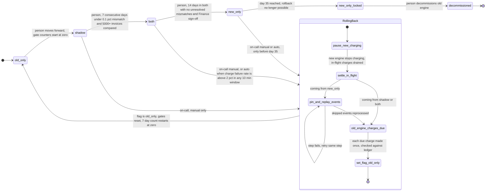

# Billing engine rollout: state machine

## Modes at a glance

| Mode | Old engine | New engine | Who charges | Who writes the ledger |
|---|---|---|---|---|
| `old_only` | computes, charges | off | old | old |
| `shadow` | computes, charges | computes into the shadow store from the same usage events | old | old |
| `both` | computes into the shadow store, no charging | computes, charges | new | new |
| `new_only` | stops computing | computes, charges | new | new |

- **`shadow`:** a nightly job compares the two engines' invoices per customer. A mismatch is a total that differs by more than one cent. The new engine never charges and never writes the ledger.
- **`both`:** the old engine keeps its shadow-store invoices current, so rollback stays cheap. The nightly comparison continues.
- **`new_only`:** the old engine skips usage events from here on. That is why a rollback from this mode needs a replay first.

## Diagram

Short state names in the diagram:

- `RollingBack` is the rollback path. It can be entered only from `shadow`, `both` or `new_only`, and always ends in `old_only`.
- `new_only_locked` is `new_only` from day 35 onward. The system does not change state, but the rollback edge is gone.
- The only exit from `old_only` is `shadow`, one step forward, made by a person.

## Rollback steps

A rollback is one durable procedure, and only one can run at a time. A manual start while one is running is a no-op. An automatic start does nothing if the rollout is already in `RollingBack`. Forward moves are blocked while it runs.

1. **Pause new charging.** The new engine stops submitting charges. Nothing is flipped yet. In `shadow` this step does nothing, because the new engine never charged.
2. **Settle in-flight charges.** Wait for every charge already sent to the payment provider to reach a known outcome. If an outcome is unknown, look it up at the provider by its idempotency key. Do not resubmit it blindly.
3. **Pin and replay (from `new_only` only).**
   1. Pin the usage events the old engine skipped since `new_only` began, so the 35-day log retention cannot expire them mid-replay.
   2. The old engine reprocesses them and writes its invoices.
   3. A failure in this step retries the same step and does not move forward.
   4. From `shadow` or `both`, skip this step, because the old engine is already current.
4. **Old engine charges what is due.** For each customer and billing period, check the ledger first. If the new engine already charged that period, the old engine does not charge it. If no charge exists, the old engine charges once. The charge key is customer plus billing period, and it is sent to the provider as the idempotency key.
5. **Set the flag to `old_only`.** This is the last step. Workers see `old_only` only after the ledger is consistent.
6. **Reset the gates.** The mismatch history, the 7-day count and the 14-day `both` clock all start over. A person must move through `shadow` again.

Why this meets both rules:

- **No double charge.** Only one engine charges at any moment: the new engine until step 1, nobody during steps 1 to 3, then the old engine. The ledger check and the idempotency key cover retries and unknown outcomes.
- **No dropped charge.** Charges that fall due during the pause are not skipped. Step 4 picks them up, so they are late but not lost.

## Where the rollout state lives

- **`billing_mode`** is one global flag in the config service. It is the only source of truth for the mode.
- **Rollback progress** needs its own durable record, so a crashed controller can resume at the right step. I assume it sits next to the flag in the config service, and that it is cleared when the flag reaches `old_only`. This is an addition to the rules you gave, so please confirm it.
- **Gate counters** are not stored separately. They are computed from the nightly comparison results, from an explicit "gates reset at" timestamp written in step 6. The `new_only` entry time is stored the same way, so the day-35 limit is checkable.
- **The ledger** is the system of record for what was charged. **The shadow store** holds the non-authoritative invoices from whichever engine is not charging.

## What happens when something fails

| Failure | Mode | Response |
|---|---|---|
| New-engine errors | `shadow` | Record only. No rollback. |
| Charge failure rate above 2% over any 10-minute window | `both`, `new_only` | Automatic rollback. |
| On-call decides to roll back | `shadow`, `both`, `new_only` (before day 35) | Manual rollback, same procedure. |
| Mismatch rate too high, or fewer than 5,000 invoices compared | `shadow` | The 7-day count restarts. No forward move. |
| Unresolved mismatch, or no Finance sign-off | `both` | Cannot move to `new_only`. |
| A rollback step fails | during `RollingBack` | Retry that step. Stay in `RollingBack`. New charging stays paused. Do not set the flag until the ledger is consistent. Page on-call if retries keep failing. |
| Controller crash mid-rollback | during `RollingBack` | Resume from the stored step. Each step is safe to repeat. |
| Failure rate above 2% on day 35 or later | `new_only_locked` | No rollback exists. Treat as an incident and fix forward. |

## Open questions

- **Forward-move triggers.** The brief says a person makes every forward move. I assumed the controller only reports whether the gates are met and never moves on its own.
- **14-day "no unresolved mismatches" in `both`.** I read this as 14 days elapsed in `both` with zero unresolved mismatches at that point. If any new mismatch should restart the 14-day clock, say so, because that changes the controller.
- **Replay and retention.** A rollback that starts close to day 35 could lose events as they age out. Pinning the events at rollback start prevents this, and I assume it is allowed. Without pinning, the safe rollback window would be shorter than 35 days.
- **A rollback from `shadow`.** I treated this as the same procedure with steps 1 to 3 doing nothing. The old engine already charges, so no ledger work is needed.
