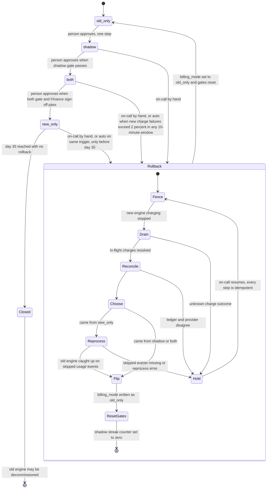

# Billing engine rollout: state machine

## Diagram

## What each mode does

| Mode | Charges customers | Writes ledger | Old engine | New engine | Comparison |
|---|---|---|---|---|---|
| `old_only` | Old | Old | Computes and charges | Off | None |
| `shadow` | Old | Old | Computes and charges | Reads same usage events, writes invoices to shadow store, never charges | Nightly, per customer |
| `both` | New | New | Computes every invoice into shadow store, never charges | Charges and writes ledger | Nightly, continues |
| `new_only` | New | New | Stopped on entry to this mode | Charges and writes ledger | None, old engine is off |

Notes on the modes:

- The shadow store holds the output of whichever engine is not charging. In `shadow` that is the new engine. In `both` that is the old engine. Rows should carry engine and mode tags so the two uses cannot be confused.
- Forward moves are one step each and always made by a person. The gate checks are preconditions the controller displays. They never move the mode by themselves.
- Rollback is the only transition a machine may start on its own, and it always ends in `old_only`.
- Every rollback resets the gates. The rollout then returns to `shadow` and the 7-day count starts again from zero.

## Where rollout state lives

- **`billing_mode`** is the single global value in the config service. Engines only read it. Only the rollout controller or on-call writes it.
- **Gate state** (the consecutive-day streak, invoice counts, the 14-day count in `both`, Finance sign-off, the `new_only` entry timestamp, and rollback progress) is not specified in the brief. Proposed: a versioned rollout record next to the flag. The flag and the record change together under compare-and-set, so a mode can never change without its gate state.
- **Charges and invoices of record** live in the billing ledger. It is the system of record for what was charged. Each charge carries an idempotency key that is checked before every charge.
- **Non-charging output** lives in the shadow store.
- **Nightly comparison results** are one row per day per customer set, in their own store, so the streak can be recomputed.
- **Usage events** live in the usage event log, which keeps 35 days. This retention is the hard clock on any return from `new_only`.

## What happens when something fails

- **Config service unreachable or flag unreadable.** No engine charges without a confirmed mode. Charging waits and the failure is paged. Engines do not guess a mode, since guessing could start two chargers.
- **Nightly comparison job fails or does not run.** That day is not counted. The streak resets, so no gate can pass on missing evidence.
- **New engine errors in `shadow`.** Recorded and counted as mismatches where totals differ. They never trigger rollback.
- **New charge failure rate above 2 percent in any 10-minute window, in `both` or `new_only`.** Auto-rollback starts at Fence.
- **Charge with unknown outcome (timeout, no response) in `both` or `new_only`.** The charge is looked up at the provider by idempotency key. It is never retried under a new key. Until it is resolved, the period is not handed to the old engine, and the rollback holds at Drain.
- **Reconcile finds ledger and provider disagree.** Hold. The ledger wins for what was charged, and the difference is resolved before any flip.
- **Reprocess finds skipped usage events already past the 35-day retention, or errors.** Hold and escalate. The flag is not flipped silently. See open question 1.
- **Rollback process crashes at any step.** Steps are idempotent. The rollout record holds the last completed step, and on-call re-runs from Fence.
- **`both` to `new_only` blocked by unresolved mismatches or missing Finance sign-off.** The gate stays shut. Nothing else changes.
- **Day 35 in `new_only`.** The rollback window closes. Decommissioning the old engine is a separate action that the brief permits but does not require.

## Rollback steps

1. **Fence.** Stop the new engine from starting any charge. Nothing else changes yet.
2. **Drain.** Wait for in-flight new-engine charges to succeed, fail or be resolved as unknown.
3. **Reconcile.** For every billing period, check the ledger against the provider. Any due, unbilled invoice is identified so the old engine picks it up after the flip. Nothing is charged twice and nothing is dropped.
4. **Reprocess** (only when starting from `new_only`). The old engine recomputes the usage events it skipped and writes the results to the ledger path it will charge from. These results must be complete before the flip.
5. **Flip.** Write `billing_mode` as `old_only`. The old engine now charges any period that is due and not yet recorded in the ledger.
6. **Reset gates.** Set the streak counter, invoice counts and sign-off to their starting values.

## Invariants

- At most one engine can charge a given billing period at a time, and every charge is checked against the ledger and its idempotency key.
- The flag is never flipped while any charge is in an unknown state.
- The flip happens only after Fence and Drain.
- Every rollback is recorded, and nothing is silent.

## Open questions to settle before the controller is written

1. **Rollback from `new_only` versus the 35-day limit.** The brief says rollback must not drop a due charge, but from day 35 the skipped events are gone. The reprocess must finish inside the window, so a rollback deadline earlier than day 35 is needed. What happens if a rollback starts late and the events have already expired is undecided.
2. **Invoice threshold for `shadow` to `both`.** Is the 5,000-invoice minimum counted per day, or summed over the 7-day streak? This draft assumes the sum.
3. **Streak reset rule.** This draft assumes any day at or above 0.1 percent, or a missing comparison day, resets the streak to zero.
4. **Auto-rollback window.** Is there a minimum number of charge attempts in a window before the 2 percent rule applies? Without one, a single failed charge in a quiet 10 minutes reads as 100 percent. Do unknown-outcome charges count as failures?
5. **Start of the 35-day clock.** This draft assumes the clock starts when the mode becomes `new_only`.
6. **Charge ownership.** The brief does not say which engine owns a billing period when the mode changes. This draft assumes ownership is recorded per period in the ledger and changes only at a flip, with no period in flight.
7. **Where the rollout record lives.** The brief does not say. This draft proposes the config service, versioned alongside `billing_mode`.