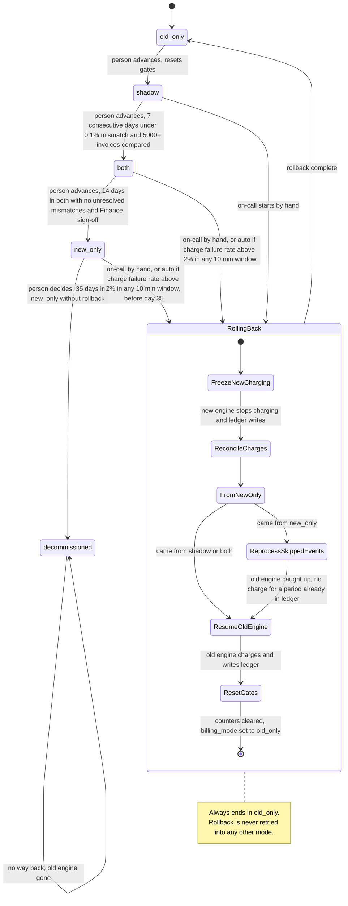

# Billing engine rollout: state machine

## Diagram

## What each mode does

| Mode | Old engine | New engine | Comparison |
|---|---|---|---|
| `old_only` | Computes invoices, writes the ledger, charges | Off | None |
| `shadow` | Computes invoices, writes the ledger, charges | Reads the same usage events and writes to the shadow store. Never charges and never writes the ledger. | Nightly per customer. A mismatch is a total that differs by more than 1 cent. |
| `both` | Computes every invoice into the shadow store, so it stays current. Never charges. | Charges and writes the ledger | Continues |
| `new_only` | Stops computing | Does everything | None |
| `RollingBack` | Taken over by the old engine again (see below) | Frozen | Paused |
| `decommissioned` | Gone | Does everything | None |

Rules for moving between modes:

- Forward moves are made by a person, one step at a time, with no skipping. Nothing advances automatically.
- Each gate is a precondition. Meeting it never triggers the move.
- A day with a mismatch rate of 0.1% or more resets the consecutive-day count for `shadow` -> `both`.
- The 14-day clock for `both` -> `new_only` starts on entry to `both`. It also needs no unresolved mismatches and Finance sign-off.
- `decommissioned` is not a rollout mode. It marks the point where the old engine is removed and rollback becomes impossible.

## Rollback steps

Rollback can start from `shadow`, `both` or `new_only`, and it always ends in `old_only`.

1. **FreezeNewCharging.** The new engine stops charging and writing the ledger immediately. This comes first so two engines never charge at once.
2. **ReconcileCharges.** Settle every charge attempt the new engine left in flight against the payment provider and the ledger. Ambiguous attempts, such as a timeout with no confirmation, are resolved by looking them up at the provider, not by retrying blindly. A charge due but not made stays pending for the old engine to pick up.
3. **ReprocessSkippedEvents.** This step runs only when rolling back from `new_only`. The old engine reads the usage events it skipped, computes those invoices, and skips any customer-period already in the ledger.
4. **ResumeOldEngine.** The old engine charges and writes the ledger again.
5. **ResetGates.** Clear the 7-day count, the mismatch history and the 14-day clock. Set `billing_mode` to `old_only`.

From `shadow` there is nothing to reconcile, because the new engine never charged. Steps 1, 2 and 3 are then trivial. From `both` there is no reprocessing, because the old engine kept computing into the shadow store.

After `old_only`, a person must advance to `shadow` again and the 7-day count starts at zero.

## Where the state lives

- **The mode** is the `billing_mode` flag in the config service. There is one global flag with four values.
- **Rollout bookkeeping** needs a durable record next to the flag. It holds the current mode, when it was entered, the consecutive-day count, the unresolved-mismatch count, the Finance sign-off, the rollback step and why the rollback started. The four-value flag cannot say "rollback in step 2". Without the record, a controller restart in mid-rollback would not know where it was. The controller reads this record on every start and resumes from the recorded step.
- **The "never charge twice" guard** lives in the billing ledger, the system of record, and not in either engine. Each charge is keyed by customer and billing period, and the key is unique. Both engines check and write it before charging, so a duplicate attempt fails. The same key lets the old engine skip periods the new engine already charged.
- **Shadow invoices** live in the separate shadow store. Nothing there is authoritative.
- **Usage events** are in the usage event log, kept 35 days. Rollback from `new_only` depends on it still holding the events the old engine skipped.

## What happens when something fails

| Failure | Response |
|---|---|
| New-engine errors in `shadow` | Record them. Never roll back. They count toward the comparison, so missing invoices show up as mismatches. |
| Charge failure rate above 2% over any 10-minute window in `both` or `new_only` | Start rollback automatically and page on-call. |
| Nightly comparison job fails or has no data | The day does not count toward the gate. The consecutive count is not advanced. |
| Mismatch in `both` | It blocks `both` -> `new_only` until resolved. It does not roll back by itself. |
| Worker or controller crashes during rollback | Resume from the recorded step. Each step must be safe to repeat. The ledger key prevents a second charge. |
| Payment provider outcome unknown during `ReconcileCharges` | Look it up at the provider. Do not resume the old engine for that customer-period until it is known. |
| Rollback from `new_only` cannot catch up before events expire | Keep the new engine charging, escalate to a person, and do not leave charges undone. The window is at most 35 days, so this is only possible near the limit. |
| Auto-trigger fires on day 35 or later in `new_only` | There is no way back. Alert on-call and fix forward in the new engine. |
| Manual rollback requested on day 35 or later | Refuse it. The old engine may already be decommissioned. |

## Assumptions to confirm

- **Freeze mechanism.** I assumed a charging-freeze signal that both engines honor, separate from `billing_mode`. This is needed because the flag only flips to `old_only` at the end of the rollback, and the new engine must stop charging at the start.
- **Day 35.** The brief says the old engine may be decommissioned after 35 days in `new_only` and that from day 35 there is no way back. I treated rollback as allowed through day 34 and refused from day 35. The usage-event retention matches that boundary. Decommissioning, once done, is deliberate and manual.
- **Rollback during rollback.** A second trigger, such as an automatic alarm while a manual rollback is running, is ignored. The state is already `RollingBack`.
- **Unresolved mismatches in `both`.** I treated these as blocking only. The brief makes the charge failure rate the only automatic rollback trigger.
