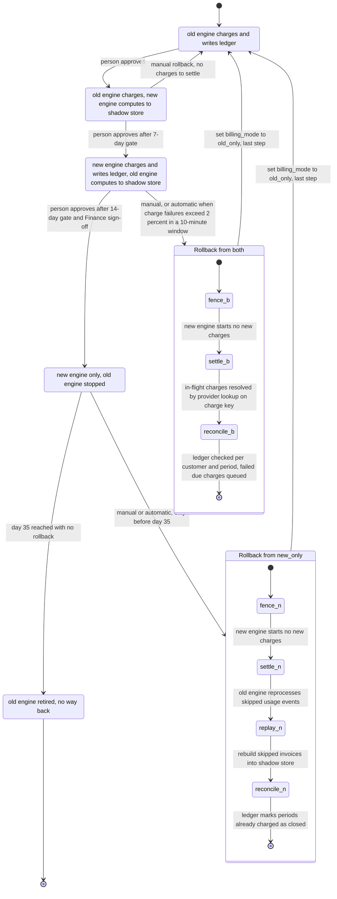

# Billing engine rollout: state machine

## Overview

We are replacing the old billing engine with a new one. The old engine is the current code that computes invoices and charges customers. The new engine is its replacement.

One config flag, `billing_mode`, says which engine is allowed to charge customers. The rollout moves through four modes in a fixed order. A person approves every forward move. At any point the rollout can return to the old engine.

Two rules hold at every step:

- **No customer is charged twice for a billing period.**
- **No charge that is due is dropped.**

## Terms used below

- **Billing period.** The span of time one invoice covers, for one customer.
- **Invoice.** The amount a customer owes for one billing period, as computed by one engine.
- **Usage event log.** The record of what customers used. Both engines read it. Each event is kept for 35 days and then deleted.
- **Ledger.** The system of record. It holds one entry per customer and billing period.
- **Payment provider.** The outside service that actually takes the money.
- **Charge key.** The unique ID of a ledger entry. It is also sent to the payment provider as its idempotency key, so the provider treats repeated requests with the same key as one charge.
- **Shadow store.** Separate storage for invoices from an engine that is not charging. It never touches the ledger.
- **Gate.** A condition that must be met before the next forward move.
- **Fence.** A rollback step that stops the new engine from starting any new charges.
- **Settle.** Resolve each charge that was in flight when the fence went up. Each one is looked up at the payment provider by its charge key.
- **Reconciliation.** Checking the ledger and the payment provider so that every due charge is either already charged once or queued for the old engine.

## Diagram

How to read the diagram: the arrows between the four modes are moves of the rollout. Forward moves need a person's approval. The arrows into `old_only` from the rollback boxes are the way back. The two "Rollback" boxes are sequences of steps that the controller runs. They are not values of `billing_mode`. The flag keeps its previous value until the last step sets it to `old_only`. That means it still says `both` or `new_only` while the fence is up.

## What each mode does

- **old_only.** The old engine reads usage events, computes invoices, writes the ledger and charges customers. The new engine is off.
- **shadow.** The old engine still charges and writes the ledger. The new engine reads the same usage events and writes its invoices to the shadow store. It never charges and never writes the ledger. A nightly job compares the two engines' invoices for each customer. A mismatch is any invoice total that differs by more than one cent. New-engine errors in this mode are recorded, but they never trigger a rollback.
- **both.** The new engine charges and writes the ledger. The old engine keeps computing every invoice into the shadow store. It does not charge and does not write the ledger. This keeps its results current in case of rollback. The nightly comparison continues.
- **new_only.** The old engine stops computing. Usage events it skips stay in the 35-day log. The 35-day clock starts when the rollout enters `new_only`.

### Rollback steps

Rollback can start from `shadow`, `both` or `new_only`. It always ends in `old_only`.

- **From shadow.** Set `billing_mode` to `old_only`. Nothing needs settling, because the new engine never charged anyone.
- **From both.**
  1. **Fence.** The new engine starts no new charges.
  2. **Settle.** Resolve each in-flight charge by looking up its charge key at the payment provider.
  3. **Reconcile.** Check the ledger for each customer and billing period. Queue failed due charges for the old engine.
  4. **Set the flag.** Set `billing_mode` to `old_only`. This is the last step.

  No reprocessing is needed, because the old engine's shadow invoices are already current.
- **From new_only.**
  1. **Fence.** The new engine starts no new charges.
  2. **Settle.** Resolve in-flight charges, as above.
  3. **Replay.** The old engine reprocesses the usage events it skipped, and rebuilds those invoices in the shadow store.
  4. **Reconcile.** Mark periods that the new engine already charged as closed, so the old engine does not charge them again.
  5. **Set the flag.** Set `billing_mode` to `old_only`. This is the last step.

  This rollback must start and finish well before day 35 (see the safety rules below).

## Gates

- **shadow to both.** Seven consecutive days. Each day needs a mismatch rate under 0.1 percent and at least 5,000 invoices compared (see open points). A day that fails resets the streak. A day that cannot be checked, such as a failed comparison job or a gap in the usage log, does not count as clean, and it does not advance the streak.
- **both to new_only.** 14 days in `both` with no unresolved mismatches, plus Finance sign-off, plus a person's approval.
- **Forward moves.** One step at a time, in order. The controller proposes a move. A person makes it.
- **After any rollback.** All gates reset to zero. The rollout returns to `shadow`, and the 7-day count starts again.

## Where the rollout state lives

- **`billing_mode` in the config service.** The only mode switch that workers read. Only the controller writes it, and only after approval.
- **Rollout record (proposed).** Durable storage next to the ledger, not in worker memory. It holds:
  - the gate day counters,
  - approvals and Finance sign-off,
  - the time the rollout entered `new_only`, which starts the 35-day clock,
  - the current rollback step and the fence flag,
  - the reconciliation queue.
- **Ledger (system of record).** One entry per customer and billing period. Each entry's charge key is also the payment provider's idempotency key. The no-double-charge guarantee rests on this key, not on the mode.
- **Shadow store.** Invoices from the engine that is not charging. It is kept separate from the ledger.

## Charging and rollback safety rules

- Before any charge, an engine checks the ledger for the charge key. If an entry exists, it skips the charge. If there is no entry and the charge is due, it charges once.
- A charge that the provider confirms as failed stays due. On rollback, it goes to the old engine's queue. It is never dropped.
- A charge with an unknown outcome (a timeout or a lost response) is looked up at the provider by its charge key before any retry.
- Rollback from `both` needs no reprocessing, because the old engine's shadow invoices are current.
- Rollback from `new_only` must reprocess the skipped events before the old engine charges anything. Each event expires from the log 35 days after it was created. A skipped event is always created after the rollout entered `new_only`, so no skipped event expires before day 35 counted from that entry. The replay must start and finish well before that point.
- In `both` or `new_only`, the fence comes first and stops new charges. The flag changes to `old_only` only after reconciliation completes.

## What happens when something fails

- **New-engine charge failure rate above 2 percent in any 10-minute window (`both` or `new_only`).** Automatic rollback starts. Further triggers are ignored while a rollback is running.
- **Nightly comparison job fails, or the usage log has a gap.** The day does not count as clean. The streak does not advance, and an alert fires. This alone does not trigger a rollback.
- **Config service unreachable.** Workers keep the last mode they read, and they start no new charges until they can read the flag again. The controller makes no transitions.
- **Reconciliation finds a difference on a period the new engine already charged.** The ledger wins. Nothing is charged again. The difference is logged for Finance. It does not block rollback, because blocking would leave due charges unpaid.
- **Reconciliation cannot compute a due invoice.** That customer is held. No charge is made from a guessed invoice, and on-call is paged.
- **Rollback stops partway.** The fence stays up, the flag stays unchanged, and due charges wait in the queue. Rollback resumes from its last recorded step. The flag is never set to `old_only` before reconciliation completes.
- **Day 35 in `new_only` with no rollback.** The rollback path closes. The old engine may be retired.

## Open points

- Is the 5,000-invoice minimum for the whole 7-day window, or for each day?
- Does an unresolved mismatch found during the 14 days restart the count, or does it only block promotion on the day it is found?
- When a day cannot count as clean (failed comparison job, usage log gap), does the streak pause or reset?
- How much margin before day 35 must a `new_only` rollback start? The limit is fixed at 35 days, but the replay must finish before the oldest skipped event expires.