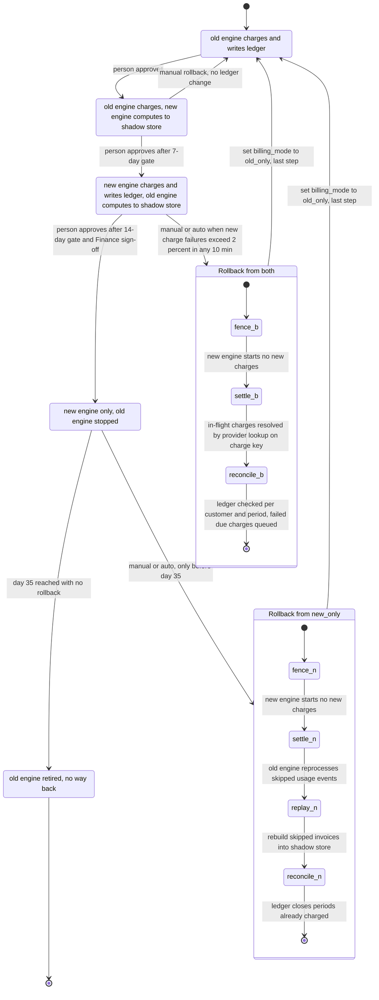

# Billing engine rollout: state machine

## Diagram

## What each mode does

- **old_only.** The old engine reads usage events, computes invoices, writes the ledger and charges. The new engine is off.
- **shadow.** The old engine still charges and writes the ledger. The new engine reads the same usage events and writes invoices to the shadow store. It never charges and never writes the ledger. A nightly job compares the two engines per customer; a mismatch is a total that differs by more than one cent. New-engine errors here are recorded and never trigger rollback.
- **both.** The new engine charges and writes the ledger. The old engine keeps computing every invoice into the shadow store without charging or writing the ledger, so it stays current. The nightly comparison continues.
- **new_only.** The old engine stops computing. Usage events it skips stay in the 35-day log. The 35-day clock starts when the rollout enters `new_only`.
- **Rollback states.** The rollback composites are controller steps, not values of `billing_mode`. The flag keeps its previous value until the final step sets `old_only`.

## Gates

- **shadow to both.** Seven consecutive days, each with a mismatch rate under 0.1 percent, and at least 5,000 invoices compared. A failing day resets the streak.
- **both to new_only.** 14 days in `both` with no unresolved mismatches, plus Finance sign-off, plus a person's approval.
- **Forward moves.** One step at a time, in order. The controller proposes a move; a person makes it.
- **After any rollback.** Gates reset to zero. The rollout returns to `shadow` and the 7-day count starts again.

## Where the rollout state lives

- **`billing_mode` in the config service.** The only mode switch the workers read. Only the controller writes it, and only after approval.
- **Rollout record (proposed).** Durable storage beside the ledger, not worker memory. Holds gate day counters, approvals and sign-off, the `new_only` entry timestamp that starts the 35-day clock, the rollback step and fence flag, and the reconciliation queue.
- **Ledger (system of record).** One entry per customer and billing period. Each entry's unique charge key is also the payment provider idempotency key. The no-double-charge guarantee rests on this key, not on the mode.
- **Shadow store.** Invoices from the engine that is not charging. Kept separate from the ledger.

## Charging and rollback safety rules

- Before any charge, an engine checks the ledger for the charge key. If an entry exists, it skips. If there is no entry and the charge is due, it charges once.
- A charge the provider confirms as failed stays due. On rollback it goes to the old engine's queue. It is never dropped.
- A charge with an unknown outcome (timeout, lost response) is looked up at the provider by its key before any retry.
- Rollback from `both` needs no reprocessing, because the old engine's shadow invoices are current.
- Rollback from `new_only` must reprocess before the old engine charges. The skipped events age out of the log 35 days after they were created, so the rollback must start and finish reprocessing well before day 35.
- In `both` or `new_only`, the fence stops new charges before anything else. The flag changes to `old_only` only after reconciliation completes.

## What happens when something fails

- **New charge failure above 2 percent in any 10-minute window (`both` or `new_only`).** Automatic rollback starts. Further triggers are ignored while a rollback runs.
- **Nightly comparison job fails, or the usage log has a gap.** The day does not count as clean, the streak does not advance, and an alert fires. This alone does not trigger rollback.
- **Config service unreachable.** Workers keep their last-read mode and start no new charges until they can read the flag again. The controller makes no transitions.
- **Reconciliation finds a difference on a period the new engine already charged.** The ledger wins. Nothing is re-charged. The difference is logged for Finance. It does not block rollback, since blocking would drop due charges.
- **Reconciliation cannot compute a due invoice.** That customer is held and on-call is paged. No charge is made from a guessed invoice.
- **Rollback stops partway.** The fence stays, the flag stays unchanged, and due charges wait in the queue. Rollback resumes from its last recorded step. The flag is never set to `old_only` before reconciliation completes.
- **Day 35 in `new_only` with no rollback.** The rollback path closes. The old engine may be retired.

## Open points

- Is the 5,000-invoice minimum for the whole 7-day window or for each day?
- Does an unresolved mismatch found during the 14 days restart the count, or only block the promotion on the day it is found?
- How much margin before day 35 must a `new_only` rollback start? The brief fixes the limit at 35 days, but the replay has to finish before the oldest skipped event expires.