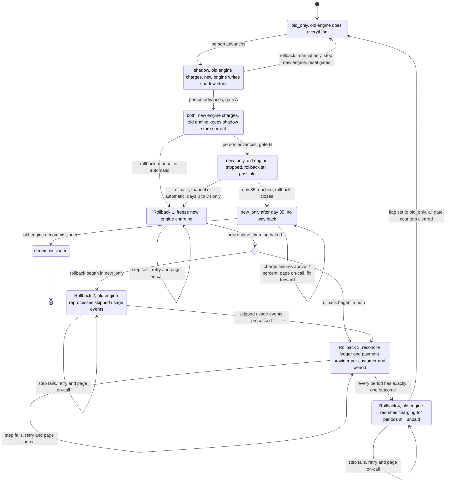

# Billing engine rollout: state machine

## 1. Summary

We are replacing the old billing engine with a new one. The switch is gradual and reversible, and it must never charge a customer twice for the same billing period.

**Terms**
- **Billing period:** the span of time one invoice covers. A customer is charged once per period.
- **Usage event log:** the input to billing. It keeps 35 days of events.
- **Ledger:** the billing ledger, the system of record for invoices.
- **Payment provider:** the external service that actually charges customers.
- **Shadow store:** a separate store for invoices that are computed but neither charged nor written to the ledger.
- **Config service:** where the rollout flag and rollout record live.
- **Rollout controller:** the component, still to be written, that checks preconditions and records each mode change.
- **Gate:** a set of conditions that must hold before a forward move. Gate A and Gate B are defined in section 2.
- **Mismatch:** a customer's invoice total that differs by more than one cent between the two engines.

The rollout has four modes, selected by one global flag in the config service, `billing_mode`: `old_only`, `shadow`, `both`, `new_only`. A person makes every forward move, one step at a time, in that order, with no skipping. Rollback always ends in `old_only`.

Two rules shape the design:

1. **At most one engine charges a customer for a given billing period.** This holds in normal operation and throughout a rollback. It is enforced by data checks, not only by the flag (section 5).
2. **A rollback from `both` or `new_only` sets `billing_mode` to `old_only` only as its last step.** Until then, no engine starts new charges, except that in the final step the old engine charges the periods that were still unpaid. Charges that fall due in the meantime are delayed, never dropped. The old engine picks them up at handoff.

## 2. Diagram

The diagram shows modes and transitions.

- Rollback from `both` or `new_only` runs through four steps (`rb_freeze`, `rb_reprocess`, `rb_reconcile`, `rb_handoff`), described in section 4. Rollback from `shadow` has no steps.
- `new_only_locked` is not a fifth flag value. It is `new_only` after day 35, tracked in the rollout record (section 5). "Day N" counts from the moment `new_only` was entered.
- A self-loop means "stay in this state". In a rollback step it means the step failed and is retried.

**Gate A (`shadow` to `both`):** 7 consecutive days with a mismatch rate under 0.1% and at least 5,000 invoices compared.

**Gate B (`both` to `new_only`):** 14 days in `both` with no unresolved mismatches, plus Finance sign-off.

The first move, `old_only` to `shadow`, has no gate. It still needs a person.

## 3. What each mode does

| Mode | Old engine | New engine | Who charges | Who writes the ledger |
|---|---|---|---|---|
| `old_only` | Computes invoices, charges, writes ledger | Off | Old | Old |
| `shadow` | Same as `old_only` | Reads the same usage events and writes invoices to the shadow store. It never charges and never writes the ledger. | Old | Old |
| `both` | Computes every invoice into the shadow store. It does not charge. | Computes, charges, writes ledger | New | New |
| `new_only` (days 0 to 34) | Stopped. It skips usage events, so a rollback must reprocess them. | Does everything | New | New |
| `new_only` (day 35 on, locked) | May be decommissioned | Does everything | New | New |

- **Comparison.** A nightly job compares the two engines' invoices per customer. It runs in `shadow` and in `both`.
  - In `shadow`, it compares the new engine's shadow-store invoices with the invoices the old engine wrote to the ledger.
  - In `both`, it compares the new engine's invoices (in the ledger) with the old engine's shadow-store invoices.
- **Gate counters.** Gate A uses the mismatch rate and the invoice count. Gate B uses the count of unresolved mismatches and the number of days spent in `both`.
- **Forward moves.** A person triggers every forward move. Nothing advances automatically. The rollout controller only checks preconditions and records the move. It rejects any move that skips a step or fails its gate.

## 4. Rollback

Rollback can start from `shadow`, `both` or `new_only`. It always ends in `old_only`.

**Triggers**

- **Manual.** On-call can start it at any time from `shadow`, `both` or `new_only`, until day 35 in `new_only`.
- **Automatic.** It starts when the new engine's charge failure rate is above 2% over any 10-minute window. This applies in `both` and `new_only` only.
- **New-engine errors in `shadow`.** They are recorded and never trigger a rollback.

**Paths**

- **From `shadow`.** The new engine has never charged or written the ledger, so there is nothing to reconcile. Stop the new engine, set `old_only`, and clear the gate counters. The shadow store can be kept or discarded. This is a single action with no intermediate states.
- **From `both`.** Run steps 1, 3 and 4. The old engine has kept the shadow store current for every invoice, so no reprocessing is needed.
- **From `new_only`.** Run steps 1, 2, 3 and 4. The old engine skipped usage events while stopped and must first reprocess all of them. The usage event log keeps only 35 days, which is why the way back closes at day 35.

**Steps**

1. **Freeze.** Stop new-engine charging. Let in-flight charges finish or time out. Charges that fall due now wait and are not dropped.
2. **Reprocess (only from `new_only`).** The old engine processes every usage event it skipped, starting from the moment `new_only` began.
3. **Reconcile.** For each customer and billing period, compare the ledger with the payment provider's record. Each period must end in exactly one outcome:
   - Charged and in the ledger: leave it alone.
   - Charged but missing from the ledger: backfill the ledger entry from the provider record. Do not charge again.
   - In the ledger but not charged: queue the charge for the old engine.
   - Neither: queue the charge for the old engine.
4. **Handoff.** Enable old-engine charging for the queued periods. Set `billing_mode = old_only`. Clear all gate counters.

**After a rollback.** The gates reset. The rollout goes through `shadow` again, and the 7-day count for Gate A starts at zero. The 14-day count for Gate B starts over when `both` is re-entered. Every forward move is again made by a person.

**No way back.** After 35 days in `new_only`, the controller enters `new_only_locked`. Manual rollback is refused and automatic rollback is off.

## 5. Where the rollout state lives

- **Mode: the `billing_mode` flag in the config service.** It is the single source of truth for the mode. It has four values, so a rollback in progress does not add a fifth.
- **Rollout record: a durable record kept next to the flag in the config service.** It holds:
  - the times `both` and `new_only` were entered;
  - the current rollback step, or none;
  - the mode the rollback began from;
  - the gate counters;
  - whether the day-35 lock has been reached.

  The rollback step is separate from `billing_mode`. While a rollback runs, `billing_mode` stays at `both` or `new_only`. Workers must check the rollback step before every charge. In steps 1 to 3 no engine starts new charges. In step 4 the old engine may charge only the queued periods. That is how a rollback pauses charging without a fifth flag value. This record is a design addition, not part of the stated requirements, and should be confirmed.
- **Comparison results: the shadow store plus the nightly job's output.** The gate counters are derived from these.
- **Charge safety: not the flag.** Workers can read the flag late, so two protections apply on every charge, whatever the flag says:
  - The charge request to the payment provider carries an idempotency key made of customer plus billing period. The provider treats a repeat of the same key as the same charge, so it charges only once.
  - The ledger has a uniqueness constraint on customer plus period, so a second ledger entry for the same period is rejected.

  Even a worker with a stale flag cannot charge a period twice.

## 6. What happens when something fails

| Failure | Behavior |
|---|---|
| New-engine charge failure rate above 2% over any 10 minutes, in `both` or `new_only` (days 0 to 34) | Automatic rollback starts. Page on-call. |
| Same failure, in `new_only_locked` | No rollback is possible. Page on-call to fix forward (repair the new engine in place). |
| New-engine errors in `shadow` | Recorded only. No rollback. They matter only if they produce mismatches. |
| Nightly comparison job fails or produces no data | That day counts toward neither gate and breaks the Gate A streak. Alert the owner. |
| A rollback step fails | The rollback stays in that step, retries, and pages on-call. `billing_mode` is not set to `old_only`, and the old engine does not charge until reconciliation is complete. Delayed charges are acceptable. Double charges and dropped charges are not. |
| Rollback is triggered while one is already running | Ignored. The running rollback continues. |
| Config service unavailable | Workers keep their last known mode. The idempotency keys and the ledger constraint still prevent double charges. No mode change or rollback step can be made until it recovers. |
| Usage event log nears 35-day retention during a `new_only` rollback | Treat as urgent. Reprocessing needs the oldest events first. If they age out, the rollback cannot be completed from the log alone. |
| Ledger and provider disagree for a period | Reconciliation decides by the provider record (section 4, step 3). It never issues a second charge for a period the provider shows as charged. |

## 7. Assumptions and open questions

- **Invoice count in Gate A.** I read "at least 5,000 invoices compared" as the total across the 7-day window, not per day. Please confirm.
- **Missed comparison days.** I treat a day with no comparison as failing and as breaking the streak. The requirements do not say.
- **Day 35.** I read "from day 35 on" as the lock point, whether or not the old engine has actually been decommissioned.
- **Rollback in progress at day 35.** One that began before the lock continues, but the oldest usage events may expire mid-rollback. This needs a decision.
- **Minimum volume for the 2% trigger.** A 10-minute window with very few charges could trip it on one or two failures. There is no volume floor.
- **Differing amounts for the same period.** If the old engine's invoice differs from what the new engine already charged, the charge stands. Any adjustment is a Finance matter outside this state machine.
