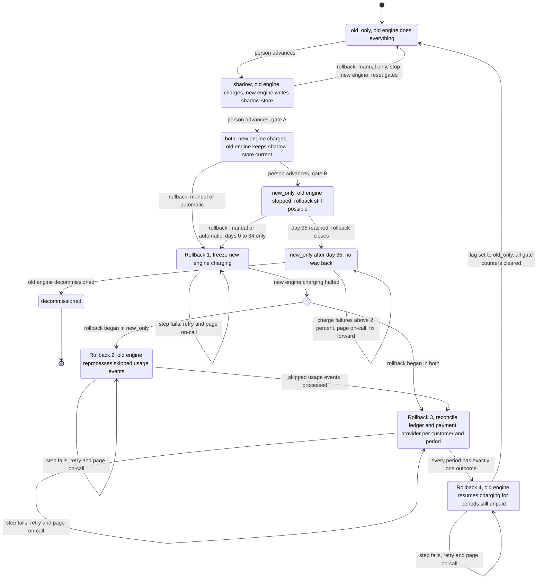

# Billing engine rollout: state machine

## 1. Summary

The rollout has four modes, selected by one global flag, `billing_mode`: `old_only`, `shadow`, `both`, `new_only`. Forward moves are made by a person, one step at a time. Rollback always ends in `old_only`.

Two rules shape the design:

1. **Exactly one engine may charge a customer for a given billing period.** This holds during normal operation and throughout a rollback. It is enforced by data checks, not only by the flag (section 5).
2. **`billing_mode` flips to `old_only` only as the last step of a rollback.** Until then the old engine does not charge. Charges that fall due during that window are delayed, never dropped, and the old engine picks them up at handoff.

## 2. Diagram

**Gate A (`shadow` to `both`):** 7 consecutive days with a mismatch rate under 0.1% and at least 5,000 invoices compared. A mismatch is an invoice total that differs by more than one cent.

**Gate B (`both` to `new_only`):** 14 days in `both` with no unresolved mismatches, plus Finance sign-off.

The first move, `old_only` to `shadow`, has no gate in the brief. It still needs a person.

## 3. What each mode does

| Mode | Old engine | New engine | Who charges | Who writes the ledger |
|---|---|---|---|---|
| `old_only` | Computes, charges, writes ledger | Off | Old | Old |
| `shadow` | Same as `old_only` | Reads the same usage events and writes invoices to the shadow store. It never charges and never writes the ledger. | Old | Old |
| `both` | Computes every invoice into the shadow store. It does not charge. | Computes, charges, writes ledger | New | New |
| `new_only` (days 0 to 34) | Stopped. It skips usage events, so a rollback must reprocess them. | Does everything | New | New |
| `new_only` (day 35 on, locked) | May be decommissioned | Does everything | New | New |

- **Comparison.** A nightly job compares the two engines' invoices per customer. It runs in `shadow` and in `both`. In `both` it compares the new engine's invoices with the old engine's shadow-store invoices. In `shadow` it compares the new engine's invoices with the invoices the old engine wrote to the ledger.
- **Gate counters.** The mismatch rate and the invoice count feed Gate A. The count of unresolved mismatches and the day count in `both` feed Gate B.
- **Forward moves.** The rollout controller only checks preconditions and records the move. A person triggers every forward move. Nothing advances automatically. The controller rejects any move that skips a step or fails its gate.

## 4. Rollback

Rollback can start from `shadow`, `both` or `new_only`. It always ends in `old_only`.

**Triggers**

- **Manual.** On-call can start it at any time from `shadow`, `both` or `new_only`, until day 35 in `new_only`.
- **Automatic.** It starts when the new engine's charge failure rate is above 2% over any 10-minute window. This applies in `both` and `new_only` only.
- **New-engine errors in `shadow`.** They are recorded and never trigger a rollback.

**Paths**

- **From `shadow`.** The new engine has never charged or written the ledger. Stop the new engine, keep or discard the shadow store, set `old_only`, and clear the gate counters. There are no charges to reconcile, so this is a single step with no intermediate states.
- **From `both`.** Run steps 1, 3 and 4. The old engine has kept the shadow store current for every invoice, so no reprocessing is needed.
- **From `new_only`.** Run steps 1, 2, 3 and 4. The old engine skipped usage events while stopped and must reprocess all of them first. The usage event log keeps 35 days, which is why the way back closes at day 35.

**Steps**

1. **Freeze.** Stop new-engine charging. Let in-flight charges finish or time out. Charges that fall due now wait and are not dropped.
2. **Reprocess (only from `new_only`).** The old engine processes every usage event it skipped, starting from the moment `new_only` began.
3. **Reconcile.** For each customer and billing period, compare the ledger with the payment provider's record. Each period must end in exactly one outcome:
   - Charged and in the ledger: leave it alone.
   - Charged but missing from the ledger: backfill the ledger entry from the provider record. Do not charge again.
   - In the ledger but not charged: queue the charge for the old engine.
   - Neither: queue the charge for the old engine.
4. **Handoff.** Enable old-engine charging for the queued periods. Set `billing_mode = old_only`. Clear all gate counters.

**Gates after rollback.** The rollout goes through `shadow` again. The 7-day count for Gate A starts at zero. The 14-day count for Gate B also starts over when `both` is re-entered. Every forward move is again made by a person.

**No way back.** After 35 days in `new_only`, the controller enters `new_only_locked`. Manual rollback is refused. Automatic rollback is also off.

## 5. Where the rollout state lives

- **Mode: `billing_mode` flag in the config service.** It is the single source of truth for the mode. It has four values, so rollback does not add a fifth.
- **Rollout record: a durable record kept with the flag in the config service.** It holds the following:
  - The time `both` and `new_only` were entered.
  - The current rollback step, or none.
  - The mode the rollback began from.
  - The gate counters.
  - Whether the day-35 lock has been reached.

  The rollback step is separate from `billing_mode`. While a rollback runs, `billing_mode` stays at `both` or `new_only`. Workers must treat a non-empty rollback step as "do not charge unless this step allows it". That is how a rollback can pause charging without a fifth flag value. The brief does not specify this record. It is a design addition and should be confirmed.
- **Comparison results: the shadow store plus the nightly job's output.** The gate counters are derived from these.
- **Charge safety: not the flag.** Workers can read the flag late. Two protections therefore apply on every charge, whatever the flag says:
  - An idempotency key of customer plus billing period is sent to the payment provider.
  - A uniqueness constraint on customer plus period applies in the ledger.

  Even a worker with a stale flag cannot charge a period twice.

## 6. What happens when something fails

| Failure | Behavior |
|---|---|
| New-engine charge failure rate above 2% over any 10 minutes, in `both` or `new_only` | Automatic rollback starts. Page on-call. |
| Same failure, in `new_only_locked` | No rollback is possible. Page on-call to fix forward. |
| New-engine errors in `shadow` | Recorded only. No rollback. They count against nothing unless they produce mismatches. |
| Nightly comparison job fails or produces no data | That day does not count toward Gate A or Gate B. Treat it as breaking the Gate A streak. Alert the owner. |
| A rollback step fails | The rollback stays in that step, retries, and pages on-call. `billing_mode` is not set to `old_only` and the old engine does not charge until reconciliation is complete. Delayed charges are acceptable. Double charges and dropped charges are not. |
| Rollback is triggered while one is already running | Ignored. The running rollback continues. |
| Config service unavailable | Workers keep their last known mode. Per-period idempotency keys and the ledger constraint still prevent double charges. No mode change or rollback step can be made until it recovers. |
| Usage event log nears 35-day retention during a `new_only` rollback | Treat as urgent. Reprocessing needs the oldest events first. If they age out, the rollback cannot be completed from the log alone. |
| Ledger and provider disagree for a period | Reconciliation decides by the provider record (section 4, step 3). It never issues a second charge for a period the provider shows as charged. |

## 7. Assumptions and open questions

- **Invoice count in Gate A.** I read "at least 5,000 invoices compared" as the total across the 7-day window, not per day. Please confirm.
- **Missed comparison days.** I treat a day with no comparison as failing and as breaking the streak. The brief does not say.
- **Day 35.** I read "from day 35 on" as the lock point, whether or not the old engine has actually been decommissioned.
- **Rollback in progress at day 35.** One that began before the lock continues, but the oldest usage events may expire mid-rollback. This needs a decision.
- **Minimum volume for the 2% trigger.** A 10-minute window with very few charges could trip it on one or two failures. The brief has no volume floor.
- **Differing amounts for the same period.** If the old engine's invoice differs from what the new engine already charged, the charge stands. Any adjustment is a Finance matter outside this state machine.
