# Checkout across Cart, Inventory, Payment and Order

This flowchart shows one checkout from **Place order** to a final order status and a money state. An order is **settled** when its money is final: a kept charge, no charge, or a completed full refund. A **clean ending** is a terminal order status with settled money. Two states are **open money states** that need an ops decision, and both alert ops: a charge **UNRESOLVED** after 24 hours, and a refund **REFUND_ESCALATED** after the retry limit.

**Status: draft.** The diagram is drawn for **Option A**, the fixed 10-minute hold in the brief. Options B and C change the Inventory hold rules and the diagram, so the owner must choose one before build (Decision 1).

Legend: solid arrows are HTTP calls and steps inside one service. Dotted arrows are asynchronous: provider webhooks, timers, and broker events (labelled `event:`). Each lane title lists what that service stores. Outcomes from a webhook, a poll or an ops entry all reach the same conditional update. The diagram draws them to the same outcome node.

```mermaid
flowchart TD
    CUST(["Customer presses Place order"])

    subgraph CART["Cart service. Stores: cart lines, processed event ids"]
        SNAP["Build snapshot of lines, unit prices and totals<br/>Cart not changed"]
        EMPTY["Empty cart<br/>Only on event: OrderConfirmed"]
    end

    subgraph ORD["Order service. Stores: orders, status and settlement, immutable order lines, short items, reserve send time, outbox, processed event ids"]
        PLACE["Insert order PLACED with snapshot"]
        ASK_RES["HTTP reserve all lines, key = order id<br/>Retry with same key until answered or 5 min"]
        RES_TIMEOUT["5 min, no answer<br/>Status CHECKOUT_FAILED, no charge"]
        RES_OK{"All lines reserved?"}
        REJ["Status REJECTED_SHORT_STOCK<br/>Store short items, show them to customer"]
        AWAIT["Status AWAITING_PAYMENT, settlement OPEN"]
        ASK_CHG["HTTP charge, key = order id<br/>Retry with same key until answered"]
        DECL_ST["Status PAYMENT_DECLINED<br/>Tell customer"]
        ASK_REL["HTTP release, key = order id<br/>Retry with backoff until acknowledged or release window ends"]
        REL_FAIL["Release window ended unacknowledged<br/>Alert Order on-call. Inventory frees stock at expires_at"]
        PS_STATE{"Status AWAITING_PAYMENT?"}
        ASK_CLAIM["HTTP claim, key = order id"]
        CLAIM_OK{"Claimed?"}
        CONFIRM["Status CONFIRMED, settlement SETTLED<br/>Outbox OrderConfirmed"]
        CANCEL["Status CANCELLED_OUT_OF_STOCK, settlement OPEN<br/>Outbox OrderCancelled<br/>Email customer once"]
        NOOP["No change: redelivered event<br/>Log any other state for ops"]
        SETTLE["Settlement SETTLED on RefundRecorded REFUNDED<br/>Stays OPEN on RefundRecorded REFUND_ESCALATED"]
    end

    subgraph INV["Inventory service. Stores: stock on hand, reservations (order id, lines, state, expires_at), processed requests by order id, release tombstones"]
        SEEN{"Order id already processed?"}
        REPLAY["Replay stored answer<br/>A tombstone replays lapsed<br/>No new hold"]
        CHECK["One transaction: check every line<br/>Available = on hand minus unexpired HELD"]
        ALL_OK{"Every line has stock?"}
        NOTHING["Reserve nothing<br/>Reply with short items"]
        HOLD["Insert reservation HELD<br/>expires_at = now + 10 min"]
        SWEEP["Every minute: set expired HELD to RELEASED<br/>Tidy only. Stock is free at expires_at"]
        CLAIM_Q{"Reservation for order id already CLAIMED?"}
        CLAIM_UPD{"Conditional update:<br/>HELD and expires_at after now?"}
        CLAIMED["Set CLAIMED, decrement on hand on first claim only<br/>Reply claimed"]
        LAPSED["Reply lapsed<br/>Hold expired, released, swept, or none exists"]
        REL["Set HELD to RELEASED if present<br/>No change if CLAIMED<br/>Write tombstone if none exists<br/>Reply ok"]
    end

    subgraph PAY["Payment service. Stores: charges (order id unique, state, provider charge id), refunds (order id unique, state, attempts, last error), processed provider event ids, outbox"]
        REC["Insert charge PENDING, unique on order id<br/>Retry returns stored state, never a second charge"]
        CHG_CALL["Send charge to provider<br/>Idempotency-Key = order id"]
        WAIT["Wait for outcome<br/>Seconds, up to 30 min"]
        WH["Charge webhook: verify signature, read event id"]
        CDUP{"Event id already stored?"}
        CHG_IGN["Return 200, no change"]
        OUT{"Provider outcome"}
        SUCC["Conditional update: PENDING or UNRESOLVED to SUCCEEDED<br/>One transaction: store event id if webhook, outbox PaymentSucceeded<br/>No row changed, same outcome: no-op. Conflict: alert ops"]
        DECLINE["Conditional update: PENDING or UNRESOLVED to DECLINED<br/>One transaction: store event id if webhook, outbox PaymentDeclined<br/>No row changed, same outcome: no-op. Conflict: alert ops"]
        RECON["At 35 min, then every 15 min:<br/>query provider for open charge"]
        RECON_ANS{"Provider answer"}
        UNRES["Charge UNRESOLVED<br/>Alert ops. Order stays AWAITING_PAYMENT"]
        REFUND["Insert refund for order id if absent, store REFUND_PENDING"]
        REF_SEND["Send full refund to provider<br/>Key = refund for order id"]
        REF_WAIT["Wait for refund outcome"]
        REF_POLL["At 35 min after each send, then every 15 min:<br/>query provider for PENDING refund"]
        REF_HOOK["Refund webhook: verify signature, read event id"]
        REF_DUP{"Event id already stored?"}
        REF_IGN["Return 200, no change"]
        REF_OUT{"Refund result"}
        REFUNDED["Refund REFUNDED<br/>Outbox RefundRecorded"]
        REF_FAIL["Refund REFUND_FAILED, store error, attempts + 1"]
        REF_LEFT{"Attempts below 8?"}
        REF_BACK["Wait backoff"]
        REF_ESC["Refund REFUND_ESCALATED<br/>Outbox RefundRecorded, alert ops; open until ops resolves"]
    end

    PROV(["Payment provider (external)"])

    CUST --> SNAP
    SNAP -->|"HTTP snapshot"| PLACE
    PLACE --> ASK_RES
    ASK_RES -->|"HTTP reserve"| SEEN
    ASK_RES -.->|"timer: 5 min, no answer"| RES_TIMEOUT
    RES_TIMEOUT -->|"release, best effort"| ASK_REL

    SEEN -->|"yes"| REPLAY
    SEEN -->|"no"| CHECK
    CHECK --> ALL_OK
    ALL_OK -->|"no: a line is short"| NOTHING
    ALL_OK -->|"yes"| HOLD
    HOLD -.->|"timer: expires_at passes"| SWEEP
    NOTHING -->|"reply: short items"| RES_OK
    HOLD -->|"reply: reserved"| RES_OK
    REPLAY -->|"reply stored answer"| RES_OK

    RES_OK -->|"no"| REJ
    RES_OK -->|"yes"| AWAIT
    AWAIT --> ASK_CHG
    ASK_CHG -->|"HTTP charge"| REC
    REC --> CHG_CALL
    CHG_CALL -->|"charge request"| PROV
    CHG_CALL --> WAIT

    PROV -.->|"webhook: seconds to 30 min, may repeat"| WH
    WAIT -.->|"no webhook by 35 min"| RECON
    WH --> CDUP
    CDUP -->|"yes: duplicate"| CHG_IGN
    CDUP -->|"no: new event"| OUT
    OUT -->|"succeeded"| SUCC
    OUT -->|"declined"| DECLINE

    RECON --> RECON_ANS
    RECON_ANS -->|"succeeded"| SUCC
    RECON_ANS -->|"declined"| DECLINE
    RECON_ANS -->|"no such charge: re-send with same key"| CHG_CALL
    RECON_ANS -->|"still pending or query error, under 24 h: wait 15 min"| RECON
    RECON_ANS -->|"still pending or query error, 24 h passed"| UNRES
    UNRES -.->|"later webhook: same dedupe path"| WH

    DECLINE -.->|"event: PaymentDeclined"| DECL_ST
    DECL_ST --> ASK_REL
    ASK_REL -->|"HTTP release"| REL
    ASK_REL -.->|"release window ends, unacknowledged"| REL_FAIL

    SUCC -.->|"event: PaymentSucceeded"| PS_STATE
    PS_STATE -->|"yes"| ASK_CLAIM
    PS_STATE -->|"no: redelivered event"| NOOP
    ASK_CLAIM -->|"HTTP claim, key = order id"| CLAIM_Q
    CLAIM_Q -->|"yes: reply claimed, no change"| CLAIMED
    CLAIM_Q -->|"no"| CLAIM_UPD
    CLAIM_UPD -->|"yes"| CLAIMED
    CLAIM_UPD -->|"no"| LAPSED
    CLAIMED -->|"reply claimed"| CLAIM_OK
    LAPSED -->|"reply lapsed"| CLAIM_OK
    CLAIM_OK -->|"yes"| CONFIRM
    CLAIM_OK -->|"no: late success"| CANCEL

    CONFIRM -.->|"event: OrderConfirmed"| EMPTY
    CANCEL -.->|"event: OrderCancelled"| REFUND

    REFUND --> REF_SEND
    REF_SEND -->|"HTTP refund, key = refund for order id"| PROV
    REF_SEND --> REF_WAIT
    REF_WAIT -.->|"no refund webhook by 35 min"| REF_POLL
    REF_POLL -.->|"still pending: poll every 15 min"| REF_POLL
    REF_POLL -->|"refunded or failed"| REF_OUT
    PROV -.->|"refund webhook, may repeat"| REF_HOOK
    REF_HOOK --> REF_DUP
    REF_DUP -->|"yes: duplicate"| REF_IGN
    REF_DUP -->|"no: new event"| REF_OUT
    REF_OUT -->|"refunded"| REFUNDED
    REF_OUT -->|"failed"| REF_FAIL
    REF_FAIL --> REF_LEFT
    REF_LEFT -->|"yes"| REF_BACK
    REF_BACK -->|"retry with same key"| REF_SEND
    REF_LEFT -->|"no"| REF_ESC
    REF_ESC -.->|"ops-entered result: conditional update"| REF_OUT
    REFUNDED -.->|"event: RefundRecorded"| SETTLE
    REF_ESC -.->|"event: RefundRecorded"| SETTLE
```

**Notes on reading the diagram**

- A reserve that arrives after Order has given up still creates a HELD reservation if Inventory has not seen a release first. That reservation expires on its own at expires_at, at most 10 minutes after it was written. No customer is charged. This is an accepted cost, not a fixed race.
- Only webhooks pass the event-id check. A poll result or an ops entry has no event id and relies on the conditional update, which is why it goes straight to the outcome node.
- The refund row is inserted once. Retries go back to the send step and never re-insert the row.

## Parameters

Change numbers here. The diagram labels and tables refer back to this table.

| Parameter | Value | Status |
|---|---|---|
| Hold length | 10 min from write | Fixed in brief (Option A) |
| Reserve wait | 5 min from send | Proposed (Decision 9) |
| Release window | Reserve send + 10 min + 1 min allowance | Proposed. Release only frees stock sooner. Stock is always free at expires_at |
| Provider outcome | Seconds, up to 30 min | Provider behaviour, from brief |
| Reconciliation and poll start | 35 min after each charge or refund send | Proposed (Decisions 7, 10) |
| Reconciliation and poll interval | 15 min | Proposed (Decision 7) |
| UNRESOLVED after | 24 h after the charge send | Proposed (Decision 7) |
| Refund attempts | 8, then REFUND_ESCALATED | Proposed (Decision 8) |
| Refund backoff | Exponential; base and cap to set | Proposed (Decision 8) |
| Sweep | Every minute, tidy only | Proposed |

## Order states

| Order status | Ends the order | Settlement | Customer sees | Cart |
|---|---|---|---|---|
| CONFIRMED | Yes | SETTLED: charge SUCCEEDED, kept | Confirmation | Emptied |
| REJECTED_SHORT_STOCK | Yes | SETTLED: no charge | Short items list | Unchanged |
| CHECKOUT_FAILED | Yes | SETTLED: no charge | "Could not complete checkout, try again" | Unchanged |
| PAYMENT_DECLINED | Yes | SETTLED: charge DECLINED, nothing to refund | Declined message | Unchanged |
| CANCELLED_OUT_OF_STOCK | Yes | OPEN until refund REFUNDED, then SETTLED. Stays OPEN if REFUND_ESCALATED | Sold-out email | Unchanged |
| AWAITING_PAYMENT | No | OPEN: charge PENDING or UNRESOLVED | "Payment pending" | Unchanged |

A **clean ending** is "Ends the order: Yes" and "Settlement: SETTLED". The order status says what happens to the order. Settlement says whether the money is final. Those are two separate fields.

## Money and stock states

| Object | State | Effect on settlement | Who acts |
|---|---|---|---|
| Charge | PENDING | OPEN (order AWAITING_PAYMENT) | Payment waits for outcome |
| Charge | SUCCEEDED or DECLINED | Final | None |
| Charge | UNRESOLVED | OPEN | Ops |
| Refund | REFUND_PENDING or REFUND_FAILED | OPEN, in progress | Payment retries or polls |
| Refund | REFUNDED | SETTLED | None |
| Refund | REFUND_ESCALATED | OPEN | Ops |
| Reservation | HELD | Stock held, no money effect | Inventory expires or claims |
| Reservation | CLAIMED or RELEASED | Final | None |

## Failure and edge cases

| Case | Path | Order status | Money | Cart |
|---|---|---|---|---|
| Short stock | Inventory reserves nothing; Order rejects | REJECTED_SHORT_STOCK | No charge | Unchanged |
| Reserve never answers | Order gives up at 5 min and sends a best-effort release. A late reserve still holds stock until expires_at. Accepted cost: stock tied up for at most 10 min, no charge | CHECKOUT_FAILED | No charge | Unchanged |
| Declined payment | Charge DECLINED; Order releases stock | PAYMENT_DECLINED | No charge | Unchanged |
| Release not acknowledged (after decline or timeout) | Order retries until acknowledged or the release window ends. Inventory frees stock at expires_at regardless. Order alerts its on-call when the window ends unacknowledged | Unchanged. Status was already set by the decline or timeout | Unchanged | Unchanged |
| Late success after hold | Claim lapsed; Order cancels, emits OrderCancelled; Payment refunds in full | CANCELLED_OUT_OF_STOCK, settlement OPEN | Charged, then full refund | Unchanged |
| Refund fails | REFUND_FAILED; retried with the same key (Decision 3) | Unchanged, settlement OPEN | Refund open until REFUNDED | Unchanged |
| Refund attempts exhausted | REFUND_ESCALATED; ops alerted; open until ops resolves | Unchanged, settlement OPEN | Refund open, ops | Unchanged |
| Duplicate charge webhook | Event id already stored: return 200 | No change | No change | No change |
| Duplicate PaymentSucceeded or PaymentDeclined | Order receives a redelivered event; no-op | No change | No change | No change |
| Duplicate refund webhook | Event id already stored: return 200 | No change | No change | No change |
| Charge webhook never arrives | Poll at 35 min, then every 15 min | Per provider answer | Per provider answer | Per provider answer |
| Charge call lost or timed out | Charge PENDING is stored first. Retries use the key. Reconciliation re-sends with the same key only if the provider has no charge | Per outcome | Never a second charge | Unchanged |
| Provider still pending after 24 h | Charge UNRESOLVED; ops alerted. Webhooks are still accepted | AWAITING_PAYMENT, settlement OPEN | Unknown until ops resolves | Unchanged. New checkout of this cart blocked (Decision 2) |
| Late success after UNRESOLVED | Dedupe path, then conditional update. Under Option A the hold has long lapsed, so the claim always fails and the late-success refund runs. CONFIRMED is possible only while the hold is still HELD | CANCELLED_OUT_OF_STOCK under Option A | Charged, then full refund | Unchanged |
| Conflicting outcome for a final charge | Conditional update changes nothing; ops alerted | Unchanged | Unchanged | Unchanged |
| Refund webhook never arrives | Poll at 35 min after send, then every 15 min | Per provider answer | Per provider answer | Unchanged |

## Hold decision

| Option | Change | Trade-off |
|---|---|---|
| A (drawn) | Hold stays at 10 minutes. Any charge that outlives the remaining hold is refunded in full | Keeps the fixed requirement. Stock is never held longer than the brief allows. Slow payments are charged and then refunded |
| B | Hold stays HELD while the charge is PENDING, up to 35 minutes. Claim also checks charge state | Fewer late refunds. Changes the fixed 10-minute requirement and holds stock longer |
| C | Claim is made when the charge is requested; release on decline. Late-success branch removed | No late-success race. Sells stock while money is pending and loses sales on declines |

**Recommendation: Option A, if measurement confirms slow payments are rare.** Option A is the only option that keeps the 10-minute hold in the brief. Its cost is that every charge slower than the remaining hold is charged and then refunded. The customer sees a charge and a refund, and the refund itself can fail. The brief gives provider latency as seconds, sometimes up to 30 minutes, but does not give the share of payments that take longer than 10 minutes. Measure that share from provider data before deciding. If it is high enough that the refund path would be common, choose B. B changes a fixed requirement, so it must be approved as a change to the brief.

## Safety rules

- **Keys.** Charge key is the order id. Refund key is "refund for order id". Reserve, claim and release are keyed by order id. A repeated request replays the stored answer. A retried charge returns the stored charge state.
- **Dedupe.** Payment stores each webhook event id under a unique constraint. Every outcome change, whether from a webhook, a poll or an ops entry, is a conditional update: PENDING or UNRESOLVED to a final state, once. A same-outcome repeat changes nothing and raises no alert. A conflicting outcome changes nothing and alerts ops.
- **Outbox.** Each state change and its event are written in one transaction. Consumers are idempotent, so a repeated event changes nothing.
- **Sweep versus claim.** Both are conditional updates on the same reservation row, so the first committed wins. Stock is free from expires_at, not from the sweep.
- **Cart.** Only OrderConfirmed empties the cart. The Cart service records processed event ids so the event is idempotent.

## Decisions

### Must decide before build

1. **Hold option: A, B or C.** See Hold decision. Recommendation: A, subject to the measurement above. The choice changes the Inventory rules and the diagram. The diagram is drawn for A.
2. **Open charges and the cart.** Proposed: (a) no automatic timeout on AWAITING_PAYMENT; ops resolves UNRESOLVED; (b) a cart with an open order cannot start a new checkout, and the customer sees "Payment pending", so one cart is never charged twice; (c) under Option A, a late success after UNRESOLVED is refunded. Open: whether ops may fulfil instead of refunding when stock is still free. That path is not designed. The brief requires a full refund and no partial orders.

### Confirm with the provider

3. **Refund key and retries.** The design assumes a failed refund can be retried under the same key. Many providers do not allow this. Ask: (a) does a failed refund accept a retry with the same key? If not, use a new key per attempt and record it on the refund row. (b) Is one full refund per order enough? The refund row is unique on order id. A partial or second refund needs a new refund row and key. That is out of scope.
4. **Refund result delivery.** Webhook (deduplicated by event id) or a synchronous answer. The poll path applies either way.
5. **Idempotency key retention.** Confirm the provider keeps the charge and refund keys long enough to cover the 24-hour reconciliation window and the retry limits. A key that expires early could allow a second charge.
6. **Email sender.** Order sends mail through an email provider. If mail must come from a separate notification service, add it as a fifth lane.

### Proposed defaults (owner accepts or changes)

7. **Reconciliation.** First query 35 minutes after the charge send, then every 15 minutes. UNRESOLVED after 24 hours, with an ops alert.
8. **Refund retries.** 8 attempts with exponential backoff, then REFUND_ESCALATED with an ops alert.
9. **Reserve and release bounds.** Order stops waiting for a reserve answer after 5 minutes (CHECKOUT_FAILED). Release retries until acknowledged or the release window ends. An unacknowledged release alerts Order on-call. Stock is free at expires_at either way.
10. **Refund webhook loss.** Poll at 35 minutes after each refund send, then every 15 minutes.