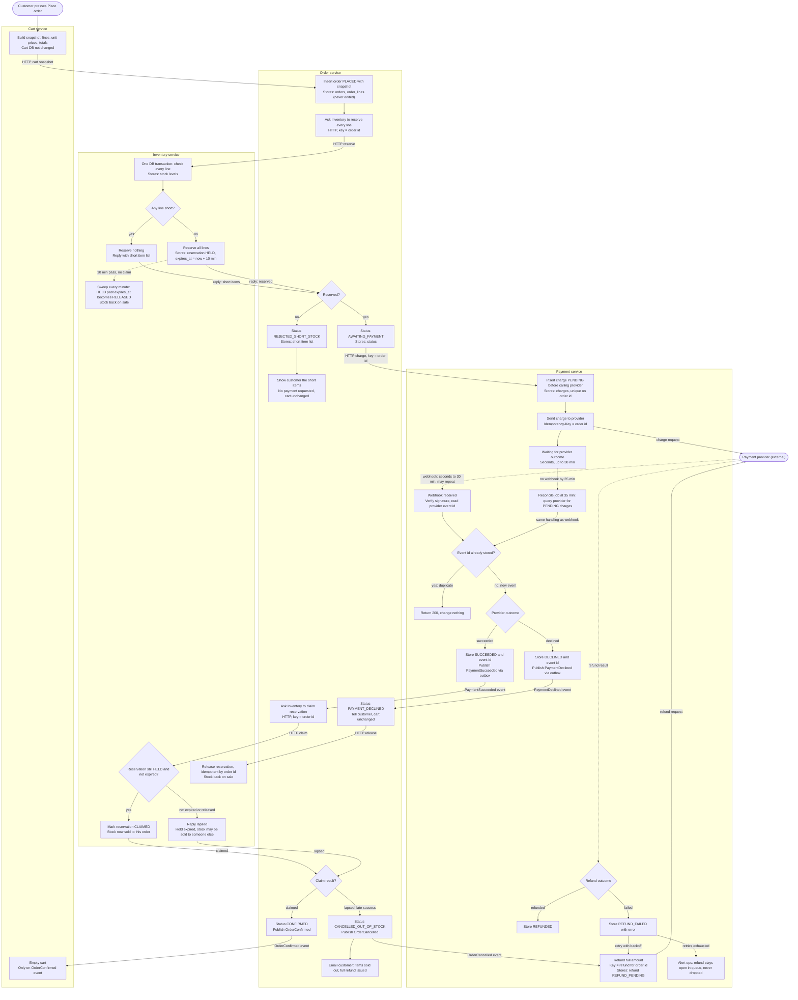

# Checkout across Cart, Inventory, Payment and Order

This flowchart shows one checkout from **Place order** to a confirmed order, a refund, or a clean failure. Each colored lane is one service, and each node shows what the service does and what it stores. The dotted lines are asynchronous: webhooks from the payment provider and events on the message broker.

## Notes on the flow

**Happy path.** Order records the snapshot, Inventory holds every line for 10 minutes, Payment charges with the order id as the idempotency key, and the provider's webhook reports success. Order then claims the reservation and confirms. Only the confirmed order empties the cart.

**Short stock.** Inventory checks all lines in one transaction and reserves nothing if any line is short. Order records the short items, shows them to the customer, and never calls Payment. The cart is untouched.

**Declined payment.** Payment stores DECLINED and publishes an event. Order releases the reservation so the stock goes back on sale, and the cart is untouched. The provider key is the order id, so a retry of the same order would return the same decline. A retry must be a new Place order attempt with a new order id.

**Late success after the hold lapsed.** The hold can expire while the webhook is still pending. Inventory's claim is a conditional update (HELD and not expired), so it rejects the claim once the hold has lapsed or the stock has gone. Order then cancels as out of stock, emails the customer, and Payment refunds the full amount. Nothing ships partially, and the cart is not emptied.

**Failed refund.** Payment records REFUND_FAILED, keeps the refund open, and retries with backoff. If retries are exhausted it alerts ops. The refund is never marked done until the provider confirms it.

**Duplicate webhooks.** Payment stores each provider event id with a unique constraint, so a repeat returns 200 with no state change. The status transition is also conditional (PENDING to a final state only once). Order's handlers and Inventory's claim and release are idempotent on the order id, so a duplicate `PaymentSucceeded` event is a no-op.

## What each service stores

| Service | Stores |
|---|---|
| Cart | Cart lines (unchanged until OrderConfirmed) |
| Inventory | Stock levels, reservations (state, order id, lines, expires_at) |
| Payment | Charges (PENDING, SUCCEEDED, DECLINED), refunds, processed provider event ids |
| Order | Orders and status, immutable order lines, short-item list when rejected |

## Assumptions and open points

1. **Claim on payment success, not at charge.** The order claims stock only when the payment succeeds. A hold that lapses during the wait goes back on sale and is handled by the late-success branch.
2. **Email sender.** The brief has four services, so Order sends the email through an email provider. If email must come from a separate notification service, add it as a fifth lane.
3. **Reconciliation at 35 minutes.** This is an addition beyond the brief. It covers a webhook that never arrives, so a PENDING charge gets queried from the provider and goes through the same dedupe path.
4. **Refund outcome delivery.** The diagram assumes refund results come back synchronously or by webhook, and both go through the same dedupe.
5. **Outbox.** Payment and Order publish events from a transactional outbox, so a state change and its event cannot diverge.
6. **Retry limit.** The number of refund retries and the alert threshold are not set in the brief and need a decision.
7. **Hold length.** The 10-minute hold is fixed by the brief. A longer hold while payment is pending would reduce late successes, but it is not part of this design.