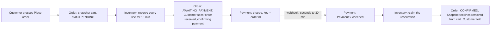
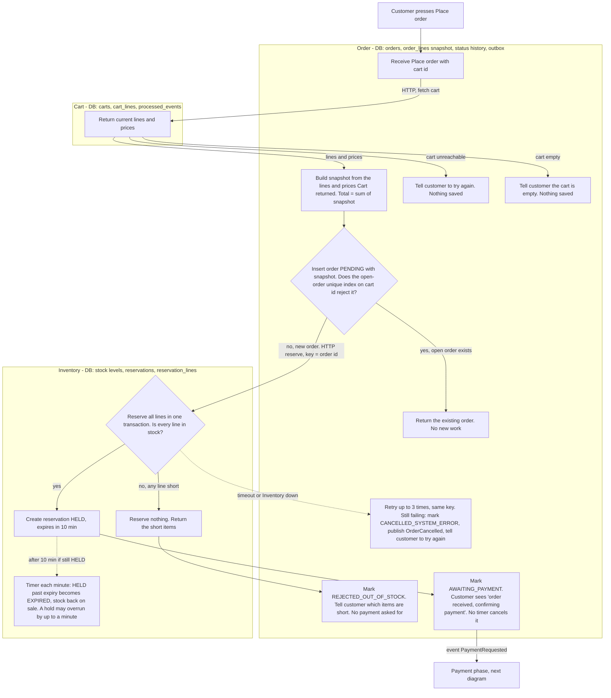
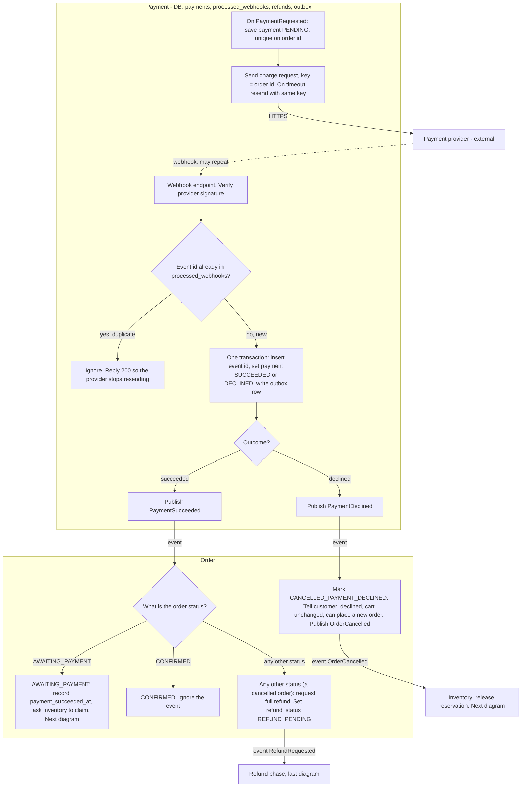
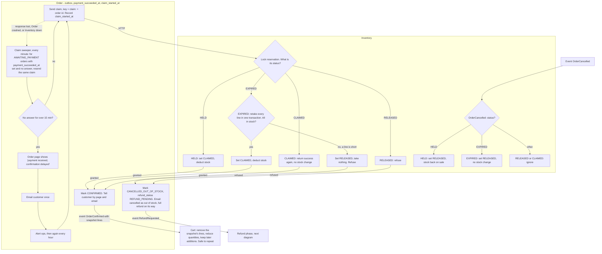
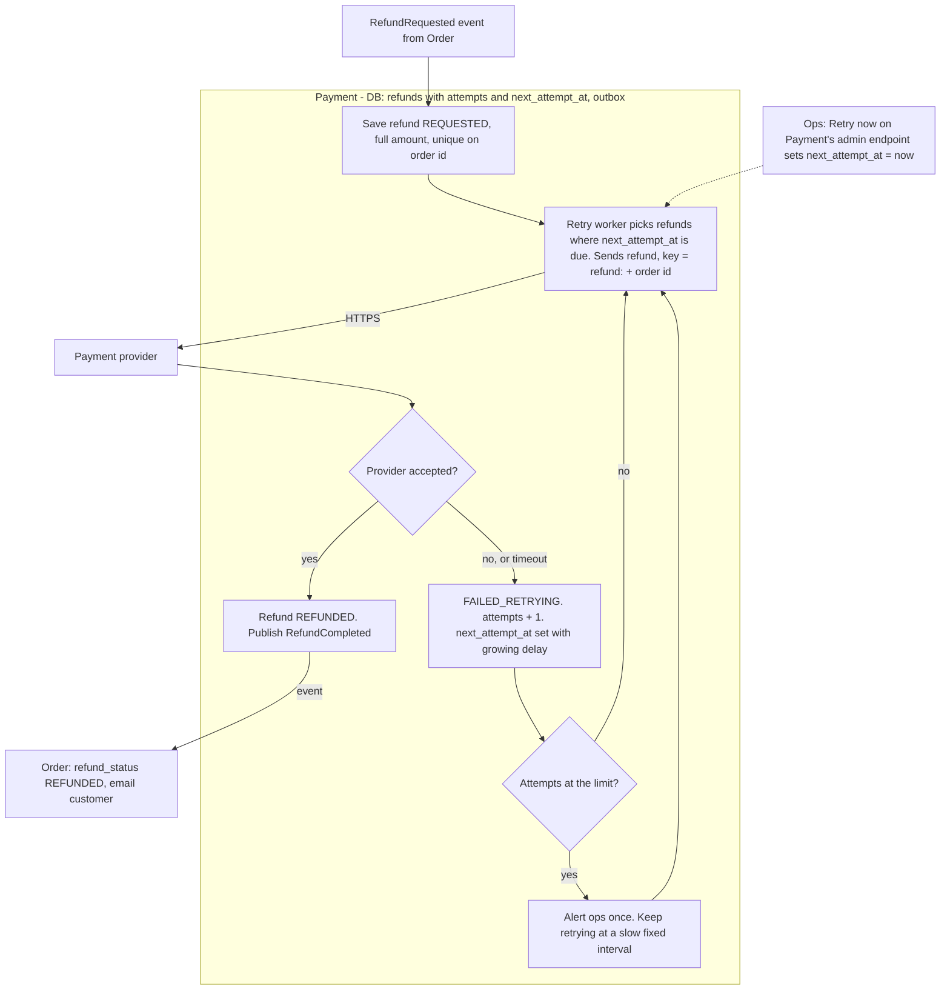

# Checkout across Cart, Inventory, Payment and Order

## How to read this

- **A paid order can still end as out of stock. This is by design.** The 10-minute hold protects stock while payment is pending. The provider can take up to 30 minutes to answer, so the hold can lapse first. If it has, the claim tries to take the stock again. If any line is short, the order is cancelled as out of stock and the customer is refunded in full. The design never keeps money for an order it can't fulfil. It does not promise that a paid order always ships.
- **Order** is the coordinator. It starts each step and records the order's state. The other three services each do one job and report back.
- **Order calls Cart and Inventory over HTTP** because it needs the answer now (the customer is waiting on the request). **Payment is driven by events** because the provider's answer takes seconds to 30 minutes.
- Each service has its own database and never reads another's tables.
- A state change that must tell another service is written in the same transaction as an outbox row. A relay then publishes it to the broker, so a crash can't leave a change without its event.
- Consumers of events and webhooks are idempotent: a repeated message changes nothing.
- The flow is split into one overview and four phase diagrams: reserve, payment outcome, claim and release, refund. Each phase diagram picks up where the previous one ends.
- In the diagrams, solid arrows are calls or events between services. Dotted arrows come from outside (the provider's webhook, a timer, or ops). Customer messages appear inside the step that sends them.
- Numbers such as "3 tries", "2 minutes" and "15 minutes" are initial values. All are configuration (see "To confirm").

## Overview: the happy path

## Keys and constraints

Every retried request uses a fixed key so the receiver can recognise it.

| Request | Key | Where it is enforced |
|---|---|---|
| Reserve (Order to Inventory) | `order id` | Unique on `reservations.order_id`. A repeat returns the existing reservation. |
| Charge (Payment to provider) | `order id` | Provider idempotency key, as required. Also unique on `payments.order_id`. |
| Claim (Order to Inventory) | `claim:` + `order id` | The claim outcome is stored on the reservation row (see Decision 1). A repeat returns the stored outcome and changes no stock. |
| Refund (Payment to provider) | `refund:` + `order id` | One full refund per order, so one key. Unique on `refunds.order_id`. |
| Place order (customer presses) | `cart id` | Partial unique index on `orders(cart_id)` where status is `PENDING` or `AWAITING_PAYMENT` (see Decision 2). |

## Decisions

1. **What the 10-minute hold means, and what claim and release do.** A reservation is `HELD`, `EXPIRED`, `RELEASED` or `CLAIMED`. The expiry timer, a claim and a release each run in a transaction that locks the reservation row, so they are serialised: they run one at a time, and the first one to run decides the outcome. The later ones see the new status and act on it as listed below.

   The expiry timer runs every minute, so a hold can overrun 10 minutes by up to a minute. This is acceptable: the extra minute only keeps stock off sale a little longer. A claim that finds the reservation still `HELD` past 10 minutes succeeds, because the stock is still ours.

   **Claim** (key `claim:` + order id), run when Order handles `PaymentSucceeded`:
   - `HELD`: set `CLAIMED`. Stock is deducted for good.
   - `EXPIRED`: try to take every line again in one transaction. If all lines are in stock, take them and set `CLAIMED`. If any line is short, take nothing, set `RELEASED` and refuse.
   - `RELEASED`: refuse.
   - `CLAIMED`: return success again without touching stock. This is what makes a retry after a lost response safe. The re-take and the status change happen in the same transaction, so a retry always sees the result.

   Refusing sets `RELEASED`, so a retry after a lost response is still refused, even if stock comes back in the meantime.

   **Release** (on `OrderCancelled`, after a decline or system error):
   - `HELD`: set `RELEASED`. Stock goes back on sale.
   - `EXPIRED`: set `RELEASED`. Stock is already back on sale, so no stock changes. A decline that arrives after the hold lapsed still leaves a clean record, and a later claim is refused.
   - `RELEASED` or `CLAIMED`: ignore.
2. **Duplicate and concurrent presses.** "This cart" means the `cart id` sent with Place order. Order has a partial unique index on `orders(cart_id)` where status is `PENDING` or `AWAITING_PAYMENT`. Two presses at the same moment both try to insert, one hits the index, and that one loads and returns the existing order. A closed order is never reused: after a decline or cancellation the index no longer covers it, so the next press creates a new order with a new id, a new reservation and a new charge key. The cart is untouched, so retrying is one press. If Order crashes while an order is `PENDING`, the row would block new presses, so a sweeper in Order cancels any `PENDING` order older than 2 minutes as `CANCELLED_SYSTEM_ERROR` and publishes `OrderCancelled`.
3. **The snapshot.** Order fetches the cart's lines and prices from Cart, builds the snapshot from exactly that response, and inserts the `PENDING` order with it. The order total is the sum of the snapshot, and Payment charges that total. An empty cart creates no order: the customer is told the cart is empty. Price changes after the fetch do not affect the order. If the customer saw older prices on screen, the order still uses the prices Cart returned at the moment of pressing, as the brief requires.
4. **Payment success for an order that is no longer waiting.** Payment is only asked to charge once an order is `AWAITING_PAYMENT`, so `PaymentSucceeded` can only arrive for an order that has been through that state. When it arrives, Order acts on the order's current status:
   - `AWAITING_PAYMENT`: record `payment_succeeded_at` and start the claim (see Phase 3).
   - `CONFIRMED`: ignore the event.
   - Any other status (in practice a `CANCELLED_*` state): request a full refund, set `refund_status` to `REFUND_PENDING`, and keep the order cancelled. If a refund is already requested, this is a no-op. We do not enumerate states, because the rule is the same: money was taken for an order we will not fulfil.

   This should be rare. An order leaves `AWAITING_PAYMENT` only through a payment outcome event, and Payment keeps the first outcome it recorded for a payment and raises an ops alert if the provider later reports the opposite one. So a late success after a cancellation is a safety net, not a normal path. For the same reason, a refund request never races a claim in flight: a claim exists only after `PaymentSucceeded`, and nothing else cancels an `AWAITING_PAYMENT` order.
5. **Refunds are tracked on the order, and owned by Payment.** `refund_status` on Order is empty by default. Order sets `REFUND_PENDING` in the same transaction that writes the `RefundRequested` outbox row, so a lost message cannot leave the two disagreeing for long: the relay keeps publishing until the broker accepts it, and Payment ignores repeats. Payment's `refunds` table is the record of what was actually attempted. Order sets `REFUNDED` on `RefundCompleted` and emails the customer. Orders that never took money have no `refund_status`.
6. **Emptying the cart.** The cart is emptied only on `OrderConfirmed`, and only of what was ordered. The event carries the snapshot's lines (cart line id and quantity). Cart removes each line, or reduces its quantity by the snapshot quantity and removes it at zero. Items the customer added during the payment window stay in the cart. Cart records the order id in its own `processed_events` table, so a repeated event does nothing.
7. **Crashes inside Order.** Order's status changes are compare-and-set on the current status, written with their outbox rows. If Order crashes after Inventory granted a claim but before `CONFIRMED` is saved, the order is still `AWAITING_PAYMENT` with `payment_succeeded_at` set, so the claim sweeper resends the same claim key. Inventory returns `CLAIMED` again with no stock change, and Order confirms.

## Order states

Order moves only along these transitions. Any event not listed for a state is ignored.

| From | Trigger | To | Refund |
|---|---|---|---|
| (none) | Place order, snapshot saved | `PENDING` | none |
| `PENDING` | Inventory reserved all lines | `AWAITING_PAYMENT` | none |
| `PENDING` | Any line short | `REJECTED_OUT_OF_STOCK` | none: payment was never requested |
| `PENDING` | Inventory failed after 3 tries, or `PENDING` for over 2 minutes | `CANCELLED_SYSTEM_ERROR` | none: payment was never requested |
| `AWAITING_PAYMENT` | `PaymentDeclined` | `CANCELLED_PAYMENT_DECLINED` | none: no money taken |
| `AWAITING_PAYMENT` | `PaymentSucceeded` and claim granted | `CONFIRMED` | none |
| `AWAITING_PAYMENT` | `PaymentSucceeded` and claim refused | `CANCELLED_OUT_OF_STOCK` | always: `REFUND_PENDING` |
| `CONFIRMED` | `PaymentSucceeded` (repeat) | no change | none |
| any `CANCELLED_*` | `PaymentSucceeded` (late, Decision 4) | no change | `REFUND_PENDING`, unless already set |

`REJECTED_OUT_OF_STOCK`, `CONFIRMED` and all `CANCELLED_*` states are final. `REJECTED_OUT_OF_STOCK` and a system-error cancellation of a `PENDING` order never have a refund, because no charge was ever requested for them. `CANCELLED_OUT_OF_STOCK` always has one. `CANCELLED_PAYMENT_DECLINED` has one only in the rare late-success case.

`refund_status` itself moves `(empty)` to `REFUND_PENDING` to `REFUNDED`, and nothing else.

## Phase 1: Place order and reserve

If Order gives up, `OrderCancelled` makes Inventory release any reservation that did succeed (Decision 1). The cart is untouched and no payment was requested.

## Phase 2: Payment and its outcome

## Phase 3: Claim, release and the claim sweeper

Order stores `payment_succeeded_at` when it handles `PaymentSucceeded`, in the same transaction as `claim_started_at` and the outbox row. The sweeper reads these fields from Order's own database, not from Payment.

The customer is paid but unconfirmed whenever Inventory cannot answer, or Order crashed after a grant and before saving `CONFIRMED`. The sweeper never gives up and never refunds on its own, because a lost response could hide a claim that succeeded. Resending the same key is always safe: Inventory returns the stored outcome. If Inventory is down for hours, ops is alerted after 15 minutes and hourly after that, and the customer sees the delay message and gets one email. When Inventory answers, the order is confirmed or refunded as above.

## Phase 4: Refund

Payment owns refund execution, including every retry. Order's `refund_status` only records that a refund was requested and whether it finished.

A refund leaves the flow only as `REFUNDED`. Reaching the retry limit adds an alert and slows the retries. It never stops them. A repeated `RefundRequested` hits the unique key on order id and does nothing. If a `RefundRequested` message is lost on its way, Order's outbox relay republishes it until the broker accepts it, so the request cannot be dropped.

## When a call fails

- **Reserve times out or Inventory is down.** Order retries up to 3 times in a few seconds, always with key = order id, so Inventory returns the same reservation instead of making another. If it still fails, see Phase 1.
- **Claim response lost, Order crashed, or Inventory down.** See Phase 3. The order stays `AWAITING_PAYMENT` and the sweeper resends the same claim key.
- **Cart unreachable at Place order.** Order saves nothing and tells the customer to try again.
- **Charge request times out.** Payment resends with the same key, so the provider returns the original charge.
- **Duplicate webhook.** The event id is inserted into `processed_webhooks` in the same transaction as the payment update. A repeat hits the unique key, is ignored, and gets a 200.

## To confirm

1. **Email.** Order sends the cancellation, confirmation, delay and refund emails through the existing mail sender. The brief names no notification service.
2. **Retry numbers.** These are configuration, with initial values as used above: 3 reserve tries, 2-minute `PENDING` cutoff, 15-minute claim alert, hourly re-alert. The refund attempt limit, backoff and slow interval have no value yet and need one.
3. **Manual override for a long Inventory outage.** Ops can only wait or fix Inventory. If you want a way to cancel and refund while Inventory is unreachable, it needs a way to block a late claim first. The brief doesn't ask for it.