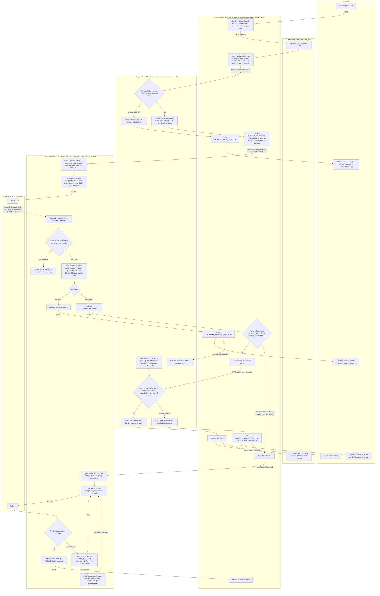

# Checkout across Cart, Inventory, Payment and Order

## How to read this

- Order is the coordinator. It starts each step and records the order's state. The other three services each do one job and report back.
- Solid arrows are calls or events between services. Dotted arrows come from outside, either the payment provider's webhook or a timer.
- Each service has its own database. A service never reads another service's tables.
- Every state change that has to tell another service is written in the same database transaction as an outbox row. A relay then publishes it to the broker. This means a crash can't leave a state change without its event.
- Consumers of events and webhooks are idempotent. A repeated message changes nothing.

## Flowchart

## Triggers and what each service stores

| Service | Triggered by | Stores | Never does |
|---|---|---|---|
| Cart | Order's HTTP request for the cart. `OrderConfirmed` event. | Cart lines, current prices | Empties the cart on anything except `OrderConfirmed` |
| Order | Place order. Inventory's reply. `PaymentSucceeded`, `PaymentDeclined` and `RefundCompleted` events. | Order, snapshot of lines and prices, status history, outbox | Touches stock or the provider |
| Inventory | Order's reserve and claim calls. `OrderCancelled` event. The expiry timer. | Stock levels, reservations with state `HELD`, `EXPIRED`, `RELEASED` or `CLAIMED` | Reads orders or payments |
| Payment | `PaymentRequested` and `RefundRequested` events. Provider webhooks. Retry worker. | Payments, processed webhook ids, refunds with attempt count and next retry time, outbox | Is the only service that talks to the provider |

## Order states

`PENDING` then one of:

- `REJECTED_OUT_OF_STOCK`: stock was short at reservation.
- `AWAITING_PAYMENT`, which leads to one of:
  - `CONFIRMED`
  - `CANCELLED_PAYMENT_DECLINED`
  - `CANCELLED_OUT_OF_STOCK`: a late success whose claim was refused, so a refund follows.

## Failure branches

| Case | What happens | Customer sees | Cart |
|---|---|---|---|
| Short stock | Inventory checks all lines in one transaction. If any is short it reserves nothing and returns the short items. Order marks `REJECTED_OUT_OF_STOCK`. Payment is never called. | The list of short items | Untouched |
| Declined payment | The webhook becomes `PaymentDeclined`. Order cancels. `OrderCancelled` makes Inventory release the hold straight away. | Payment declined, can retry | Untouched |
| Late success after the hold lapsed | The hold expired and the stock may be gone. Order asks Inventory to claim. The claim is refused, so Order cancels as out of stock and requests a full refund. Payment refunds automatically. No partial shipment. | Cancellation email | Untouched |
| Refund fails | The refund row stays open (`FAILED_RETRYING`) with an attempt count. A worker retries with the same refund key, so a retry can't refund twice. At the retry limit an alert goes to ops and the row stays in the manual queue until `REFUNDED`. | Refund arrives late | Untouched |
| Duplicate webhook | The provider event id is inserted into `processed_webhooks` in the same transaction as the payment update. A repeat hits the unique key, is ignored, and gets a 200. | Nothing | Unchanged |
| Retried charge request | The idempotency key is the order id, so the provider returns the original charge. | Nothing | Unchanged |

## Why the claim step exists

The payment webhook can arrive up to 30 minutes after the 10-minute hold started. So the hold can lapse before the money is confirmed. Inventory is the only authority on stock, and the claim is one transaction on the reservation row. A background expiry and a claim therefore can't both win. The outcome is either `CLAIMED` or refused, and a refused claim triggers the refund.

## Assumptions to confirm

1. **Lapsed hold with stock still free.** The claim re-takes all lines atomically instead of refunding. The customer keeps a paid order whenever it can still be fulfilled. To refund on every lapse, make the claim require a `HELD` reservation.
2. **Emails.** Order sends the "cancelled, refunded" email through the existing mail sender. No notification service is named in the brief. A "refund completed" email can be added on `RefundCompleted`.
3. **Emptying the cart.** On `OrderConfirmed`, Cart empties the whole cart. The brief doesn't say how to treat edits made after Place order.
4. **Refund outcome.** The diagram shows it as the provider's reply to the refund call. If the provider reports refunds by webhook, they go through the same signature check and `processed_webhooks` dedup as charges.
5. **Retry limit.** "Attempts exhausted" is a number to set. A refund is never closed by hitting it.
