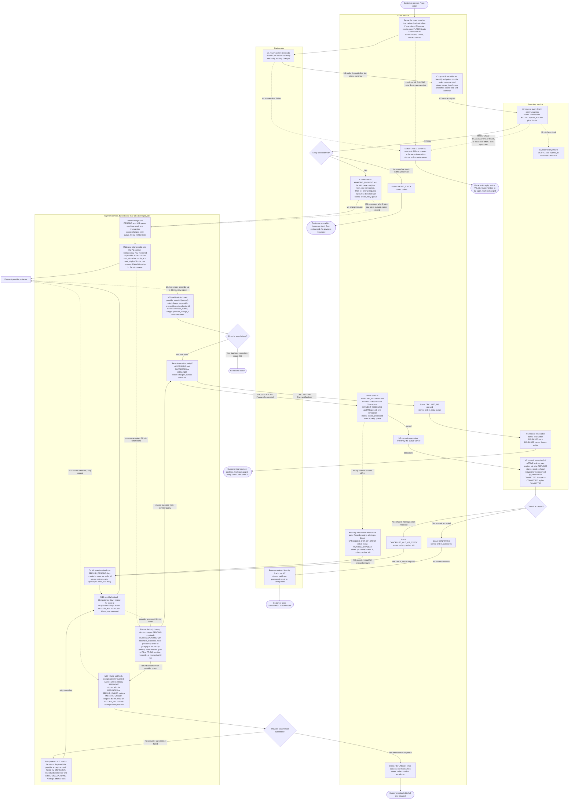

# Checkout across Cart, Inventory, Payment and Order

Checkout runs as four services. Order drives the flow. Inventory holds stock. Payment is the only service that talks to the payment provider. Cart is read once at the start, and changed once, at the very end, when Order confirms the order. Each service owns its own tables. Services talk over HTTP calls or broker events. Each service sends its events through its own outbox. Every message is listed in the Messages table below, with its transport, payload, idempotency key and what happens when there is no answer.

## Terms

- **Idempotency key**: a value sent with a request so that the receiver can tell a repeat from a new request. Repeats return the same result and change nothing.
- **Reservation (hold)**: stock set aside for one order. It lasts 10 minutes unless it is committed or released first.
- **Retry queue**: a table in a service's own database that holds calls it still has to make, with the next try time and the attempt count. A worker checks it every minute. A row is removed when its call gets its final answer (see Retries).
- **Outbox**: a table in a service's own database that holds events it still has to publish. The event is written in the same database transaction as the change it reports. A relay process publishes unsent rows to the broker and marks them sent.
- **Broker**: the shared message broker that carries events between services. Each consumer has its own durable subscription.
- **Webhook**: an HTTP POST that the payment provider sends to Payment when a charge or refund has an outcome. Webhooks can arrive late or more than once.
- **Reconciliation**: when no webhook has arrived 30 minutes after the provider accepted a charge or refund, Payment asks the provider for the outcome itself.
- **Checkout token**: a value that the customer's page creates once for each press of Place order and sends with that request. It lets Order tell a repeated press (the same token) from a new press.
- **Open order**: an order in status PLACING, AWAITING_PAYMENT or PAYMENT_RECEIVED. A cart has at most one open order at a time.
- **Recovery job**: a job in Order that runs every minute and fails orders left in PLACING for more than 5 minutes (see Retries).

## Messages

| ID | Message | From to | Transport and reply | Carries | Idempotency key | If there is no answer |
|---|---|---|---|---|---|---|
| M1 | Get cart | Order to Cart | HTTP GET, reply with current lines (cart line id, sku, qty, unit price) and currency | cart id | none, read only | Retry 3 times, 2 s timeout each. Then Order sets FAILED. Nothing was reserved, cart unchanged |
| M2 | Reserve stock | Order to Inventory | HTTP POST, reply RESERVED, or SHORT (with the short skus), or REFUSED (with reason RELEASED or EXPIRED, when a record for this order id already exists in that state) | order id, lines (sku, qty) | order id | Retry 3 times. Then Order sets FAILED and queues M6. Any REFUSED reply, whatever its reason, also sets FAILED and queues M6. Any reply that arrives after Order has given up is dropped |
| M3 | Commit reservation | Order to Inventory | HTTP POST, reply COMMITTED or REFUSED (with a reason: EXPIRED, RELEASED or NOT_FOUND) | order id | order id | Order's retry queue. A repeat on a reservation that is already COMMITTED replies COMMITTED and changes nothing |
| M4 | Charge request | Order to Payment | HTTP POST, reply 202 Accepted once the charge row and its M11 queue row are stored | order id, amount, currency | order id | Retry 3 times inline, right after the AWAITING_PAYMENT commit. If still no answer, the M4 row stays in Order's retry queue (same order id) and the order stays AWAITING_PAYMENT. Payment returns the existing charge for that order id, so a late repeat cannot charge twice. Order does not wait for the provider |
| M5 | Payment outcome | Payment to Order | Event PaymentSucceeded or PaymentDeclined, on the broker, sent through Payment's outbox | order id, charge id, amount | event id | Payment's outbox relay retries until the broker accepts. Order ignores repeats by event id |
| M6 | Release reservation | Order to Inventory | HTTP POST, reply RELEASED. An ACTIVE reservation becomes RELEASED. If there is no record, Inventory creates a RELEASED record with no stock. For a RELEASED or EXPIRED record it changes nothing. For a COMMITTED record it changes nothing and replies COMMITTED, and Order alerts ops | order id | order id | Order's retry queue. Repeats change nothing |
| M7 | Order confirmed | Order to Cart | Event OrderConfirmed, on the broker, sent through Order's outbox | order id, cart line ids of the ordered lines (from order_lines) | event id | Order's outbox relay retries until the broker accepts. Cart removes only those lines, so a repeat changes nothing |
| M8 | Order cancelled, refund required | Order to Payment | Event OrderCancelledOutOfStock, on the broker, sent through Order's outbox. Also sent for the anomaly cases in Decisions | order id, amount (the amount Payment charged, from M5), currency | event id | Same as M7. Payment creates the refund row once per order id, so a repeat changes nothing |
| M9 | Refund completed | Payment to Order | Event RefundCompleted, on the broker, sent through Payment's outbox | order id, refunded amount | event id | As M5 |
| M10 | Provider webhook | Provider to Payment | HTTP POST from the provider | provider event id, type, charge or refund id, and the order id or refund key the provider echoes back (unknown, see open questions) | provider event id | Payment returns 200 only after its database commit. Otherwise the provider resends |
| M11 | Charge at provider | Payment to provider | HTTP POST. The provider's immediate reply is only an acknowledgment. The outcome comes only by M10 or reconciliation | order id, amount, currency | Idempotency-Key = order id | Payment's retry queue, same key. The first try is made right after the commit that writes the row. The 30 min timer starts only when the provider accepts it |
| M12 | Refund at provider | Payment to provider | HTTP POST, full amount. The immediate reply is only an acknowledgment | order id, amount, currency | Idempotency-Key = refund for order id | Payment's retry queue, same key. The first try is made right after the commit that writes the row |

## Retries

- Calls made while the customer waits (M1, M2, M4) use a 2 s timeout and 3 tries. The customer's Place order request waits for them.
- Order's retry queue holds M3, M4 (its row is written in the same transaction as the AWAITING_PAYMENT commit) and M6. Payment's retry queue holds M11 and M12. Each queued call retries with the same idempotency key.
- A queue row is removed when its call gets its final answer: M3 on COMMITTED or REFUSED, M4 on the 202 from Payment, M6 on RELEASED, and M11 or M12 when the provider accepts the call.
- Before each M4 try, Order checks that the order is still AWAITING_PAYMENT. If it has left that status, an outcome has already come back from Payment, so a charge row exists. The row is then removed without calling.
- A refund that the provider later reports as REFUND_FAILED is a new failed try on the same refund, not a new call. Its M12 row is reopened (see P7 and P8).
- The first try of an M4 row is the inline try made right after the AWAITING_PAYMENT commit. If the process crashes before that try, the minute-check worker sends it. The first try of an M3 or M6 row is the next minute-check after its row is written. Payment's M11 and M12 rows are due at once: Payment makes the first try right after the commit that wrote the row, and the minute-check worker takes over only if that try fails.
- After a failed try, the wait starts at 1 minute and doubles up to a cap of 1 hour. Queued calls never give up.
- Events (M5, M7, M8, M9) are not retried through a queue. They wait in the sending service's outbox until the relay has published them. Outbox rows are never dropped. A consumer keeps a delivered event until its own commit succeeds (see Decisions).
- After N = 10 failed tries on any queued call or outbox row, and after 10 failed deliveries of one event to a consumer, the service alerts ops. The row or message is kept until the call, publish or delivery succeeds.
- Stuck PLACING orders: the recovery job in Order checks every minute for orders that have been PLACING for more than 5 minutes. Each such order is set to FAILED, and its M6 row is written in the same transaction. Normal Place order requests finish well inside 5 minutes, because M1 and M2 each have a 2 s timeout and 3 tries. M6 is safe even when no reservation was made, because Inventory then creates a RELEASED record.

## Flow

## How to read it

- Each box names its owner service, what it stores, and what triggers it. Each arrow is labelled with its message id (M1 to M12), or with a timer or wait.
- Solid arrows are HTTP calls or broker events. Dotted arrows are waits: webhooks, timers, the sweeper, the recovery job and anomaly paths.
- Events (M5, M7, M8, M9) are drawn as arrows, but each one leaves through the sending service's outbox. The outbox is written in the same transaction as the state change.
- Cart is written only at C2, after the order is confirmed. Every failure branch leaves the cart exactly as it was.
- No service reads another service's tables. Each cross-service fact arrives by call or event.

## Customer experience

- Each press of Place order carries a checkout token (see Decisions). The customer's page sends Place order as an HTTP POST to Order, with the cart id and the checkout token. The Place order request returns after M1, M2 and M4. Its reply always carries the order id and the order's current status. Worst case the request waits about 18 s: three tries of 2 s each for M1, M2 and M4.
  - Short stock: the reply has status SHORT_STOCK and lists the short items.
  - Otherwise: the reply has status AWAITING_PAYMENT. If M4 gets no answer after 3 tries, the order is still AWAITING_PAYMENT and the M4 row stays queued, so the reply is the same.
  - Failed before a reservation was confirmed (M1 gave no answer after 3 tries, or M2 gave no answer after 3 tries or was REFUSED for any reason): the reply has status FAILED. The M6 release, if any, is queued in the background and the reply does not wait for it. The page needs no polling for a FAILED reply.
  - A repeated press while the order is still open: the reply returns that open order's current status (PLACING, AWAITING_PAYMENT or PAYMENT_RECEIVED), so no second order is made.
- The customer's page polls GET /orders/{id} on Order every 2 seconds only when the reply or the last poll shows a pending status (PLACING, AWAITING_PAYMENT or PAYMENT_RECEIVED). It stops at a final status. Final statuses are CONFIRMED, DECLINED, SHORT_STOCK, FAILED and REFUNDED. Polling is used for simplicity. Push is not part of this design.
- The pending page is shown while the status is PLACING, AWAITING_PAYMENT or PAYMENT_RECEIVED. An order cancelled out of stock shows "cancelled, refund in progress" until it reaches REFUNDED. The customer is not told about a failed refund: Order learns of a refund only at M9, and ops is alerted instead.

Order statuses: PLACING, FAILED, SHORT_STOCK, AWAITING_PAYMENT, DECLINED, PAYMENT_RECEIVED, CONFIRMED, CANCELLED_OUT_OF_STOCK, REFUNDED.

## What each service stores

| Service | Stores | Notes |
|---|---|---|
| Cart | Cart and cart lines; processed event ids (M7) | Read at M1 (line ids, lines, prices, currency). Written only at M7, which removes the ordered lines. |
| Order | orders (order id, cart id, checkout token, status, total, currency; checkout token unique; at most one open order per cart); order_lines (frozen snapshot: cart line id, sku, qty, unit price); status history; processed event ids (M5, M9); outbox (M7, M8, customer email); retry queue (M3, M4, M6) | The snapshot never changes after Place order. The total is the sum of line price times quantity, computed in O2. The one-open-order rule is a unique index over cart id where status is PLACING, AWAITING_PAYMENT or PAYMENT_RECEIVED. |
| Inventory | stock on hand; reservations (order id, sku, qty, status ACTIVE, COMMITTED, RELEASED or EXPIRED, expires_at) | Available stock = on hand minus ACTIVE reservations not past expiry. On COMMIT, on hand drops by the reserved qty, so committed stock is no longer counted as held. Keyed by order id. A RELEASED record is kept, with no stock, so a late reserve for that order id is refused. |
| Payment | charges (key = order id; provider_charge_id, set when first seen; PENDING, SUCCEEDED, DECLINED; sent_at, reconcile_at, indexed); refunds (key = refund for order id; provider refund id when first seen; REFUND_PENDING, REFUNDED, REFUND_FAILED; reconcile_at); webhook_events (unique provider event id, matched or unmatched); outbox (M5, M9); retry queue (M11, M12) | Only service with provider credentials. The 30 min timer is the reconcile_at column, so it survives restarts. The reconciliation job scans that column. |

## Failure branches

| Branch | Where in diagram | What happens | Cart | Customer sees |
|---|---|---|---|---|
| Short stock | D_STOCK, No | Inventory reserves nothing, in one transaction (M2). Order is SHORT_STOCK. No charge is requested. | Unchanged | The short items, in the Place order reply |
| Cart or Inventory does not answer, or Inventory refuses M2 | M1 or M2, no answer after 3 tries; or M2 REFUSED | Order is FAILED, in the same step as the reply. M6 release is queued. A late M2 is refused by Inventory (see Decisions). The stock returns at 10 minutes at the latest. | Unchanged | "Checkout failed, try again", in the Place order reply |
| Order stops in PLACING | Recovery job, or the order crashes before AWAITING_PAYMENT | After 5 minutes in PLACING, the recovery job sets FAILED and writes the M6 row in one transaction. Nothing is charged, because M4 is sent only after AWAITING_PAYMENT is committed. A late M2 is refused by Inventory. | Unchanged | "Checkout failed, try again" on the next poll. If the Place order request was lost, the customer retries, and a repeat press is refused until the recovery job has failed the order |
| Crash after AWAITING_PAYMENT is committed | M4 row in Order's retry queue | The M4 row was written in the same transaction as the commit, so the minute-check worker sends M4 with the same order id. Payment cannot charge twice. | Unchanged | Pending page |
| Charge request does not answer | M4, no answer after 3 tries | Order stays AWAITING_PAYMENT. The M4 row stays queued with the same order id. Payment cannot charge twice. | Unchanged | Pending page. See open questions |
| Declined payment | P4, DECLINED | Order is DECLINED. M6 release is queued. | Unchanged | Decline message. A retry creates a new order |
| Late success after hold lapsed | D_RES, No | Commit is refused (M3), for any reason. Order is CANCELLED_OUT_OF_STOCK and sends M8 through its outbox. Payment refunds the full amount (M12). Email is queued in the same step as REFUNDED, after M9 RefundCompleted. | Unchanged | "Cancelled, refund in progress", then the refund and the email |
| Succeeded charge in an unexpected state or with a different amount | M5 PaymentSucceeded checked in O_PAID | Event id is recorded and ops is alerted. M8 is sent so Payment refunds the full charged amount. Status becomes CANCELLED_OUT_OF_STOCK only if the order was AWAITING_PAYMENT. Money is never kept for an order that is not confirmed | Unchanged | "Cancelled, refund in progress" if the status changed. Otherwise nothing new |
| Failed refund | D_REF, No | Provider says the refund failed: the row becomes REFUND_FAILED, and the refund's M12 row is reopened with the attempt count plus one. It resends with the same key after backoff. Ops is alerted after 10 tries. The row is kept until a send is accepted. A refund with no answer stays REFUND_PENDING and is retried the same way. | Unchanged | "Cancelled, refund in progress". No email until the refund is confirmed |
| Commit does not answer | M3, no answer | Order stays PAYMENT_RECEIVED and retries from its queue. Ops is alerted after 10 tries. If the hold lapses while retrying, the commit is refused and the late-success branch applies. | Unchanged until M7 | "Payment received, confirming order" |
| Duplicate webhook | D_DUP, Yes; same idea at P7 | Charge: the provider event id is already stored, so the insert fails. Nothing happens and 200 is returned. The update applies only while the charge is PENDING. Refund: the update applies unless the refund is already REFUNDED, so a repeat REFUNDED sends no second M9. | Unchanged | Nothing new |
| Unmatched webhook | P3, no charge or refund matches | The event is stored as unmatched, ops is alerted, and 200 is returned so the provider does not resend forever. Charges are still found by reconciliation (P9) by order id | Unchanged | Pending page until resolved |
| Event for an order in an unexpected state | M5 DECLINED or M9 for an order not in the expected state | Event id is recorded and ops is alerted. Status does not change. See Decisions | Unchanged | Nothing new |
| No webhook | P9 | At reconcile_at (30 min after the provider accepted the charge or refund), Payment asks the provider by order id (charge) or refund key (refund) and feeds the answer into P4 or P7. If the provider still says pending, it asks again after another 30 min. | Unchanged | Pending page until resolved |
| Event delivery keeps failing | A consumer cannot commit an event (for example its database is down) | The message is not acknowledged, so the broker redelivers it. Ops is alerted after 10 failed deliveries. The message is not dropped. See Decisions | Unchanged until M7 is consumed | Depends on the event: see the rows above |

## Decisions beyond the brief (for review)

- The Place order request is an HTTP POST from the customer's page to Order, carrying the cart id and the checkout token. Its reply is the order id and the current status. The brief does not say how this request is authenticated (see open questions).
- Every Inventory call is keyed by order id, so reserve, commit and release can be retried safely.
- Each service writes its events through a transactional outbox. The event row is written in the same database transaction as the state change, and a relay publishes it afterwards and marks it sent. A committed change is never lost. Delivery is at least once, so receivers ignore repeats by event id.
- Events (M5, M7, M8, M9) travel on the shared broker. Each consumer has its own durable subscription: Order for M5 and M9, Cart for M7, Payment for M8. A consumer acknowledges a message only after its own database commit. A technical failure (for example its database is down) leaves the message unacknowledged, so the broker redelivers it. After 10 failed deliveries ops is alerted, and the message is not dropped. A logical anomaly (an unexpected state or amount) is not a failure: the handler records the event id, alerts ops and acknowledges. No dead-letter queue is used, because a message moved there would stop without a retry. The broker's redelivery and dead-letter settings are not named in the brief (see open questions).
- Payment handles a webhook in one transaction: insert the provider event id (unique), and, only if the charge is still PENDING, set the outcome and write the outbox event. A duplicate fails the insert and changes nothing.
- Payment matches a webhook to its charge or refund by the provider charge or refund id, once that id is stored. Until then it uses the order id or refund key that the provider echoes back. Whether the provider echoes them is unknown (see open questions). Payment stores the provider's id the first time a webhook or reconciliation answer shows it.
- Payment does not use the immediate reply from the provider (M11, M12) to set an outcome. The outcome comes only from a webhook (M10) or a reconciliation query (P9). The brief does not say what that immediate reply contains, so the design does not depend on it.
- Payment sends M11 right after the P1 commit, not at the next minute check. P1 writes the charge row and the M11 queue row in one transaction, replies 202, and makes the first send. If that send fails, the minute-check worker takes over. A failed or slow send never changes the charge outcome.
- The 30 min timer starts when the provider accepts the charge or refund, not on the first attempt. Payment sets reconcile_at in the same transaction that records the acceptance, and removes the queue row in that transaction. If the provider never accepts, no timer runs (see open questions).
- Reconciliation (P9) runs every minute. It takes charges PENDING and refunds REFUND_PENDING whose reconcile_at has passed, and asks the provider. An answer of succeeded, declined, refunded or refund failed is applied with the same conditional update the webhook uses, so a webhook and a query that both arrive apply once. An answer of still pending sets reconcile_at to now plus 30 min. A charge or refund that the provider does not find is treated as not accepted, not as declined (see open questions).
- A retry queue row is removed when its call gets its final answer. For M11 and M12 that is the provider's acceptance of the call. A REFUND_FAILED webhook is not a new call. In the same transaction that sets REFUND_FAILED (P7), Payment reopens the refund's M12 row with the attempt count plus one and the next try after backoff. The count carries over, so ops is still alerted after 10 failed tries on that refund, and a repeated failure cannot loop silently. The row is removed once a resend is accepted.
- Order commits status AWAITING_PAYMENT and writes the M4 queue row (due now) in the same transaction, and only then sends M4. So a PaymentSucceeded or PaymentDeclined from Payment never finds the order still in PLACING. If the process crashes between that commit and the M4 try, the minute-check worker sends M4, so an order is never left in AWAITING_PAYMENT with no charge request. Before each M4 try, the worker checks the order. If it has left AWAITING_PAYMENT, an outcome has already come back, the charge row exists, and the M4 row is removed without a call. If an M4 try were sent anyway, Payment returns the existing charge.
- The inline M4 try (right after the commit) and a minute-check M4 retry can overlap in time. Both send the same order id. Payment's charge row is keyed by order id, so the second send returns the existing charge and cannot charge twice. No lock or coordination between Order's inline try and its worker is needed.
- Order handles M5 (PaymentSucceeded) in one transaction: check that the order is AWAITING_PAYMENT and that the M5 amount equals the stored total, record the event id as processed, set PAYMENT_RECEIVED and write the M3 queue row, which is due now. The event is acknowledged to the broker only after that commit, so a failed commit means the event is redelivered. The queue worker, which checks every minute, makes the first M3 attempt.
- M5 that is not on the normal path is handled as follows. PaymentSucceeded for an order not in AWAITING_PAYMENT, or with an amount that differs from the total: the event id is recorded, ops is alerted, M8 is sent with the amount Payment charged, so the full charge is refunded. The status becomes CANCELLED_OUT_OF_STOCK only if it was AWAITING_PAYMENT, and otherwise does not change. PaymentDeclined for an order not in AWAITING_PAYMENT (for example one already PAYMENT_RECEIVED or CONFIRMED): the status check in the same transaction finds it is not AWAITING_PAYMENT, so only the event id is recorded and ops is alerted. The status does not change, and no M6 or M8 is sent. A repeat with an event id already processed changes nothing.
- The M5 amount is compared with orders.total before the order is confirmed. Payment sends the same amount it charged, so a mismatch means one of the two sides is wrong, and ops is alerted.
- The commit step checks expires_at itself and does not rely on the sweeper. The sweeper runs every minute, so a lapsed hold can still show ACTIVE for up to a minute. Commit refuses it anyway.
- The hold is not extended. From minute 10 the stock is on sale again, while the payment may still be pending. A late success is refunded, as the brief requires.
- Late success is detected at commit time. The design does not re-reserve stock.
- Inventory replies COMMITTED to a repeat M3 for an order that is already COMMITTED. Order sends M3 only after PaymentSucceeded, so a RELEASED reservation at commit should not normally happen. If it does, any REFUSED reply, for any reason (EXPIRED, RELEASED or NOT_FOUND), leads to CANCELLED_OUT_OF_STOCK and a full refund. Order does not branch on the reason: all three reasons take the same path. Money is never kept for an order that cannot be filled.
- M2 and M6 can arrive in either order at Inventory, because M2 may still be in flight when Order gives up. M6 is queued only after M2's 3 tries, so this happens only with an earlier try that was still in flight. If M6 finds no record, Inventory creates a RELEASED record with no stock. A later M2 for that order id then gets REFUSED with reason RELEASED and reserves nothing. Order does not act on that reply beyond FAILED: it has already set FAILED, so it drops any reply that arrives late. Any REFUSED reply that reaches Order, for any reason, sets FAILED and queues M6, the same as no answer after 3 tries. The M6 is harmless in that case, because Inventory already holds a RELEASED or EXPIRED record for that order id.
- Order sends the customer email only after M9 RefundCompleted. The email row is written to Order's outbox in the same transaction that sets REFUNDED, and only from CANCELLED_OUT_OF_STOCK. The relay sends it. A repeat M9 is ignored by event id, and a repeat finds the order already REFUNDED, so no second email row is written.
- M9 for an order that is not CANCELLED_OUT_OF_STOCK or REFUNDED cannot be normal, because a refund only exists after M8. Order records the event id, does not change the status, does not send an email, and alerts ops. Order never sees REFUND_FAILED. It learns of a refund only at M9, and a failed refund is handled by Payment's queue and by ops.
- Cart consumes M7 in one transaction: it records the event id as processed and deletes the listed lines by line id. The line ids come from the order_lines snapshot, which copied them from the M1 reply. Lines the customer added after Place order have other line ids and stay in the cart. An ordered line that the customer changed after Place order is still removed, because the order holds the snapshot taken before the change. A line already removed matches nothing, so a repeat changes nothing. Cart acknowledges the broker message only after its commit, so a Cart failure is redelivered by the broker. Cart does not reply to Order, and Order does not wait for it. Order's outbox row is done once the broker accepts it.
- REFUND_FAILED is set only when the provider says the refund failed, by webhook or reconciliation query. No answer or a timeout leaves the refund REFUND_PENDING. A retry sets it back to REFUND_PENDING when it resends M12.
- Order total is the sum of line price times quantity from the frozen snapshot. The currency comes from Cart's M1 reply. Tax, shipping and discounts are not in the brief and are not in this total (see open questions).
- A retry after a decline uses a new order id, because the provider key is the order id.
- Order generates the order id in O1, when it creates the order. The id is used as the key for Inventory, Payment and the events.
- Repeated presses of Place order do not make a second order. The customer's page creates a checkout token once per press and sends it with the request. Order keeps the token on the order, unique. A request with a token it has already seen returns that order's current status and changes nothing. A request with a new token, for a cart that already has an open order (PLACING, AWAITING_PAYMENT or PAYMENT_RECEIVED), also returns that open order. A unique index over cart id where status is open makes this hold under concurrent presses. A new order is created only when the cart has no open order. A retry after DECLINED, SHORT_STOCK or FAILED is therefore a new press with a new order id, and it may reserve stock again.
- A PLACING order that never finishes (a crash, or a lost request) is failed by the recovery job after 5 minutes, and the M6 release is written with it. This is safe because nothing is charged before AWAITING_PAYMENT is committed, and Inventory refuses a late M2 for that order id. The 5 minutes is far longer than the normal Place order path, which is bounded by the 2 s timeouts and 3 tries of M1 and M2. The threshold is a design choice, not a brief requirement.
- The Place order reply always returns the order's current status. FAILED is a final status, so the page does not poll after a FAILED reply. The M6 release that follows a FAILED reply is queued in Order's retry queue and does not delay the reply.
- Reconciliation (P9) is not in the brief. It is added so that an order cannot wait forever on a lost webhook. Refunds work the same way, by refund key.
- Retry rules are in the Retries section. Ops is alerted after N = 10 failed tries.

## Open questions

- How the customer's page authenticates the Place order request and the polling requests to Order is not in the brief.
- How the outbox relay processes and the minute-check workers are deployed and coordinated, and how a stuck worker is detected, is not decided here.
- Cart edits during checkout: the design removes only the ordered lines (by line id) and keeps anything added later. This design assumes that is the intended behaviour.
- Should the cart be locked during checkout? The brief does not require it, and this design does not lock it.
- Where do the alerts go (REFUND_FAILED, commit not answering, charge request not answering, outbox stuck, unmatched webhook, anomalous M5 or M9, M6 reply COMMITTED, Cart consumer stuck, any consumer failing to deliver an event, PLACING order failed by the recovery job)? Ops needs a named channel and a runbook.
- Which message broker carries the events, and what are its redelivery, ordering and dead-letter settings? The brief says only "the shared message broker". The design assumes each consumer has a durable subscription and that a message is redelivered until it is acknowledged. Whether the broker keeps redelivering a message that always fails, and in what order, is not known.
- Should Order cancel early when the reservation expires, instead of waiting for the webhook? This design waits, because late success must still be handled.
- Can the provider still report a charge or refund as pending after 30 minutes? This is unknown. The brief gives 30 minutes as the webhook delay, not as a hard limit. The design re-queries and keeps the order waiting, so the pending page could last longer than 30 minutes.
- Does the provider's webhook carry the order id (for a charge) or the refund key (for a refund) as an echoed reference? Does its immediate acceptance reply carry the provider charge or refund id? Neither is in the brief. Until one of them is known, Payment matches a webhook only by the id it has already stored, and an unmatched webhook is an ops case.
- What does the provider answer to a reconciliation query for an order id or refund key that it does not know? This design treats it as not accepted, not as declined. Ops decides whether that is a permanent state.
- What if a charge never reaches the provider (M4 or M11 keeps failing)? No timer runs, and the order waits in AWAITING_PAYMENT while its reservation expires. The brief gives no timeout for this. Ops decides the rule, and this is not decided here. While the order is open, its cart cannot start a new order.
- Does the provider return the old result when a refund is retried with the same Idempotency-Key after it failed? If it does, a retry needs a new attempt key, and that must not allow a second refund. Unknown.
- A FAILED refund webhook from an earlier attempt can arrive after a retry has been sent. The design does not yet match webhooks to attempts. Unknown how the provider labels attempts.
- Which email service sends the customer email is not named in the brief. A crash between sending the email and marking the outbox row sent could send it twice. Accepted risk is not decided here.
- Taxes, shipping and discounts are not in the brief. The total in O2 assumes line price times quantity only.
- The 5 minute threshold for failing a stuck PLACING order is a design choice. The brief does not set it, and the customer's page has no way to learn the order id if the Place order reply is lost. How a customer who lost the reply finds out about the order is not decided here.
- Empty cart: the M1 reply may contain no lines. The design does not say whether Order should refuse the checkout, set FAILED, or do something else, and what total and currency an empty order would carry. Not decided here.