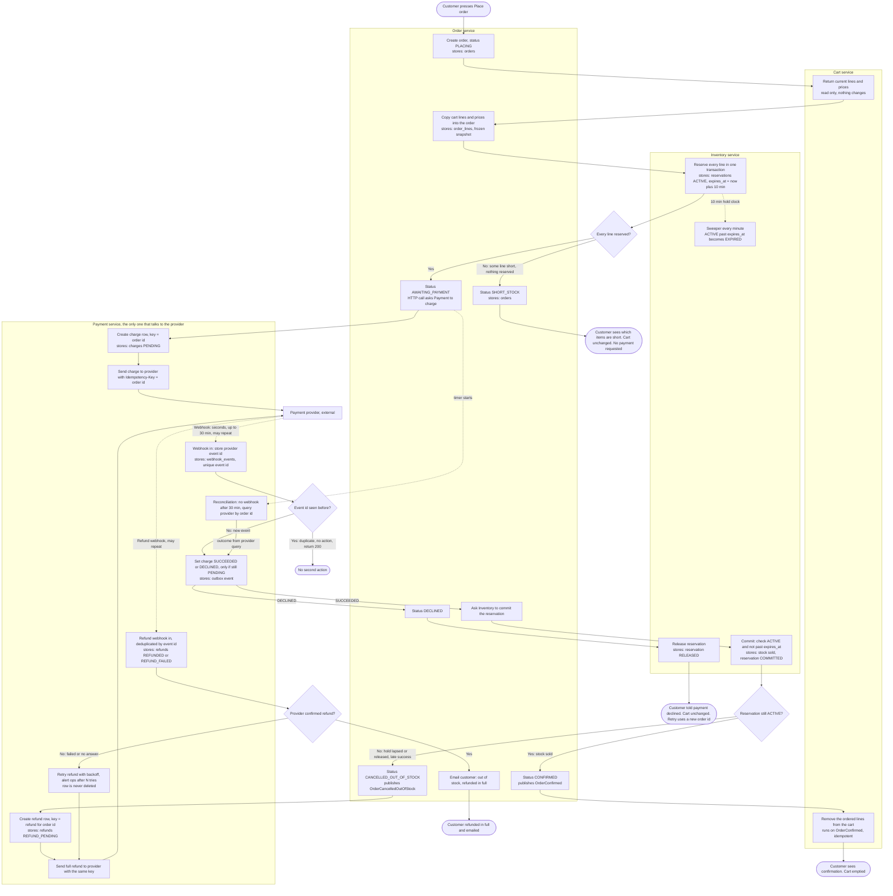

# Checkout across Cart, Inventory, Payment and Order

Checkout runs as four services. Order drives the flow. Inventory holds stock, Payment is the only service that talks to the payment provider, and Cart is written once, at the very end. Each service owns its tables. Services talk over HTTP or through broker events.

## Flow

## How to read it

- Each box names its owner service, what it stores, and what triggers it.
- Solid arrows are HTTP calls or broker events. Dotted arrows are waits: webhooks, timers and the sweeper.
- Cart is written only at C2, after the order is confirmed. Every failure branch leaves the cart exactly as it was.
- No service reads another service's tables. Each cross-service fact arrives by call or event.

## What each service stores

| Service | Stores | Notes |
|---|---|---|
| Cart | Cart and cart lines | Read at Place order. Written only at C2. |
| Order | orders (status), order_lines (frozen snapshot), status history, processed event ids | The snapshot never changes after Place order. |
| Inventory | stock (on hand), reservations (order id, sku, qty, status, expires_at) | Available stock = on hand minus ACTIVE reservations. Keyed by order id. |
| Payment | charges (key = order id), refunds (key = refund for order id), webhook_events (unique provider event id), outbox | Only service with provider credentials. |

## Failure branches

| Branch | Where in diagram | What happens | Cart | Customer sees |
|---|---|---|---|---|
| Short stock | D_STOCK, No | Inventory reserves nothing, in one transaction. Order is SHORT_STOCK. No payment is requested. | Unchanged | The short items |
| Declined payment | P4, DECLINED | Order is DECLINED. Inventory releases the hold. | Unchanged | Decline message. Retrying creates a new order |
| Late success after hold lapsed | D_RES, No | Commit is refused. Order is CANCELLED_OUT_OF_STOCK. Payment refunds the full amount. Email is sent once the refund is confirmed. | Unchanged | Cancellation and refund email |
| Failed refund | D_REF, No | The refund row stays open and is retried with backoff. Ops is alerted after N tries. The row is never deleted. | Unchanged | No refund email until the refund succeeds |
| Duplicate webhook | D_DUP, Yes; same check at P7 | The provider event id is already stored, so nothing happens and 200 is returned. The conditional update (only if PENDING) blocks a second outcome for the same charge. | Unchanged | Nothing new |
| No webhook | P9 | After 30 min, Payment asks the provider by order id and feeds the answer into P4. | Unchanged | Pending page until resolved |

## Decisions beyond the brief (for review)

- Every Inventory call is keyed by order id, so reserve, commit and release can be retried safely.
- Each service writes its events through a transactional outbox, so a committed state change is never lost.
- The commit step checks expires_at itself and does not rely on the sweeper. The sweeper runs every minute, so a lapsed hold can still show ACTIVE for up to a minute.
- Late success is detected at commit time. The brief says refund, so the design does not try to re-reserve the stock.
- A retry after a decline must use a new order id. The provider key is the order id, so reusing it would return the original declined result.
- The reconciliation job (P9) is not in the brief. It is added so that an order cannot wait forever on a lost webhook.
- Order sends the customer email, because Order owns customer communication.

## Open questions

- Cart edits during checkout: should C2 remove only the ordered lines (by line id) and keep anything added later? This design assumes yes.
- Should the cart be locked during checkout? The brief does not require it, and this design does not lock it.
- Where does REFUND_FAILED alert go? Ops needs a named channel and a runbook.
- Should Order cancel early when the reservation expires, instead of waiting for the webhook? This design waits, because late success must still be handled.