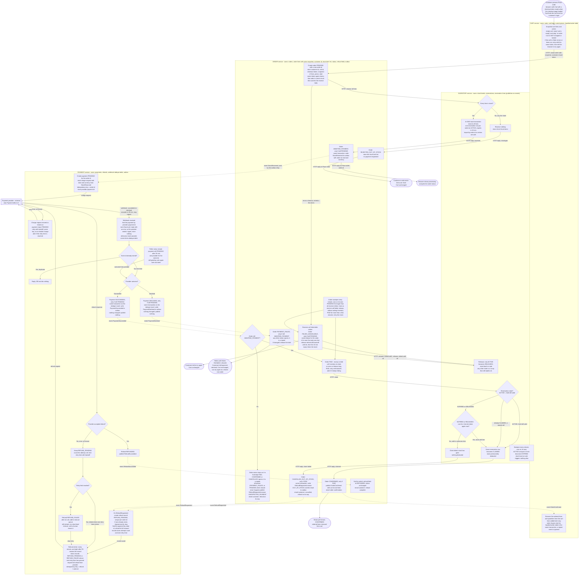

# Checkout across Cart, Inventory, Payment and Order

## How to read this

- Solid arrows are synchronous HTTP calls or steps inside one service.
- Dotted arrows are events on the shared message broker. The label is the event name.
- Each box sits in the service that does the step. No service reads another service's tables, so data crosses only in HTTP bodies and event payloads.
- **Outbox.** Every event is written to an outbox table in the sender's own database, in the same transaction as the state change that causes it. A small relay process inside each service polls for rows not yet marked published, sends them to the broker, then marks them published. If the service crashes between "saved" and "published", the relay finds the unpublished row after the restart, so no event is lost. If the relay crashes after sending but before marking, it sends the event again after the restart; this is one reason consumers must tolerate duplicates. A delayed relay only delays the event. How often the relay polls is not chosen (see the open questions). Only Order and Payment publish events, so only they have an outbox. Inventory publishes nothing: Order learns the result of a reserve, claim or release from the HTTP reply.
- **Broker assumption.** The broker keeps each event for every subscribing service until that service acknowledges it, and redelivers if the service is down or does not acknowledge. So delivery is at least once, and an event can arrive twice. This is an assumption about our broker, listed in the open questions.
- **Duplicates.** Consumers tolerate repeats: each one either makes a change that is harmless to repeat, or records the ids it has handled (Cart records order ids, Payment records provider event ids and keeps at most one refund record per order id). How long those recorded ids are kept is not decided (see the open questions); until it is, nothing deletes them.
- **State changes are conditional.** Whenever a service moves an order, payment or reservation to a new state, it does so as one database update that only applies if the record is still in the expected old state (for example "set AWAITING_PAYMENT where status is still PENDING"). If the update changes nothing, someone else got there first and the caller stops: it publishes and sends nothing. This is how a repeat, a retry, a sweeper and the original flow can all run without two of them winning. The outbox rows and emails for a change are written in the same transaction as that update.
- Every HTTP call between services is keyed by the order id (or the checkout token for the first call). A retry returns the first result and never repeats the work.

## What the customer sees

The slow part (payment, up to 30 minutes) happens after the Place order request has already returned.

- The browser calls Cart's Place order endpoint with the checkout token. Cart knows which cart is meant from the customer's login session (an assumption: the brief does not describe authentication). If that cart is empty, Cart replies "cart is empty" and stops: no order is created and nothing is sent to Order.
- Place order returns as soon as the reservation step is done. Order waits for Inventory's reserve reply before it answers Cart, so the reply is one of three things: the list of short items, "try again" (Inventory or Order unreachable), or the new order id. It does not wait for payment.
- If the same token reaches Order again, Order answers with the current result for that order: the order id (status `AWAITING_PAYMENT` or later), the stored short-item list (`REJECTED_OUT_OF_STOCK`), or "try again" (`FAILED_UNAVAILABLE`, or still `PENDING` because the first call is still running). This is what makes a retry safe when a reply was lost, for example if Cart crashed after calling Order but before answering the browser: the browser retries with the same token, Cart snapshots the unchanged cart again, and Order returns the existing order instead of making a second one.
- **Polling.** With an order id, the browser shows "processing" and polls Order directly (not through Cart) every few seconds: a read-only status request carrying the order id and the customer's login session. Cart sends the customer id to Order when it creates the order, and Order stores it. Order answers a status request only if the session's customer id matches the stored one; otherwise it answers "not found". How Order checks the login session (a shared gateway or a shared session service) is not described in the brief (see the open questions). The order id is generated by Order and is not guessable. The status reply contains the order status and the refund field (`NONE` or `REFUNDED`). What each combination shows:

| Order status | Refund field | Browser shows |
|---|---|---|
| `PENDING`, `AWAITING_PAYMENT`, `PAID` | `NONE` | "Processing your order. Payment confirmation can take up to 30 minutes. We will email you." Polling continues. |
| `CONFIRMED` | `NONE` | Done. The order is confirmed. |
| `PAYMENT_FAILED` | `NONE` | Payment declined, cart unchanged, customer can retry. |
| `PAYMENT_FAILED` | `REFUNDED` | Same, plus "a payment that arrived unexpectedly has been refunded". Rare. |
| `CANCELLED_OUT_OF_STOCK` | `NONE` | Cancelled because the stock went, refund on its way. |
| `CANCELLED_OUT_OF_STOCK` | `REFUNDED` | Cancelled because the stock went, refund complete. |
| `REJECTED_OUT_OF_STOCK`, `FAILED_UNAVAILABLE` | `NONE` | Normally seen only in the Place order reply. If the customer reloads, the page shows the short items or "try again". |

  The 10-minute hold lapsing does not change what the customer sees: the status stays "processing" until payment gives an outcome. The emails say the same as the final statuses.
- **If the customer closes the page.** Polling stops, but nothing is lost: the email is the only message pushed to them, and the order status stays readable later with the same status request (for example from an order page), because the status lives on the order, not in the browser.
- The checkout token is created when the checkout page loads. The browser keeps the same token when it got no answer (network error, or Cart replied "try again" because it could not reach Order), so a retry or double-click returns the same order instead of making a second one. It makes a new token after any final answer (short items, declined, cancelled, or `FAILED_UNAVAILABLE`), because the same token would just return that same finished order.
- **Retrying after a final answer.** A retry with a new token is a completely new order: new order id, new snapshot of the cart as it is now, new reservation, new payment. The old order stays in its final state (for example `PAYMENT_FAILED`, with its payment `DECLINED` and its hold released) and nothing further happens to it.
- If Cart's call to Order errors or times out, Cart retries it with the same token a few times. If it still fails, Cart tells the browser to try again. Cart has changed nothing, and the retry with the same token is safe because Order returns the existing order if the first call actually arrived.

## Step by step

1. **Place order.** Cart reads its own lines and prices and sends them to Order with the checkout token and the customer id. Cart does not change. Order creates the order id, and saves a private copy of the lines, prices, total, cart id and customer id. Later cart edits or price changes cannot touch it. A token Order has seen before returns the existing order's current result (see "What the customer sees").
2. **Reserve stock before any payment.** Order calls Inventory over HTTP and waits for the reply. Inventory checks every line and reserves them all in one local transaction, or reserves nothing. There is one reservation row per order id, so a retry returns the same reservation. Each reservation expires 10 minutes after it is created.
   If the call errors or times out, Order retries it a few times. If it still fails, Order marks the order `FAILED_UNAVAILABLE` (only if it is still `PENDING`), sends Inventory a release for that order id (the reply may have been lost after the reservation was made) and tells the customer to try again. That release is retried by Order with backoff until Inventory replies ok, like the release after a decline. If Order crashes before it succeeds, or it never succeeds, the 10-minute expiry frees the stock anyway, so the worst case is stock held a few minutes too long.
   The Order sweeper (see step 7) gives an order left `PENDING` for longer than all the reserve retries together, for example after an Order crash, the same treatment. The sweeper does not ask Inventory whether the reserve actually succeeded. It always marks the order `FAILED_UNAVAILABLE` and sends the release. I chose this because the release is harmless when nothing was reserved, and asking would add a new call and a new failure case. The cost is that a reservation that did succeed is thrown away and the customer must try again. The exact retry count and time limit are not chosen yet, but the sweeper's limit must be longer than the whole retry window.
   **Original flow against sweeper.** Both move the order out of `PENDING` with a conditional update (see "How to read this"). Whichever commits first wins. If the sweeper wins, the original flow's later update to `AWAITING_PAYMENT` changes nothing, so it publishes nothing and sends Inventory a release (harmless). If the original flow wins, the sweeper's update changes nothing and it leaves the order alone.
3. **Short stock.** Inventory replies with the short items. Order is marked `REJECTED_OUT_OF_STOCK`, stores the short-item list (so a repeated token can return it), no payment is ever requested, and the customer sees which items are short. The cart is untouched.
4. **Request payment.** Order becomes `AWAITING_PAYMENT` (only if still `PENDING`) and in the same transaction writes `StockReserved`, with the order id, total and currency, to its outbox. The relay publishes it. If the relay is slow, the payment starts later and the order stays `AWAITING_PAYMENT`; the 10-minute hold may lapse meanwhile, which step 7 handles. `StockReserved` therefore exists only for orders that really became `AWAITING_PAYMENT`, and never for one that became `FAILED_UNAVAILABLE`, because the two changes both start from `PENDING` and only one can apply. It also means no charge exists, and so no payment result can arrive, while an order is still `PENDING`. Payment creates its record for that order id and sends the charge to the provider with the order id as the idempotency key. It stores the provider's payment id. A retried request can never double-charge. How the customer's card or other payment method reaches the provider is not described in the brief (see the open questions).
   If the charge request errors or times out, the payment stays `PENDING` and Payment retries the same request (same key) with backoff, so a charge that actually went through the first time is not repeated. When the retry limit is reached Payment alerts. The payment stays `PENDING`, and the poller in step 11 then asks the provider what happened. If the provider definitively rejects the request itself, it is not decided whether that counts as declined (see the open questions).
5. **Webhook.** The provider reports the result by webhook, usually within seconds and sometimes up to 30 minutes later. The webhook says "succeeded" or "declined". That is the only meaning of "declined": an error or timeout on a request is not a decline and is retried. The webhook carries the provider's payment id, which Payment uses to find its payment and so the order id, and a provider event id. That event id is created by the provider and is unique per delivery event, and a re-delivery repeats the same id.
   **Webhook before the payment id is stored.** A webhook could arrive before Payment has stored the provider payment id from the charge reply (for example the reply was slow or lost). Payment then finds no payment. It stores nothing, not even the event id, and replies with an error status instead of 200, so a provider that re-sends undelivered webhooks tries again later, by which time the id is usually stored. If the provider does not re-send, or the id is never stored, the poller in step 11 finds the outcome after 35 minutes. Whether the provider re-sends after an error reply, and how a webhook is matched when the charge request never returned an id, are open questions.
   **One transaction.** When a payment is found, Payment does these in a single transaction: insert the event id into a table with a unique constraint; update the payment from `PENDING` to `SUCCEEDED` or `DECLINED` (conditional); write `PaymentSucceeded` or `PaymentDeclined` to the outbox. If the event id is already there, the webhook is a duplicate: Payment replies 200 and does nothing. If the update changes nothing (the payment already left `PENDING`, for example the poller got there first), nothing is written to the outbox and Payment replies 200. A crash rolls all three back, so there is no half-processed event.
6. **Declined.** Payment publishes `PaymentDeclined`. Order handles it with a conditional update: set `PAYMENT_FAILED` where the status is still `AWAITING_PAYMENT`. If that changes the order, Order tells Inventory to release the hold. If it changes nothing, the event is a repeat (the order is already `PAYMENT_FAILED`) and Order ignores it; the first handling is already responsible for the release. The order cannot be `PAID` or `CONFIRMED` here, because one payment leaves `PENDING` only once and so never publishes both a decline and a success. `FAILED_UNAVAILABLE` and `REJECTED_OUT_OF_STOCK` orders never have a payment. Release only changes an `ACTIVE` reservation. For `EXPIRED`, `CLAIMED` or `RELEASED` it does nothing and replies ok. If Inventory cannot be reached, Order keeps retrying. If that never works, the 10 minute expiry frees the stock anyway. The customer sees the result on the next status poll, and the cart is unchanged so they can retry.
7. **Succeeded.** Payment publishes `PaymentSucceeded`. Order handles it by status:
   - `AWAITING_PAYMENT`: Order saves `PAID` (conditional update), which records that the money is held, and asks Inventory to claim the reservation.
   - `PAID`, `CONFIRMED` or `CANCELLED_OUT_OF_STOCK`: a repeat delivery. Order ignores it. If the order is `PAID` and the claim has not finished, the claim retry loop or the sweeper (below) is already responsible for finishing it, so the repeat needs to do nothing. (`CANCELLED_OUT_OF_STOCK` is only ever reached from `PAID` after a failed claim, see step 9, so a success arriving there is always the repeat of the one that made it `PAID`.)
   - Any other status (for example `PAYMENT_FAILED`): the customer paid for an order we will not fulfil, see "Decisions". This is the "No" branch of "Order still AWAITING_PAYMENT?" in the diagram. One payment leaves `PENDING` only once, so Payment never publishes both `PaymentDeclined` and `PaymentSucceeded` for the same payment; this branch is a safety net for unexpected cases only. A success for `FAILED_UNAVAILABLE` or `REJECTED_OUT_OF_STOCK` cannot happen, because no charge is requested for those. A success while the order is `PENDING` also cannot happen (see step 4); if it ever did, it takes this same branch and the money is refunded.

   Inventory then looks at the reservation state when claiming:
   - **`ACTIVE`, hold still valid:** it claims the stock.
   - **`CLAIMED` already:** this is a repeat call. It replies "claimed" again and changes nothing.
   - **`EXPIRED` or `RELEASED`, but the stock is still free:** in one transaction it deducts all lines again and sets the same reservation row to `CLAIMED`. No new row is made. A retry that arrives after this succeeded finds `CLAIMED` and replies "claimed". A claim should never reach a `RELEASED` reservation, because only a declined payment or a failed reserve call releases, and neither leads to `PAID`. If it somehow does, the customer has paid, so it is treated like `EXPIRED`.
   - **`EXPIRED` or `RELEASED` and the stock has gone:** the claim fails, and nothing is deducted.

   Claiming and expiring are both state changes on the same reservation row inside Inventory. Only one of them can win. Inventory tells Order only through the HTTP reply to the claim call.

   If the claim call errors or times out, the order stays `PAID`. Order retries the claim with backoff (it is keyed by order id, so repeating it is safe) until Inventory gives a real answer, claimed or claim failed. If retries keep failing, Order raises an alert. The money stays held until then. Only a real "claim failed" answer leads to a refund.

   **Order sweeper.** If Order crashes after saving `PAID` and before the claim call, nothing in the retry loop is running any more. So a sweeper inside Order runs every minute. It finds orders in `PAID` for more than a few minutes and starts the claim again (safe, the claim is keyed by order id). The same sweeper handles orders stuck in `PENDING` (step 2). It is the same recovery, started by the clock instead of by an event.
8. **Confirmed.** Order becomes `CONFIRMED` (only from `PAID`) and emails the customer. Its `OrderConfirmed` event carries the order id, the cart id and the ordered lines. Cart removes exactly those lines and quantities from that cart. In the same transaction it records the order id in a handled-order table, so if the event is delivered twice, the second delivery finds the order id already there and does nothing. Anything the customer added or changed after pressing Place order stays. This is the only place the cart is changed because of an order.
9. **Late success after the stock is gone.** When Inventory replies "claim failed", Order runs one transaction: update the order from `PAID` to `CANCELLED_OUT_OF_STOCK` (conditional, `where status = PAID`); in the same transaction write `RefundRequested` (reason `OUT_OF_STOCK`, order id) and the customer email to the outbox. If the update changes nothing, nothing is written. Payment finds the payment for that order id in its own records and refunds its full amount automatically. A payment has at most one refund record, enforced by a unique constraint on the order id. If `RefundRequested` is delivered twice, the second delivery finds the record and does nothing, so there are never two refunds. The refund goes back to the customer's original payment method through the provider; it does not matter that the order was never `CONFIRMED`. Nothing ships, so no partial orders are possible.
10. **Refund failure.** On `RefundRequested`, Payment inserts the refund record (`REFUND_PENDING`, with an attempt count and a next-retry time) and a refund retrier sends the request to the provider. The retrier is a timer inside Payment that runs every minute (and once straight after the record is created). It takes every record that is `REFUND_PENDING` or `REFUND_FAILED` and whose next-retry time has passed. So a retry does not go back through the event handler; it re-sends the request for the stored record. Each request uses its own idempotency key (refund + order id, the same on every retry and unique per order) so retries cannot refund twice. After a failed attempt the attempt count goes up and the next-retry time is set with backoff. If the retry limit is reached, the record becomes `REFUND_FAILED`. That raises an alert and puts the refund in a manual queue. It is never deleted, and the retrier keeps trying it at a slow fixed interval until it succeeds or a person closes it. What the queue is and what closing does are not decided (see the open questions). When a refund succeeds, Payment publishes `RefundSucceeded`. Order then sets the order's separate refund field to `REFUNDED` (the order status stays as it is) and emails the customer that the money is back. A repeated `RefundSucceeded` sets the same value and does not send a second email.
11. **Payment outcome never arrives.** Payment's poller looks for payments still `PENDING` 35 minutes after the charge request and asks the provider for the outcome. The answer goes through the same decision as a webhook (step 6 or 7), using the same conditional update from `PENDING` and the same outbox write in one transaction. The poller has no event id, so the conditional update, not the dedupe table, is what stops it and a late webhook both acting: whichever commits first publishes, and the other's update changes nothing and publishes nothing. If the provider says it is still pending, Payment asks again later and alerts. Until an outcome exists the order stays `AWAITING_PAYMENT`. What to do when the provider has no record of the charge is not decided (see the open questions).

**Emails.** An email is queued in the same transaction as the status change that causes it, and only the update that actually changed the status queues it. So a repeated event, which changes nothing, sends nothing. The mail sender itself may rarely deliver one email twice; that is accepted.

## Order states

`PENDING` then one of:

- `REJECTED_OUT_OF_STOCK`
- `FAILED_UNAVAILABLE`
- `AWAITING_PAYMENT`, then `PAYMENT_FAILED` or `PAID`
- `PAID`, then `CONFIRMED` or `CANCELLED_OUT_OF_STOCK`

`CANCELLED_OUT_OF_STOCK` is the only cancel state. Nothing else in the design cancels an order.

Refunds are not an order status. Order has a separate refund field, `NONE` at first and `REFUNDED` once Payment reports the refund done. It is only ever set for an order that was refunded (`CANCELLED_OUT_OF_STOCK`, or any order that got an unexpected payment).

## What each service stores

| Service | Owns |
|---|---|
| Cart | Carts, cart lines, current prices, handled-order table (order ids whose `OrderConfirmed` was applied). It changes only when the customer edits it or when `OrderConfirmed` arrives. |
| Order | Orders, the price and line snapshot, cart id, customer id, checkout token (unique), order status, short-item list (for `REJECTED_OUT_OF_STOCK`), refund field, outbox (events and emails). |
| Inventory | Stock levels, reservations (ACTIVE, CLAIMED, EXPIRED, RELEASED) with expiry time, one row per order id. No outbox: it publishes no events. |
| Payment | Payments with the provider payment id, refunds (REFUND_PENDING, REFUNDED, REFUND_FAILED, one per order id, each with attempt count and next-retry time), dedupe table of provider event ids, outbox. |

## Decisions I made that you may want to change

- **The hold lapsing does not cancel the order.** The order stays `AWAITING_PAYMENT` until the payment outcome arrives, because that can take up to 30 minutes. Only the stock is released at 10 minutes.
- **Re-taking lapsed stock.** If a hold lapsed but the stock is still free, the order is fulfilled. This avoids needlessly cancelling paid orders. If you would rather cancel and refund every late payment, remove the "can all lines be taken again" check.
- **Who sends email.** The brief names no notification service, so I assumed Order sends the emails. Move that to a separate service if you have one.
- **Success arriving for an order that is not awaiting payment.** This should not happen, for example a success after a decline. Repeats for orders already `PAID`, `CONFIRMED` or `CANCELLED_OUT_OF_STOCK` are ignored. For any other order the customer has paid for something we will not fulfil, so Order requests a full refund with reason `UNEXPECTED_PAYMENT`. Payment refunds the full amount of the payment it holds for that order id, so Order does not need to know the amount. The order status does not change, and the email does not blame stock.
- **Clearing the cart.** Only the ordered lines are removed, not the whole cart, so items added during the wait are not lost. If you want the whole cart emptied, change step 8.
- **Duplicate orders.** The checkout token stops double-clicks and retries. Two separate browser tabs with different tokens can still create two orders and two reservations. I accepted that.
- **Polling, not push.** The browser polls Order for the status because it needs no extra infrastructure.
- **Unmatched webhook gets an error reply.** A webhook that matches no payment is not recorded and gets a non-200 reply, so a re-sending provider delivers it again. This relies on the provider re-sending (unconfirmed); the 35-minute poller is the fallback.
- **The sweeper does not check Inventory.** A stuck `PENDING` order is always failed and released, never looked up, so a reservation that did succeed is discarded and the customer retries.

## Open questions

- Retry counts and time limits (reserve call, charge request, claim call, release, Order sweeper, refund retry limit and the slow interval after `REFUND_FAILED`) are not chosen. One constraint is fixed: the sweeper's `PENDING` limit must exceed the whole reserve retry window. How often each outbox relay polls is also not chosen.
- Broker behaviour: I assume durable, at-least-once delivery per subscribing service with redelivery until acknowledged. Confirm against the broker we actually run.
- Cleanup of recorded ids: Cart's handled-order table and Payment's webhook dedupe table are never cleaned up for now. An id is safe to delete only after the broker can no longer redeliver that event (Cart) or the provider can no longer re-send that webhook (Payment). I do not know either retention period, so no deletion rule is set. Both tables are small (one short id per order or event), so keeping them is cheap until the periods are known.
- Webhook shape: I assume the provider's webhook carries a unique event id and its payment id. Confirm against the provider's documentation. Also unknown: whether the provider re-sends a webhook after a non-200 reply (step 5 relies on this for a webhook that arrives before the payment id is stored), and how a webhook (or the poller) is matched to a payment when the charge request never returned a provider payment id. A possible fix is for the provider to echo the idempotency key (order id) or metadata we send, but this is not confirmed.
- If the poller finds that the provider has no record of the charge, should Payment treat it as declined? Not decided. The same question applies if the provider definitively rejects the charge request itself. Also unconfirmed: whether the provider can look up a charge by idempotency key (order id) as well as by its own payment id, which the poller needs when the charge request never returned a payment id.
- Payment method: the brief does not say how the customer's card or saved method is supplied. `StockReserved` carries only total and currency. Probably the provider holds the method (for example a token the browser obtained from the provider), but this is not designed here.
- The manual queue for `REFUND_FAILED`: who works it, and what "a person closes it" does to the refund record and the order refund field, are not decided.
- How the customer is identified when pressing Place order (login session assumed) is not described in the brief. The same applies to the status poll: Order compares the session's customer id with the stored one, but how Order validates the session (shared gateway or session service) is not known.
