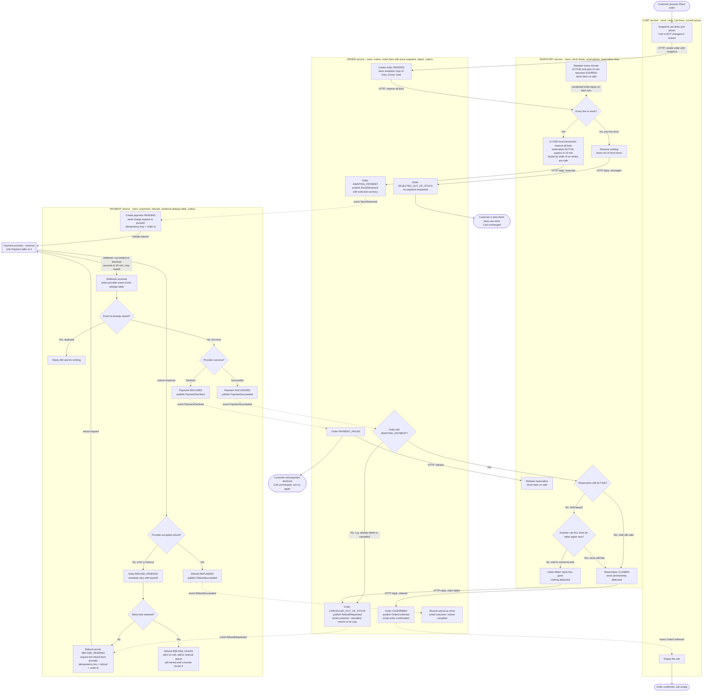

# Checkout across Cart, Inventory, Payment and Order

## How to read this

- Solid arrows are synchronous HTTP calls or steps inside one service.
- Dotted arrows are events on the shared message broker. The label is the event name.
- Each box sits in the service that does the step. No service reads another service's tables, so data crosses only in HTTP bodies and event payloads.
- Every event is written to the sender's own database in the same transaction as its state change (a transactional outbox) and then published. A crash between "saved" and "published" therefore cannot lose an event. Consumers tolerate duplicates.

## Step by step

1. **Place order.** Cart reads its own lines and prices and sends them to Order. Cart does not change at this point. Order saves a private copy of the lines, prices and total, so later cart edits or price changes cannot touch it.
2. **Reserve stock before any payment.** Order calls Inventory over HTTP. Inventory checks every line and reserves them all in one local transaction, or reserves nothing. The call is keyed by order id, so a retry returns the same reservation. Each reservation expires 10 minutes after it is created.
3. **Short stock.** Inventory replies with the short items. Order is marked REJECTED_OUT_OF_STOCK, no payment is ever requested, and the customer sees which items are short. The cart is untouched.
4. **Request payment.** Order publishes `StockReserved` with the total. Payment creates its record and sends the charge to the provider with the order id as the idempotency key. A retried request can never double-charge.
5. **Webhook.** The provider reports the result by webhook, usually within seconds and sometimes up to 30 minutes later. Payment first inserts the provider's event id into a table with a unique constraint. If the insert finds the id already there, the webhook is a duplicate. Payment replies 200 and does nothing. The insert and the payment state change commit together, so a crash cannot leave a half-processed event.
6. **Declined.** Payment publishes `PaymentDeclined`. Order moves to PAYMENT_FAILED and tells Inventory to release the hold. The customer is told, and the cart is unchanged so they can retry.
7. **Succeeded.** Payment publishes `PaymentSucceeded`. Order asks Inventory to claim the reservation. Inventory handles three cases:
   - **Hold still valid:** it claims the stock.
   - **Hold lapsed but the stock is still free:** it takes all lines again in one transaction and claims them.
   - **Hold lapsed and the stock has gone:** the claim fails, and nothing is deducted.

   Claiming and expiring are both state changes on the same reservation row inside Inventory. Only one of them can win.
8. **Confirmed.** Order becomes CONFIRMED and emails the customer. Its `OrderConfirmed` event is what makes Cart empty the cart. This is the only place the cart is emptied.
9. **Late success after the stock is gone.** Order is marked CANCELLED_OUT_OF_STOCK and emails the customer. It publishes `RefundRequested`, and Payment refunds the full amount automatically. Nothing ships, so no partial orders are possible.
10. **Refund failure.** The refund is a stored record in REFUND_PENDING and is retried with backoff, using its own idempotency key so retries cannot refund twice. If the retry limit is reached, the record becomes REFUND_FAILED. That raises an alert and puts the refund in a manual queue. It is never deleted, and it keeps being retried until it succeeds or a person closes it. When a refund succeeds, Order emails the customer that the money is back.

## Order states

`PENDING` then one of:

- `REJECTED_OUT_OF_STOCK`
- `AWAITING_PAYMENT`, then `PAYMENT_FAILED`, `CONFIRMED` or `CANCELLED_OUT_OF_STOCK`

## What each service stores

| Service | Owns |
|---|---|
| Cart | Carts, cart lines, current prices. It changes only when the customer edits it or when `OrderConfirmed` arrives. |
| Order | Orders, the price and line snapshot, order status, outbox. |
| Inventory | Stock levels, reservations (ACTIVE, CLAIMED, EXPIRED, RELEASED) with expiry time, outbox. |
| Payment | Payments, refunds (REFUND_PENDING, REFUNDED, REFUND_FAILED), dedupe table of provider event ids, outbox. |

## Decisions I made that you may want to change

- **The hold lapsing does not cancel the order.** The order stays AWAITING_PAYMENT until the payment outcome arrives, because that can take up to 30 minutes. Only the stock is released at 10 minutes. If a payment never gets an outcome, Payment should poll the provider after about 35 minutes. I left that out of the diagram.
- **Re-taking lapsed stock.** If a hold lapsed but the stock is still free, the order is fulfilled. This avoids needlessly cancelling paid orders. If you would rather cancel and refund every late payment, remove the "can all lines be taken again" check.
- **Who sends email.** The brief names no notification service, so I assumed Order sends the emails. Move that to a separate service if you have one.
- **Success arriving for a dead order.** A `PaymentSucceeded` event can arrive for an order that is no longer AWAITING_PAYMENT, for example one already marked PAYMENT_FAILED or cancelled. Order sends it straight to the refund path.
