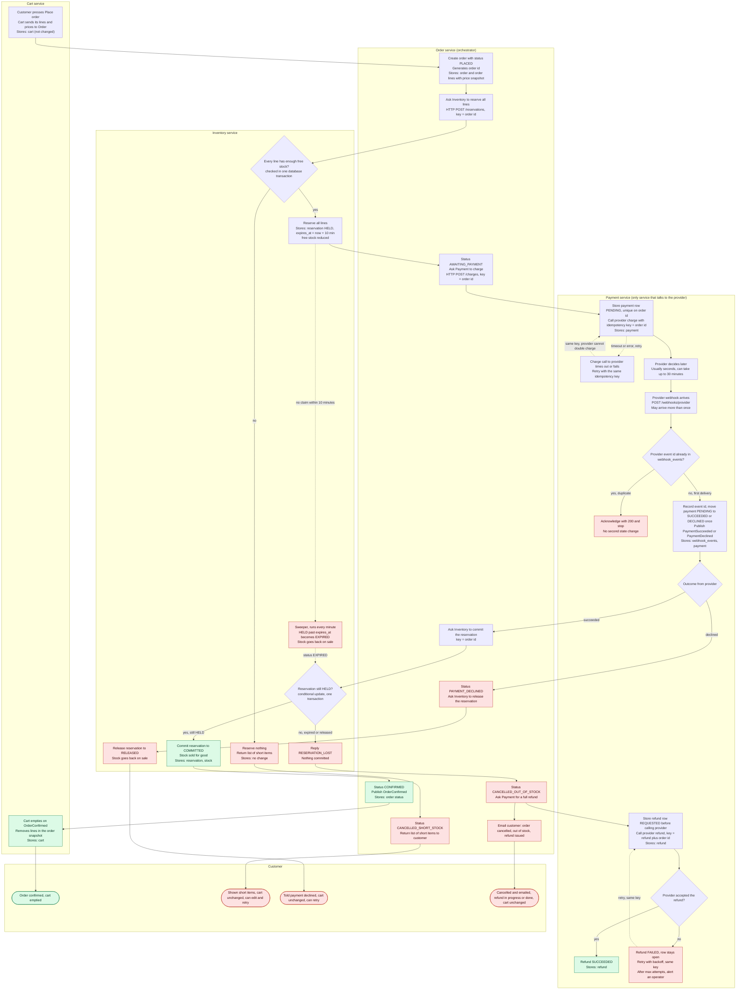

# Checkout across Cart, Inventory, Payment and Order

This flowchart shows checkout from **Place order** to a confirmed order, a clean stop, or a refund. Order is the orchestrator: it calls Inventory and Payment over HTTP and reacts to their results. Payment hears from the provider by webhook. Cart changes only after an order is confirmed.

Read the diagram top to bottom. Each box names the service that acts, what it stores, and what triggers it. Red boxes are failure outcomes. Dotted arrows are retries or background jobs.

## Notes on the flow

**Who does what, and what each service stores**

| Service | Triggered by | Acts | Stores |
|---|---|---|---|
| Cart | Customer presses Place order | Sends lines and prices to Order. Empties on OrderConfirmed. | Cart. Not changed until confirmed. |
| Order | Cart request, Inventory and Payment replies, OrderConfirmed-related events | Orchestrates every step, sets order status, sends refund request and email | Order, order lines (price snapshot), status |
| Inventory | Order reserve, commit and release calls, expiry sweeper | Checks and reserves all lines in one transaction. Commits or releases. Expires holds. | Stock levels, reservations (HELD, COMMITTED, RELEASED, EXPIRED) |
| Payment | Order charge and refund calls, provider webhook | Only service that calls the provider. Dedupes webhooks. Retries refunds. | Payment rows, webhook event ids, refund rows |

**Why each branch is safe**

- **Short stock.** Inventory checks every line in one transaction. If any line is short, it reserves nothing and returns the short items. No payment is requested.
- **Declined payment.** Payment records the decline. Order releases the reservation so the stock is available again. The cart was never touched.
- **Late success after the hold lapsed.** The 10-minute hold can expire while the provider is still working, since the outcome can take up to 30 minutes. Commit is a conditional update that succeeds only while the reservation is still HELD. If it has expired or been released, Inventory replies RESERVATION_LOST. Order then cancels the order as out of stock and requests a full refund. The refund key is tied to the order, so retries are safe.
- **Failed refund.** The refund row is saved before the provider is called. A failure leaves the row open. It is retried with the same key and backoff, and an operator is alerted after the maximum number of attempts. It is never dropped.
- **Duplicate webhooks.** Payment stores each provider event id with a unique constraint. A repeat is acknowledged and ignored. Payment moves each payment from PENDING to a final state only once.
- **Cart.** The cart is emptied only on OrderConfirmed. On every failure path the cart stays as it was.

**Assumptions to confirm**

- The 10-minute hold is not extended while payment is pending. This follows the brief. It is the reason the late-success branch exists.
- Late success always leads to a refund, even if the stock is still free. Re-reserving stock when it is still free is possible but not in the brief, so it is left out.
- The email is sent by Order through an email gateway. The brief does not name an owner for email.
- OrderConfirmed empties only the lines in the order snapshot. Lines the customer adds during checkout are kept. Product should confirm this against "emptied".
- Events are delivered at least once. Every consumer (Cart on OrderConfirmed, Inventory on commit or release, Order on payment events) must handle repeats safely.
