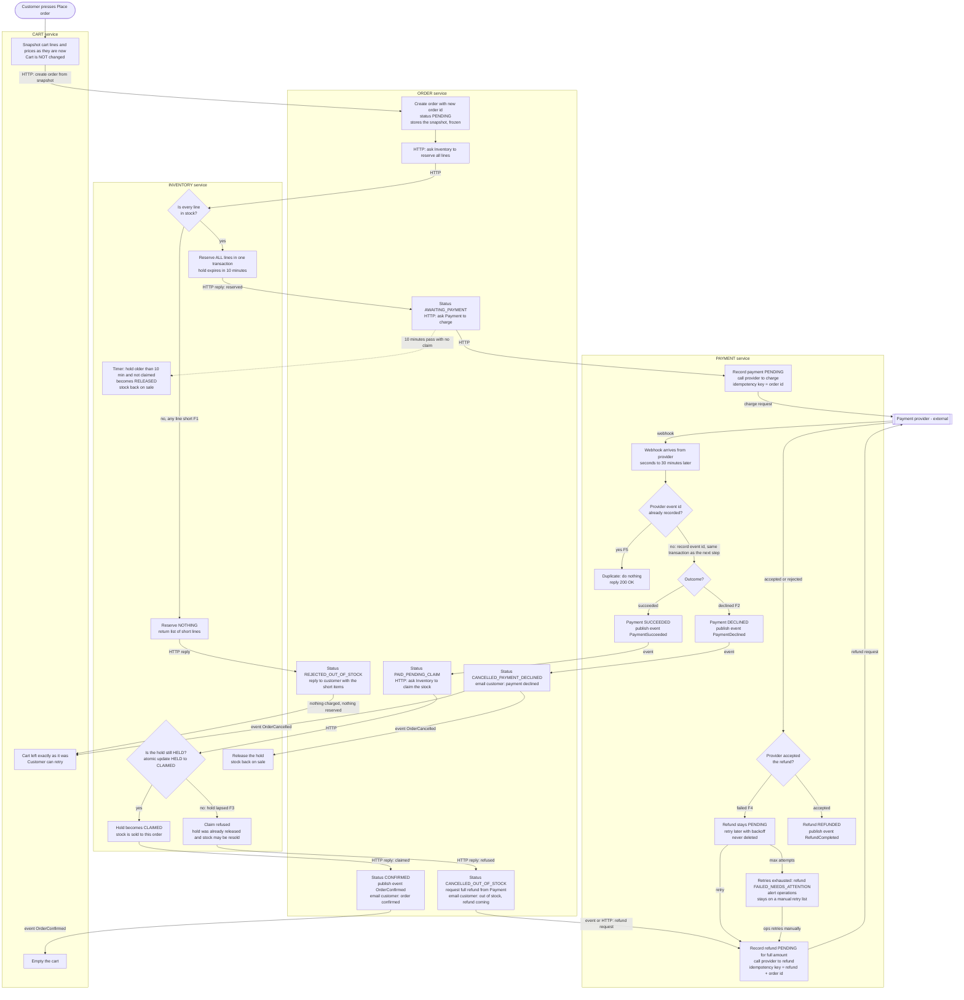

# Checkout across Cart, Inventory, Payment and Order

## How to read this

- Each box is a step. Each swimlane is the service that performs it.
- Arrow labels say what triggers the next step. "HTTP" is a direct request. "event" is a message on the shared broker.
- What each service stores is in the table below the diagram. Each service writes only to its own database.
- Failure branches are labelled **F1 to F6** and explained after the diagram.

## Flowchart

## The failure branches

| Ref | Case | What happens | Where the customer ends up |
|---|---|---|---|
| **F1** | **Short stock** | Inventory checks every line and reserves nothing if any line is short. Order replies to the customer with the short items. Payment is never called. | Cart unchanged. Told which items are short. |
| **F2** | **Declined payment** | Payment publishes `PaymentDeclined`. Order cancels. Inventory releases the hold. If the hold has already lapsed, the release does nothing. | Cart unchanged. Told the payment was declined. |
| **F3** | **Success after the hold lapsed** | The 10-minute timer releases the stock, and it may be sold to someone else. The webhook then reports success, so Order asks Inventory to claim the stock. Inventory refuses because the hold is no longer HELD. Order cancels as out of stock and asks Payment for a full refund. | Cart unchanged. Emailed that the order was cancelled for lack of stock and the refund is on its way. |
| **F4** | **Refund fails at the provider** | The refund stays PENDING and is retried with backoff. After the retry limit it becomes `FAILED_NEEDS_ATTENTION` and operations are alerted. It stays on a manual retry list and is never deleted. Retries are safe because the refund request has its own idempotency key. | Order stays CANCELLED_OUT_OF_STOCK. Refund is completed later. |
| **F5** | **Duplicate webhook** | Payment stores the provider's event id under a unique constraint. A repeat finds it, returns 200 and stops. | No visible effect. |
| **F6** | **Hold expires while waiting** (dotted arrow) | Nothing fails at this point. The stock goes back on sale, and the order keeps waiting for the webhook. The outcome is decided later, either by F2 or F3 above, or by a normal success if the stock is still unsold. | See F2 and F3. |

## Who does what, what triggers it, what it stores

| Service | Triggered by | Steps it performs | What it stores in its own database |
|---|---|---|---|
| **Cart** | Customer presses Place order. Event `OrderConfirmed`. | Takes the snapshot and sends it to Order. Empties the cart only on `OrderConfirmed`. | Cart lines and current prices. Cart is never emptied on any failure. |
| **Order** | HTTP create from Cart. Replies from Inventory. Events from Payment. | Owns the order's status and decides what happens next. Sends emails. | Order id, status, frozen copy of the lines and prices, total, timestamps. Order status is `PENDING`, `REJECTED_OUT_OF_STOCK`, `AWAITING_PAYMENT`, `PAID_PENDING_CLAIM`, `CONFIRMED`, `CANCELLED_PAYMENT_DECLINED` or `CANCELLED_OUT_OF_STOCK`. |
| **Inventory** | HTTP reserve, claim. A timer. Event `OrderCancelled`. | Checks stock and reserves all-or-nothing. Claims the hold. Releases expired or unneeded holds. | Stock levels. One hold per order: order id, lines, status `HELD`, `CLAIMED` or `RELEASED`, `expires_at` (created time + 10 min). |
| **Payment** | HTTP charge request. Provider webhooks. Refund request. Retry timer. | The only service that talks to the provider. Handles webhook deduplication. Runs refunds and retries. | Payment per order: order id (also the idempotency key), amount, status. Processed provider event ids (unique). Refund per order: status, attempt count, next retry time, last error. |

## Why it is safe

- **One owner for each decision.** Only Order changes order status. Only Inventory changes holds. Only Payment talks to the provider. No service reads another's tables.
- **No double charge.** Every charge request carries the order id as the idempotency key. If Payment crashes and re-sends, the provider returns the original result.
- **No double processing.** Webhooks are deduplicated by provider event id. The event id and the resulting state change are written in the same transaction, so a crash cannot record one without the other.
- **Claim versus expiry is race-free.** Claim and expiry both use a conditional update on the hold row (`HELD` to `CLAIMED`, or `HELD` to `RELEASED`). Whichever commits first wins, and the other sees the new status and does nothing.
- **Event publishing is reliable.** Each service writes its state change and the outgoing event in one transaction (an outbox table), and a relay publishes to the broker. Consumers apply status changes only from an allowed previous status, so a re-delivered broker message is harmless.
- **Money is never kept for an order we cannot fulfil.** The only route out of "payment succeeded" without a confirmed order is the refund branch (F3). That branch has no end state other than REFUNDED or the visible FAILED_NEEDS_ATTENTION list.
- **Cart.** Cart changes only when it receives `OrderConfirmed`. The order uses its own snapshot, so cart edits and price changes during checkout do not affect it.

## Assumptions and open points

1. **Emails.** I assumed Order sends the customer emails through whatever mail mechanism already exists. If a separate notification service exists, Order should publish the events and that service should send the emails.
2. **Provider never answers.** The brief says up to 30 minutes. I suggest a reconciliation job that asks the provider for the status of any payment still PENDING after about 35 minutes, and treats the answer as if it were a webhook. Please confirm.
3. **Cart edits during payment.** On `OrderConfirmed`, the cart is emptied entirely. If the customer added items while waiting, those would be lost. A safer option is to have Cart empty only the lines in the snapshot. I need your decision.
4. **Refund outcome by webhook.** I assumed refund results can also arrive by webhook and use the same deduplication. If they come back synchronously, step P9 handles it directly.
5. **Retry limit for refunds.** The number of attempts and the backoff schedule are not set here. They need a decision. Whatever they are, exhausting them leads to an alert, never to dropping the refund.
