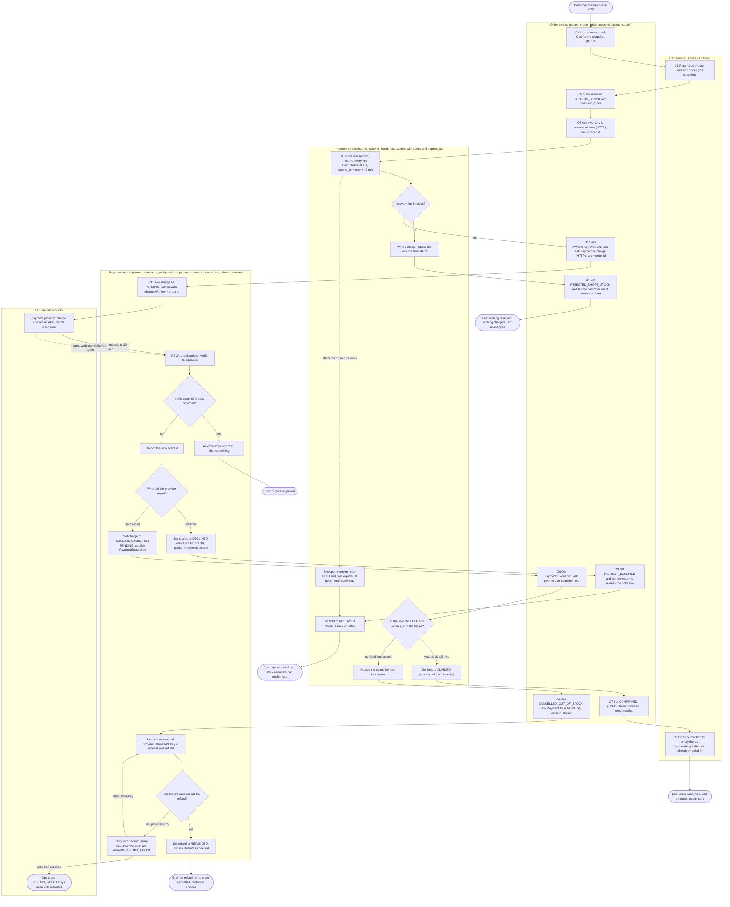

# Checkout across Cart, Inventory, Payment and Order

This document follows one checkout from the moment the customer presses **Place order** to the moment it ends. Checkout ends in one of four ways:

1. **Confirmed.** The order is confirmed, the cart is emptied, and a receipt is sent.
2. **Short stock.** Some items are out of stock. The order is rejected. Nothing is reserved and nothing is charged.
3. **Declined.** The payment provider declines the charge. No money is kept, and the reserved stock goes back on sale.
4. **Late success.** The payment succeeds after the stock hold has expired. The money is refunded in full, and the order is cancelled.

Each box in the diagram is labelled with the service that owns it. The data each service keeps is listed under the diagram.

## Terms used in this document

- **Service**: a separate program with its own database. No service reads another service's database.
- **HTTP call**: one service asks another service for something and waits for the answer.
- **Event**: a message one service publishes to a shared message broker (a queue that delivers messages between services). The sender does not wait for anyone to react.
- **Outbox**: a table where a service writes the events it wants to publish, in the same database transaction as the change that caused them. If the transaction fails, neither the change nor the event is saved. A separate relay process reads the outbox and publishes the events to the broker. So a state change and its event can never disagree.
- **Snapshot**: a copy of the cart's lines and prices, taken when the customer presses Place order. The order keeps this copy and never changes it.
- **Stock on hand**: how many units of each item are available to sell.
- **Hold (reservation)**: stock set aside for one order. A hold is created as HELD and expires 10 minutes after it is created.
- **Claim**: turning a hold into a real sale. A claim succeeds only if the hold is still HELD and has not expired. The claim checks the expiry time when it runs.
- **Release**: giving held stock back to stock on hand, so anyone can buy it.
- **Sweeper**: a background job that runs every minute and releases holds that have expired.
- **Charge**: Payment's record of one attempt to take money from the customer. It is keyed by order id.
- **Refund**: Payment's record of money returned to the customer for one order.
- **Idempotency key**: a unique key sent with a request. If the same request arrives again with the same key, the receiver recognises the repeat and does not act on it a second time. In this design the key for a charge is the order id. The key for a refund is the order id plus the refund.
- **Webhook**: a message the payment provider sends to the Payment service to report the outcome of a charge. The provider may send the same webhook more than once. Each webhook carries an event id, which is unique to that event.
- **Ops queue**: a list of failed refunds that a person must handle.
- **Status words** such as PENDING, HELD or CLAIMED are the states a record can be in. The stores table below lists them for each service.

## Flow in plain words

1. The customer presses Place order. The **Order** service starts checkout.
2. Order asks **Cart** for the snapshot of the cart's lines and prices.
3. Order saves the order as PENDING_STOCK, with those lines and prices.
4. Order asks **Inventory** to reserve every line. Inventory does this in one transaction, so either every line is reserved or none is.
   - If any line is short, nothing is reserved. Order records REJECTED_SHORT_STOCK and tells the customer which items are short. Checkout ends. No payment is requested.
5. If the reservation succeeds, Order records AWAITING_PAYMENT and asks **Payment** to charge the customer. The idempotency key is the order id.
6. Payment saves the charge as PENDING and calls the payment provider. The provider decides the outcome and later sends a webhook. This usually takes seconds but can take up to 30 minutes.
7. Payment checks the webhook's signature, then checks its event id. If that event id was already recorded, the webhook is a repeat and is acknowledged but ignored. If the event id is new, Payment records it and continues.
8. If the charge succeeded, Payment publishes PaymentSucceeded. Order then asks Inventory to claim the hold.
   - If the hold is still valid, the claim succeeds. Order sets the order to CONFIRMED, publishes OrderConfirmed, and emails a receipt. Cart then empties its lines.
   - If the hold has expired, the claim is refused. Order sets CANCELLED_OUT_OF_STOCK, asks Payment to refund the full amount, and emails the customer. If the refund fails at the provider, Payment retries it with the same key. After the retry limit, the refund goes to the ops queue.
9. If the charge was declined, Payment publishes PaymentDeclined. Order sets PAYMENT_DECLINED and asks Inventory to release the hold now, so the stock goes back on sale without waiting for the sweeper.

## Diagram

## What each service stores

| Service | What it stores | Notes |
|---|---|---|
| Cart | Cart lines | Written only when the cart is emptied after confirmation. Checkout never changes it otherwise. |
| Order | Order header and status (PENDING_STOCK, REJECTED_SHORT_STOCK, AWAITING_PAYMENT, CONFIRMED, PAYMENT_DECLINED, CANCELLED_OUT_OF_STOCK), the lines and prices from Place order, and the outbox | The price snapshot is written once and never updated. |
| Inventory | Stock on hand, and reservations (id, order id, lines, status HELD / CLAIMED / RELEASED, expires_at) | A reservation is one transaction across all its lines, so it is all or nothing. |
| Payment | Charges keyed by order id (status PENDING / SUCCEEDED / DECLINED), processed webhook event ids (each one unique), refunds (status and attempt count), and the outbox | Only Payment talks to the provider. |

## Failure branches

| Branch | What happens | Cart | Money | Stock |
|---|---|---|---|---|
| Short stock | Inventory writes nothing and returns the short items. No payment is requested. Order records REJECTED_SHORT_STOCK. | Unchanged | None taken | Unchanged |
| Declined payment | Payment stores the charge as DECLINED. Order records PAYMENT_DECLINED and asks Inventory to release the hold now, instead of waiting for the sweeper. | Unchanged | None taken | Released to sale |
| Late success after the hold lapsed | The claim is refused because the hold is no longer HELD or has expired. Payment refunds the full amount. Order records CANCELLED_OUT_OF_STOCK and emails the customer. A partial order is never shipped. | Unchanged | Refunded in full | Not sold to this order |
| Failed refund | Each attempt is recorded and retried with the same idempotency key, so a retry cannot refund twice. After the retry limit, Payment sets REFUND_FAILED and the refund stays on the ops queue until it succeeds. It is never dropped. | Unchanged | Still with us until refunded. The refund is flagged. | Not sold to this order |
| Duplicate webhook | The event id is already recorded, so Payment acknowledges the webhook and changes nothing. A repeated outcome also cannot change a charge, because a charge changes only from PENDING. | Unchanged | Unaffected | Unaffected |
| Hold lapses while payment is pending | The sweeper releases the stock after 10 minutes. If the success webhook arrives later, the claim is refused and the late-success branch runs. | Unchanged | Refunded if the payment succeeded | Back on sale |

## Why the flow is safe

- **No payment without stock.** Order asks for a charge (O5) only after Inventory has created the hold (I1 "yes").
- **No double charge.** Every charge uses the order id as the provider's idempotency key. Payment stores one charge row per order id.
- **No double processing of webhooks.** Each webhook's event id is recorded once. A charge changes only from PENDING, so a repeated webhook cannot move a charge to a second outcome.
- **The claim checks the clock.** The claim checks expires_at at the moment it runs. A sweeper that runs late cannot let an expired hold be sold.
- **Cart changes only on confirmation.** The cart is read at Place order and written only when OrderConfirmed is handled. Every failure branch leaves it untouched.

## Assumptions and open decisions

1. **Late success with stock still free.** The brief says to refund. This design refunds in every late-success case, even when nobody else bought the stock. The alternative is to try a fresh reservation first and confirm the order if it succeeds. Decide before building.
2. **Email sender.** The brief names no notification service, so this design has Order send the customer emails.
3. **Missing webhook.** The brief says a webhook can take up to 30 minutes. It does not say what happens if none arrives. Adding a provider status check for charges still PENDING after about 35 minutes is recommended. This is not in the brief.
4. **Cart edits during checkout.** If the customer edits the cart while the order is pending, the confirmed order still uses the snapshot. Decide whether OrderConfirmed empties the whole cart or only the lines in the snapshot.
5. **Refund failure ownership.** The ops queue needs an owner and an alert threshold. The customer needs an agreed message while a refund is stuck.