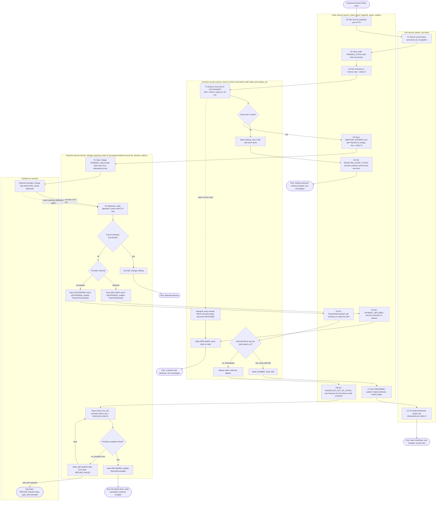

# Checkout across Cart, Inventory, Payment and Order

This flowchart shows checkout from **Place order** to a confirmed order, a rejected order, a declined payment, or a refunded order. Each box is labelled with the service that owns it. The stores are listed under the diagram. Services talk over HTTP (request and reply) or through events on the message broker (fire and forget). Each service writes its state and its outgoing event in one database transaction (the outbox pattern), so a state change and its event cannot get out of step.

## Stores by service

| Service | What it stores | Notes |
|---|---|---|
| Cart | Cart lines | Writes only when the cart is emptied after confirmation. Checkout never writes to it otherwise. |
| Order | Order header, status, the lines and prices as they were at Place order, outbox | The price snapshot is never updated after creation. |
| Inventory | Stock on hand, reservations (id, order id, lines, status HELD / CLAIMED / RELEASED, expires_at) | A reservation is one transaction across all its lines, so it is all-or-nothing. |
| Payment | Charges keyed by order id (status PENDING / SUCCEEDED / DECLINED), processed webhook event ids (unique), refunds (status, attempts), outbox | Only Payment talks to the provider. |

## Failure branches

| Branch | What happens | Cart | Money | Stock |
|---|---|---|---|---|
| Short stock | Inventory writes nothing and returns the short items. No payment is requested. Order records REJECTED_SHORT_STOCK. | Unchanged | None taken | Unchanged |
| Declined payment | Payment stores DECLINED. Order sets PAYMENT_DECLINED and asks Inventory to release the hold now, rather than waiting for the sweeper. | Unchanged | None taken | Released to sale |
| Late success after the hold lapsed | The hold claim is refused because the hold is no longer HELD or unexpired. Payment refunds the full amount. Order sets CANCELLED_OUT_OF_STOCK and emails the customer. We never ship a partial order. | Unchanged | Refunded in full | Not sold to this order |
| Failed refund | Each attempt is recorded and retried with the same idempotency key, so a retry cannot refund twice. After the retry limit, Payment sets REFUND_FAILED and the refund stays on the ops queue until it succeeds. It is never dropped. | Unchanged | Still held until refunded, and flagged | Not sold to this order |
| Duplicate webhook | The event id is already in processed_webhooks, so Payment acks and changes nothing. A repeat outcome also cannot flip a charge, because status changes only from PENDING. | Unchanged | Unaffected | Unaffected |
| Hold lapses while payment is pending | The sweeper releases the stock after 10 minutes. If the success webhook arrives later, the claim is refused and the late-success branch runs. | Unchanged | Refunded if it succeeded | Back on sale |

## Why the flow is safe

- **No payment without stock.** The payment request (O5) is made only after Inventory has created the hold (I1 yes).
- **No double charge.** Each charge uses the order id as the provider idempotency key. Payment stores one charge row per order id.
- **No double processing of webhooks.** Each webhook's event id is stored once. Each state change is conditional on PENDING, so a repeat cannot move a charge to a second outcome.
- **The claim checks the clock.** The hold claim checks expires_at at the moment of the claim, so a sweeper that runs late cannot let an expired hold be sold.
- **Cart changes only on confirmation.** Cart is read at Place order and written only when OrderConfirmed is consumed. Every failure branch leaves it untouched.

## Assumptions and open decisions

1. **Late success with stock still free.** The brief says to refund. This design refunds in every late-success case, even when nobody else bought the stock. An alternative is to try a fresh reservation first and confirm if it succeeds. Decide before build.
2. **Email sender.** The brief names no notification service, so this design has Order send the customer emails.
3. **Missing webhook.** The brief says a webhook can take up to 30 minutes. It does not say what happens if none arrives. Adding a provider status poll for charges still PENDING after about 35 minutes is recommended. It is not in the brief.
4. **Cart edits during checkout.** If the customer edits the cart while the order is pending, the confirmed order still uses the snapshot. Decide whether OrderConfirmed empties the whole cart or only the snapshot lines.
5. **Refund failure ownership.** The ops queue needs an owner and an alert threshold, and the customer needs an agreed message while a refund is stuck.