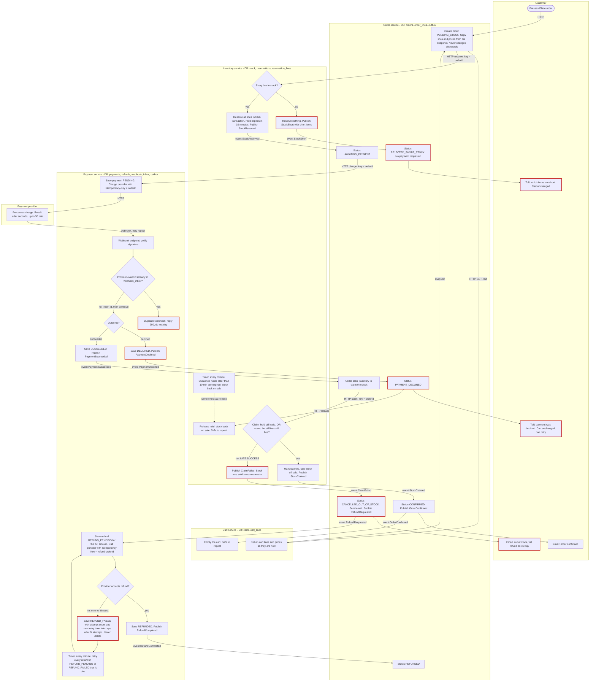

# Checkout across Cart, Inventory, Payment and Order

## How to read this

- There are four services: **Cart**, **Order**, **Inventory** and **Payment**. Each owns its own database. They talk only by HTTP calls (arrows labelled `HTTP`) or by events on the shared broker (labelled `event`).
- Only **Payment** talks to the payment provider.
- Order is the coordinator. It decides what happens next after each reply or event.
- Each box sits in the lane of the service that performs the step. Arrow labels say what triggers the step.
- The red-bordered boxes are the failure branches asked for: short stock, declined payment, late success, failed refund and duplicate webhook.

## Flowchart

## What the flow does, step by step

1. **Place order.** Order calls Cart over HTTP for the current lines and prices. It saves them as the order's own copy. After that, cart edits and price changes cannot touch the order. Order also drops a repeated Place order (double click) by using the cart id as a dedupe key.
2. **Reserve stock.** Order asks Inventory to reserve all the lines, using the order id as the key. Inventory checks every line and reserves all of them in one database transaction, or none. If any line is short, Inventory reports exactly which ones. Order marks the order rejected, and the customer sees the short items. No payment is requested and the cart is untouched.
3. **Request payment.** After `StockReserved`, Order asks Payment to charge. Payment saves a PENDING row (one row per order id, enforced by a unique constraint). It then calls the provider with the order id as the idempotency key. If Payment or Order retries this call, the provider returns the original charge instead of making a second one.
4. **Wait for the webhook.** The result can take up to 30 minutes. Payment does not poll or block. It waits for the provider's webhook.
5. **Webhook intake.** Payment verifies the signature. It then inserts the provider's event id into `webhook_inbox`, which has a unique constraint on that id. If the insert finds the id already there, Payment replies 200 and does nothing. This is the duplicate-webhook branch. The inbox insert and the outgoing event are written in one transaction (an outbox), so a crash cannot record the webhook without the event.
6. **Declined.** Payment publishes `PaymentDeclined`. Order marks the order `PAYMENT_DECLINED`, asks Inventory to release the hold, and tells the customer. The cart is untouched. A retry from the customer is a new Place order with a new order id and so a new idempotency key. A declined order id is never charged again.
7. **Succeeded.** Payment publishes `PaymentSucceeded`. Order asks Inventory to **claim** the stock for that order.
   - **Normal path.** The hold is still valid. Inventory marks it claimed. Order marks the order `CONFIRMED`, emails the customer, and publishes `OrderConfirmed`. Cart reacts to that event by emptying the cart. This is the only point where the cart is emptied.
   - **Late success.** The hold has lapsed. Inventory first checks whether every line is still free and, if so, re-takes it and the claim succeeds. Otherwise it answers `ClaimFailed`. Order marks the order `CANCELLED_OUT_OF_STOCK`, emails the customer, and publishes `RefundRequested`. Nothing is shipped, since we never ship partial orders. The cart stays as it was.
8. **Refund.** Payment saves a refund row for the full amount before it calls the provider, using the key `refund-<orderId>`. If the provider accepts it, Payment saves `REFUNDED` and publishes `RefundCompleted`, and Order marks the order `REFUNDED`. If the provider rejects it or times out, the row becomes `REFUND_FAILED` with an attempt count and next retry time. A timer retries every refund that is not `REFUNDED`. After N failed attempts it also alerts a person, but the retries continue. A refund is never deleted or given up on.
9. **Hold expiry.** A timer in Inventory expires unclaimed holds after 10 minutes and puts the stock back on sale. Expiry and claim both do a conditional update on the reservation row (`held` to `expired` or `claimed`), so exactly one of them wins when they race.

## What each service stores

| Service | Stores | Key constraints |
|---|---|---|
| Cart | Carts and cart lines (product, quantity, price) | Emptied only on `OrderConfirmed`. Emptying is safe to repeat |
| Order | Order, its copy of the lines and prices, status, outbox | Unique per checkout attempt. Lines and prices are never updated |
| Inventory | Stock levels, reservations (`held`, `claimed`, `expired`, `released`), reservation lines, `expires_at` | One reservation per order id. Reserve and claim are each a single transaction |
| Payment | Payment (status, amount, provider charge id), refunds (status, attempts, next retry), `webhook_inbox`, outbox | Unique payment per order id. Unique provider event id in the inbox |

## Order statuses

`PENDING_STOCK` leads to one of:

- `REJECTED_SHORT_STOCK` (end)
- `AWAITING_PAYMENT`, which leads to one of:
  - `PAYMENT_DECLINED` (end)
  - `CONFIRMED` (end)
  - `CANCELLED_OUT_OF_STOCK`, then `REFUNDED`

Every status change checks the current status first. A repeated or out-of-order event therefore changes nothing.

## Failure branches at a glance

| Case | Where it is caught | Result |
|---|---|---|
| Any line short | Inventory reserve | Nothing reserved, no payment, customer sees the short items, cart unchanged |
| Payment declined | Payment webhook, then Order | Hold released, customer told, cart unchanged, retry makes a new order |
| Success after hold lapsed and stock gone | Inventory claim | Full automatic refund, order cancelled as out of stock, customer emailed, cart unchanged |
| Refund fails at the provider | Payment refund row and retry timer | Status `REFUND_FAILED`, retried until it succeeds, ops alerted after N tries |
| Duplicate webhook | Payment `webhook_inbox` unique event id | Acknowledged, not processed again |
| Retried charge request | Provider idempotency key = order id | No second charge |
| Duplicate event or HTTP call between services | Status checks and keys on order id | No repeated effect |

## Assumptions to confirm

- Cart is the source of line prices. If a separate catalogue owns prices, the snapshot call changes but the design does not.
- No separate email service exists, so Order sends the emails. If there is a notification service, it would sit behind an event instead.
- The customer gets one email when the order is cancelled, and Order records the refund later as `REFUNDED`. If you want a second email when the refund lands, trigger it from `RefundCompleted`.
- The values for N (refund attempts before alerting) and the retry backoff are not decided yet.
- An order stuck in `AWAITING_PAYMENT` with no webhook long after 30 minutes is not covered by the stated requirements. I suggest a reconciliation job in Payment that asks the provider for the charge status once an order is older than about 35 minutes.
