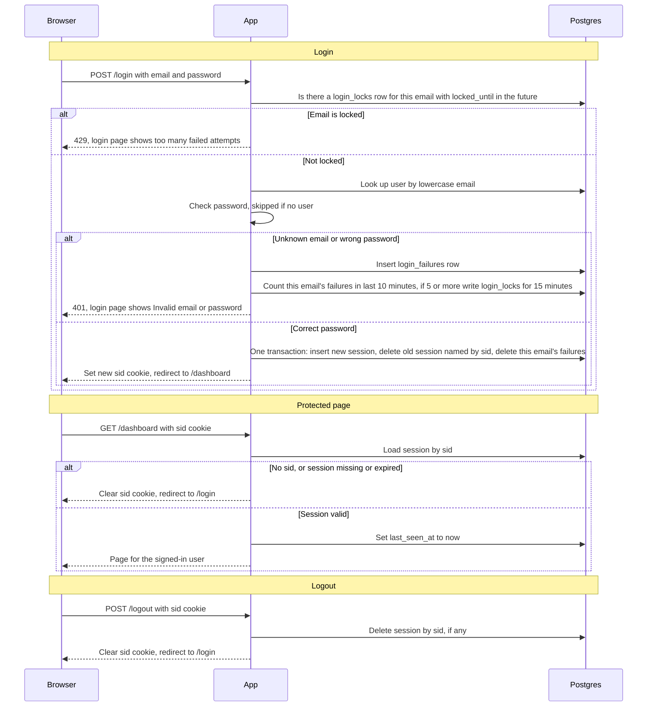

# Login with server-side sessions

**What this is.** Today every page is public. After this change, every page except `/login` needs a signed-in user. The browser holds only a random session ID, in the `sid` cookie. The server keeps sessions, failed attempts and locks in Postgres, so both app instances see the same state. Redis is not in the stack, and adding it would mean running another service. Postgres is already shared by both instances. The cost is that each protected request writes `last_seen_at`.

**Terms**
- **Session**: one row in `sessions`, linked to one user.
- **Session ID**: 256 random bits from a cryptographically secure source. It is the primary key of `sessions`.
- **sid cookie**: the browser's copy of a session ID. It holds nothing else: no signature and no user data.
- **Failure**: a `POST /login` with an unknown email or a wrong password.
- **Lock**: a `login_locks` row that refuses logins for one email until `locked_until`.
- **Idle timeout**: a session ends 30 minutes after its last request.
- **Absolute timeout**: a session ends 12 hours after login.
- **Fail closed**: when the database fails, refuse the request. Never let it through.

Tables: `sessions`, `login_failures` (one row per failure), `login_locks` (one row per locked email). The `users` table already exists.

**Notes on the diagram**
- Lowercase the email before every lookup, failure count and lock.
- Failures and locks are recorded for every email, known or not. This keeps the responses identical.
- A session past either timeout counts as missing. Its row stays until cleanup removes it.

**Steps**

*Login (`POST /login`)*

1. **Lock check.** Starts when the form is posted. Look up `login_locks` for this email. If `locked_until` is later than now, return 429 and stop. Do not check the password. Keeps: nothing is written. If the database fails, return 503.
2. **Password check.** Look up the user by lowercase email and check the password against `password_hash`. If there is no user, skip the check and treat the attempt as a failure. Keeps: nothing is written. If the database fails, return 503.
3. **Failure.** Runs for an unknown email or a wrong password. Insert a `login_failures` row. Count this email's rows from the last 10 minutes. If the count is 5 or more, write a `login_locks` row with `locked_until` = now + 15 minutes. The 5th failure still gets a 401. The next attempt gets a 429. Keeps: `login_failures`, `login_locks`. If the database fails, return 503.
4. **Success.** Runs for a correct password. In one transaction: insert a new session with a new random ID, delete the session the incoming `sid` named (if any), and delete this email's `login_failures` rows. Then set the new `sid` cookie and redirect to `/dashboard`. Keeps: `sessions`, `login_failures`. If the transaction fails, nothing changes and no cookie is set. Return 503.

*Protected request (any page except `/login`)*

5. **Check the session.** Starts with any request. If there is no `sid` cookie, clear the cookie and redirect to `/login`. Otherwise load the row by `sid`. It is valid only if now is before `last_seen_at` + 30 minutes and before `created_at` + 12 hours. If it is missing or not valid, clear the cookie and redirect to `/login`. If it is valid, set `last_seen_at` to now, and run the request as the session's user. Keeps: `sessions`, with `last_seen_at` updated. If the database fails, show a 503 page with no content. Leave the cookie unchanged, and do not treat the user as signed in.

*Logout (`POST /logout`)*

6. **End the session.** Starts with the logout form post. Delete the session named by `sid`, if there is one. Then clear the cookie and redirect to `/login`. The result is the same when there is no session. Keeps: `sessions`. If the database fails, return 503 and leave the cookie unchanged. The session then ends by timeout.

*Cleanup*

7. **Remove old rows.** Starts every 15 minutes on each instance. Delete sessions past either timeout, `login_failures` older than 10 minutes, and `login_locks` past `locked_until`. Cleanup only frees space. Step 5 refuses expired sessions between runs. Both instances may run it, because repeating a delete is harmless.

**What happens when things fail**

| Situation | What the browser gets | What is stored |
|---|---|---|
| Unknown email or wrong password | 401, login page: "Invalid email or password" | One `login_failures` row |
| Email is locked | 429, login page: "Too many failed attempts. Try again in 15 minutes." | Nothing |
| No `sid`, or session unknown or expired | Clear cookie, redirect to `/login` | Nothing |
| DB error during login | 503, login page: "Sign-in is temporarily unavailable. Try again." | Nothing. No cookie is set. |
| DB error on a protected page | 503 page with no content | Cookie unchanged. User is not treated as signed in. |
| DB error on logout | 503 | Cookie unchanged. Session ends by timeout. |

**Open questions**
- An unknown email skips the password check, so response time may reveal whether an account exists. The brief asks for identical responses, not identical timing. This plan does not handle timing.
- The live database schema and the scheduler for the cleanup job have not been checked against the deployment.