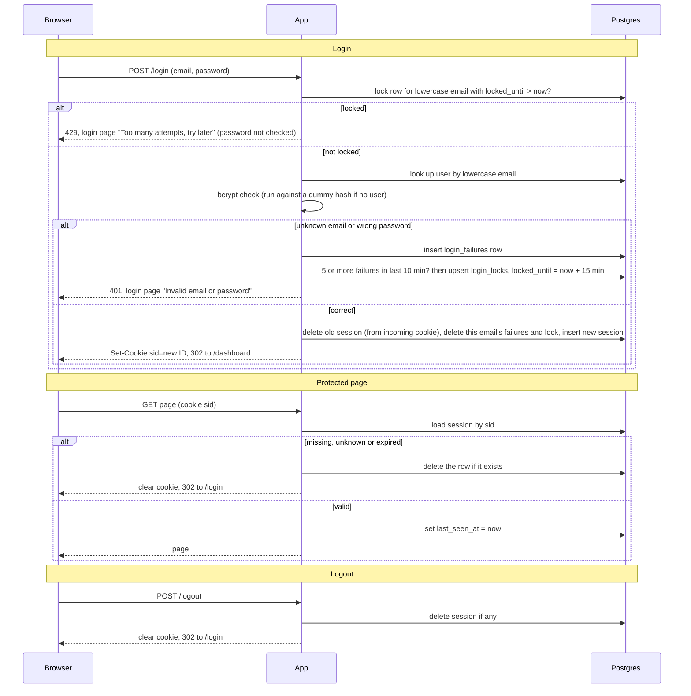

# Auth plan

## What this is

Every page except `/login` needs a signed-in user. Today the app is public. After this change, a successful login creates a session row in Postgres, and the browser keeps only a random session ID in a cookie. Each protected request looks that ID up in the database. We use Postgres because both app instances already share it. Redis is not added.

## Terms

- **sid**: the cookie value. A random 32-byte ID, base64url encoded. It holds no user data. Cookie flags: HttpOnly, Secure, SameSite=Lax.
- **sessions** table: `id` (the sid, primary key), `user_id`, `created_at`, `last_seen_at`.
- **login_failures** table: `email` (lowercase), `failed_at`. One row per failed attempt, for known and unknown emails alike.
- **login_locks** table: `email` (lowercase), `locked_until`. One row per locked email.

## Flow

## Rules

1. **Expiry.** A session is expired if `now - last_seen_at > 30 min` or `now - created_at > 12 h`. Every valid request sets `last_seen_at = now`. `created_at` never changes.
2. **Lockout.** The lock is keyed on lowercase email only, not IP. Unknown emails are counted too, so nothing reveals whether an account exists. While locked, no password check runs and no failure is recorded. A successful login deletes the email's failures and lock.
3. **New session on login.** The session named by the incoming cookie is deleted, even if it belongs to another user. A new random ID is always issued.
4. **Cleanup.** Each instance runs one idempotent delete every hour. It removes expired sessions, failures older than 10 minutes, and locks whose `locked_until` has passed. Deleting at request time is only a shortcut. Correctness comes from the expiry check.

## When Postgres fails or is slow

Nobody is ever let through on an error. The user is treated as not signed in.

| Step | What the user sees |
|---|---|
| Login | 503 page "Something went wrong, try again". No session is issued. |
| Protected page | 503 page. The cookie is kept, because the session may still be valid. |
| Logout | 503 page. The cookie is kept so the user can retry. |

## Open questions

- None.
