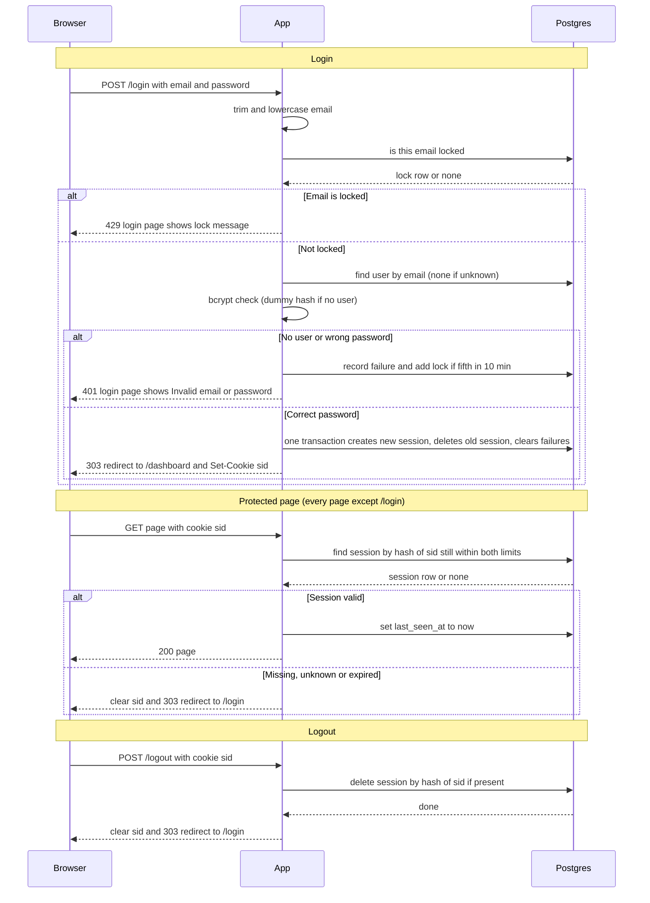

## Auth plan

### What this does

Users sign in with an email and password. After this change, every page except `/login` requires a signed-in user. Pages that do not need sign-in are not affected.

After a successful sign-in, the server creates a **session**. A session is a record on the server that says "this browser is signed in as this user, until this time." The browser holds only a random session ID, stored in a cookie named `sid`. The server keeps the session record in Postgres, the database the app already uses. On every protected page request, the server looks up the session ID in the database and checks that the session is still valid.

No session data lives in app memory. The app runs as two identical instances behind a load balancer (a router that spreads incoming requests across the instances). Either instance can serve any request, because both read the same database. A user does not need to be sent back to the same instance.

### Terms used below

- **Cookie:** a small value the server asks the browser to store and send back with each request to the same site.
- **Session:** a server-side record of one sign-in. It has an ID, a user, and two expiry times.
- **Hash:** a one-way fingerprint of a value. You can check a value against its hash, but you cannot recover the value from the hash. SHA-256 is one such function.
- **bcrypt:** a slow, salted hash function for passwords. The database stores only the bcrypt hash of a password, never the password itself. Checking a password means hashing the attempt and comparing the results. bcrypt is deliberately slow, which makes guessing expensive.
- **Row:** one record in a database table.
- **Primary key:** the column that uniquely identifies each row in a table.
- **Transaction:** a group of database operations that either all take effect or none do.
- **Advisory lock:** a Postgres lock on a name the app chooses (here, an email address). It does not lock any table row. A second transaction that asks for the same name waits until the first transaction finishes.
- **Fail closed:** when a check cannot be completed, the request is refused. It is never allowed through by default.
- **303 redirect:** a reply that tells the browser to load another page using GET. It is used after form posts, so that refreshing the page does not repeat the post.
- **HTTP status codes used:** 303 (redirect), 401 (wrong credentials), 429 (too many failed attempts), 503 (a required check could not be completed, so the request is refused for now).

### Stored data

- `users` (existing, unchanged): `id`, `email` (stored lowercase, unique), `password_hash` (bcrypt).
- `sessions` (new): one row per signed-in session.
  - `id`: the SHA-256 hash of the session ID. This is the primary key. The raw session ID is never stored.
  - `user_id`: the user the session belongs to.
  - `created_at`: when the session was created.
  - `last_seen_at`: the time of the most recent valid request on this session.
  - `expires_at`: `created_at` plus 12 hours.
- `login_failures` (new): one row per failed login attempt.
  - `email`
  - `failed_at`
- `login_locks` (new): one row per locked email.
  - `email`: the primary key.
  - `locked_until`: the time the lock ends.

### Choices

**Where state lives: Postgres, not Redis.**
Sessions and failure counts are stored in Postgres. Both instances already share Postgres, so both can see the same sessions and failure counts. Sticky sessions (where the load balancer always sends a user to the same instance) would also work, but they would tie each user to one instance and make the instances less interchangeable. Redis is a separate in-memory data store. Using it would mean running, securing, backing up and monitoring a new service, and splitting data across two stores. The data here is small: a few rows per user. Every page already queries the database, so the session check adds little new load. Revisit this choice only if login traffic grows far beyond a team's needs.

**Session IDs.**
Each session ID is 32 random bytes from a cryptographically secure random source (one designed for secrets). It is encoded as base64url, a text encoding that is safe to put in a URL. The database stores only the SHA-256 hash of the ID. If someone copies the sessions table, they cannot use it as a login cookie, because the cookie needs the original ID, which is never stored.

**How expiry is checked.**
Each protected request runs one query. The query finds a session whose hashed ID matches and returns it only if the current time is before both of these:
- `last_seen_at` plus 30 minutes (the idle limit), and
- `expires_at` (the 12-hour limit).

Rows past either limit never match. If the session is valid, the server then sets `last_seen_at` to now. This restarts the 30-minute idle clock. "Now" is the database's clock, not the app server's clock, so the two instances cannot disagree about the time.

**How abandoned rows are removed.**
A cleanup job runs every 15 minutes and deletes:
- sessions past either limit,
- `login_failures` older than 10 minutes,
- `login_locks` whose `locked_until` time has passed.

Cleanup only frees storage. The checks ignore expired rows, so a user is never let in just because cleanup has not run yet.

**Lockout (per email).**
- Every submitted email is tracked, whether or not an account exists. Real and unknown emails get the same lock response, so the lock does not reveal which accounts exist.
- The lock is checked before the password. A locked attempt gets HTTP 429. Its password is not checked, and it is not recorded as a failure.
- A failed attempt adds a `login_failures` row. If that makes five rows for the email within the last 10 minutes, the server adds a `login_locks` row that lasts 15 minutes, and deletes that email's failure rows.
- The lock check, the failure count and the insert happen in one transaction. The transaction takes a per-email advisory lock (`pg_advisory_xact_lock`). If two instances handle guesses for the same email at the same moment, the second waits for the first. Neither can miss the fifth failure.
- A successful login deletes that email's failure rows.

**Unknown emails.**
When no user matches the email, the server still runs bcrypt, against a fixed dummy hash. The response then takes about as long as a wrong password would. Response time therefore does not reveal whether the account exists.

**Email matching.**
The input is trimmed (leading and trailing spaces removed) and lowercased before any lookup, lock check or failure record.

**Login success.**
In one transaction, the server:
1. creates a new session with a new random ID,
2. deletes the session named by the incoming `sid` cookie, if there is one,
3. deletes that email's failure rows.

The server sends the cookie and the redirect only after the transaction commits. If the transaction fails, no cookie is sent and no session is created.

**Cookie.**
`sid` holds only the session ID. It is set with these attributes:
- `HttpOnly`: page scripts cannot read it.
- `Secure`: browsers send it only over HTTPS.
- `SameSite=Lax`: browsers do not send it on most cross-site form posts.
- `Path=/`.

It has no `Max-Age` or `Expires`, so it is a session cookie. The browser drops it when closed. The server, not the browser, enforces the 30-minute and 12-hour limits.

**Redirects after POST.**
Redirects after a form post use 303 See Other, so the browser follows them with GET.

**Storage failures (fail closed).**
When the database cannot answer, the server refuses the request rather than guessing.
- **Login:** if the lock check, the user lookup or the session transaction fails, return 503 and the login page with "Sign-in is temporarily unavailable. Try again in a few minutes." Set no cookie and create no session. If the lock check fails, the password is not checked at all.
- **Protected pages:** if the session check fails, return 503 with "We could not check your sign-in. Try again shortly." Keep the cookie and do not redirect to `/login`. A page is never served without a successful check. A brief database outage therefore does not sign people out.
- **Logout:** if the delete fails, return 503 with "Could not sign you out. Try again." Keep the cookie, because the session is still valid on the server.
- **Cleanup job:** a failure is logged and retried on the next run. Lookups ignore expired rows, so users are not affected.
- **Logs** record the error and the route. They never record passwords, session IDs or cookie values.

### Login, step by step

1. The browser posts the email and password to `POST /login`.
2. The server trims and lowercases the email.
3. The server checks whether the email is locked. If it is, the server returns 429 and stops. The password is not checked.
4. The server looks up the user by email. If no user matches, it uses a dummy hash.
5. The server runs bcrypt on the password.
6. If the password is wrong or there is no user, the server records a failure, adds a lock if this is the fifth failure in 10 minutes, and returns 401.
7. If the password is right, the server creates the new session, deletes the old one and clears the failures, all in one transaction. Then it sends the cookie and redirects to `/dashboard` with 303.

### Sequence

The diagram covers three flows: login (success, bad credentials and lockout), a protected page, and logout. The 503 rules above are not drawn. Any database step can fail, and a failed step ends the request as described under Storage failures.

Notes on what the diagram does not show:
- The lock check, the failure record and the lock insert run in one transaction under a per-email advisory lock (see Lockout). The diagram shows them as separate steps.
- The lock check happens before any password check. If the lock check fails, the server returns 503 and skips the password check.
- A protected page's `last_seen_at` update happens only after a valid check. The page is served only after that check succeeds.
- Logout returns the same response whether or not a session exists. Only the database delete differs.

### Rules at a glance

- **Lockout:** five failures within 10 minutes lock that email for 15 minutes. Locked attempts get HTTP 429 and are not checked against the password.
- **Bad email or bad password:** HTTP 401 and the login page with "Invalid email or password". Both cases get the identical response. The form keeps the typed email and clears the password.
- **Timeouts:** a session ends after 30 minutes with no requests, or 12 hours after login, whichever comes first. Every valid request restarts the idle clock.
- **New session on every login:** a new random ID is issued even if the browser already sent one. The old session is destroyed.
- **Protected pages:** if the session is missing, unknown or expired, clear `sid` and redirect to `/login`. If the check itself fails, return 503 and keep the cookie.
- **Logout:** behaves the same whether or not a session exists.

### Open boundaries (not part of this brief)

- Lockout is per email. It does not limit guesses spread across many emails or many IP addresses.
- The per-email lock has a cost: anyone who knows a user's email can lock that user out for 15 minutes. This is accepted for now.
- Requests that passed the lock check before the fifth failure was recorded can still be checked against the password. A burst of parallel guesses for one email can therefore produce a few more password checks than the limit allows. Closing this gap would mean holding the per-email lock across the password check, which would make each login for that email wait for bcrypt.
- The exact wording of the lock message on the 429 page is not yet set. The brief does not specify it.
- Sign-up, password reset and "sign out everywhere" are out of scope.