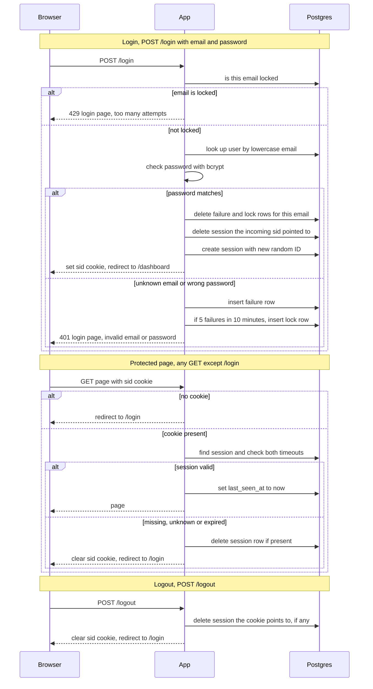

## Auth plan

**Summary.** Today every page is public and the app has no sign-in. This adds sign-in with server-side sessions stored in Postgres. The browser holds only a random session ID in the `sid` cookie. Every page except `/login` checks that session on the server. Login is rate-limited per email.

Choices:
- **Postgres, not Redis, for sessions and failure counts.** The two app instances share no memory, and Postgres is already in the stack. Redis would add a second store to run for a small team app.
- **Failure counts are per email, known or not.** This keeps the lockout response the same for unknown and known emails.
- **Storage errors fail closed.** If the database is down, no one gets in, and the user sees a clear retry message.

**Terms**
- **Session**: a row in `sessions` that links a random session ID to a user, with the times it was created and last used.
- **`sid` cookie**: the browser cookie that holds only the session ID. It is HttpOnly, Secure and SameSite=Lax.
- **Failure row**: a row in `login_failures` for each wrong attempt. Only rows from the last 10 minutes count.
- **Lock row**: a row in `login_locks` that refuses logins for one email until a set time.

**Diagram**

**Notes**
- Lockout: the fifth failed attempt within 10 minutes gets a 401 and creates a lock row for 15 minutes. Attempts while locked get a 429 and never reach the password check. Locked attempts do not add failure rows.
- Unknown emails: an attempt for an unknown email adds a failure row and can trigger a lock, just like a wrong password. Each such attempt also runs one bcrypt check against a dummy hash, so timing does not reveal whether the account exists.
- Expiry is checked on every request. An expired row is refused even before cleanup deletes it.

**Steps**

1. **Login (`POST /login`).**
   - Starts: the browser posts an email and password.
   - Does: lowercases the email and checks `login_locks`. If locked, it returns 429. Otherwise it checks the password. On a match, it deletes the email's failure and lock rows, deletes the session the incoming `sid` pointed to, creates a new session, sets the cookie and redirects to `/dashboard`. The new session ID is 32 random bytes from a cryptographic random source, written as hex. On a miss, it records a failure and returns 401.
   - Keeps data in: `sessions`, `login_failures`, `login_locks`.
   - When it goes wrong: see the table below.

2. **Protected page (any `GET` except `/login`).**
   - Starts: the browser requests a page, with or without a `sid` cookie.
   - Does: with no cookie, it redirects to `/login`. Otherwise it loads the session. The session is valid only if the row exists, less than 30 minutes have passed since `last_seen_at`, and less than 12 hours have passed since `created_at`. If valid, it sets `last_seen_at` to now and serves the page. If not, it deletes the row if present, clears the cookie and redirects to `/login`.
   - Keeps data in: `sessions`.
   - When it goes wrong: see the table below.

3. **Logout (`POST /logout`).**
   - Starts: the browser posts to `/logout`.
   - Does: deletes the session the cookie points to, if any. Then it clears the cookie and redirects to `/login`. With no session, it does the same.
   - Keeps data in: `sessions`.
   - When it goes wrong: see the table below.

4. **Cleanup, hourly.**
   - Starts: a timer on either instance. Both may run it, and that is harmless because deletes are idempotent.
   - Does: deletes sessions past either timeout, failure rows older than 10 minutes, and lock rows whose time has passed.
   - Keeps data in: all three tables.
   - When it goes wrong: the run is logged and retried in the next hour. Expired rows are still refused on read.

**What happens when things fail**

| Situation | What the user sees | What the app does |
|---|---|---|
| Email is locked | Login page: "Too many failed attempts. Try again in 15 minutes." (429) | Checks no password and adds no failure row. |
| Wrong email or password | Login page: "Invalid email or password." (401) | Adds a failure row. Same for unknown emails. |
| Database down at login | Page: "Sign-in is unavailable right now. Try again in a minute." (503) | Creates no session and changes no cookie. |
| Database down on a protected page | Same 503 page | No redirect, so no login loop. The cookie stays. |
| Database down at logout | Same 503 page | The cookie stays so the user can retry. If they do not, the session ends within 30 minutes. |
| Session missing, unknown or expired | Login page | Deletes the row if present, clears the cookie, redirects. |
| Cleanup fails | Nothing | Logged, retried next hour. |

**Open questions**
- Parallel wrong guesses for one email can overshoot the 5-attempt limit by a few, because the count and the lock write are not atomic. Accepted for now.