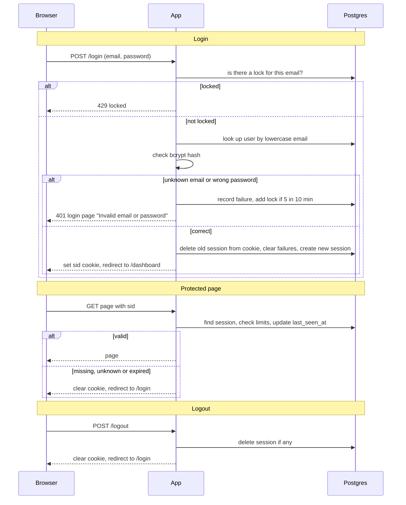

# Auth plan: server-side sessions in Postgres

Every page except `/login` needs a signed-in user. Today the app is public. The app runs as two identical instances behind a load balancer with no sticky sessions, so all login state lives in the one Postgres database. The browser holds only an opaque session ID in a cookie. On each request the app looks that ID up in Postgres.

Redis is not added. Postgres is already in the stack and handles this load, so adding Redis would only add a new part to run.

## Terms

- **Session**: a row in `sessions` that says a user is signed in. Its ID is a long random string.
- **`sid`**: the cookie that holds the session ID and nothing else. Flags: HttpOnly, Secure, SameSite=Lax.
- **Failure record**: a row in `login_failures` for one failed login, with the email and the time.
- **Lock**: a row in `login_locks` that stops logins for one email until a set time.
- **Idle limit / max age**: a session ends after 30 minutes with no requests, or 12 hours after login, whichever comes first.

## Tables

| Table | Holds |
|---|---|
| `users` | Already exists: `id`, `email` (lowercase), `password_hash` (bcrypt). |
| `sessions` | `id`, `user_id`, `created_at`, `last_seen_at`. |
| `login_failures` | `email`, `failed_at`. |
| `login_locks` | `email`, `locked_until`. |

## Diagram

## Steps

Each step: what starts it, what it does, what data it touches, what happens on failure.

1. **Login.** Starts on `POST /login`. The app lowercases the email and reads `login_locks`.
   - If a lock exists and `locked_until` is in the future, reply 429 and stop. The password is not checked.
   - Otherwise look up the user and check the bcrypt hash. For an unknown email, still run a bcrypt check against a dummy hash, so timing does not reveal whether the account exists.
   - Data: `users`, `login_locks`.
   - On a Postgres error: see the failure table.
2. **Bad credentials.** Starts when the email is unknown or the password is wrong. Both cases do exactly the same thing.
   - Insert a `login_failures` row. If the email now has 5 failures in the last 10 minutes, set `locked_until` to now plus 15 minutes.
   - Reply 401 with the login page showing "Invalid email or password".
   - Data: `login_failures`, `login_locks`.
3. **Successful login.** Starts when the password is right.
   - In one transaction: delete the session named by any incoming `sid`, delete this email's `login_failures` and any lock, and insert a new session with a fresh random ID.
   - Reply with the `sid` cookie and a redirect to `/dashboard`. The ID is new every time, even if the browser sent one.
   - Data: `sessions`, `login_failures`, `login_locks`.
4. **Protected request.** Starts on any request except `/login`.
   - Read the session by `sid`. It is valid only if `last_seen_at` is under 30 minutes ago and `created_at` is under 12 hours ago.
   - If valid, set `last_seen_at` to now and serve the page.
   - If the cookie is missing, the session is unknown, or it has expired, delete the row if there is one, clear the cookie and redirect to `/login`.
   - Data: `sessions`.
5. **Logout.** Starts on `POST /logout`.
   - Delete the session row if there is one. Then clear the cookie and redirect to `/login`. With no session it does the same thing.
   - Data: `sessions`.
6. **Cleanup.** Starts on a timer, every hour, run by either instance.
   - Delete sessions past the idle limit or max age, failures older than 10 minutes, and locks that have ended. It is safe to run twice at once, because it only deletes.
   - Expiry is always checked on each request, so cleanup is only for tidying and never decides who is signed in.
   - Data: `sessions`, `login_failures`, `login_locks`.

## When things fail

| Where | Failure | What the user sees |
|---|---|---|
| Login, any step | Postgres error | 503 page "Try again shortly". No session is created. |
| Protected request | Postgres error | 503 page. The user is not shown protected content, and the cookie is kept. |
| Logout | Postgres error | 503 page. The cookie is kept, so the user can retry. |
| Cleanup | Postgres error | Nothing. It runs again next hour. |

No retries or fallbacks. Storage errors always fail closed.

## Open questions

- Should the 503 on logout also clear the cookie? The plan keeps it, so the user can retry, but the session stays alive on the server until it expires.
