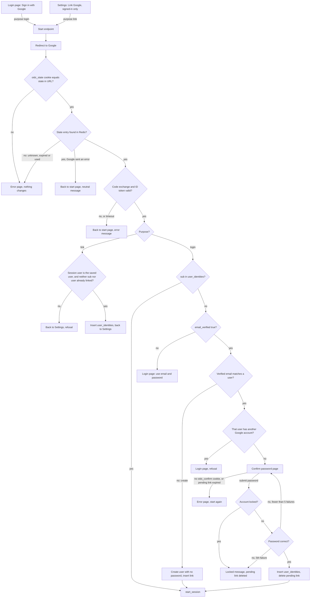

# Google sign-in

## What this is

Today a user signs in with email and password. bcrypt checks the password. Five wrong tries lock the account for 15 minutes. A good login calls `start_session`, which creates a `sessions` row and the `sid` cookie.

This adds "Sign in with Google" (OpenID Connect, authorization code flow with PKCE) to the login page and to Account Settings. Google sign-in reuses the same lockout and session code. It adds one table, `user_identities`, and short-lived Redis entries.

The main flow: the browser goes to Google and comes back to a callback. The callback signs the user in, links a Google account to a signed-in user, or asks for the password of an existing account first.

## Terms

- **sub**: Google's permanent ID for a Google account. We find linked users by `sub`, never by email.
- **State**: a random value that ties a callback to the start that created it. It works once and expires after 10 minutes.
- **Nonce**: a random value sent to Google. Google returns it inside the ID token, and the callback checks that it matches.
- **PKCE verifier**: a secret kept in Redis. Start sends only its hash to Google. The callback sends the secret itself, so only the same start can finish the sign-in.
- **Purpose**: either `login` (started from the login page) or `link` (started from Settings). It is saved with each attempt.
- **Pending link**: a temporary record of a Google `sub` and a user. It exists while the password is being confirmed.
- **start_session**: the existing function. It creates a `sessions` row, sets the `sid` cookie and redirects. Every successful Google sign-in calls it.

## Main flow

Notes:
- Both entry points use the same start endpoint. The stored purpose tells the callback whether to sign in or to link.
- A new account skips password confirmation. The verified Google email shows that the person controls it, and no existing account is involved.
- Every successful sign-in ends in `start_session`, the same call that password login makes.

## Steps

Each step says what starts it, what it does, what data it keeps, and what happens when it goes wrong.

1. **Start.**
   - **Starts when:** the user clicks Sign in with Google on the login page, or Link Google in Settings.
   - **What it does:** For link, the user must already be signed in, or Start refuses. Start creates a state, a nonce and a PKCE verifier. It saves them in Redis as `oidc:state:<state>`, with the purpose, the signed-in user id (link only) and the next page. The next page comes from the `next` query parameter. It is kept only if it is a relative path on our site, as `start_session` does. Start sets the `oidc_state` cookie to the state value. Then it redirects to Google with scopes `openid email profile`, and sends Google the hash of the verifier.
   - **Keeps:** the Redis entry and the cookie.
   - **When it goes wrong:** if Redis is down, show an error page. Nothing changes.

2. **Callback.**
   - **Starts when:** Google redirects the browser back to us.
   - **What it does, in order:**
     1. Check that the `state` in the URL equals the `oidc_state` cookie. If not, show an error page and change nothing. Do not touch the Redis entry, so the real browser can still finish.
     2. Read and delete `oidc:state:<state>` in one step. Keep its purpose, user id and next page for this request only. Clear the cookie.
     3. If Google sent an `error` (for example, the user pressed Cancel), return to the start page with a neutral message. The start page is the login page for login, and Settings for link.
     4. Otherwise, exchange the code with Google using the verifier. Check the ID token's signature, issuer, audience, expiry and nonce. Read `sub`, `email` and `email_verified`. Then go to step 3 for login, or step 5 for link.
   - **Keeps:** nothing beyond this request.
   - **When it goes wrong:**
     - Entry missing (unknown, expired or used), or Redis down: error page. Nothing changes.
     - Google error: neutral message on the start page.
     - Code exchange fails or times out, or the ID token is invalid: error message on the start page.

3. **Sign in** (purpose login, valid callback).
   - **Starts when:** step 2 succeeds for purpose login.
   - **What it does, in order:**
     - If `sub` is in `user_identities`, go to `start_session`.
     - If `email_verified` is false, refuse and point the user to email and password. Nothing is created.
     - If the verified email matches no user, create a user with no password and a verified email. Insert the link. Then call `start_session`. If the insert fails on the unique email, show an error page.
     - If the verified email matches a user who already has a different Google account, refuse.
     - Otherwise, save a pending link (`oidc:confirm:<token>` with `sub`, user id and next page). Set the `oidc_confirm` cookie. Show the confirm password page.
   - **Keeps:** a new user and its link (permanent), or a pending link (temporary, see step 4).
   - **When it goes wrong:** refusals show a message on the login page. Nothing changes. An insert failure shows an error page. Nothing changes.

4. **Confirm password.**
   - **Starts when:** the user submits a password on the confirm password page.
   - **What it does:** Read the token from the `oidc_confirm` cookie. Load `oidc:confirm:<token>` to find the `sub` and the user. Then:
     - If `locked_until` is in the future, show "Account temporarily locked", delete the pending link and clear the cookie. The password is not checked.
     - If the password is wrong, add 1 to `failed_logins`. At 5, set `locked_until` to now plus 15 minutes, set `failed_logins` to 0, and delete the pending link.
     - If the password is right, set `failed_logins` to 0. Insert the `user_identities` row. Delete the pending link and clear the cookie. Call `start_session`.
   - **Keeps:** the pending link, for up to 10 minutes.
   - **When it goes wrong:** if the cookie is missing, or the pending link has expired, show an error page that says to start again. Nothing changes. A wrong password shows an error message and stays on this page until the lock.

5. **Link from Settings** (purpose link, valid callback).
   - **Starts when:** step 2 succeeds for purpose link.
   - **What it does:** Check that the `sid` cookie belongs to the user id saved in the attempt. Refuse if the Google `sub` is linked to anyone, or if this user already has a Google account. Otherwise insert the link and return to Settings. No password is asked, and the emails need not match.
   - **Keeps:** the new `user_identities` row (permanent).
   - **When it goes wrong:** show the message in Settings. Nothing changes.

6. **Unlink** (separate action from Settings).
   - **Starts when:** the user clicks Unlink Google in Settings.
   - **What it does:** If `password_hash` is NULL, refuse and tell the user to set a password with the reset email. Otherwise delete the user's `user_identities` row. No password is asked again.
   - **Keeps:** nothing. It removes the link.
   - **When it goes wrong:** show the refusal in Settings. Nothing changes.

### Where state lives

| Data | Where | Lasts | Removed by |
|---|---|---|---|
| Sign-in attempt: state, nonce, verifier, purpose, user id (link only), next page | Redis `oidc:state:<state>` | 10 minutes | The callback deletes it in one step, or it expires |
| Browser check: the state value | HttpOnly cookie `oidc_state` | 10 minutes | The callback clears it, or it expires |
| Pending link: `sub`, user id, next page | Redis `oidc:confirm:<token>`. The token is in HttpOnly cookie `oidc_confirm`. | 10 minutes | Success, lockout, or expiry |
| Google link | `user_identities` (user_id, google_sub), unique on each column | Until removed | Unlink, or deleting the user |
| Lockout | `users.failed_logins` and `users.locked_until` (existing) | Existing rules | Existing rules |
| Session | `sessions` row and `sid` cookie (existing) | Existing rules | Sign-out, password reset, expiry |

Schema change: `users.password_hash` becomes nullable. Google sign-in never changes `users.email`. Google's tokens are never stored.

## What happens when things fail

| What goes wrong | User sees | What changes |
|---|---|---|
| `state` in the URL does not match the `oidc_state` cookie, or the cookie is missing | Error page | Nothing. The Redis entry is kept, so the real browser can still finish. |
| State unknown, expired or already used, or Redis down at start or callback | Error page | Nothing |
| Google sends an error, such as Cancel | Start page, neutral message | Nothing new |
| Google is down or slow, the code exchange fails, or the ID token is invalid (signature, issuer, audience, expiry or nonce) | Start page, error message | Nothing new |
| Unlinked, and email not verified | Login page: use email and password | Nothing |
| Verified email matches a user who already has another Google account | Login page, refusal | Nothing |
| Wrong password on confirm | Error message | `failed_logins` plus 1, as in password login |
| Fifth wrong password, or account already locked | Locked message | Lock for 15 minutes. Pending link deleted. |
| Confirm submit with no `oidc_confirm` cookie, or after 10 minutes | Error page, start again | Nothing |
| Settings link to a Google account already linked | Settings, refusal | Nothing |
| Settings link when the session user has changed | Settings, refusal | Nothing |
| Unlink with no password set | Settings: set a password with the reset email | Nothing |
| Two new sign-ins for the same email at once | Error page | Nothing (unique email) |

## Open questions

- How long to wait for Google's token call before giving up. The value is not set yet. It must fit inside the 10-minute round trip.
- Linking from Settings does not require a verified Google email. The brief is silent here, so this is a decision to confirm.