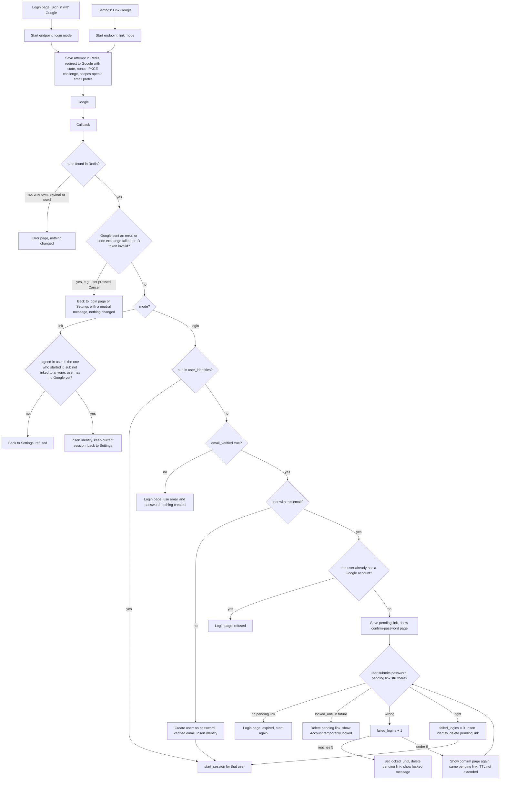

# Google sign-in

Users can sign in with Google from the login page, and link or unlink Google from Account Settings. Today a user signs in with email and password at `POST /login`. A successful login calls `start_session`, which inserts a `sessions` row and sets the `sid` cookie. Google sign-in (OpenID Connect, authorization-code flow with PKCE) ends in the same `start_session`, so there is no new session type.

The main flow: the user clicks a button, we save the attempt in Redis and redirect to Google, Google redirects back to our callback, and the callback checks the result and either signs the user in, links the account, or asks for a password to confirm a link.

## Terms

- **sub**: Google's permanent user ID, from the ID token. We identify a Google account by `sub`, never by email.
- **identity**: a row in `user_identities` that links one `sub` to one user.
- **login mode / link mode**: login mode starts on the login page. Link mode starts in Settings, from a signed-in user.
- **attempt**: a Redis entry for one round trip to Google.
- **pending link**: a Redis entry that holds a verified `sub` while the user confirms the password of the matching account.
- **lockout**: the existing rule. 5 wrong passwords set `locked_until` to now + 15 minutes. While locked, the password is not checked.

## State

| State | Where | Contents | Removed by |
|---|---|---|---|
| Attempt | Redis `goog:state:<state>`, 10 min TTL | nonce, PKCE verifier, mode, `next`, and in link mode the signed-in user id | the callback reads and deletes it in one step (`GETDEL`), so each attempt is honoured once; the TTL removes it otherwise |
| Pending link | Redis `goog:pending:<token>`, 10 min TTL, never extended; `<token>` is random and sits in an HttpOnly, Secure cookie | `sub`, matched user id, `next` | success, account lockout, or the TTL |
| Identity | Postgres `user_identities` (`user_id` UNIQUE, `google_sub` UNIQUE, `created_at`), `ON DELETE CASCADE` | the link only; no email, no Google tokens | unlink, or deleting the user |
| Password | `users.password_hash`, now nullable | NULL for users created by Google | `/login` treats NULL as a wrong password |

We keep no Google access or refresh tokens. From the ID token we read only `sub`, `email` and `email_verified`. Google never changes `users.email`.

## Steps

Each step lists what starts it, what it does, what state it touches, and what happens when it fails.

1. **Start**
   - Starts when: the user presses the button on the login page or in Settings (a POST).
   - Does: keeps the form's `next` only if it is a relative path on our site, otherwise drops it (`/home` is used later). Makes a random `state`, `nonce` and PKCE verifier. Saves them in the attempt, with the mode, `next` and, in link mode, the signed-in user id read from the current `sid` session. Redirects to Google.
   - Data: writes the attempt.
   - Fails: if Redis is down, show an error and do nothing else.

2. **Callback**
   - Starts when: Google redirects the browser back.
   - Does: reads and deletes the attempt by `state`, then checks Google's answer (no error, code exchange works, ID token passes signature, issuer, audience, expiry and nonce checks). Then goes to link mode or login mode.
   - Data: consumes the attempt.
   - Fails: a missing attempt gives an error page and nothing changes. A Google error (such as Cancel), a failed code exchange or a bad ID token returns to the login page (or Settings) with a neutral message such as "Google sign-in did not complete". Nothing is stored and there is no retry.

3. **Link mode** (from Settings)
   - Starts when: the callback finds mode = link.
   - Does: continues only if the session in the current `sid` cookie belongs to the saved user, the `sub` is not linked to anyone, and the user has no Google account yet. Inserts the identity. The session stays as it is. No password is asked and the emails need not match.
   - Data: writes an identity.
   - Fails: return to Settings with a refusal; nothing is linked.

4. **Login mode, known `sub`**
   - Starts when: the callback finds mode = login and the `sub` is in `user_identities`.
   - Does: calls `start_session` for the linked user. Lockout is not checked, because no password is used.
   - Data: none new.
   - Fails: see the failure table.

5. **Login mode, unknown `sub`**
   - Starts when: the callback finds mode = login and the `sub` is not linked. Uses the lowercased token email.
   - Does, by case:
     - `email_verified` false: refuse and point to email and password. Nothing is created.
     - No user has that email: create the user (no password, `email_verified_at` = now), insert the identity, call `start_session`.
     - A user has that email and already has a Google account: refuse.
     - A user has that email and no Google account: save a pending link (with `sub`, the user id and the attempt's `next`), set its cookie and show the confirm-password page.
   - Data: writes a user and identity, or a pending link.
   - Fails: refusals go to the login page and create nothing.

6. **Confirm password**
   - Starts when: the user submits the confirm page. It needs only the pending-link cookie, not a session.
   - Does: reads the pending link and applies the existing lockout rules exactly as `/login` does.
     - Locked account: reject and delete the pending link.
     - Wrong password: count toward lockout and show the same generic message on the same confirm page. The pending link and its original TTL stay. Reaching 5 locks the account and deletes the pending link.
     - Right password: reset `failed_logins`, insert the identity, delete the pending link, and call `start_session` using the `next` saved in the pending link.
   - Data: reads and deletes the pending link; writes an identity.
   - Fails: if the pending link has expired, return to the login page; nothing is linked.

7. **Unlink**
   - Starts when: the user presses Unlink in Settings.
   - Does: allowed only if `password_hash` is not NULL. No password is typed. Deletes the identity.
   - Data: deletes an identity.
   - Fails: with no password, tell the user to set one with the existing reset email first.

`start_session` is unchanged. It deletes any old `sid` session row, inserts a new one, sets the cookie and redirects to `next` (a relative path) or `/home`.

## Failures

| Where | What happens |
|---|---|
| Unknown, expired or reused `state` | Error page; nothing changes |
| Google error or Cancel, failed code exchange, bad ID token | Neutral message; nothing stored; user starts again |
| Unverified email | Refused; nothing created |
| Insert breaks a unique rule (race) | Treated as a refusal; no session |
| Redis or Postgres error during the callback or confirm step | Generic error page; no session; the attempt is already used, so the user starts again. Nothing is half-linked, because the identity insert is the last write |
| Confirm page expired (10 minutes) | Back to login; nothing linked |
| Account locks | Pending link deleted; nothing linked |

## Rollout

Build in this order: add `user_identities` and make `password_hash` nullable; make `/login` treat a NULL hash as a wrong password; then ship the endpoints and buttons.

## Open questions

- The callback does not tie the attempt to a browser cookie, so a forged callback could complete an attempt for someone else. Whether to add that binding is undecided.
- A Google-created user with no password gets one only through the existing reset email. That is the only way, by design.
