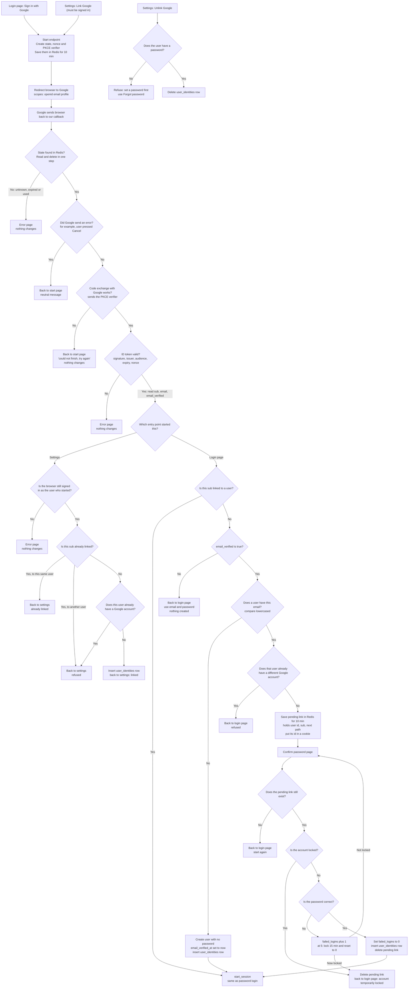

# Google sign-in

This adds "Sign in with Google" to the login page and "Link Google" to Account Settings. Google tells us who the person is, and nothing more. We never receive or keep Google access tokens or refresh tokens.

## Background for a reader new to this app

- **Entry points.** A Google flow starts from one of two pages: the login page or Account Settings. Below, each of these is called a **start page**.
- **Redirect and callback.** The start endpoint sends the browser to Google. Google later sends the browser back to our **callback** URL with a result.
- **Authorization code.** Google's callback includes a one-time code. Our server trades that code for an **ID token** by calling Google directly from the server. The browser never sees the ID token.
- **Session.** The app's normal logged-in state: a row in the `sessions` table plus a `sid` cookie. Password login creates one. Every successful Google sign-in creates one too.

Terms used below:

- **state**: a random value we send to Google and check when Google sends the browser back. It blocks forged and replayed callbacks. Each state works for one callback only.
- **nonce**: a random value we send to Google. Google copies it into the ID token. We check it to confirm the token belongs to this one attempt.
- **PKCE verifier**: a random secret we keep on the server. At the start we send its hash (the **challenge**) to Google. When we trade the code, we send the verifier itself. Google checks that the two match, which proves the code exchange comes from the same attempt that started it.
- **sub**: Google's permanent ID for a Google account. We identify Google accounts only by `sub`, never by email.
- **ID token**: a signed token from Google that says who signed in. We check its signature, issuer, audience, expiry and nonce. We read only `sub`, `email` and `email_verified` from it.
- **start_session(user_id)**: the existing function that creates a normal session. Every successful Google sign-in ends here.
- **user_identities**: a new table that links one Google account (`sub`) to one of our users.
- **Redis key with a TTL**: a Redis entry that deletes itself after a fixed time (its time to live, or TTL).
- **HttpOnly cookie**: a cookie that page scripts in the browser cannot read.
- **Lock**: when `locked_until` is set on a user, password checks are refused until that time passes. This is the existing lockout from password login.

## Flow

How to read the diagram: every path begins at a start page. Each path ends in one of three places: a successful session (`start_session`), back on a page with a message, or an error page. "Nothing changes" means no database row was created or changed.

Notes on the diagram:

- **Start page** means the page the user came from: the login page or Account Settings.
- **The state check comes first.** So an error callback with an unknown or used state gets the error page, not the neutral message.
- **The login-page branch that needs a password** ends at the **pending link** and the **confirm page**. The pending link is a short-lived record that says: "this Google account wants to link to this user, once the password is confirmed." The confirm page asks for that account's password.
- **The 10 minutes on the pending link is fixed** when the callback creates it. Retrying a wrong password does not extend it.
- **Settings linking never asks for a password,** and the emails do not need to match.
- **Every success path** ends at `start_session`, the same function password login uses.

## Where each new piece of state lives

| State | Where | Created | Lifetime | Removed by |
|---|---|---|---|---|
| Attempt: state, nonce, PKCE verifier, entry point, next path, user id (settings only) | Redis, key `goog:state:<state>` | Start endpoint | 10 min (Redis TTL) | The callback reads and deletes it in one step (Redis `GETDEL`), or the TTL expires |
| Pending link: matched user id, sub, next path, time | Redis, key `goog:link:<id>`. Its id is in a short HttpOnly cookie | Callback, when a matched account needs its password | 10 min (Redis TTL) | Successful confirm, lockout, or TTL expiry |
| Google link | PostgreSQL table `user_identities` (user_id, provider `google`, sub, linked_at) | Successful link (login, confirm, or settings) | Permanent | Unlink in settings, or deleting the user (cascade: the database deletes the linked rows too) |
| New Google-only user | PostgreSQL `users` row with `password_hash` NULL and `email_verified_at` set | Callback with a verified email that matches no user | Permanent | Same as any user |
| Session | `sessions` row and `sid` cookie | `start_session` | 14 days, slid forward on each request | Sign-out, password reset, or expiry |

The attempt and the pending link never touch PostgreSQL. Nothing permanent changes until the Google identity is proven and, for a matched account, the password is confirmed.

## Schema changes

The existing schema (`users`, `sessions`, `password_reset_tokens`) needs two changes:

- **`users.password_hash` must become nullable.** Today it is `NOT NULL`. Google-only users have no password.
- **New table `user_identities`:**
  - `user_id BIGINT NOT NULL REFERENCES users(id) ON DELETE CASCADE`
  - `provider TEXT NOT NULL` (always `google` for now)
  - `sub TEXT NOT NULL`
  - `linked_at TIMESTAMPTZ NOT NULL DEFAULT now()`
  - A unique key on `(provider, sub)`: one Google account links to at most one user.
  - A unique key on `(user_id, provider)`: one user has at most one Google account.

Emails are stored lowercased, as they are today.

## Rules

- **One use per state.** The callback reads and deletes the attempt in one step. A repeated or replayed callback gets the error page.
- **10-minute limits.** The Google round trip must finish within 10 minutes of the start endpoint running. The pending link lasts 10 minutes after the callback creates it.
- **Identity is `sub`.** If `sub` is already linked, the user reaches that account even if their Google email has changed. We never store or overwrite our email from Google.
- **Settings linking.** No password is asked, and the emails need not match. The start endpoint requires a signed-in session. The callback checks that the browser is still signed in as the same user. If not, it shows the error page.
- **Confirm loop.** A wrong password follows the existing lockout rules: `failed_logins` goes up by 1. At 5, the account is locked for 15 minutes and the count resets to 0. A locked account is rejected before the password is checked. A lock deletes the pending link, so the user must start again. A correct password resets `failed_logins`, links the account, and calls `start_session`.
- **Lockout and Google sign-in (open decision).** Lockout protects against password guessing. A Google sign-in for an already-linked account does not check a password, so this draft does not block it when `locked_until` is set. This needs confirmation.
- **Success.** Every success path calls `start_session(user_id)`, the same as password login. It deletes any existing `sid` session row, creates a new one, sets the cookie, and redirects to the saved next path if it is a relative path on our site. Otherwise it redirects to `/home`.
- **Unlink.** Allowed only when `password_hash` is set. Otherwise the user is told to set a password with Forgot password, which emails a reset link valid for one hour.
- **Password login for Google-only users.** `POST /login` must handle a NULL `password_hash`. It returns the same generic failure message as an unknown email, and it does not compare any password.

## Failures

| Failure | What the user sees | What changes |
|---|---|---|
| State unknown, expired or already used | Error page | Nothing |
| Google sends an error (for example, Cancel) | Back to the start page with a neutral message | The attempt is already deleted. Nothing else changes |
| Code exchange fails (network error or Google rejects the code) | Back to the start page: "could not finish, try again" | Nothing. No tokens are stored. The user starts again |
| ID token invalid (signature, issuer, audience, expiry or nonce) | Error page | Nothing |
| Settings: browser no longer signed in as the user who started | Error page | Nothing |
| Unlinked Google email not verified | Back to the login page: use email and password | Nothing created |
| Settings: sub belongs to another user, or this user already has a different Google account | Back to settings, refused | Nothing |
| Login: matched user already has a different Google account | Back to the login page, refused | Nothing |
| Confirm page: pending link expired or missing | Back to the login page, start again | Nothing |
| Wrong password on confirm | Confirm page with the same generic message as password login | `failed_logins` plus 1 |
| Fifth wrong password, or account already locked | Back to the login page: "Account temporarily locked" | `locked_until` set, pending link deleted |
| Unlink without a password | Refused, with a pointer to Forgot password | Nothing |
| Two requests race to create or link the same account | Error page | The transaction rolls back. Unique keys on `user_identities` (sub, and user plus provider) and on `users.email` stop duplicates |