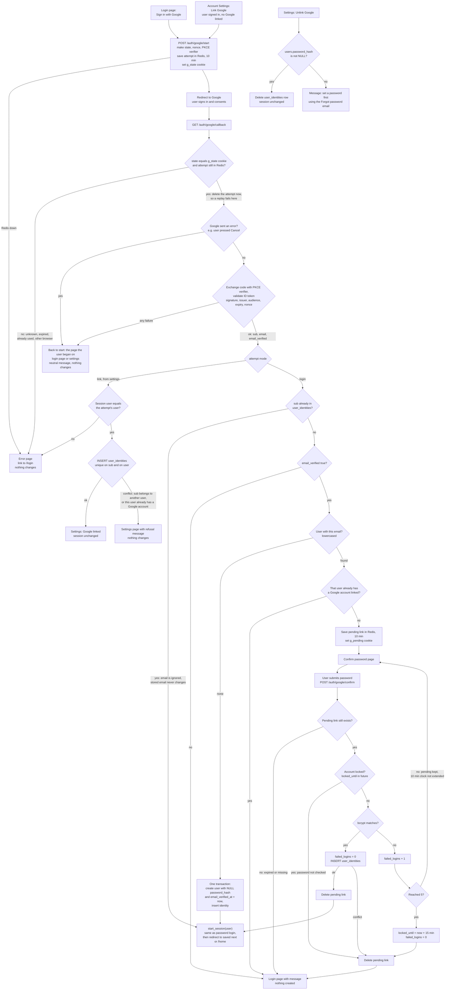

# Google sign-in

This design adds "Sign in with Google" (OpenID Connect, authorization-code flow with PKCE) next to email and password. It builds on the existing `users` and `sessions` tables, the `/login` lockout rules and the `start_session` function. It replaces none of them.

**Context.** One backend service renders the pages. PostgreSQL holds permanent data. Redis (a key-value store with expiring keys) holds short-lived data. `start_session(user_id)` is the existing function that creates a `sessions` row and sets the `sid` cookie. `/login` locks an account for 15 minutes after 5 wrong passwords.

**Terms used below**
- `sub` is Google's permanent ID for an account. We identify a Google account by `sub`, never by email.
- `state` is a random value we send to Google and get back. It ties the callback to the attempt that started it.
- `nonce` is a random value that comes back inside the ID token. Checking it proves the token belongs to this attempt.
- The PKCE verifier is a random secret. At the start we send Google its hash. When we exchange the code we send the secret itself. This stops a stolen code from being used by someone else.
- An attempt is one round trip to Google, from the start endpoint to the callback. It must finish within 10 minutes.
- A pending link is a half-finished link. Google has proved who the user is, but the user must still enter the password of the existing account with the same email.

**What is new**

| Piece | Purpose |
|---|---|
| `POST /auth/google/start` | Creates an attempt and redirects to Google. Both entry points use it. |
| `GET /auth/google/callback` | Google redirects back here. It checks the attempt, exchanges the code and decides the outcome. |
| `GET` and `POST /auth/google/confirm` | Asks for the existing account's password before linking Google to it. |
| `POST /settings/google/unlink` | Removes the Google link. |
| Table `user_identities` | The permanent Google link. |
| Redis entries and two short-lived cookies | The temporary state. See "Where state lives". |
| `users.password_hash` becomes nullable | Users created through Google have no password. |

We request scopes `openid email profile`. We keep no Google access or refresh tokens. At sign-in we read only the ID token's `sub`, `email` and `email_verified`, and we do not store the email.

## Flow

Read the chart from the two entry points at the top. "Error page" and "Back to start" are explained under "Notes on the flow".

## Notes on the flow

**Two ways to fail.** Every failure ends in one of two places.
- *Error page.* The attempt cannot be trusted, or the system is unavailable. Causes: an unknown, expired, used or wrong-browser `state`; a settings attempt whose session user changed; Redis or the database being unavailable. The page says the link has expired and links to `/login`.
- *Back to start with a message.* The user returns to the login page or Account Settings (whichever they began on) with a fixed message, passed as a code such as `/login?g=cancelled`. The code selects a fixed string, so no text from Google is ever shown.

Neither failure changes any user data. The only change is that the callback has already deleted the attempt.

**The messages**

| Situation | Message | Shown on |
|---|---|---|
| Google returned an error (including Cancel), or code exchange or ID-token validation failed | "Google sign-in did not complete. Please try again." (neutral, the same for all of these) | The page the user started on |
| Email not verified by Google | "Google has not verified this email address. Please sign in with your email and password." | Login |
| Matched account already has a different Google account | "That account is already linked to a different Google account. Please sign in with your email and password." | Login |
| Account locked (already locked, or locked by the fifth wrong password) | "Account temporarily locked" | Login |
| Confirmation expired, missing, or lost a link conflict | "That confirmation expired. Please start again." | Login |
| Settings link conflict | "That Google account cannot be linked. It is already linked to a user, or your account already has a Google account." | Settings |
| Unlink without a password | "Set a password first. Use the Forgot password email." | Settings |

**Lockout.** A wrong password on the confirm page uses the same counter as `/login`: `failed_logins` goes up by 1, and the fifth failure locks the account for 15 minutes and resets the counter to 0. When the account locks, the pending link is deleted, so the user must start Google sign-in again after the lock ends. If the account is already locked when the password is submitted, the password is not checked and the pending link is also deleted.

**Matching rules**
- *Sign-in.* An email match is considered only at sign-in, only when Google says the email is verified, and only to find which account to ask a password for. The password is the proof of ownership. Google never changes `users.email`.
- *Settings.* No password is asked and the emails need not match, because the user is already signed in. Google's `email_verified` is not checked there.
- *Lockout (assumption).* A user who is already linked and signs in with Google is let in even while the password lockout is active, because the lockout exists to stop password guessing. If Google sign-in should be blocked too, that is a one-line change; confirm which is wanted.

**Same session.** Every successful Google sign-in calls the existing `start_session(user_id)`. It deletes any old `sid` session row, inserts a new `sessions` row and sets the `sid` cookie. A Google login and a password login produce the same session. Linking from settings is not a sign-in and leaves the session alone.

**Users with no password.** `POST /login` for a user whose `password_hash` is NULL behaves like a wrong password: the same generic message, and it counts toward lockout. The code compares against a dummy hash, so timing does not reveal that the account has no password. A user can get a password through the existing `/forgot` email, which sets `password_hash` and deletes their sessions as it does today. After that, unlinking is allowed. Unlinking asks for no password. It only requires that one exists.

**Confirm page.** The diagram shows the submit step. Opening the page with `GET` follows the same rule: if the pending link is missing or expired, the user goes to the login page with the expiry message.

## Where state lives

**Permanent (PostgreSQL)**

| Item | Contents | Created by | Removed by |
|---|---|---|---|
| `user_identities` | `user_id BIGINT REFERENCES users(id) ON DELETE CASCADE`, `provider TEXT` (always `'google'`), `sub TEXT`, `created_at`. `PRIMARY KEY (user_id, provider)` means a user has at most one Google account. `UNIQUE (provider, sub)` means a Google account links to at most one user. | New Google user, successful password confirmation, or settings link | Unlink, or the user being deleted (cascade) |
| `users.password_hash` | `ALTER COLUMN password_hash DROP NOT NULL`. NULL means no password. | NULL only for users created through Google | Set by `/forgot`. Unlink needs it set, so it never returns to NULL. |
| `users` row from Google | Lowercased email, `email_verified_at = now()`, NULL password | Google sign-in with a verified email that matches no user | Normal user deletion |

**Temporary**

| Item | Contents | Lifetime | Removed by |
|---|---|---|---|
| Redis `gauth:attempt:<state>` | PKCE verifier, nonce, mode (`login` or `link`), user ID (link mode only), `next` (kept only if it is a relative path on our site) | 10 min TTL | The callback deletes it as soon as it reads it, so each attempt works once. Otherwise the TTL removes it. |
| Cookie `g_state` | A copy of `state`. HttpOnly, Secure, SameSite=Lax, path `/auth/google`. It ties the attempt to the browser that started it. | 10 min | Cleared by the callback, or expires |
| Redis `gauth:pending:<token>` | Our user ID, the unlinked `sub`, `next`. The token is 32 random bytes. | 10 min from creation, never extended by wrong passwords | Deleted on a successful link, on lockout, on a link conflict, or when the TTL ends |
| Cookie `g_pending` | The token, with the same flags as `g_state`, path `/auth/google` | 10 min | Cleared when the pending link is deleted, or expires |

Nothing else about Google is kept. No Google tokens, no ID token and no Google email are stored.

## What happens on each failure

| Failure | User sees | State change |
|---|---|---|
| Redis unavailable at start | Error page | None |
| Callback with unknown, expired, already-used or other-browser `state` | Error page | None. If the cookie does not match, the stored attempt is left alone. |
| Google returns an error such as Cancel | Back to start with the neutral message | Attempt already deleted, nothing else |
| Code exchange fails (timeout, network error, Google rejects the code) or ID-token validation fails (bad signature, issuer, audience, expiry or nonce) | Back to start with the neutral message. We do not retry, because a code works only once. The user starts again. The cause is logged on the server. | Attempt already deleted, nothing else |
| Database error in the callback or confirm step | Error page | Transaction rolled back |
| Unverified email, or the matched account already has a different Google account | Login page with message | None |
| Settings link conflict | Settings page with message | None |
| Confirm page opened or submitted after 10 minutes, or with no `g_pending` cookie | Login page with message | None |
| Wrong password | Confirm page again with the generic wrong-password message | `failed_logins + 1`. The pending link stays. |
| Fifth wrong password, or account already locked | Login page with "Account temporarily locked" | Lock set if this was the fifth failure. Pending link deleted. |
| Unlink without a password | Settings page with message | None |