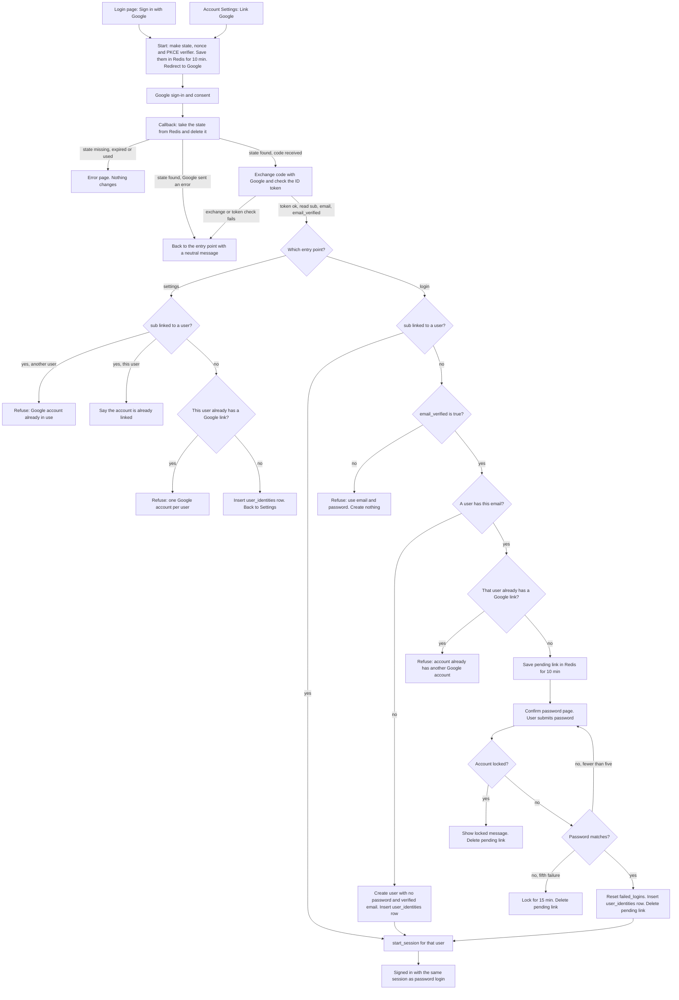

# Google sign-in

## What this is

Today users sign in only with email and password. A successful password login calls `start_session`, which stores a row in `sessions` and sets the `sid` cookie. This change adds "Sign in with Google" (OpenID Connect, authorization-code flow with PKCE) to the login page and to Account Settings. Every successful Google sign-in ends in the same `start_session` call as a password login. No new session type is added.

The main flow: the user starts at the login page or in Settings, goes to Google, and comes back to a callback. The callback checks the attempt, reads the verified Google identity, and then signs the user in, links the Google account, or asks for the account password first.

## Terms

- **sub**: Google's permanent ID for an account. We find linked users by `sub`, never by email.
- **state**: a random value made at start. It ties one callback to one attempt. A callback can use it once.
- **nonce**: a random value sent to Google. It must come back inside the ID token, so a token from another attempt is rejected.
- **PKCE verifier**: a random secret we keep. We send a hash of it to Google at start and the secret itself at the code exchange.
- **ID token**: a signed token from Google. We read only `sub`, `email` and `email_verified` from it. We keep no Google access or refresh tokens.
- **Pending link**: a short-lived record saying that a Google account waits for a password confirmation for one user.
- **user_identities**: a new permanent table. Each row links one Google `sub` to one user.

## Diagram

## Notes

### Schema changes

- `users.password_hash` becomes nullable. Google-only users have no password.
- New table `user_identities`: `user_id` references `users(id)` with `ON DELETE CASCADE`, `google_sub` is unique, and `user_id` is unique. So one Google account links to at most one user, and one user has at most one Google account.
- Google never changes `users.email`. A linked user who changes their Google email still signs in to the same account.

### Steps in order

Each step says what starts it, what it does, what keeps its data, and what happens when it goes wrong.

1. **Start.** Starts when the user clicks Sign in with Google or Link Google. Makes state, nonce and PKCE verifier. Saves them in Redis, with the entry point (login or settings), the user id (settings only) and the `next` value, for 10 minutes. Redirects to Google with scope `openid email profile`. If Redis is unavailable, show an error page. Nothing changes.
2. **Callback.** Starts when Google redirects back. Takes the state from Redis and deletes it in one step, so it is used once. Check the state first, because the entry point is stored there. If the state is missing, expired or used, show an error page. Otherwise, if Google sent an error (for example, the user pressed Cancel), go back to the entry point with a neutral message.
3. **Exchange.** Starts when the callback has a code and a valid state. Sends the code and the PKCE verifier to Google. Checks the ID token's signature, issuer, audience, expiry and nonce. If the exchange or any check fails, go back to the entry point with a neutral message. Nothing is stored.
4. **Route.** Starts after a valid ID token. Settings mode only links, and does not compare emails. Login mode finds the user by `sub` first, then by verified email. Each branch is in the diagram.
5. **Confirm password.** Starts when a verified email matches a user with no Google link. The pending link in Redis is the only state kept. Its id is held in an HttpOnly cookie. A correct password inserts the `user_identities` row and deletes the pending link. A wrong password counts toward the existing lockout: `failed_logins` goes up by 1, and the fifth failure locks the account for 15 minutes and deletes the pending link. If the account is already locked, show the existing "Account temporarily locked" message and delete the pending link. If the pending link has expired or is missing, go back to login with a message.
6. **Session.** Starts from the login branch or after step 5. Calls `start_session(user_id)` exactly as today: deletes any old `sid` session, inserts a session row, sets the cookie, and redirects to `next` or `/home`.
7. **Unlink (Settings only).** Allowed only if the account has a password, meaning `password_hash` is not NULL. Otherwise, tell the user to set a password with the reset email (`POST /forgot`). If allowed, delete the `user_identities` row.

### Where state lives

| State | Where | Lifetime | Removed by |
| --- | --- | --- | --- |
| State, nonce, PKCE verifier, entry point | Redis | 10 min | Callback deletes it on use, or it expires |
| Pending link and its cookie id | Redis | 10 min | Correct password, fifth wrong password, locked account, or expiry |
| `user_identities` row | Postgres, permanent | Until unlink | Unlink, or the user row is deleted (cascade) |
| New user with no password | Postgres, permanent | Until deleted | Same as other users |
| Session row | Postgres | 14 days, existing rules | Sign-out, password reset, or a new login that replaces it |

### What happens when things fail

| Where | What the user sees | What changes |
| --- | --- | --- |
| Callback: state missing, expired or used | Error page | Nothing |
| Callback: Google error, such as Cancel | Back to entry point, neutral message | Nothing (state already deleted) |
| Exchange fails or ID token check fails | Back to entry point, neutral message | Nothing |
| Login: `email_verified` is false | Refusal, pointing to email and password | Nothing created |
| Settings: `sub` is linked to another user | Refusal | Nothing |
| Settings or login: this user already has a different Google link | Refusal | Nothing |
| Confirm: wrong password, fewer than five | Error on the same page | `failed_logins` plus 1 |
| Confirm: fifth wrong password | "Account temporarily locked" | `locked_until` set, `failed_logins` reset to 0, pending link deleted |
| Confirm: account already locked | "Account temporarily locked" | Pending link deleted |
| Confirm: pending link expired or missing | Back to login with a message | Nothing |
| Create user: email taken by a parallel request | Error page | Nothing (the transaction rolls back) |
| Unlink: no password set | Tell the user to set a password with the reset email | Nothing |

### Open questions

- Should unlink ask for the password again, or is "has a password set" enough? The brief requires only that a password exists.
- What should happen when Redis is down during the callback, not just at start? The plan currently shows an error page with nothing changed.
