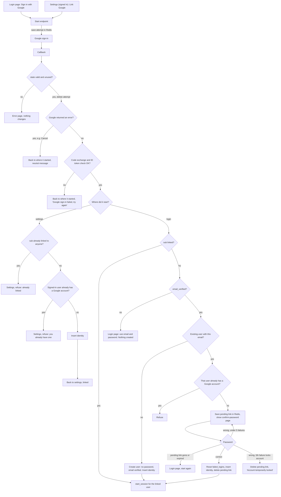

# Google sign-in

## What this is

Today users sign in with email and password (`POST /login`). Wrong passwords count toward a lockout (5 failures lock the account for 15 minutes). A successful login calls `start_session`, which creates a `sessions` row and sets the `sid` cookie.

This adds "Sign in with Google" (OpenID Connect, authorization-code flow with PKCE). The user starts from the login page or from Account Settings. Google sends them back to our callback. The callback either signs them in, asks them to confirm their password, or shows an error. Every successful sign-in ends in `start_session`, so a Google login is the same session as a password login.

## Terms

- **sub**: Google's permanent id for an account. We identify a Google account by `sub`, never by email.
- **attempt**: one round trip to Google. Redis holds its `state`, `nonce`, PKCE verifier and where it started (login or settings). It lives 10 minutes and is deleted when the callback uses it. A callback is honoured once.
- **pending link**: a Redis entry saying "this `sub` is waiting for the password of user X". It lives 10 minutes and is deleted when the user confirms, the account locks, or it expires.
- **identity**: a row in the new `user_identities` table (`user_id`, `sub`). Both `sub` and `user_id` are unique, so a Google account links to at most one user and a user has at most one Google account. It is deleted on unlink, or when its user is deleted.

We keep no Google access or refresh tokens. At sign-in we read only the ID token's `sub`, `email` and `email_verified`. Google never changes our stored email.

## Changes to existing data

- `users.password_hash` becomes nullable. A user created through Google has no password.
- New table `user_identities`, described above.
- New Redis entries: attempts and pending links, described above.

## Main flow

## Steps

Each step lists what starts it, what it does, where its data lives, and what happens on failure.

1. **Start endpoint.**
   - Starts: the user clicks "Sign in with Google" on the login page, or "Link Google" in settings (signed-in users only).
   - Does: creates `state`, `nonce` and a PKCE verifier. Saves them with the starting point (login or settings) as an attempt in Redis for 10 minutes. Redirects to Google with scopes `openid email profile`.
   - Data: Redis attempt.
   - Fails: if Redis is down, show an error on the starting page. Nothing was created.

2. **Callback.**
   - Starts: Google redirects the browser back.
   - Does: looks up the attempt by `state` and deletes it in the same operation, so a second callback finds nothing. If Google sent an error, returns the user to the starting point with a neutral message. Otherwise exchanges the code (with the PKCE verifier), then checks the ID token (signature, `nonce`, expected audience, not expired) and reads `sub`, `email`, `email_verified`.
   - Data: reads and deletes the Redis attempt.
   - Fails: unknown, expired or used `state` gives an error page and changes nothing. A failed code exchange or bad ID token returns the user to the starting point with "Google sign-in failed, try again". Nothing is created and the user can retry.

3. **Link from settings** (attempt started in settings).
   - Starts: step 2 succeeded. No password is asked and the emails need not match.
   - Does: inserts an identity for the signed-in user.
   - Data: `user_identities`.
   - Fails: if the `sub` is linked to anyone, or the user already has a Google account, refuse with a message on the settings page. Nothing changes.

4. **Login with a known `sub`** (attempt started at login).
   - Starts: step 2 succeeded and an identity exists for the `sub`.
   - Does: calls `start_session` for the linked user, even if their Google email has changed.
   - Data: `sessions`.
   - Fails: if `start_session` fails, show the normal login error. Nothing else changed.

5. **Login with an unknown `sub`.**
   - Starts: step 2 succeeded and no identity exists for the `sub`.
   - Does, in order:
     - `email_verified` false: refuse, point the user to email and password, create nothing.
     - No user has that email (lowercased): create a user with no password and a verified email, insert the identity, call `start_session`.
     - A user has that email and already has a different Google account: refuse.
     - A user has that email and no Google account: save a pending link and show the confirm-password page (step 6).
   - Data: `users`, `user_identities`, Redis pending link.
   - Fails: if two requests create the same user or identity at once, the unique constraints reject the second one. It shows the error page and nothing changes.

6. **Confirm password.**
   - Starts: the user submits the password on the confirm-password page.
   - Does: loads the pending link. If the account is locked, applies the existing rule (reject without checking the password). Otherwise checks the password the same way as `POST /login`. Correct: resets `failed_logins`, inserts the identity, deletes the pending link, calls `start_session`. Wrong: counts a failed login. If that failure locks the account, deletes the pending link and shows "Account temporarily locked". Otherwise shows the page again.
   - Data: Redis pending link, `users.failed_logins` and `locked_until`, `user_identities`.
   - Fails: a missing or expired pending link sends the user back to the login page to start again.

7. **Unlink** (settings).
   - Starts: a signed-in user clicks "Unlink Google".
   - Does: deletes their identity if they have a password.
   - Data: `user_identities`.
   - Fails: with no password, refuse and tell them to set one with the existing password-reset email.

## What happens when things fail

| Where | Failure | Result |
|---|---|---|
| Callback | unknown, expired or used `state` | error page, nothing changes |
| Callback | Google returned an error (Cancel) | back to the start, neutral message |
| Callback | code exchange or ID token check fails | back to the start, "try again", nothing created |
| Login | `email_verified` false | refuse, use email and password, nothing created |
| Login | email matches a user with another Google account | refuse |
| Settings | `sub` linked to someone else, or user already has Google | refuse, nothing changes |
| Confirm password | wrong password | existing lockout counting, page shown again |
| Confirm password | account locks | pending link deleted, locked message |
| Confirm password | 10 minutes pass | pending link expires, start again |
| Unlink | no password | refuse, point to password reset |

## Build order

1. Migration: make `password_hash` nullable and add `user_identities`. Check that password login and reset still work with a null hash (a null hash never matches a password).
2. Start endpoint and callback with the settings link path.
3. Login paths: known `sub`, new user, confirm-password page.
4. Unlink.

## Open questions

- Whether a user created through Google gets a verified-email marker beyond `email_verified_at` is not specified.
- Whether password reset by a Google-only user should be allowed is not stated. It is assumed yes, since reset sets a password.
