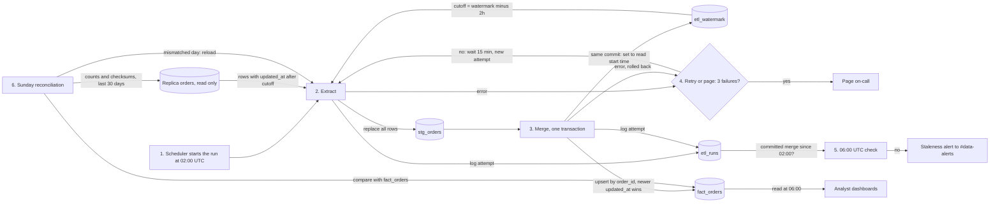

## Nightly orders ETL

This is a new nightly job. At 02:00 UTC it copies the app's `orders` table from the read replica into the warehouse, one row per order. Each run reads the rows changed since the last successful run, minus a 2-hour overlap, and merges them in one transaction. The saved watermark moves forward only when that merge commits. A Sunday check finds and reloads days that the overlap missed.

### Terms

- **Replica**: the read-only copy of the app's Postgres database. The job never writes to it.
- **Warehouse**: the analytics database. All pipeline state lives here.
- **Watermark** (`etl_watermark`): one row holding the time the last successful run started reading.
- **Lookback**: 2 hours. Each run re-reads rows changed in the 2 hours before the watermark, because a bulk import can make a row visible up to 90 minutes after its `updated_at`.
- **`stg_orders`**: a scratch table holding the rows one attempt read.
- **`fact_orders`**: the table dashboards read. One row per `order_id`.
- **`etl_runs`**: a log with one row per attempt.
- **Attempt**: one try at a night's run. A night gets at most three.

### Flow

### Notes

- Dashboards read `fact_orders` at 06:00 UTC whatever its state. The merge is one transaction, so they see either the whole previous night or the whole new one, never a half-loaded night.
- The watermark is the time the read started, not the time it ended. The 2-hour lookback covers rows that became visible after the read started.

### Steps

Each step lists what starts it, what it does, where its data lives, and what happens if it fails.

1. **Start.**
   - Starts: the scheduler, at 02:00 UTC.
   - Does: begins attempt 1 and runs step 2.
   - Data: none. The attempt is logged in `etl_runs` when it ends.
   - If it fails: see open questions.

2. **Extract.**
   - Starts: step 1, or a retry from step 4.
   - Does: reads `etl_watermark` and sets the cutoff to the watermark minus 2 hours. Reads every replica row with `updated_at` after the cutoff. Empties `stg_orders` and writes those rows into it.
   - Data: reads the replica and `etl_watermark`. Writes `stg_orders`.
   - If it fails: logs the attempt as failed in `etl_runs`, then goes to step 4. Nothing else changes.

3. **Merge.**
   - Starts: step 2 finishes without error.
   - Does: in one warehouse transaction:
     1. For each row in `stg_orders`, inserts it if its `order_id` is new. If the `order_id` exists, replaces that row when the staged `updated_at` is equal or newer.
     2. Sets `is_deleted` to true when `deleted_at` is set.
     3. Sets `etl_watermark` to the time step 2 started reading.
     4. Commits.
   - Data: writes `fact_orders` and `etl_watermark` in the same commit. After the commit, logs the attempt as committed in `etl_runs`.
   - If it fails: the transaction rolls back, so `fact_orders` and the watermark do not change. Logs the attempt as failed, then goes to step 4.

4. **Retry or page.**
   - Starts: a failed step 2 or step 3.
   - Does: counts the failed attempts for the night in `etl_runs`. If fewer than three have failed, waits 15 minutes and starts a new attempt at step 2. If three have failed, pages on-call.
   - Data: reads `etl_runs`.
   - If it fails: see open questions.

5. **06:00 check.**
   - Starts: the clock, at 06:00 UTC.
   - Does: looks in `etl_runs` for a committed merge since 02:00 UTC. If there is none, posts a staleness alert to #data-alerts.
   - Data: reads `etl_runs`. Writes nothing to the warehouse tables.
   - If it fails: see open questions.

6. **Sunday reconciliation.**
   - Starts: Sunday, after that night's load.
   - Does: for each order-creation day in the last 30 days, compares the row count and a checksum of `order_id` plus `updated_at` between the replica and `fact_orders`. For each day that differs, re-reads all of that day's rows from the replica, ignoring the watermark, and merges them as in step 3. It does not change the watermark.
   - Data: reads the replica and `fact_orders`. Writes `stg_orders`, `fact_orders` and `etl_runs`.
   - If it fails: a failed reload follows the retry rule in step 4.

### Open questions

- Which scheduler runs the 02:00 job, and which tool sends the page and the alert? The brief does not name them.
- Where does the first-ever run start, when no watermark exists yet?
- If paging or the 06:00 check itself fails, how does anyone find out?
- If the night's load is still missing at 06:00, does Sunday reconciliation still run?
- Does the three-attempt limit in step 4 also apply to a reload during Sunday reconciliation?