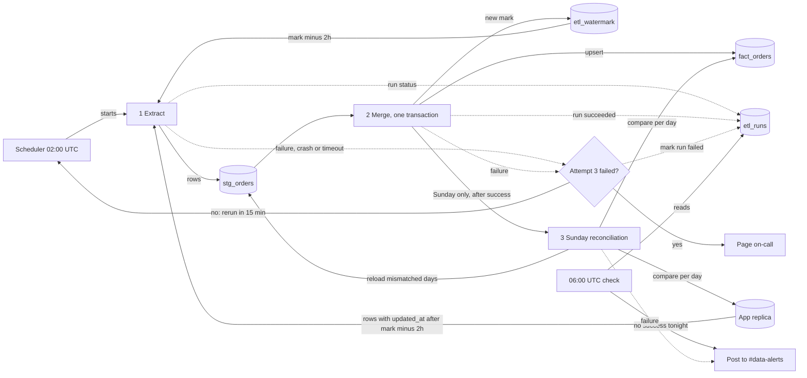

# Nightly orders ETL

Every night at 02:00 UTC a job copies new and changed rows from the app's `orders` table (Postgres read replica) into the warehouse table `fact_orders`. It loads them into a staging table, then merges them into `fact_orders` and moves the high-water mark in one transaction, so dashboards never see a half-loaded night. On Sundays, after the merge succeeds, the same run reconciles the last 30 days and repairs rows the nightly load missed.

## Terms

- **Replica**: the app's read-only Postgres copy. The job only reads from it.
- **High-water mark**: the `updated_at` of the newest row we have loaded. Stored in `etl_watermark`, a one-row warehouse table. It starts at 1970-01-01, so the first run loads everything.
- **Lookback**: each night we re-read 2 hours before the mark, because bulk imports can make a row visible up to 90 minutes after its `updated_at`.
- **`stg_orders`**: warehouse staging table. Emptied at the start of every extract and every reconciliation reload.
- **`fact_orders`**: the final table. One row per `order_id`, always its latest version.
- **Night**: the UTC date on which the scheduler started the run. Retries keep the same night, even after midnight.
- **`etl_runs`**: warehouse table with one row per run attempt: night, kind (nightly or reconciliation), attempt number, status (running, succeeded or failed), start and end time.
- **Soft delete**: the app sets `deleted_at`, which also updates `updated_at`. The app never hard-deletes, so there is nothing else to detect.

## Diagram

## Steps

1. **Extract.**
   - Starts: the scheduler, at 02:00 UTC.
   - Does: marks any older `running` row for the same night as `failed`, records a new `running` row in `etl_runs`, empties `stg_orders`, reads the mark from `etl_watermark`, and copies every replica row with `updated_at` later than the mark minus 2 hours into `stg_orders`. The same orders are pulled again on later nights while they are inside the lookback. That is fine, because merge is safe to repeat.
   - Keeps data in: `stg_orders` and `etl_runs`. `fact_orders` and the mark are untouched.
   - On failure: the run is marked `failed` and retried (see the failure table).
2. **Merge.**
   - Starts: when extract ends.
   - Does, in one warehouse transaction:
     - keeps one row per `order_id` in staging, the one with the highest `updated_at`;
     - upserts these into `fact_orders` by `order_id`, only where the staged `updated_at` is at least the existing one, so an older copy never overwrites a newer one;
     - sets `is_deleted` to true wherever `deleted_at` is set (the row stays);
     - sets the mark to the highest `updated_at` in staging (unchanged if staging is empty);
     - marks the run `succeeded` in `etl_runs`.
   - Keeps data in: `fact_orders`, `etl_watermark`, `etl_runs`. Dashboards see either the whole night or none of it.
   - On failure: the transaction rolls back, undoing all of the above. The job then marks the run `failed` in a separate write.
3. **Sunday reconciliation.**
   - Starts: on Sundays, right after the same run's merge succeeds. So it never overlaps a nightly extract and can share `stg_orders`.
   - Does: for each order-creation day in the last 30 days, compares the row count and a checksum of `order_id` + `updated_at` between the replica and `fact_orders`. If any day differs, it empties `stg_orders`, copies all orders of the differing days from the replica into it, and merges as in step 2 without moving the mark. It logs itself in `etl_runs` as kind reconciliation.
   - Keeps data in: `stg_orders`, `fact_orders`, `etl_runs`.
   - On failure: marked `failed` and posts to #data-alerts. It is not retried and the nightly is not rerun. The next Sunday tries again.

## When things fail

| What | What happens |
|---|---|
| Extract or merge fails | The job marks its run `failed`. The scheduler reruns the whole nightly from the start, up to 2 more times, 15 minutes apart. A rerun is safe: staging is emptied first and merge can be repeated. |
| Job crashes or exceeds its time limit | The run is left `running`. The scheduler reruns it as above, and the next attempt marks the stale `running` row `failed`. After the third attempt, the paging step marks it `failed`. The time limit per attempt is not yet chosen. |
| Third attempt fails | Page on-call. The mark has not moved, so the next 02:00 run covers the gap. Dashboards may be stale for up to about 24 hours. On-call may rerun the job by hand, which is safe. |
| Sunday's nightly fails all three attempts | Reconciliation is skipped that week and runs next Sunday. |
| Night not committed by 06:00 UTC | A separate check reads `etl_runs`. If there is no `succeeded` nightly row for today's UTC date, it posts a staleness alert to #data-alerts. Reconciliation rows are ignored. It does not stop the job: a later finish still commits, and dashboards pick it up at their next refresh. |
| Row visible later than the lookback covers (for example the replica fell behind) | The Sunday reconciliation finds the mismatched day and reloads it. |

## Open questions

- How on-call is paged (tool and schedule) is not decided.
- Should a failed Sunday reconciliation page on-call, or only post to #data-alerts as written above?
- The per-attempt time limit for a hung job is not chosen.
- How the scheduler detects a failed attempt and counts attempts is left to the scheduler's own features.
