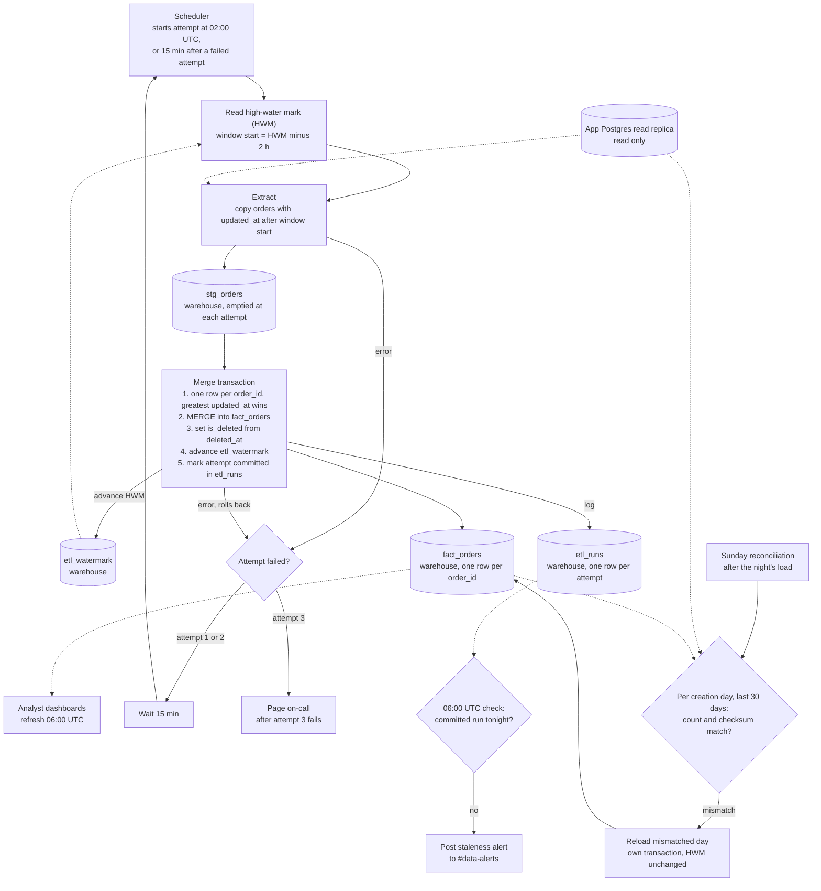

## Nightly orders ETL

Every night at 02:00 UTC, a job copies the app's `orders` table from its Postgres read replica into the analytics warehouse. After a successful night, the warehouse holds exactly one row per order, and that row is the order's latest version. Deleted orders stay in the table, flagged as deleted.

We have no write access to the app database. So all of the pipeline's own state lives in the warehouse.

### Terms

- **Replica**: a read-only copy of the app database. The pipeline reads from it and never writes to it.
- **Warehouse**: the analytics database. It holds the pipeline's tables, and dashboards read from it.
- **Night**: one scheduled run of the job, starting at 02:00 UTC. A night has up to three attempts.
- **Attempt**: one try at a night's job. A failed attempt does not commit any change to the warehouse data.
- **High-water mark (HWM)**: a timestamp that means "every order changed before this time is loaded." It is stored in `etl_watermark`.
- **Lookback**: 2 hours. Each night reads again the changes from the 2 hours before the HWM. This catches rows that became visible late.
- **Window start**: the HWM minus the lookback. The extract takes every order whose `updated_at` is later than the window start.
- **Staging**: `stg_orders`, a scratch table. It holds one attempt's extract until the merge is done.
- **Soft delete**: the app marks an order as deleted by setting `deleted_at`. It does not remove the row. The pipeline keeps the row and sets `is_deleted` to true.
- **Merge (upsert)**: insert the row if its `order_id` is new. If the `order_id` already exists, update that row only when the new copy is newer.

**Why the lookback exists.** A bulk-import transaction in the app can stay open for up to 90 minutes. The app sets `updated_at` when it writes the row, not when the transaction commits. So a bulk-imported row can become visible to us up to 90 minutes after its `updated_at`. Reading 2 hours of changes each night covers that gap. The cost is that the same order is often extracted more than once.

### Where state lives

All of the pipeline's state is in the warehouse:

- `etl_watermark`: the HWM. It has one row.
- `etl_runs`: one row per attempt. It records the attempt number and the outcome.
- `stg_orders`: the current attempt's extract. It is emptied at the start of every attempt.
- `fact_orders`: the result. It has one row per `order_id`.

### Diagram

Solid arrows show the flow of work. Dotted arrows show reads from state or from a data source.

### Steps

1. **Start.** The scheduler starts attempt 1 at 02:00 UTC. The attempt writes a row to `etl_runs` with its attempt number and the outcome "started."
2. **Read the HWM and set the new cutoff.** Read `etl_watermark` and compute the window start as the HWM minus 2 hours. Also record the current time as this attempt's **new cutoff**. Record it before the extract query runs. The cutoff becomes the new HWM only if this attempt commits. Recording it first means that any row changed while the query is running has an `updated_at` after the cutoff. The next night's window will therefore include it.
3. **Extract.** Query the replica for every order whose `updated_at` is later than the window start. First empty `stg_orders`, so it holds only this attempt's rows. Then copy the rows unchanged into `stg_orders`. Nothing is written to the replica.
4. **Merge.** Steps 4a to 4e run in one warehouse transaction. Either all of them commit or none of them do. If any step fails, the whole transaction rolls back. The HWM stays where it was, so the next attempt uses the same window.
   - a. Reduce staging to one row per `order_id`. Keep the row with the greatest `updated_at`. The lookback overlap means the same order can appear several times in staging.
   - b. MERGE into `fact_orders` on `order_id`. Update an existing row only when the staged `updated_at` is greater than the stored one. Insert orders that are not yet in the table. An older copy never overwrites a newer one. So running the same window again changes nothing.
   - c. Set `is_deleted` to true for each row whose `deleted_at` is set. A delete is a write, so it has a newer `updated_at` and wins under rule 4b. Deleted rows are kept and never removed.
   - d. Set `etl_watermark` to the new cutoff from step 2.
   - e. Mark the attempt as committed in `etl_runs`.
5. **Dashboards.** At 06:00 UTC, analyst dashboards read `fact_orders`. Because the merge is a single transaction, dashboards see either the previous complete load or the new complete load, never a partial one.

### Failure and retry

- A failure in extract or merge ends the attempt. A merge failure rolls back, so no data changes and the HWM does not move. An extract failure leaves only staging rows, which the next attempt empties. The attempt's `etl_runs` row is then updated to "failed." That update is a separate write, outside the merge transaction.
- Attempts 2 and 3 start 15 minutes after the previous failure.
- A success on any attempt ends the retries. No page is sent.
- If attempt 3 fails, the job pages on-call.

### 06:00 UTC deadline check

At 06:00, a separate check looks in `etl_runs` for a committed attempt for that night. If there is none, the check posts a staleness alert to #data-alerts. The check does not stop or change the job. Dashboards refresh at 06:00 whether or not the load has finished.

### Sunday reconciliation

Some rows become visible after the 2-hour lookback has passed, for example when the replica falls behind. The nightly job cannot see those rows, so once a week a reconciliation looks for them.

It runs every Sunday, after that night's load has committed. If Sunday night's load did not commit, the reconciliation is skipped for that Sunday.

1. **Compare.** For each order-creation day in the last 30 days (the day each order was created), compute two numbers on both the replica and the warehouse: the row count, and a checksum of `order_id` and `updated_at`. The checksum is the sum of a hash computed for each row, so row order does not matter. Include deleted orders. Convert timestamps to UTC before hashing, so both sides produce the same values.
2. **Reload.** If either number differs for a day, reload that day. Read every order created that day from the replica, ignoring the window. Merge those rows using the same rules as step 4, in their own transaction.
3. **HWM.** Reconciliation never changes the HWM.

Because the merge keeps the latest version, a reload cannot replace a row with an older one.

### Assumptions to confirm

The brief does not cover these points, so this document assumes:

- The first run has no HWM. Its starting value must be set by hand as a backfill start.
- If Sunday night's load did not commit, reconciliation is skipped for that Sunday.
- A reload that fails follows the same rule as the nightly job: up to three attempts, 15 minutes apart, then page on-call.