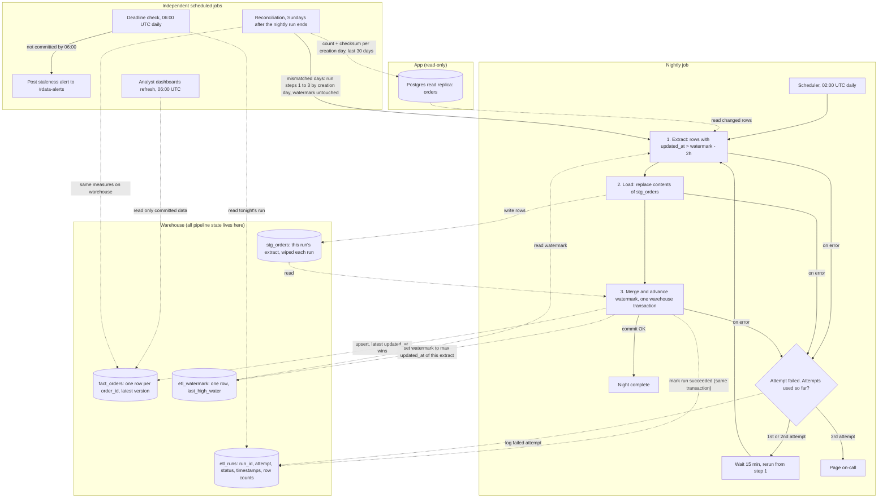

## Nightly orders ETL

Copies the app's `orders` table from the Postgres read replica into the analytics warehouse every night. It stays correct when rows arrive late or change after export. The scheduler starts it at 02:00 UTC.

**Terms.** The *watermark* (high-water mark) is the largest `updated_at` the pipeline has successfully loaded. It is stored in `etl_watermark.last_high_water`. *Staging* is a scratch table, `stg_orders`, that holds one run's extract before it is merged into the real table, `fact_orders`. An *attempt* is one try at the whole job. A *night's run* is up to three attempts.

### Pipeline diagram

Solid arrows are control flow (what triggers what). Dotted arrows are data and state reads and writes. Cylinders are tables.

### How each step works

**1. Extract.** The scheduler starts the job. It reads `last_high_water` from `etl_watermark` and queries the replica for rows where `updated_at > last_high_water - 2 hours`. It reads only from the replica. We cannot write to the app database, so all bookkeeping is in the warehouse.

**Why the 2-hour lookback.** Bulk-import transactions can stay open for up to 90 minutes. `updated_at` is stamped when the row is written, not when the transaction commits, so a row can become visible up to 90 minutes after its `updated_at`. Re-reading the last 2 hours picks those rows up, with margin. The cost is that the same order is extracted on more than one night. The merge makes that harmless.

**2. Load to staging.** The extract replaces the contents of `stg_orders`. Staging holds only this run's rows. Dashboards never read it, so a failed run can leave it half-filled with no effect on anyone.

**3. Merge and advance the watermark.** This is one warehouse transaction:
- Deduplicate `stg_orders` by `order_id`, keeping the row with the greatest `updated_at`.
- Upsert into `fact_orders` on `order_id`. Overwrite an existing row only if the staged `updated_at` is greater than or equal to the stored one. An older copy can never replace a newer one, and rerunning the same night gives the same result.
- A soft delete (`deleted_at` set) arrives as an ordinary updated row, because it is a write. The merge stores it with `is_deleted = true`. Rows are never removed from the warehouse.
- Set `last_high_water` to the greater of its current value and the maximum `updated_at` in this extract. If the extract was empty, leave it unchanged.
- Mark the attempt `succeeded` in `etl_runs`.

Because the data, the watermark and the success mark commit together, the watermark advances only if the load succeeded. Dashboards see either the previous night's state or the new one, never a half-loaded night.

### Where state lives (all in the warehouse)

| Table | Contents | Written by |
|---|---|---|
| `fact_orders` | One row per `order_id`, latest version, with `is_deleted` | Merge |
| `stg_orders` | The current run's extracted rows, wiped each run | Load |
| `etl_watermark` | A single row, `last_high_water` | Merge |
| `etl_runs` | One row per attempt: run id, attempt number, status, start and end time, row counts | The `succeeded` mark is written inside the merge transaction. Start, progress and `failed` records are written outside it, so failures are still recorded |

### Failure and retry

- A failure in any step fails the attempt. The scheduler waits 15 minutes and reruns from step 1, at most 2 retries (3 attempts total, starting at about 02:00, 02:15 and 02:30, each plus the run time of the earlier attempts).
- A rerun is safe at any point. The watermark moves only in the final transaction, so a failed attempt leaves it untouched. Staging is wiped on the next load, and the merge is idempotent.
- After the third failed attempt, the pipeline pages on-call.

### 06:00 deadline

- Dashboards refresh from `fact_orders` at 06:00 UTC whether or not the job has finished. The single-transaction merge guarantees they read only fully committed data.
- A separate check runs at 06:00 UTC and reads `etl_runs`. If tonight's merge has not committed, it posts a staleness alert to #data-alerts. This is independent of paging, so it fires even if retries are still running.

### Sunday reconciliation

The lookback cannot catch rows that become visible more than 2 hours after their `updated_at` (for example, when the replica falls behind). Every Sunday, after that night's run has ended, a reconciliation job covers them:
- For each order-creation day in the last 30 days, compute the row count and a checksum over `order_id` + `updated_at`, on both the replica and `fact_orders`.
- Reload any day where the count or checksum differs. The job extracts that day's orders by creation date (instead of by watermark) and runs the normal load and merge, so the same upsert rule applies. A reload skips the watermark update, so it does not change the watermark.
- Deleted orders still count, because they stay in both places.
- Assumptions beyond the brief: the scheduler starts reconciliation once Sunday's nightly run has succeeded or exhausted its retries, so it never shares `stg_orders` with a running nightly job. Reconciliation logs to `etl_runs` and posts to #data-alerts if it fails.