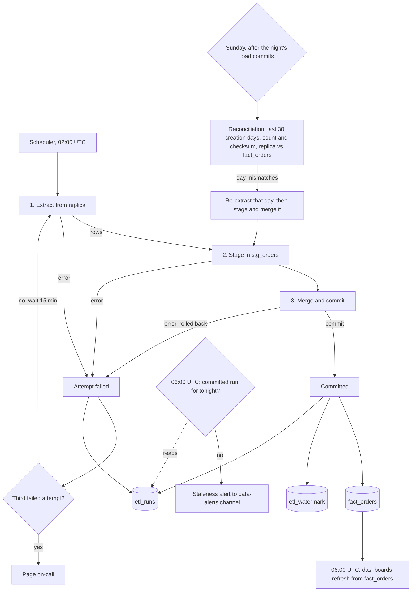

# Nightly orders ETL

## What this is

Each night at 02:00 UTC, a job copies the app's `orders` table from the Postgres read replica into the warehouse. It reads only rows that changed since the last committed run, starting 2 hours earlier to catch late rows. It merges them into one table, `fact_orders`, in a single transaction. Only after that commit does it move the high-water mark forward. The app is not changed.

## Terms

- **Replica**: the app's read-only Postgres copy. The job reads from it and never writes to it.
- **Warehouse**: the analytics database. All job state lives here.
- **High-water mark (HWM)**: the latest `updated_at` that a committed run covered. Stored in `etl_watermark`.
- **Lookback**: 2 hours. Each run starts reading at HWM minus 2 hours. Bulk-imported rows can appear up to 90 minutes after their `updated_at`.
- **stg_orders**: a staging table in the warehouse. Holds one attempt's rows. Emptied at the start of each attempt.
- **fact_orders**: the final table. One row per `order_id`. Dashboards read only this table.
- **etl_runs**: one row per attempt, with its status.
- **Soft delete**: the app sets `deleted_at` instead of deleting a row. We keep the row and set `is_deleted`.

## Diagram

## Steps

Each attempt runs steps 1 to 3 in order. Steps 4 to 6 run around them.

1. **Extract.**
   - Starts: the 02:00 UTC schedule, or a retry 15 minutes after a failed attempt.
   - Does: reads the HWM from `etl_watermark`. Reads every `orders` row from the replica with `updated_at` later than HWM minus 2 hours.
   - Keeps data: nothing is written yet.
   - If it fails: the attempt fails. Go to step 4.

2. **Stage.**
   - Starts: when extract returns rows.
   - Does: empties `stg_orders`, then writes the extracted rows into it. If one `order_id` appears twice in the batch, keeps the copy with the later `updated_at`.
   - Keeps data: `stg_orders` in the warehouse.
   - If it fails: the attempt fails. The next attempt empties `stg_orders` first.

3. **Merge and commit.**
   - Starts: when staging finishes.
   - Does, in one warehouse transaction:
     - For each `order_id` in `stg_orders`, updates its `fact_orders` row if the staged `updated_at` is later than or equal to the stored one. Inserts the row if it is new. An older copy never replaces a newer one, so rerunning the same rows changes nothing.
     - Sets `is_deleted` to true when `deleted_at` is set.
     - Moves the HWM to the largest `updated_at` in the batch. If the batch is empty, the HWM stays where it was.
     - Marks the attempt committed in `etl_runs`.
   - Keeps data: `fact_orders`, `etl_watermark` and `etl_runs` change together or not at all.
   - If it fails: the transaction rolls back. The fact table and the HWM are unchanged. The attempt fails.

4. **Retry or page.**
   - Starts: any failed attempt from steps 1 to 3.
   - Does: records the failure in `etl_runs`. After the first or second failure, waits 15 minutes and starts the next attempt at step 1. After the third failure, pages on-call.
   - Keeps data: `etl_runs`, one row per attempt.
   - If it fails: the 06:00 check in step 5 still runs.

5. **Deadline check, 06:00 UTC.**
   - Starts: the clock, every night, whether or not the load has committed.
   - Does: reads `etl_runs` for a committed run for that night. If there is none, posts a staleness alert to the data-alerts channel. Dashboards refresh from `fact_orders` at the same time.
   - Keeps data: reads `etl_runs` and `fact_orders`. Writes nothing.
   - If it fails: dashboards still show the last committed night. A commit after 06:00 appears at the next dashboard refresh.

6. **Sunday reconciliation.**
   - Starts: after that night's load commits. If the Sunday load did not commit, reconciliation does not run that Sunday.
   - Does: for each order-creation day in the last 30 days, compares the row count and a checksum of `order_id` and `updated_at` between the replica and `fact_orders`. For each day that does not match, re-extracts that day's rows from the replica by creation date, with no lookback, and runs steps 2 and 3 for them.
   - Keeps data: `fact_orders`. Each reload is logged in `etl_runs`.
   - If it fails: the failed reload is logged. The day is compared again the next Sunday.

## Open questions

- Rows that appear later than the lookback, and are older than 30 days, are never reloaded. The brief does not say how to find them.
- The brief does not say what happens when a reconciliation reload fails. This plan logs it and checks again the next Sunday.
- Reconciliation defines a creation day by a `created_at` column. The brief does not name one. Confirm the column exists.
- If the warehouse holds a newer `updated_at` than the replica for a row, for example after a replica restore, the merge keeps the warehouse copy and that day mismatches every Sunday. Not decided.