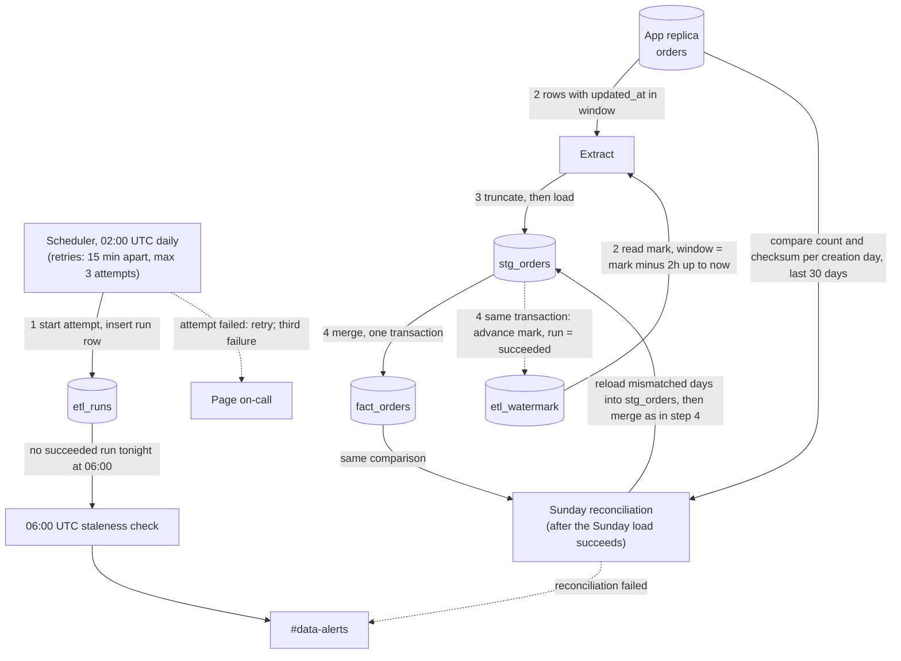

# Nightly orders ETL

Every night at 02:00 UTC a job copies new and changed rows from the app's `orders` table into the warehouse table `fact_orders`. It reads only from the app's Postgres read replica. It loads the rows into a staging table, then merges them into `fact_orders` and moves the high-water mark forward, all in one warehouse transaction. Today there is no such job. A Sunday reconciliation repairs rows that arrive later than the nightly job can catch.

## Terms

- **Replica**: the read-only Postgres copy of the app database. The job has no write access to the app.
- **`updated_at`**: set by the app to the write time of every change, including deletes. A bulk import stamps it when a row is written, not when the transaction commits. So a row can become visible up to 90 minutes after its `updated_at`.
- **Deleted order**: the app never removes rows. It sets `deleted_at`. The warehouse keeps the row and sets `is_deleted = true`.
- **High-water mark**: the `updated_at` time up to which all data has been loaded. It is one row in `etl_watermark`.
- **Lookback**: a 2-hour overlap. Each night starts from the high-water mark minus 2 hours, so late-visible rows are caught. The same order may be extracted on several nights.
- **`stg_orders`**: a warehouse staging table holding only the current attempt's extract.
- **`fact_orders`**: the warehouse copy that analysts read. It has exactly one row per `order_id`, the latest version.
- **`etl_runs`**: a warehouse table with one row per attempt: start time, status (`running`, `succeeded`, `failed`) and the extract window. All pipeline state lives in the warehouse, because we cannot write to the app database.

## Diagram

Solid arrows move data. Dotted arrows are control, state changes or alerts.

## Steps of the nightly run

| # | Starts when | What it does | Where its data lives | If it fails |
|---|---|---|---|---|
| 1. Start | The scheduler fires at 02:00 UTC, or at a retry 15 minutes after a failed attempt. | Inserts an `etl_runs` row with status `running`. | `etl_runs` | The attempt counts as failed (see Retries). |
| 2. Extract | Step 1 is done. | Reads the high-water mark. Takes a window from (mark minus 2 hours) up to the replica's current time, noted as `window_end`. Reads every order with `updated_at` in that window. | Reads `etl_watermark` and the replica. Nothing is written to the app. | The attempt fails. Nothing in the warehouse has changed yet, except the run row. |
| 3. Stage | Extract has rows (zero rows is fine and skips to step 4). | Empties `stg_orders`, then loads the extract into it. | `stg_orders` | The attempt fails. The next attempt empties staging again. |
| 4. Merge and commit | Staging is loaded. | In one warehouse transaction: (a) per `order_id`, keep only the staged row with the highest `updated_at`; (b) insert it into `fact_orders`, or overwrite the existing row only if the staged `updated_at` is greater than or equal to the stored one; (c) set `is_deleted = (deleted_at is not null)`; (d) set the high-water mark to `window_end`; (e) mark the run `succeeded`. | `fact_orders`, `etl_watermark`, `etl_runs` | The transaction rolls back. `fact_orders` and the mark stay as they were, and the attempt fails. |

Rule (b) means an older copy of an order never replaces a newer one. This is why extracting the same order twice, or re-running a night, does no harm. Because the merge and the mark move in one commit, dashboards never see a half-loaded night, and the mark moves only after the data has loaded.

## Retries and alerts

- **Failed attempt**: the scheduler marks the run `failed` and starts a new attempt 15 minutes later. Each retry starts again at step 1. A retry is safe because the mark has not moved and the merge is repeatable.
- **Third failed attempt**: page on-call. No more retries that night.
- **06:00 UTC check**: dashboards refresh at 06:00 whatever happens. A separate job at 06:00 looks in `etl_runs` for a `succeeded` run for tonight. If there is none, it posts a staleness alert to #data-alerts. The dashboards then show last night's data, which is complete but old.
- **Sunday reconciliation failure**: post to #data-alerts. The next Sunday tries again. No automatic retry.

## Sunday reconciliation

Some rows become visible later than the 2-hour lookback covers, for example when the replica falls behind. Every Sunday, after that night's load has succeeded, this job runs. If that night's load never succeeds, it is skipped.

1. For each order-creation day in the last 30 days, count the rows and compute a checksum of `order_id` plus `updated_at`. Do this on the replica and on `fact_orders`.
2. For each day where the count or checksum differs, extract all of that day's orders from the replica into `stg_orders`, and merge them with the same rules as step 4(a) to (c) in one transaction.
3. It does not change the high-water mark.

## Open questions

- Assumes the warehouse supports multi-statement transactions. If it does not, the merge and the mark update need a different way to commit together.
- How the scheduler sees "the Sunday load succeeded" is not decided. It could read `etl_runs`.
- Whether an hour-long reconciliation, or one run still going at 06:00, needs special handling is not decided.