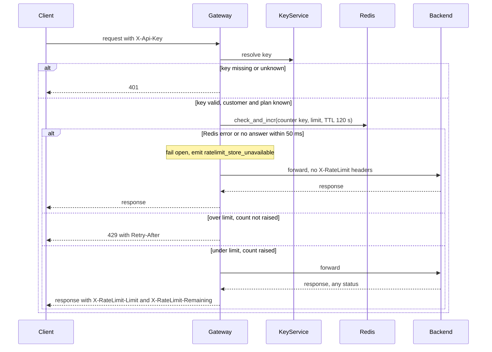

# Per-customer rate limiting on the public API

## Summary

Today, all public traffic goes through the API Gateway. It runs as 6 stateless instances behind a load balancer. For each request, the gateway asks the Key Service which customer and plan the API key belongs to, then forwards the request to the backend that owns the route.

This design adds one check between the key lookup and the forward. The gateway counts the request against the customer's budget in a shared Redis store. Over the limit, it returns 429 and does not forward. If Redis fails or is slow, it forwards the request anyway (fail open).

## Terms

- **Key**: a secret the client sends in the `X-Api-Key` header. A customer can have several keys.
- **Customer**: the owner of one or more keys. All of a customer's keys share one budget.
- **Plan**: `Standard` or `Enterprise`. The Key Service returns it with the customer ID.
- **Counter**: a number in Redis. It counts one customer's allowed requests in one minute.
- **Window**: a fixed clock minute, such as 12:03:00 to 12:03:59.
- **check_and_incr**: a Lua script in Redis. It reads a counter, adds 1 only if the counter is under the limit, and returns the result. Redis runs a script in one step, so two gateway instances cannot both take the last slot.
- **Fail open**: forward a request without the limit check, because the counter store cannot answer.

## Main flow

## Notes

- The budget is per customer. Every key a customer owns counts against one shared counter.
- The window is fixed. A customer can send 100 requests in the last second of one minute and 100 in the first second of the next. This is accepted for v1.

## Steps

Each step says what starts it, what it does, which part keeps its data, and what happens when it goes wrong.

1. **Authenticate.**
   - Starts: a request arrives with an `X-Api-Key` header.
   - Does: the gateway asks the Key Service for the customer ID and plan. Each instance keeps its own in-memory cache of valid answers, keyed by the key string, for 5 minutes. A cache miss calls the Key Service.
   - Keeps data: the in-memory cache, one per instance.
   - When it fails: a missing or unknown key gets 401. Redis is not called and no counter changes. Unknown keys are not cached, so a new key works at once. A revoked key or changed plan can take up to 5 minutes to apply. Key Service errors or slowness are not decided (see Open questions).

2. **Pick the limit and check and count.**
   - Starts: the key is valid and the plan is known.
   - Does: the gateway maps the plan to a limit from its config. Standard is 100 requests per minute. Enterprise has no limit yet (see Open questions). It then calls check_and_incr with the key `rl:<customer ID>:<minute>`, the limit, and a TTL of 120 seconds. The minute is the instance's Unix time in seconds divided by 60, rounded down. Clocks are kept in sync by NTP, so a small clock difference only moves a window edge by a few seconds. The TTL is set on the first increment. It is 120 seconds, not 60, so a slightly late instance still uses the same key. The script returns allowed or denied, and the count.
   - Keeps data: the counter in Redis. The script raises it only when the request is allowed.
   - When it fails: a Redis error, or no answer within 50 ms, triggers fail open. The gateway cannot tell whether the script ran before the timeout, so the count may or may not have risen for this request. The request is forwarded either way, so each failure affects at most one request's count.

3. **Reject over the limit.**
   - Starts: check_and_incr returns denied.
   - Does: the gateway returns 429 with `Retry-After` set to `60 - (current Unix second mod 60)`. This is a whole number from 1 to 60, the number of seconds until the next clock minute starts. The request is not forwarded.
   - Keeps data: nothing. The count is not raised.
   - When it fails: nothing extra. A client that waits `Retry-After` seconds arrives in a new window, where the counter starts at zero.

4. **Forward and count.**
   - Starts: check_and_incr returns allowed.
   - Does: the gateway forwards the request to the backend and returns the backend's response, with `X-RateLimit-Limit` (the plan limit) and `X-RateLimit-Remaining` (the limit minus the count after this request). This happens even if the backend returns an error such as 500.
   - Keeps data: the counter, already raised in step 2. It is raised before forwarding, so a backend failure still uses budget.
   - When it fails: the backend's error goes back to the client with the headers. The request stays counted.

## What happens when things fail

| Situation | Result |
|---|---|
| Key missing or unknown | 401. Redis is not called. No counter changes. No `X-RateLimit-*` headers. |
| Over the limit | 429 with `Retry-After`. Not forwarded and not counted. No `X-RateLimit-*` headers. |
| Redis errors, or no answer within 50 ms | Fail open: forward with no `X-RateLimit-*` headers and emit `ratelimit_store_unavailable`. The request may or may not be counted. |
| Backend fails after the check passed | Return the backend's error with `X-RateLimit-*` headers. The request stays counted. |
| Key revoked or plan changed | Takes effect within 5 minutes, when the cache entry expires. |
| Redis restarts or loses data | Counters start at zero. A customer can get up to one extra window of budget. |
| Key Service fails or is slow | Not decided. See Open questions. |

## Open questions

- **Enterprise limit**: Product has not set it, and no number is chosen here. Enterprise traffic cannot go live until it is set.
- **Key Service failure or slowness**: the brief does not say what the gateway does. This must be decided.
- **Metric owner**: who watches `ratelimit_store_unavailable`, and at what rate it alerts, is not decided.
- **Redis deployment**: whether Redis runs as a single node or a cluster, and how it fails over, is not decided.